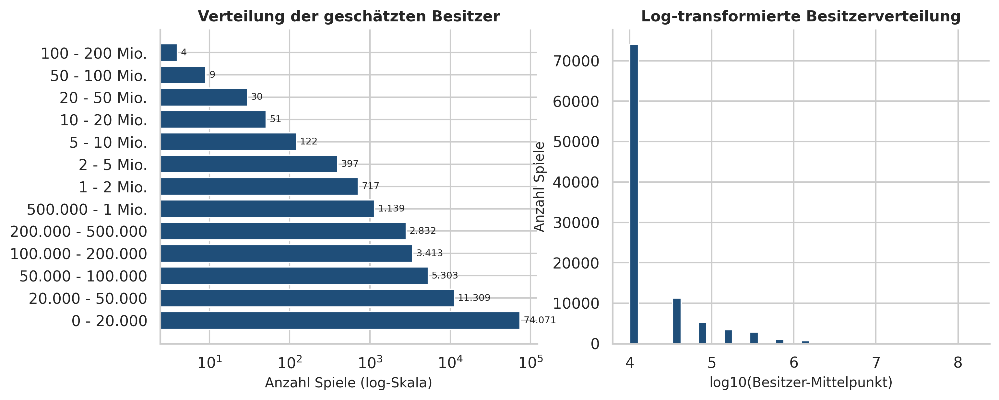
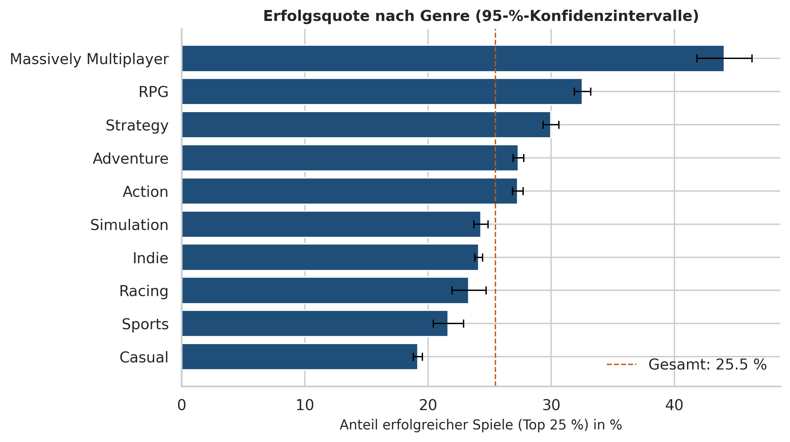
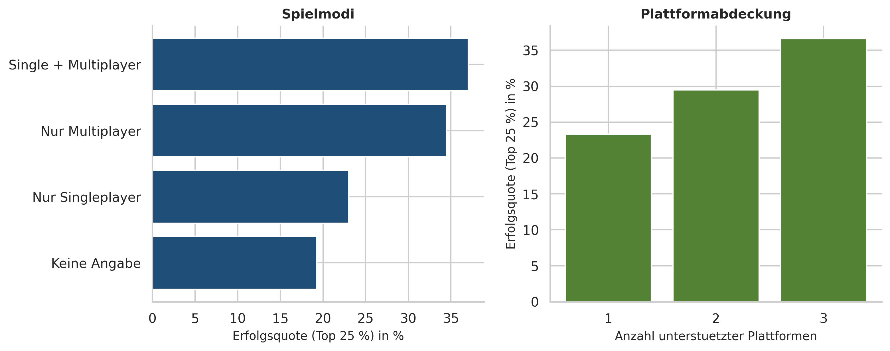
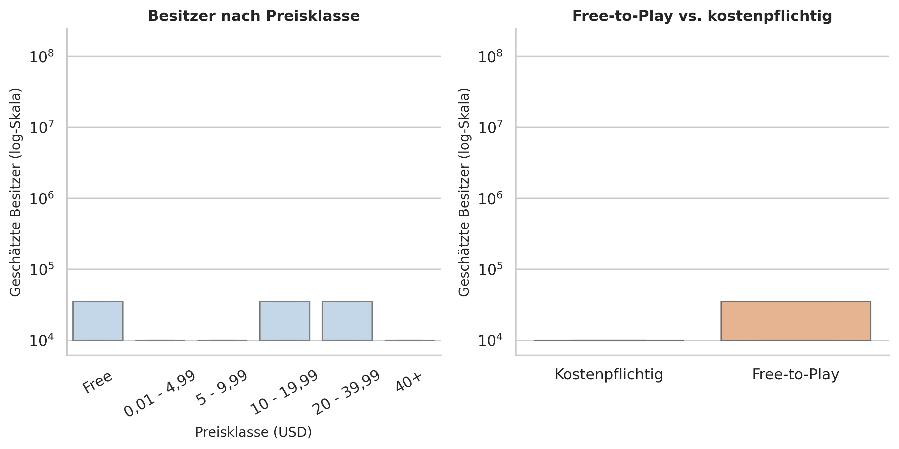
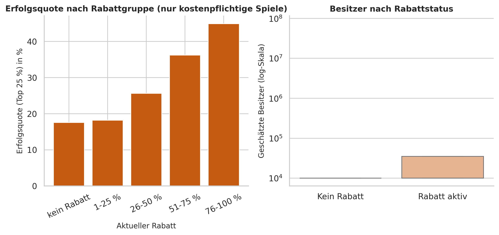
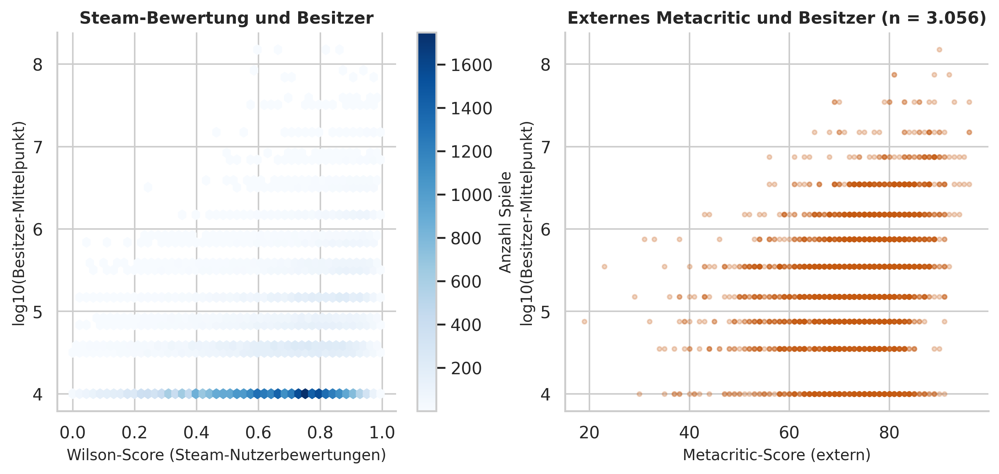
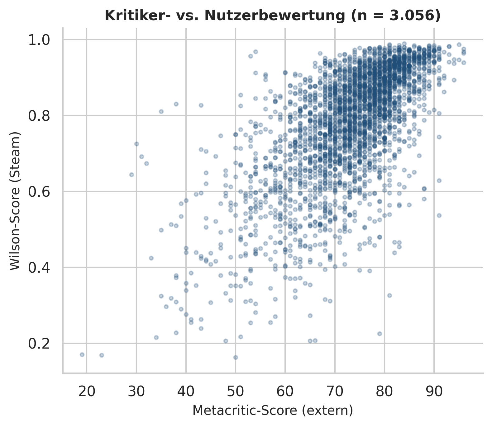
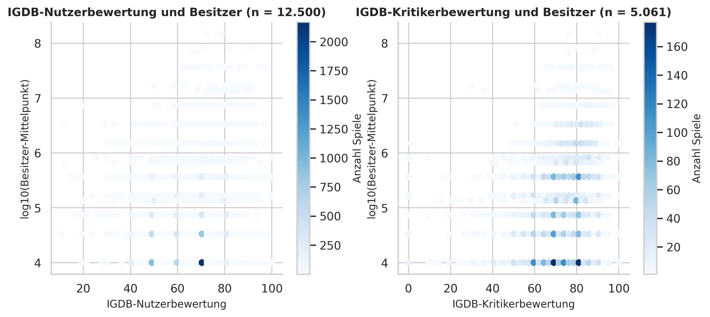
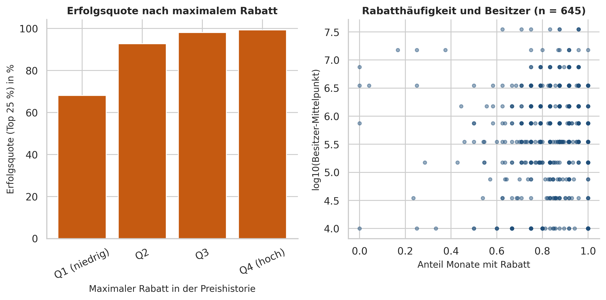
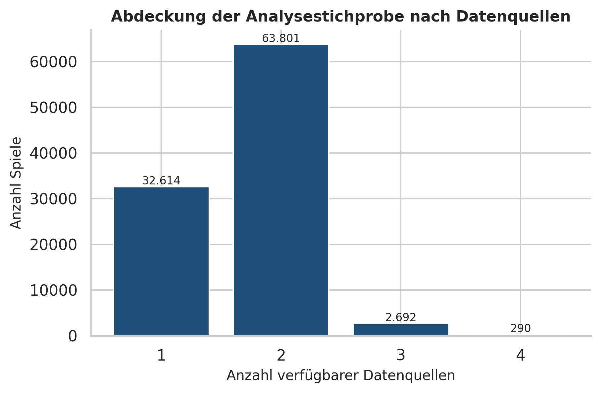

# Umsetzung der Analyse: Erfolgsfaktoren von Videospielen auf Steam

*Ergebnisbericht zur empirischen Umsetzung des Forschungsvorhabens.*  
*Datengrundlage: FronkonGames Steam Games Dataset (Version 57) sowie externe IGDB-, Metacritic- und Preishistorien-Daten. Auswertungsstand: 3. November 2026.*

## 0. Kurzfassung

Die Analyse verbindet **vier Datenquellen**: den FronkonGames-Steam-Datensatz, IGDB-Spielemetadaten, einen externen Metacritic-Datensatz und eine Steam-Preishistorie. Die Basis-Analysestichprobe umfasst **99.397 Spiele**. Davon lassen sich **66.354** mit IGDB (66,8 %), **3.056** mit externen Metacritic-Daten (3,1 %) und **645** mit der Preishistorie (0,6 %) verknüpfen. Für **66.783** Spiele liegen mindestens zwei Quellen vor, für **290** alle vier.

Als Erfolg wird primär das **obere Quartil der Besitzerverteilung** definiert (untere Besitzergrenze ≥ 20.000; 25,5 % der Analysestichprobe). Ergänzend werden die oberen 10 % (≥ 50.000; 14,1 %) und „mindestens 100.000 Besitzer“ (8,8 %) untersucht. Es werden **keine Prognose- oder Klassifikationsmodelle** geschätzt; berichtet werden deskriptive Muster, Effektstärken und statistische Tests.

Zentrale Befunde:

- **Spieleigenschaften (F1):** Massively Multiplayer, RPG und Strategy sind unter erfolgreichen Spielen überdurchschnittlich häufig vertreten, Casual und Indie seltener. Die IGDB-Daten bestätigen die Bedeutung von Mehrspieler- und Koop-Merkmalen; die IGDB-Bewertungen korrelieren ebenfalls mit der Reichweite.
- **Preis (F2):** Free-to-Play-Spiele erreichen häufiger hohe Besitzerzahlen. Unter kostenpflichtigen Spielen ist der Zusammenhang zwischen aktuellem Preisniveau und Besitzern schwach. Die **Preishistorie** zeigt für die 645 gematchten Spiele eine starke Rohkorrelation zwischen maximalem Rabatt und Besitzern; nach Kontrolle des Veröffentlichungsjahres verschwindet sie jedoch. Das spricht eher für Alters- und Selektionskonfounder als für einen eigenständigen Rabatteffekt.
- **Bewertungen (F3):** Die Höhe der Steam-Nutzerbewertung (Positive Ratio) hängt praktisch nicht mit der Reichweite zusammen; der Wilson-Score tut dies nur, weil er das Review-Volumen enthält. Externe Metacritic-Scores zeigen in der selektiven Teilstichprobe einen moderaten positiven Zusammenhang mit Besitzern und Peak CCU.
- **Quellenübergreifend:** IGDB-Nutzer- und Kritikerbewertungen sowie externe Metacritic-Scores liefern konsistente, aber unterschiedlich starke Signale. Die Matching-Quote und die Selektionsverzerrung werden transparent ausgewiesen.

## 1. Datengrundlage, Datenqualität und Stichprobe

### 1.1 Datenquellen und Matching

Verwendet werden:

1. **FronkonGames Steam Games Dataset** (Kaggle, Version 57): 125.855 Zeilen mit AppID, Name, Release-Datum, geschätzten Besitzern, Peak CCU, Preis, Rabatt, DLC-Anzahl, Plattformen, Metacritic-Score, Reviews, Kategorien und Genres. Dies ist der Basisdatensatz.
2. **IGDB-Spielemetadaten** (Kaggle: `emirshn/igdb-dataset-for-data-mining-projects`, Version 1): 232.595 Rohzeilen (230.201 nach Name/Jahr-Deduplizierung) mit IGDB-ID, Name, Release-Datum, Nutzer- und Kritikerbewertung, Genres, Spielmodi, Plattformen, Entwicklern und Publishern.
3. **Externer Metacritic-Datensatz** (Kaggle: `stadynromn/metacritic-video-games-reviews-up-to-sep-2025`, Version 1): 22.224 Plattform-Einträge, davon 6.387 PC-Einträge (6.277 nach Name/Jahr-Deduplizierung) mit Metascore, Nutzerscore, Genre, Entwickler und Publisher.
4. **Steam-Preishistorie** (Kaggle: `andrii222/steam-price-history-nov-2023-oct-2025`, Version 1): 651 Apps mit monatlichen Preisinformationen von November 2023 bis November 2025 (Basispreis, niedrigster Preis, Preisänderungen, Rabatttage).

Die Verknüpfung erfolgt über:

- **IGDB:** normalisierter Spielname plus Veröffentlichungsjahr; pro Name/Jahr wird ein IGDB-Treffer ausgewählt.
- **Metacritic:** normalisierter Spielname plus Veröffentlichungsjahr, ausschließlich PC-Einträge; pro Name/Jahr ein Treffer.
- **Preishistorie:** Steam-AppID (exakter Join).

Die Matching-Ergebnisse:

| Quelle               | Datensatz                                                | N_Quelle   | N in Analysestichprobe   | Match-Rate   | Matching-Schlüssel                  |
|:---------------------|:---------------------------------------------------------|:-----------|:-------------------------|:-------------|:------------------------------------|
| FronkonGames (Steam) | steam-games-dataset, Version 57                          | 125.855    | 99.397                   | 100,0 %      | AppID                               |
| IGDB                 | emirshn/igdb-dataset-for-data-mining-projects            | 230.201    | 66.354                   | 66,8 %       | normalisierter Name + Jahr          |
| Metacritic extern    | stadynromn/metacritic-video-games-reviews-up-to-sep-2025 | 6.277      | 3.056                    | 3,1 %        | normalisierter Name + Jahr (nur PC) |
| Preishistorie        | andrii222/steam-price-history-nov-2023-oct-2025          | 651        | 645                      | 0,6 %        | Steam-AppID                         |

Die **IGDB-Abdeckung** ist mit 66,8 % der Analysestichprobe gut. **Externes Metacritic** ist mit 3,1 % und die **Preishistorie** mit 0,6 % deutlich selektiver. Die Preishistorie enthält nur 651 Apps; die Analysen zu Preisentwicklung sind daher als **Fallstudie für populäre Titel** zu lesen, nicht als repräsentative Stichprobe aller Steam-Spiele.

Die Überlappung der Quellen in der Analysestichprobe:

| Anzahl Datenquellen   | N      | Anteil   |
|:----------------------|:-------|:---------|
| 1                     | 32.614 | 32,8 %   |
| 2                     | 63.801 | 64,2 %   |
| 3                     | 2.692  | 2,7 %    |
| 4                     | 290    | 0,3 %    |

### 1.2 Datenqualität

Ein technisches Problem des FronkonGames-Rohdatensatzes: Die Kopfzeile enthält 39 Spaltennamen, die Datenzeilen enthalten 40 Felder. Die Spalte `DiscountDLC count` ist in den Daten in `Discount` und `DLC count` aufgeteilt. Die Analyse liest die Datei daher mit einer expliziten 40er-Spaltenliste ein. Weitere Auffälligkeiten:

| Prüfung                                        | Wert   | Anteil   |
|:-----------------------------------------------|:-------|:---------|
| Zeilen im Rohdatensatz                         | 125855 | 100,0 %  |
| Eindeutige AppIDs                              | 125855 | 100,0 %  |
| Besitzer '0 - 0' (fehlend)                     | 24579  | 19,5 %   |
| Preis = 0                                      | 26661  | 21,2 %   |
| Keine Reviews                                  | 42899  | 34,1 %   |
| Kein Metacritic-Score                          | 121597 | 96,6 %   |
| Peak CCU = 0                                   | 106175 | 84,4 %   |
| Keine Genre-Angabe                             | 10134  | 8,1 %    |
| Software/Utilities                             | 1208   | 1,0 %    |
| Nicht-Spiel-Name (Demo/Playtest usw.)          | 8310   | 6,6 %    |
| Namens-/Editionsduplikate (entfernt)           | 402    | 0,3 %    |
| Analysestichprobe                              | 99397  | 79,0 %   |
| IGDB-Match in Analysestichprobe                | 66354  | 52,7 %   |
| Externer Metacritic-Match in Analysestichprobe | 3056   | 2,4 %    |
| Preishistorie-Match in Analysestichprobe       | 645    | 0,5 %    |
| Mindestens zwei Datenquellen                   | 66783  | 53,1 %   |
| Alle vier Datenquellen                         | 290    | 0,2 %    |

Die wichtigsten Einschränkungen sind die **große Zahl fehlender Besitzerangaben** (`0 - 0`: 19,5 %), die **grobe Besitzerklassierung** (74,5 % der Analysestichprobe liegen in der untersten Klasse 0–20.000), die **hohe Zahl fehlender Metacritic-Scores** im Basisdatensatz und der hohe Anteil an Spielen ohne Reviews (34,1 %). Peak CCU ist bei 84,4 % der Spiele null; diese Nullwerte werden als „keine ausgewiesene Aktivität“ behandelt, nicht als fehlend.

Die externen Quellen haben eigene Einschränkungen: IGDB enthält viele Editionen und Mehrfacheinträge, die über Name/Jahr dedupliziert werden; Metacritic deckt nur PC-Versionen ab; die Preishistorie umfasst nur 651 Apps und monatliche Aggregationen. Diese Unterschiede werden in den Grenzen ausführlich diskutiert.

### 1.3 Bereinigung und Analyse-Sample

Die Bereinigung erfolgt sequenziell: fehlende Besitzerangaben, Veröffentlichungen nach 2025 (unvollständiges Jahr), Demo-/Playtest-/Soundtrack-/DLC-Einträge, Software-/Utilities-Einträge und Namens-/Editionsduplikate werden entfernt. Die Duplikaterkennung normalisiert Spielnamen (u. a. Entfernung von Editionszusätzen) und gruppiert zusätzlich nach Veröffentlichungsjahr; pro Gruppe bleibt der Eintrag mit den meisten Besitzern erhalten.

| Schritt                                                           | Basis                           | N      | Anteil_am_Rohdatensatz   | Entfernt   |
|:------------------------------------------------------------------|:--------------------------------|:-------|:-------------------------|:-----------|
| Rohdatensatz                                                      | sequenzielle Bereinigung        | 125855 | 100,0 %                  | 0          |
| Besitzerangabe vorhanden (nicht '0 - 0')                          | sequenzielle Bereinigung        | 101276 | 80,5 %                   | 24.579     |
| Veröffentlichung 1997–2025                                       | sequenzielle Bereinigung        | 100976 | 80,2 %                   | 300        |
| ohne Demo/Playtest/Soundtrack/DLC usw.                            | sequenzielle Bereinigung        | 100874 | 80,2 %                   | 102        |
| ohne Software/Utilities                                           | sequenzielle Bereinigung        | 99799  | 79,3 %                   | 1.075      |
| Analysestichprobe (ohne Namens-/Editionsduplikate)                | sequenzielle Bereinigung        | 99397  | 79,0 %                   | 402        |
| Teilstichprobe: mind. 10 Reviews (F3, Bewertungsanalysen)         | Teilmenge der Analysestichprobe | 55806  | 44,3 %                   | –          |
| Teilstichprobe: mind. 50 Reviews (Robustheit F3)                  | Teilmenge der Analysestichprobe | 30214  | 24,0 %                   | –          |
| Teilstichprobe: FronkonGames-Metacritic vorhanden (nur Vergleich) | Teilmenge der Analysestichprobe | 4169   | 3,3 %                    | –          |
| Teilstichprobe: Peak CCU > 0 (ergänzende Zielgröße)            | Teilmenge der Analysestichprobe | 19301  | 15,3 %                   | –          |
| Teilstichprobe: IGDB-Match vorhanden                              | Teilmenge der Analysestichprobe | 66354  | 52,7 %                   | –          |
| Teilstichprobe: externe Metacritic-Daten vorhanden                | Teilmenge der Analysestichprobe | 3056   | 2,4 %                    | –          |
| Teilstichprobe: Preishistorie vorhanden                           | Teilmenge der Analysestichprobe | 645    | 0,5 %                    | –          |
| Teilstichprobe: alle vier Datenquellen vorhanden                  | Teilmenge der Analysestichprobe | 290    | 0,2 %                    | –          |

Die **Analysestichprobe** umfasst **99.397 Spiele**. Für Bewertungsanalysen wird zusätzlich eine Mindestzahl von **10 Reviews** verlangt (55.806 Spiele; Robustheit: 50 Reviews, 30.214 Spiele). Für IGDB-Analysen stehen 66.354 Spiele zur Verfügung, für externe Metacritic-Analysen 3.056, für Preishistorien-Analysen 645. Für Peak-CCU-Analysen werden nur Spiele mit Peak CCU > 0 betrachtet (19.301 Spiele). Die FronkonGames-eigene Metacritic-Spalte deckt 4.169 Spiele ab und dient nur als Vergleichswert.

**Selektionshinweis:** Die Review-Schwelle verschiebt die Stichprobe deutlich in Richtung populärer Spiele. Die Erfolgsprävalenz (oberes Quartil) beträgt in der Analysestichprobe 25,5 %, in der Bewertungsstichprobe dagegen 39,9 %. Die externen Teilstichproben sind noch stärker selektiert; die Selektions-Tests werden in Abschnitt 3.5 dokumentiert.

### 1.4 Operationalisierung von Erfolg

Die Besitzerangabe liegt nur als Spanne vor. Verwendet werden die untere Grenze (`owners_low`) für Schwellenwerte und der Mittelpunkt (`owners_mid`) für Rangkorrelationen und die log-transformierte Zielgröße. Die Erfolgsschwellen und ihre tatsächliche Prävalenz:

| Kriterium                    | Schwelle (untere Besitzergrenze)   | Anteil in der Analysestichprobe   |
|:-----------------------------|:-----------------------------------|:----------------------------------|
| Top 25 % (oberes Quartil)    | 20.000                             | 25,5 %                            |
| Top 10 % (Perzentilschwelle) | 50.000                             | 14,1 %                            |
| Mindestens 100.000 Besitzer  | 100.000                            | 8,8 %                             |
| Peak CCU oberes Quartil      | –                                  | 25,2 %                            |

Die starke Konzentration in der untersten Klasse (0–20.000) ist eine zentrale Messgrenze: Das obere Quartil entspricht praktisch der Menge der Spiele, die die unterste Klasse verlassen. Feine Unterschiede innerhalb der 0–20.000-Klasse sind nicht beobachtbar.

## 2. Deskriptive Ergebnisse

### 2.1 Verteilung der Besitzer

| Besitzerklasse    | N     | Anteil   |
|:------------------|:------|:---------|
| 0 - 20.000        | 74071 | 74,5 %   |
| 20.000 - 50.000   | 11309 | 11,4 %   |
| 50.000 - 100.000  | 5303  | 5,3 %    |
| 100.000 - 200.000 | 3413  | 3,4 %    |
| 200.000 - 500.000 | 2832  | 2,8 %    |
| 500.000 - 1 Mio.  | 1139  | 1,1 %    |
| 1 - 2 Mio.        | 717   | 0,7 %    |
| 2 - 5 Mio.        | 397   | 0,4 %    |
| 5 - 10 Mio.       | 122   | 0,1 %    |
| 10 - 20 Mio.      | 51    | 0,1 %    |
| 20 - 50 Mio.      | 30    | 0,0 %    |
| 50 - 100 Mio.     | 9     | 0,0 %    |
| 100 - 200 Mio.    | 4     | 0,0 %    |

Die Verteilung ist stark rechtsschief: 74,5 % der Spiele liegen in der untersten Klasse, während nur 0,04 % (4 Spiele) die Klasse 100–200 Mio. erreichen. Für Korrelationen und Gruppenvergleiche wird daher `log10(owners_mid)` verwendet.



### 2.2 Steam-Genres

| Genre                 | N     | Anteil   | Erfolgsquote   | 95-%-KI          | Median-Preis (USD)   | F2P-Anteil   |
|:----------------------|:------|:---------|:---------------|:-----------------|:---------------------|:-------------|
| Massively Multiplayer | 1903  | 1,9 %    | 44,0 %         | [41,8 %; 46,3 %] | 0,99                 | 43,1 %       |
| RPG                   | 18469 | 18,6 %   | 32,5 %         | [31,9 %; 33,2 %] | 3,99                 | 9,5 %        |
| Strategy              | 19696 | 19,8 %   | 30,0 %         | [29,3 %; 30,6 %] | 3,49                 | 9,5 %        |
| Adventure             | 40172 | 40,4 %   | 27,3 %         | [26,9 %; 27,8 %] | 2,99                 | 8,3 %        |
| Action                | 41093 | 41,3 %   | 27,3 %         | [26,8 %; 27,7 %] | 2,99                 | 10,0 %       |
| Simulation            | 21184 | 21,3 %   | 24,3 %         | [23,7 %; 24,9 %] | 3,59                 | 8,1 %        |
| Indie                 | 71441 | 71,9 %   | 24,1 %         | [23,8 %; 24,4 %] | 2,99                 | 9,2 %        |
| Racing                | 3581  | 3,6 %    | 23,3 %         | [21,9 %; 24,7 %] | 2,99                 | 8,8 %        |
| Sports                | 4280  | 4,3 %    | 21,6 %         | [20,4 %; 22,9 %] | 2,99                 | 9,6 %        |
| Casual                | 43451 | 43,7 %   | 19,2 %         | [18,8 %; 19,5 %] | 2,39                 | 8,9 %        |

Massively Multiplayer, RPG und Strategy weisen die höchsten Erfolgsquoten auf; Casual, Sports und Racing liegen unter dem Gesamtwert. Der Median-Preis unterscheidet sich zwischen den Genres nur moderat; der F2P-Anteil ist bei Massively Multiplayer deutlich erhöht.



### 2.3 Spielmodi und Plattformen

| Merkmal     | Ausprägung           | N     | Erfolgsquote   | 95-%-KI          |
|:------------|:---------------------|:------|:---------------|:-----------------|
| mode        | Keine Angabe         | 477   | 19,3 %         | [16,0 %; 23,1 %] |
| mode        | Nur Multiplayer      | 3372  | 34,5 %         | [32,9 %; 36,1 %] |
| mode        | Nur Singleplayer     | 80802 | 23,0 %         | [22,7 %; 23,3 %] |
| mode        | Single + Multiplayer | 14746 | 37,0 %         | [36,2 %; 37,8 %] |
| n_platforms | 1                    | 76544 | 23,3 %         | [23,0 %; 23,6 %] |
| n_platforms | 2                    | 12695 | 29,5 %         | [28,7 %; 30,3 %] |
| n_platforms | 3                    | 10158 | 36,6 %         | [35,7 %; 37,6 %] |

Nur-Singleplayer-Spiele haben eine niedrigere Erfolgsquote als Single- plus Multiplayer-Spiele; reine Multiplayer-Titel liegen dazwischen. Spiele mit mehreren Plattformen sind erfolgreicher. Der Anteil an Spielen mit Singleplayer-Kategorie ist sehr hoch; die Kategorie „Singleplayer“ ist daher eher der Normalfall als ein Differenzierungsmerkmal.



### 2.4 Aktueller Preis und aktuelle Rabatte

| Preisklasse   | N     | Erfolgsquote   | 95-%-KI          | Median Besitzer   | Mittelwert Besitzer   |
|:--------------|:------|:---------------|:-----------------|:------------------|:----------------------|
| Free          | 9560  | 39,5 %         | [38,5 %; 40,5 %] | 10.000            | 300.769               |
| 0,01 - 4,99   | 61063 | 23,4 %         | [23,1 %; 23,8 %] | 10.000            | 62.913                |
| 5 - 9,99      | 17955 | 23,9 %         | [23,3 %; 24,5 %] | 10.000            | 92.246                |
| 10 - 19,99    | 8746  | 27,5 %         | [26,6 %; 28,5 %] | 10.000            | 122.776               |
| 20 - 39,99    | 1564  | 30,8 %         | [28,5 %; 33,1 %] | 10.000            | 416.880               |
| 40+           | 509   | 14,1 %         | [11,4 %; 17,4 %] | 10.000            | 515.835               |

Free-to-Play-Spiele haben die höchste Erfolgsquote. Unter den kostenpflichtigen Spielen ist der Zusammenhang nicht monoton; die 40+-Klasse hat eine niedrige Erfolgsquote, aber einen hohen Mittelwert der Besitzer, was auf einzelne sehr große Titel hindeutet.

| Rabattgruppe   | N     | Erfolgsquote   | 95-%-KI          |
|:---------------|:------|:---------------|:-----------------|
| kein Rabatt    | 49615 | 17,5 %         | [17,2 %; 17,9 %] |
| 1-25 %         | 4972  | 18,2 %         | [17,1 %; 19,3 %] |
| 26-50 %        | 14568 | 25,7 %         | [24,9 %; 26,4 %] |
| 51-75 %        | 12491 | 36,2 %         | [35,4 %; 37,1 %] |
| 76-100 %       | 8191  | 44,9 %         | [43,8 %; 46,0 %] |

Mit steigender aktuellem Rabattstufe steigt die Erfolgsquote deutlich. Dieser Zusammenhang ist **nicht kausal** zu lesen: Rabatte werden häufig gerade für ältere oder bereits populäre Titel gesetzt, und der Basisdatensatz enthält nur den **aktuellen** Rabatt, nicht die Rabattgeschichte.





### 2.5 Steam-Bewertungen und externes Metacritic

| Bewertungsmaß       | Quartil      | N     | Erfolgsquote   | 95-%-KI          |
|:--------------------|:-------------|:------|:---------------|:-----------------|
| Wilson-Score        | Q1 (niedrig) | 13954 | 26,3 %         | [25,6 %; 27,1 %] |
| Wilson-Score        | Q2           | 13953 | 34,8 %         | [34,0 %; 35,6 %] |
| Wilson-Score        | Q3           | 13947 | 41,6 %         | [40,8 %; 42,4 %] |
| Wilson-Score        | Q4 (hoch)    | 13952 | 56,8 %         | [56,0 %; 57,6 %] |
| Positive Ratio      | Q1 (niedrig) | 13952 | 36,8 %         | [36,0 %; 37,6 %] |
| Positive Ratio      | Q2           | 13951 | 43,9 %         | [43,1 %; 44,8 %] |
| Positive Ratio      | Q3           | 13951 | 44,2 %         | [43,4 %; 45,0 %] |
| Positive Ratio      | Q4 (hoch)    | 13952 | 34,5 %         | [33,8 %; 35,3 %] |
| Metacritic (extern) | Q1 (niedrig) | 810   | 85,8 %         | [83,2 %; 88,0 %] |
| Metacritic (extern) | Q2           | 827   | 89,8 %         | [87,6 %; 91,7 %] |
| Metacritic (extern) | Q3           | 704   | 88,9 %         | [86,4 %; 91,0 %] |
| Metacritic (extern) | Q4 (hoch)    | 715   | 91,0 %         | [88,7 %; 92,9 %] |

Der Wilson-Score zeigt einen monotonen Anstieg der Erfolgsquote über die Quartile. Die Positive Ratio zeigt dagegen ein nicht-monotones Muster. Der scheinbare Wilson-Effekt ist teilweise auf das Bewertungsvolumen zurückzuführen (siehe Abschnitt 3.6).

Die externe Metacritic-Teilstichprobe ist stark selektiert; die Erfolgsquoten und Besitzer-Mediane nach Metacritic-Quartilen:

| Bewertungsmaß            | Quartil      | N   | Erfolgsquote   | 95-%-KI          | Median Besitzer   |
|:-------------------------|:-------------|:----|:---------------|:-----------------|:------------------|
| Metacritic-Kritikerscore | Q1 (niedrig) | 810 | 85,8 %         | [83,2 %; 88,0 %] | 150.000           |
| Metacritic-Kritikerscore | Q2           | 827 | 89,8 %         | [87,6 %; 91,7 %] | 150.000           |
| Metacritic-Kritikerscore | Q3           | 704 | 88,9 %         | [86,4 %; 91,0 %] | 350.000           |
| Metacritic-Kritikerscore | Q4 (hoch)    | 715 | 91,0 %         | [88,7 %; 92,9 %] | 750.000           |
| Metacritic-Nutzerscore   | Q1 (niedrig) | 785 | 85,1 %         | [82,4 %; 87,4 %] | 150.000           |
| Metacritic-Nutzerscore   | Q2           | 848 | 88,9 %         | [86,6 %; 90,9 %] | 150.000           |
| Metacritic-Nutzerscore   | Q3           | 703 | 91,7 %         | [89,5 %; 93,6 %] | 350.000           |
| Metacritic-Nutzerscore   | Q4 (hoch)    | 720 | 90,0 %         | [87,6 %; 92,0 %] | 350.000           |

| Kennzahl                                                      | Wert   |
|:--------------------------------------------------------------|:-------|
| Analysestichprobe (N)                                         | 99.397 |
| mit externem Metacritic-Score (N)                             | 3.056  |
| externe Metacritic-Coverage                                   | 3,1 %  |
| externe Metacritic-Coverage unter erfolgreichen Spielen       | 10,7 % |
| externe Metacritic-Coverage unter nicht erfolgreichen Spielen | 0,5 %  |
| mit FronkonGames-Metacritic-Score (N)                         | 4.169  |
| FronkonGames-Metacritic-Coverage                              | 4,2 %  |





### 2.6 IGDB-Merkmale

Die IGDB-Daten liefern eine unabhängige Quelle für Genres, Spielmodi und Bewertungen. Deskriptive Statistik der IGDB-Variablen:

| Variable                | N      | Mittelwert   | SD    | Median   | Q1    | Q3    | Min   | Max    |
|:------------------------|:-------|:-------------|:------|:---------|:------|:------|:------|:-------|
| igdb_rating             | 12.500 | 64,86        | 12,47 | 70,00    | 55,99 | 70,14 | 10,79 | 100,00 |
| igdb_aggregated_rating  | 5.061  | 72,01        | 13,93 | 74,92    | 65,67 | 80,00 | 0,00  | 100,00 |
| igdb_n_genres           | 66.354 | 2,26         | 1,23  | 2,00     | 1,00  | 3,00  | 0,00  | 16,00  |
| mc_metascore            | 3.056  | 73,23        | 10,03 | 75,00    | 68,00 | 80,00 | 19,00 | 96,00  |
| mc_user_score           | 3.056  | 6,83         | 1,28  | 7,10     | 6,20  | 7,70  | 0,90  | 9,80   |
| ph_max_discount_pct     | 645    | 57,31        | 23,92 | 60,03    | 35,02 | 75,08 | 0,00  | 96,70  |
| ph_share_months_on_sale | 645    | 0,84         | 0,15  | 0,88     | 0,79  | 0,92  | 0,00  | 1,00   |
| ph_price_changes_total  | 645    | 28,06        | 13,15 | 31,00    | 20,00 | 36,00 | 1,00  | 90,00  |
| ph_base_price           | 645    | 29,94        | 15,66 | 24,99    | 19,99 | 39,99 | 2,99  | 79,99  |
| ph_lowest_price         | 645    | 11,94        | 8,84  | 9,99     | 4,99  | 15,99 | 0,99  | 55,99  |

Erfolgsquote nach IGDB-Genre (nur Genres mit mindestens 100 Spielen):

| IGDB-Genre                | N     | Anteil   | Erfolgsquote   | 95-%-KI          | Median Besitzer   | Median-Preis (USD)   |
|:--------------------------|:------|:---------|:---------------|:-----------------|:------------------|:---------------------|
| Real Time Strategy Rts    | 579   | 0,9 %    | 66,8 %         | [62,9 %; 70,6 %] | 75.000            | 4,99                 |
| Turn Based Strategy Tbs   | 1046  | 1,6 %    | 60,5 %         | [57,5 %; 63,4 %] | 35.000            | 5,99                 |
| Tactical                  | 810   | 1,2 %    | 59,5 %         | [56,1 %; 62,8 %] | 35.000            | 5,99                 |
| Hack And Slash Beat Em Up | 891   | 1,3 %    | 52,0 %         | [48,7 %; 55,2 %] | 35.000            | 4,99                 |
| Point And Click           | 1247  | 1,9 %    | 50,0 %         | [47,2 %; 52,7 %] | 10.000            | 2,99                 |
| Shooter                   | 3933  | 5,9 %    | 47,3 %         | [45,7 %; 48,9 %] | 10.000            | 3,49                 |
| Fighting                  | 882   | 1,3 %    | 43,9 %         | [40,6 %; 47,2 %] | 10.000            | 4,79                 |
| Quiz Trivia               | 108   | 0,2 %    | 39,8 %         | [31,1 %; 49,2 %] | 10.000            | 2,99                 |
| Music                     | 470   | 0,7 %    | 39,1 %         | [34,8 %; 43,6 %] | 10.000            | 4,49                 |
| Puzzle                    | 6378  | 9,6 %    | 38,6 %         | [37,4 %; 39,8 %] | 10.000            | 2,99                 |
| Role Playing Rpg          | 10957 | 16,5 %   | 37,3 %         | [36,4 %; 38,2 %] | 10.000            | 3,99                 |
| Card Board Game           | 983   | 1,5 %    | 33,6 %         | [30,7 %; 36,6 %] | 10.000            | 3,59                 |
| Strategy                  | 13384 | 20,2 %   | 33,3 %         | [32,5 %; 34,1 %] | 10.000            | 3,29                 |
| Platform                  | 4165  | 6,3 %    | 33,3 %         | [31,8 %; 34,7 %] | 10.000            | 2,99                 |
| Arcade                    | 3998  | 6,0 %    | 33,1 %         | [31,7 %; 34,6 %] | 10.000            | 2,99                 |
| Visual Novel              | 2040  | 3,1 %    | 32,0 %         | [30,0 %; 34,1 %] | 10.000            | 4,49                 |
| Adventure                 | 28528 | 43,0 %   | 30,9 %         | [30,4 %; 31,5 %] | 10.000            | 2,99                 |
| Simulator                 | 13862 | 20,9 %   | 29,2 %         | [28,5 %; 30,0 %] | 10.000            | 3,49                 |
| Indie                     | 50330 | 75,9 %   | 26,9 %         | [26,5 %; 27,2 %] | 10.000            | 2,49                 |
| Racing                    | 2513  | 3,8 %    | 26,4 %         | [24,7 %; 28,1 %] | 10.000            | 2,69                 |
| Sport                     | 2914  | 4,4 %    | 24,6 %         | [23,0 %; 26,2 %] | 10.000            | 2,99                 |

Erfolgsquote nach IGDB-Spielmodus:

| IGDB-Merkmal   | N     | Erfolgsquote   | 95-%-KI          | Median Besitzer   |
|:---------------|:------|:---------------|:-----------------|:------------------|
| Singleplayer   | 54902 | 28,4 %         | [28,0 %; 28,8 %] | 10.000            |
| Multiplayer    | 10300 | 38,9 %         | [38,0 %; 39,8 %] | 10.000            |
| Kooperation    | 5937  | 42,0 %         | [40,8 %; 43,3 %] | 10.000            |

Erfolgsquote nach IGDB-Bewertungsquartilen:

| Bewertungsmaß          | Quartil      | N    | Erfolgsquote   | 95-%-KI          | Median Besitzer   |
|:-----------------------|:-------------|:-----|:---------------|:-----------------|:------------------|
| IGDB-Nutzerbewertung   | Q1 (niedrig) | 3125 | 60,3 %         | [58,5 %; 62,0 %] | 35.000            |
| IGDB-Nutzerbewertung   | Q2           | 6157 | 54,1 %         | [52,8 %; 55,3 %] | 35.000            |
| IGDB-Nutzerbewertung   | Q3           | 93   | 92,5 %         | [85,3 %; 96,3 %] | 150.000           |
| IGDB-Nutzerbewertung   | Q4 (hoch)    | 3125 | 90,5 %         | [89,5 %; 91,5 %] | 350.000           |
| IGDB-Kritikerbewertung | Q1 (niedrig) | 1269 | 65,2 %         | [62,6 %; 67,8 %] | 35.000            |
| IGDB-Kritikerbewertung | Q2           | 1262 | 73,2 %         | [70,7 %; 75,6 %] | 75.000            |
| IGDB-Kritikerbewertung | Q3           | 1293 | 75,1 %         | [72,7 %; 77,4 %] | 75.000            |
| IGDB-Kritikerbewertung | Q4 (hoch)    | 1237 | 85,3 %         | [83,2 %; 87,2 %] | 350.000           |



### 2.7 Preishistorie

Für die 645 gematchten Spiele stehen monatliche Preisinformationen von November 2023 bis November 2025 zur Verfügung. Analysiert werden der maximale Rabatt, die Rabatthäufigkeit (Anteil Monate mit Rabatt) und die Anzahl der Preisänderungen.

| Preismerkmal             | Quartil      | N   | Erfolgsquote   | 95-%-KI          | Median Besitzer   |
|:-------------------------|:-------------|:----|:---------------|:-----------------|:------------------|
| Maximaler Rabatt         | Q1 (niedrig) | 163 | 68,1 %         | [60,6 %; 74,8 %] | 150.000           |
| Maximaler Rabatt         | Q2           | 165 | 92,7 %         | [87,7 %; 95,8 %] | 350.000           |
| Maximaler Rabatt         | Q3           | 158 | 98,1 %         | [94,6 %; 99,4 %] | 1.500.000         |
| Maximaler Rabatt         | Q4 (hoch)    | 159 | 99,4 %         | [96,5 %; 99,9 %] | 1.500.000         |
| Anteil Monate mit Rabatt | Q1 (niedrig) | 165 | 86,7 %         | [80,6 %; 91,0 %] | 350.000           |
| Anteil Monate mit Rabatt | Q2           | 217 | 94,5 %         | [90,6 %; 96,8 %] | 750.000           |
| Anteil Monate mit Rabatt | Q3           | 116 | 97,4 %         | [92,7 %; 99,1 %] | 1.500.000         |
| Anteil Monate mit Rabatt | Q4 (hoch)    | 147 | 78,9 %         | [71,6 %; 84,7 %] | 750.000           |
| Preisänderungen          | Q1 (niedrig) | 165 | 61,8 %         | [54,2 %; 68,9 %] | 35.000            |
| Preisänderungen          | Q2           | 181 | 98,3 %         | [95,2 %; 99,4 %] | 750.000           |
| Preisänderungen          | Q3           | 138 | 99,3 %         | [96,0 %; 99,9 %] | 1.500.000         |
| Preisänderungen          | Q4 (hoch)    | 161 | 99,4 %         | [96,6 %; 99,9 %] | 1.500.000         |

Roh betrachtet weisen Spiele mit höheren maximalen Rabatten und mehr Preisänderungen höhere Besitzerzahlen auf; die Rabatthäufigkeit allein zeigt dagegen kaum einen Zusammenhang. Nach Kontrolle des Veröffentlichungsjahres bleibt nur der Zusammenhang der Preisänderungen bestehen, während der maximale Rabatt und die Rabatthäufigkeit statistisch nicht mehr signifikant sind. Wegen der kleinen, selektiven Stichprobe und der gemeinsamen Zeitperiode sind dies **Assoziationen, keine Kausaleffekte**.



### 2.8 Datenquellen-Überlappung

| Anzahl Datenquellen   | N      | Anteil   |
|:----------------------|:-------|:---------|
| 1                     | 32.614 | 32,8 %   |
| 2                     | 63.801 | 64,2 %   |
| 3                     | 2.692  | 2,7 %    |
| 4                     | 290    | 0,3 %    |

Die meisten Spiele stammen aus dem Basisdatensatz; 66.354 Spiele haben zusätzlich IGDB-Daten. Nur 290 Spiele haben alle vier Quellen. Die Multi-Source-Analysen nutzen daher jeweils die größtmögliche Teilstichprobe und dokumentieren die unterschiedliche Abdeckung.



## 3. Statistische Tests

Alle Tests berichten Effektstärken und 95-%-Konfidenzintervalle. p-Werte werden innerhalb jeder Hypothese per **Benjamini-Hochberg**-Verfahren korrigiert. Wegen der großen Stichprobe sind viele p-Werte extrem klein; die inhaltliche Bewertung stützt sich daher auf Effektgrößen und Konfidenzintervalle.

### 3.1 H1 – Spieleigenschaften

**Genres, Spielmodi und Plattformen** (unadjustierte OR sowie adjustierte OR mit Kontrolle für Veröffentlichungsjahr und Jahr²):

| Merkmal                      | Test                                | Effektmaß              | N      | Effekt [95-%-KI]   | p (BH-korrigiert)   |
|:-----------------------------|:------------------------------------|:-----------------------|:-------|:-------------------|:--------------------|
| Anzahl Plattformen (1/2/3)   | Chi2 (kategorial)                   | Chi2                   | 99.397 | 952,44             | < 0,001             |
| Genre: Action                | Chi2 / Odds Ratio                   | Odds Ratio             | 99.397 | 1,17 [1,14; 1,21]  | < 0,001             |
| Genre: Action                | Logistische Regression (adjustiert) | adjustierte Odds Ratio | 99.397 | 1,13 [1,09; 1,16]  | < 0,001             |
| Genre: Adventure             | Chi2 / Odds Ratio                   | Odds Ratio             | 99.397 | 1,18 [1,14; 1,21]  | < 0,001             |
| Genre: Adventure             | Logistische Regression (adjustiert) | adjustierte Odds Ratio | 99.397 | 1,29 [1,26; 1,34]  | < 0,001             |
| Genre: Casual                | Chi2 / Odds Ratio                   | Odds Ratio             | 99.397 | 0,54 [0,53; 0,56]  | < 0,001             |
| Genre: Casual                | Logistische Regression (adjustiert) | adjustierte Odds Ratio | 99.397 | 0,58 [0,56; 0,60]  | < 0,001             |
| Genre: Indie                 | Chi2 / Odds Ratio                   | Odds Ratio             | 99.397 | 0,78 [0,76; 0,80]  | < 0,001             |
| Genre: Indie                 | Logistische Regression (adjustiert) | adjustierte Odds Ratio | 99.397 | 0,82 [0,79; 0,85]  | < 0,001             |
| Genre: Massively Multiplayer | Chi2 / Odds Ratio                   | Odds Ratio             | 99.397 | 2,35 [2,14; 2,57]  | < 0,001             |
| Genre: Massively Multiplayer | Logistische Regression (adjustiert) | adjustierte Odds Ratio | 99.397 | 2,30 [2,09; 2,54]  | < 0,001             |
| Genre: RPG                   | Chi2 / Odds Ratio                   | Odds Ratio             | 99.397 | 1,54 [1,49; 1,59]  | < 0,001             |
| Genre: RPG                   | Logistische Regression (adjustiert) | adjustierte Odds Ratio | 99.397 | 1,79 [1,73; 1,86]  | < 0,001             |
| Genre: Racing                | Chi2 / Odds Ratio                   | Odds Ratio             | 99.397 | 0,88 [0,82; 0,96]  | 0,002               |
| Genre: Racing                | Logistische Regression (adjustiert) | adjustierte Odds Ratio | 99.397 | 0,86 [0,79; 0,94]  | < 0,001             |
| Genre: Simulation            | Chi2 / Odds Ratio                   | Odds Ratio             | 99.397 | 0,92 [0,89; 0,96]  | < 0,001             |
| Genre: Simulation            | Logistische Regression (adjustiert) | adjustierte Odds Ratio | 99.397 | 1,02 [0,98; 1,06]  | 0,251               |
| Genre: Sports                | Chi2 / Odds Ratio                   | Odds Ratio             | 99.397 | 0,80 [0,74; 0,86]  | < 0,001             |
| Genre: Sports                | Logistische Regression (adjustiert) | adjustierte Odds Ratio | 99.397 | 0,75 [0,69; 0,81]  | < 0,001             |
| Genre: Strategy              | Chi2 / Odds Ratio                   | Odds Ratio             | 99.397 | 1,33 [1,28; 1,37]  | < 0,001             |
| Genre: Strategy              | Logistische Regression (adjustiert) | adjustierte Odds Ratio | 99.397 | 1,36 [1,31; 1,42]  | < 0,001             |
| Mehr als eine Plattform      | Chi2 / Odds Ratio                   | Odds Ratio             | 99.397 | 1,59 [1,54; 1,64]  | < 0,001             |
| Mehr als eine Plattform      | Logistische Regression (adjustiert) | adjustierte Odds Ratio | 99.397 | 1,29 [1,24; 1,33]  | < 0,001             |
| Plattform: Linux             | Chi2 / Odds Ratio                   | Odds Ratio             | 99.397 | 1,49 [1,44; 1,55]  | < 0,001             |
| Plattform: macOS             | Chi2 / Odds Ratio                   | Odds Ratio             | 99.397 | 1,77 [1,71; 1,83]  | < 0,001             |
| Spielmodus (4 Kategorien)    | Chi2 (kategorial)                   | Chi2                   | 99.397 | 1.441,18           | < 0,001             |
| Spielmodus: Koop             | Chi2 / Odds Ratio                   | Odds Ratio             | 99.397 | 1,91 [1,83; 1,99]  | < 0,001             |
| Spielmodus: Koop             | Logistische Regression (adjustiert) | adjustierte Odds Ratio | 99.397 | 2,04 [1,94; 2,13]  | < 0,001             |
| Spielmodus: MMO              | Chi2 / Odds Ratio                   | Odds Ratio             | 99.397 | 3,92 [3,43; 4,47]  | < 0,001             |
| Spielmodus: MMO              | Logistische Regression (adjustiert) | adjustierte Odds Ratio | 99.397 | 3,54 [3,08; 4,08]  | < 0,001             |
| Spielmodus: Multiplayer      | Chi2 / Odds Ratio                   | Odds Ratio             | 99.397 | 1,93 [1,86; 1,99]  | < 0,001             |
| Spielmodus: Multiplayer      | Logistische Regression (adjustiert) | adjustierte Odds Ratio | 99.397 | 1,72 [1,66; 1,79]  | < 0,001             |
| Spielmodus: PvP              | Chi2 / Odds Ratio                   | Odds Ratio             | 99.397 | 1,48 [1,42; 1,55]  | < 0,001             |
| Spielmodus: PvP              | Logistische Regression (adjustiert) | adjustierte Odds Ratio | 99.397 | 1,43 [1,37; 1,50]  | < 0,001             |
| Spielmodus: Singleplayer     | Chi2 / Odds Ratio                   | Odds Ratio             | 99.397 | 0,70 [0,65; 0,75]  | < 0,001             |
| Spielmodus: Singleplayer     | Logistische Regression (adjustiert) | adjustierte Odds Ratio | 99.397 | 0,73 [0,68; 0,79]  | < 0,001             |

Kernergebnisse:

- **Genres:** Massively Multiplayer (adjustierte OR 2,30 [2,09; 2,54]), RPG (1,79 [1,73; 1,86]) und Strategy sind nach Alterskontrolle überrepräsentiert. Casual (0,58 [0,56; 0,60]) und Indie sind unterrepräsentiert.
- **Spielmodi:** Multiplayer, Koop, MMO und PvP sind positiv mit Erfolg assoziiert. Die Singleplayer-Kennzahl ist kleiner als 1, weil Spiele **ohne** Singleplayer (also reine Multiplayer-Titel) erfolgreicher sind; das ist kein Beleg gegen Singleplayer-Spiele als solche.
- **Plattformen:** Mehr als eine Plattform, macOS und Linux sind positiv assoziiert. Die Plattformangabe ist auch ein Indikator für Portierungsaufwand und Zielgruppe; eine kausale Interpretation ist nicht möglich.

**H1 wird insgesamt gestützt:** Bestimmte Genres, Spielmodi und Plattformen sind unter erfolgreichen Spielen überrepräsentiert, und die Befunde bleiben nach Alterskontrolle bestehen.

### 3.2 H2 – Preis

| Merkmal                                        | Test                      | Effektmaß        | N      | Effekt [95-%-KI]   | p (BH-korrigiert)   |
|:-----------------------------------------------|:--------------------------|:-----------------|:-------|:-------------------|:--------------------|
| Besitzer: Free-to-Play vs. kostenpflichtig     | Mann-Whitney-U            | Cliff's Delta    | 99.397 | 0,16               | < 0,001             |
| Peak CCU: Free-to-Play vs. kostenpflichtig     | Mann-Whitney-U            | Cliff's Delta    | 99.397 | 0,03               | < 0,001             |
| Erfolgsquote: Free-to-Play vs. kostenpflichtig | Chi2 / Odds Ratio         | Odds Ratio       | 99.397 | 2,07 [1,98; 2,16]  | < 0,001             |
| Preis vs. Besitzer (nur kostenpflichtig)       | Spearman                  | Spearman rho     | 89.837 | 0,02 [0,01; 0,03]  | < 0,001             |
| Preis vs. Besitzer (nur kostenpflichtig)       | Spearman (partiell, Jahr) | Spearman rho     | 89.837 | 0,06 [0,06; 0,07]  | < 0,001             |
| Preis vs. Peak CCU (nur kostenpflichtig)       | Spearman                  | Spearman rho     | 89.837 | 0,20 [0,19; 0,21]  | < 0,001             |
| Rabatt vs. Besitzer (nur kostenpflichtig)      | Spearman                  | Spearman rho     | 89.837 | 0,22 [0,22; 0,23]  | < 0,001             |
| Rabatt vs. Besitzer (nur kostenpflichtig)      | Spearman (partiell, Jahr) | Spearman rho     | 89.837 | 0,22 [0,21; 0,22]  | < 0,001             |
| Rabatt vs. Peak CCU (nur kostenpflichtig)      | Spearman                  | Spearman rho     | 89.837 | 0,25 [0,24; 0,25]  | < 0,001             |
| Erfolgsquote: Rabatt aktiv vs. kein Rabatt     | Chi2 / Odds Ratio         | Odds Ratio       | 89.837 | 2,21 [2,14; 2,28]  | < 0,001             |
| Besitzer nach Rabattgruppe                     | Kruskal-Wallis            | Kruskal-Wallis H | 89.837 | 4.863,28           | < 0,001             |
| Besitzer nach Preisklasse                      | Kruskal-Wallis            | Kruskal-Wallis H | 89.837 | 198,94             | < 0,001             |
| DLC-Anzahl vs. Besitzer (alle Spiele)          | Spearman                  | Spearman rho     | 99.397 | 0,25 [0,25; 0,26]  | < 0,001             |

Kernergebnisse:

- **Free-to-Play vs. kostenpflichtig:** F2P-Spiele haben eine höhere Erfolgsquote (OR 2,07 [1,98; 2,16]) und tendenziell mehr Besitzer. Der Unterschied bei Peak CCU ist dagegen vernachlässigbar. F2P-Spiele erreichen also eher eine große Besitzerbasis, aber nicht zwingend eine höhere gleichzeitige Spieleraktivität.
- **Preisniveau (nur kostenpflichtige Spiele):** Die unadjustierte Spearman-Korrelation zwischen Preis und Besitzern ist praktisch null; nach Kontrolle des Veröffentlichungsjahres ergibt sich eine kleine positive Korrelation. Mit Peak CCU ist der Zusammenhang etwas stärker.
- **Rabatte:** Der aktuelle Rabatt korreliert positiv mit Besitzern und Peak CCU; Spiele mit aktivem Rabatt haben eine höhere Erfolgsquote. Die Rabattgruppen zeigen einen monotonen Gradienten. Wegen der Querschnittsdaten und der momentanen Rabattmessung sind diese Zusammenhänge nicht kausal interpretierbar.
- **DLC-Anzahl:** Die DLC-Anzahl korreliert positiv mit Besitzern. Auch hier ist die Richtung offen: Erfolgreiche Spiele erhalten mehr DLCs, oder DLCs erhöhen die Sichtbarkeit.

**H2 wird teilweise gestützt:** Der Unterschied zwischen kostenlosen und kostenpflichtigen Spielen ist deutlich. Unter den kostenpflichtigen Spielen ist der Preisniveau-Effekt auf die Besitzerzahl jedoch schwach; Rabatte und DLC-Anzahl zeigen stärkere, aber nicht kausal interpretierbare Zusammenhänge.

### 3.3 H3 – Bewertungen

| Merkmal                                                         | Test                          | Effektmaß        | N      | Effekt [95-%-KI]   | p (BH-korrigiert)   |
|:----------------------------------------------------------------|:------------------------------|:-----------------|:-------|:-------------------|:--------------------|
| Wilson-Score vs. Besitzer (mind. 10 Reviews)                    | Spearman                      | Spearman rho     | 55.806 | 0,28 [0,27; 0,29]  | < 0,001             |
| Wilson-Score vs. Besitzer (mind. 10 Reviews)                    | Spearman (partiell, Jahr)     | Spearman rho     | 55.806 | 0,33 [0,33; 0,34]  | < 0,001             |
| Wilson-Score vs. Peak CCU (mind. 10 Reviews)                    | Spearman                      | Spearman rho     | 55.806 | 0,40 [0,40; 0,41]  | < 0,001             |
| Positive Ratio vs. Besitzer (mind. 10 Reviews)                  | Spearman                      | Spearman rho     | 55.806 | 0,00 [-0,01; 0,01] | 0,846               |
| Positive Ratio vs. Besitzer (mind. 10 Reviews)                  | Spearman (partiell, Jahr)     | Spearman rho     | 55.806 | 0,08 [0,07; 0,09]  | < 0,001             |
| Positive Ratio vs. Peak CCU (mind. 10 Reviews)                  | Spearman                      | Spearman rho     | 55.806 | 0,16 [0,15; 0,16]  | < 0,001             |
| Erfolgsquote Wilson Q4 vs. Q1 (mind. 10 Reviews)                | Chi2 / Odds Ratio (Q4 vs. Q1) | Odds Ratio Q4/Q1 | 27.906 | 3,68 [3,50; 3,87]  | < 0,001             |
| Erfolgsquote Positive Ratio Q4 vs. Q1 (mind. 10 Reviews)        | Chi2 / Odds Ratio (Q4 vs. Q1) | Odds Ratio Q4/Q1 | 27.904 | 0,91 [0,86; 0,95]  | < 0,001             |
| Wilson-Score vs. Besitzer (mind. 50 Reviews)                    | Spearman                      | Spearman rho     | 30.214 | 0,17 [0,16; 0,18]  | < 0,001             |
| Wilson-Score vs. Besitzer (mind. 50 Reviews)                    | Spearman (partiell, Jahr)     | Spearman rho     | 30.214 | 0,24 [0,23; 0,25]  | < 0,001             |
| Wilson-Score vs. Peak CCU (mind. 50 Reviews)                    | Spearman                      | Spearman rho     | 30.214 | 0,35 [0,34; 0,36]  | < 0,001             |
| Positive Ratio vs. Besitzer (mind. 50 Reviews)                  | Spearman                      | Spearman rho     | 30.214 | 0,01 [-0,01; 0,02] | 0,324               |
| Positive Ratio vs. Besitzer (mind. 50 Reviews)                  | Spearman (partiell, Jahr)     | Spearman rho     | 30.214 | 0,08 [0,07; 0,09]  | < 0,001             |
| Positive Ratio vs. Peak CCU (mind. 50 Reviews)                  | Spearman                      | Spearman rho     | 30.214 | 0,22 [0,21; 0,23]  | < 0,001             |
| Erfolgsquote Wilson Q4 vs. Q1 (mind. 50 Reviews)                | Chi2 / Odds Ratio (Q4 vs. Q1) | Odds Ratio Q4/Q1 | 15.109 | 1,54 [1,44; 1,64]  | < 0,001             |
| Erfolgsquote Positive Ratio Q4 vs. Q1 (mind. 50 Reviews)        | Chi2 / Odds Ratio (Q4 vs. Q1) | Odds Ratio Q4/Q1 | 15.113 | 0,76 [0,71; 0,81]  | < 0,001             |
| Metacritic (extern) vs. Besitzer                                | Spearman                      | Spearman rho     | 3.056  | 0,31 [0,27; 0,34]  | < 0,001             |
| Metacritic (extern) vs. Besitzer                                | Spearman (partiell, Jahr)     | Spearman rho     | 3.056  | 0,37 [0,34; 0,40]  | < 0,001             |
| Metacritic (extern) vs. Peak CCU                                | Spearman                      | Spearman rho     | 3.056  | 0,43 [0,40; 0,46]  | < 0,001             |
| Metacritic-Nutzerscore (extern) vs. Besitzer                    | Spearman                      | Spearman rho     | 3.056  | 0,24 [0,21; 0,28]  | < 0,001             |
| Metacritic-Nutzerscore (extern) vs. Peak CCU                    | Spearman                      | Spearman rho     | 3.056  | 0,27 [0,24; 0,30]  | < 0,001             |
| Positive Ratio vs. Besitzer (externe Metacritic-Teilstichprobe) | Spearman                      | Spearman rho     | 2.983  | 0,25 [0,22; 0,28]  | < 0,001             |
| Wilson vs. Besitzer (externe Metacritic-Teilstichprobe)         | Spearman                      | Spearman rho     | 2.983  | 0,35 [0,32; 0,38]  | < 0,001             |
| Wilson vs. Metacritic (externe Quelle, Übereinstimmung)         | Spearman                      | Spearman rho     | 2.983  | 0,64 [0,62; 0,66]  | < 0,001             |
| Externes vs. FronkonGames-Metacritic (Übereinstimmung)          | Spearman                      | Spearman rho     | 2.051  | 0,99 [0,99; 1,00]  | < 0,001             |
| Erfolgsquote Metacritic (extern) Q4 vs. Q1                      | Chi2 / Odds Ratio (Q4 vs. Q1) | Odds Ratio Q4/Q1 | 1.525  | 1,68 [1,22; 2,33]  | 0,002               |

Kernergebnisse:

- **Steam-Nutzerbewertungen:** Der Wilson-Score korreliert positiv mit Besitzern (0,281 [0,273; 0,289]) und Peak CCU. Die **Positive Ratio** – der reine Anteil positiver Bewertungen – korreliert dagegen praktisch nicht mit Besitzern (-0,001 [-0,009; 0,007]). Mit Peak CCU besteht ein schwacher positiver Zusammenhang. Nach Kontrolle des Veröffentlichungsjahres wird die Positive-Ratio-Korrelation mit Besitzern leicht positiv, bleibt aber klein.
- **Externes Metacritic:** In der Teilstichprobe korreliert der externe Metacritic-Score positiv mit Besitzern (0,307 [0,275; 0,339]) und Peak CCU. Die Übereinstimmung zwischen Steam-Wilson und externem Metacritic ist moderat. Wegen der starken Selektion (nur 3,1 % der Analysestichprobe haben externe Metacritic-Daten) sind diese Werte nicht auf alle Spiele verallgemeinerbar.
- **Vergleich der Metacritic-Quellen:** Der externe Metacritic-Score und die FronkonGames-eigene Metacritic-Spalte werden direkt gegeneinander geprüft; die Übereinstimmung ist ein Validitätsindikator für das Matching.

**H3 wird für Kritikerbewertungen gestützt, für Steam-Nutzerbewertungen nur eingeschränkt:** Die Bewertungshöhe der Steam-Nutzer hängt nicht mit der Reichweite zusammen; der positive Wilson-Besitzer-Zusammenhang ist größtenteils ein Volumenartefakt.

### 3.4 H4 – Quellenübergreifende Analysen

Die folgende Tabelle prüft, ob die externen Quellen die Befunde stützen. IGDB-Bewertungen und -Modi, Preishistorien-Merkmale und die Übereinstimmung zwischen den Bewertungsquellen werden getrennt ausgewiesen:

| Merkmal                                        | Test                                | Effektmaß              | N      | Effekt [95-%-KI]      | p (BH-korrigiert)   |
|:-----------------------------------------------|:------------------------------------|:-----------------------|:-------|:----------------------|:--------------------|
| IGDB-Nutzerbewertung vs. Besitzer              | Spearman                            | Spearman rho           | 12.500 | 0,24 [0,22; 0,26]     | < 0,001             |
| IGDB-Nutzerbewertung vs. Besitzer              | Spearman (partiell, Jahr)           | Spearman rho           | 12.500 | 0,25 [0,24; 0,27]     | < 0,001             |
| IGDB-Nutzerbewertung vs. Peak CCU              | Spearman                            | Spearman rho           | 12.500 | 0,34 [0,32; 0,35]     | < 0,001             |
| IGDB-Kritikerbewertung vs. Besitzer            | Spearman                            | Spearman rho           | 5.061  | 0,27 [0,24; 0,30]     | < 0,001             |
| IGDB-Kritikerbewertung vs. Besitzer            | Spearman (partiell, Jahr)           | Spearman rho           | 5.061  | 0,33 [0,31; 0,36]     | < 0,001             |
| IGDB-Kritikerbewertung vs. Peak CCU            | Spearman                            | Spearman rho           | 5.061  | 0,37 [0,35; 0,39]     | < 0,001             |
| Anzahl IGDB-Genres vs. Besitzer                | Spearman                            | Spearman rho           | 66.354 | 0,19 [0,18; 0,19]     | < 0,001             |
| Erfolgsquote IGDB-Nutzerbewertung Q4 vs. Q1    | Chi2 / Odds Ratio (Q4 vs. Q1)       | Odds Ratio Q4/Q1       | 6.250  | 6,30 [5,48; 7,25]     | < 0,001             |
| Erfolgsquote IGDB-Kritikerbewertung Q4 vs. Q1  | Chi2 / Odds Ratio (Q4 vs. Q1)       | Odds Ratio Q4/Q1       | 2.506  | 3,09 [2,54; 3,75]     | < 0,001             |
| IGDB: Multiplayer vs. kein Multiplayer         | Chi2 / Odds Ratio                   | Odds Ratio             | 66.354 | 1,89 [1,81; 1,98]     | < 0,001             |
| IGDB: Multiplayer vs. kein Multiplayer         | Logistische Regression (adjustiert) | adjustierte Odds Ratio | 66.354 | 1,62 [1,54; 1,70]     | < 0,001             |
| IGDB: Singleplayer vs. kein Singleplayer       | Chi2 / Odds Ratio                   | Odds Ratio             | 66.354 | 1,40 [1,33; 1,47]     | < 0,001             |
| IGDB: Singleplayer vs. kein Singleplayer       | Logistische Regression (adjustiert) | adjustierte Odds Ratio | 66.354 | 1,10 [1,05; 1,16]     | < 0,001             |
| IGDB: Kooperation vs. keine Kooperation        | Chi2 / Odds Ratio                   | Odds Ratio             | 66.354 | 2,08 [1,97; 2,19]     | < 0,001             |
| Maximaler Rabatt (Preishistorie) vs. Besitzer  | Spearman                            | Spearman rho           | 645    | 0,50 [0,44; 0,56]     | < 0,001             |
| Maximaler Rabatt (Preishistorie) vs. Besitzer  | Spearman (partiell, Jahr)           | Spearman rho           | 645    | 0,06 [-0,02; 0,13]    | 0,159               |
| Maximaler Rabatt (Preishistorie) vs. Peak CCU  | Spearman                            | Spearman rho           | 645    | 0,20 [0,12; 0,27]     | < 0,001             |
| Anteil Monate mit Rabatt vs. Besitzer          | Spearman                            | Spearman rho           | 645    | 0,05 [-0,03; 0,13]    | 0,220               |
| Anteil Monate mit Rabatt vs. Besitzer          | Spearman (partiell, Jahr)           | Spearman rho           | 645    | 0,04 [-0,04; 0,12]    | 0,326               |
| Anteil Monate mit Rabatt vs. Peak CCU          | Spearman                            | Spearman rho           | 645    | 0,01 [-0,06; 0,09]    | 0,752               |
| Preisänderungen (Preishistorie) vs. Besitzer   | Spearman                            | Spearman rho           | 645    | 0,51 [0,45; 0,57]     | < 0,001             |
| Preisänderungen (Preishistorie) vs. Besitzer   | Spearman (partiell, Jahr)           | Spearman rho           | 645    | 0,22 [0,15; 0,29]     | < 0,001             |
| Erfolgsquote maximaler Rabatt Q4 vs. Q1        | Chi2 / Odds Ratio (Q4 vs. Q1)       | Odds Ratio Q4/Q1       | 322    | 74,02 [10,08; 543,41] | < 0,001             |
| Erfolgsquote Rabatthäufigkeit Q4 vs. Q1        | Chi2 / Odds Ratio (Q4 vs. Q1)       | Odds Ratio Q4/Q1       | 312    | 0,58 [0,32; 1,05]     | 0,081               |
| IGDB-Nutzerbewertung vs. Steam-Wilson          | Spearman                            | Spearman rho           | 12.405 | 0,66 [0,65; 0,67]     | < 0,001             |
| IGDB-Kritikerbewertung vs. Steam-Wilson        | Spearman                            | Spearman rho           | 5.016  | 0,46 [0,44; 0,48]     | < 0,001             |
| IGDB-Kritikerbewertung vs. Metacritic (extern) | Spearman                            | Spearman rho           | 2.399  | 0,74 [0,72; 0,76]     | < 0,001             |

Kernergebnisse:

- **IGDB-Bewertungen:** IGDB-Nutzerbewertungen korrelieren mit Besitzern (0,241 [0,225; 0,258]), IGDB-Kritikerbewertungen ebenfalls (0,270 [0,245; 0,296]). Die Effekte sind kleiner als beim externen Metacritic, aber konsistent in der Richtung.
- **IGDB-Spielmodi:** IGDB-Multiplayer ist positiv mit Erfolg assoziiert (adjustierte OR 1,62 [1,54; 1,70]); die übrigen Modi zeigen ebenfalls positive, aber unterschiedlich starke Assoziationen.
- **Preishistorie:** Der maximale Rabatt korreliert roh mit Besitzern (0,500 [0,440; 0,556]), nach Alterskontrolle jedoch nicht mehr (0,058 [-0,019; 0,135]). Die Rabatthäufigkeit ist roh (0,050 [-0,027; 0,127]) und partiell (0,040 [-0,038; 0,117]) schwach. Die Anzahl der Preisänderungen korreliert roh (0,511 [0,452; 0,566]) und auch nach Alterskontrolle (0,220 [0,145; 0,292]) positiv. Die bivariaten Rabattmuster sind damit stark durch die selektive Stichprobe und das Alter der Spiele geprägt.
- **Quellenübereinstimmung:** IGDB-Kritikerbewertungen, externes Metacritic und Steam-Wilson zeigen positive Übereinstimmungen. Die externen Quellen widersprechen den Steam-Befunden nicht, messen aber unterschiedliche Konstrukte (Kritikerurteil, Nutzerurteil, Reichweite).

**H4 wird teilweise gestützt:** IGDB-Bewertungen und -Modi liefern konsistente Zusatzinformationen; die Preishistorie zeigt dagegen nur für Preisänderungen einen robusten Zusammenhang. Wegen der unterschiedlichen Abdeckung und Zeiträume sind die Ergebnisse **komplementär und nicht austauschbar**.

### 3.5 Selektionsverzerrung der externen Teilstichproben

Spiele mit externen Daten sind größer und populärer als Spiele ohne externe Daten. Die folgende Tabelle vergleicht die Besitzerverteilung zwischen gematchten und nicht gematchten Spielen:

| Merkmal                                                 | N     | Cliff's Delta [95-%-KI]   | p (BH-korrigiert)   |
|:--------------------------------------------------------|:------|:--------------------------|:--------------------|
| Besitzer: IGDB-Match vorhanden vs. nicht                | 99397 | 0,05                      | < 0,001             |
| Besitzer: externer Metacritic-Match vorhanden vs. nicht | 99397 | 0,77                      | < 0,001             |
| Besitzer: Preishistorie-Match vorhanden vs. nicht       | 99397 | 0,81                      | < 0,001             |
| Besitzer: FronkonGames-Metacritic vorhanden vs. nicht   | 99397 | 0,74                      | < 0,001             |

Die Matching-Quote ist daher kein neutraler Datenzusatz: IGDB-, Metacritic- und Preishistorien-Analysen sind **Selektionsanalysen** für Spiele, die in den jeweiligen Quellen dokumentiert sind. Das ist besonders für die Preishistorie (651 Apps) und das externe Metacritic (PC-only) relevant.

### 3.6 Bewertungsvolumen als Störfaktor

Die folgende Diagnose trennt Bewertungshöhe und Bewertungsvolumen:

| Merkmal                                                                    | N     | Spearman rho [95-%-KI]   | p (BH-korrigiert)   |
|:---------------------------------------------------------------------------|:------|:-------------------------|:--------------------|
| Review-Anzahl vs. Besitzer (mind. 10 Reviews)                              | 55806 | 0,666 [0,662; 0,671]     | < 0,001             |
| Review-Anzahl vs. Peak CCU (mind. 10 Reviews)                              | 55806 | 0,607 [0,602; 0,612]     | < 0,001             |
| Wilson-Score vs. Review-Anzahl (mind. 10 Reviews)                          | 55806 | 0,506 [0,500; 0,512]     | < 0,001             |
| Positive Ratio vs. Review-Anzahl (mind. 10 Reviews)                        | 55806 | 0,063 [0,054; 0,071]     | < 0,001             |
| Wilson vs. Besitzer, kontrolliert Review-Anzahl (mind. 10 Reviews)         | 55806 | -0,087 [-0,095; -0,079]  | < 0,001             |
| Positive Ratio vs. Besitzer, kontrolliert Review-Anzahl (mind. 10 Reviews) | 55806 | -0,057 [-0,066; -0,049]  | < 0,001             |
| Review-Anzahl vs. Besitzer (mind. 50 Reviews)                              | 30214 | 0,747 [0,742; 0,752]     | < 0,001             |
| Review-Anzahl vs. Peak CCU (mind. 50 Reviews)                              | 30214 | 0,640 [0,634; 0,647]     | < 0,001             |
| Wilson-Score vs. Review-Anzahl (mind. 50 Reviews)                          | 30214 | 0,384 [0,374; 0,394]     | < 0,001             |
| Positive Ratio vs. Review-Anzahl (mind. 50 Reviews)                        | 30214 | 0,176 [0,165; 0,187]     | < 0,001             |
| Wilson vs. Besitzer, kontrolliert Review-Anzahl (mind. 50 Reviews)         | 30214 | -0,197 [-0,208; -0,186]  | < 0,001             |
| Positive Ratio vs. Besitzer, kontrolliert Review-Anzahl (mind. 50 Reviews) | 30214 | -0,193 [-0,203; -0,182]  | < 0,001             |

Die Review-Anzahl korreliert sehr stark mit Besitzern und mit dem Wilson-Score. Wird das Review-Volumen herauspartialisiert, wird die Wilson-Besitzer-Korrelation **negativ**. Der Wilson-Score misst daher nicht nur Zufriedenheit, sondern auch, wie viele Reviews ein Spiel hat – und die Review-Anzahl ist selbst ein Popularitätsmaß. Aus diesem Grund wird die **Positive Ratio** als inhaltlich saubere Bewertungsvariable verwendet; der Wilson-Score dient nur als Sensitivitätsanalyse.

## 4. Beantwortung der Forschungsfragen

### F1 – Spieleigenschaften

**Welche Genres, Spielmodi und Plattformen sind bei erfolgreichen Spielen überdurchschnittlich häufig vertreten?**

Massively Multiplayer, RPG und Strategy sind überdurchschnittlich, Casual und Indie unterdurchschnittlich vertreten. Mehrspieler-, Koop-, MMO- und PvP-Spiele sowie Spiele mit mehreren Plattformen (insbesondere macOS und Linux) sind häufiger erfolgreich. Die IGDB-Daten bestätigen die Bedeutung von Multiplayer- und Koop-Merkmalen. Die Befunde bleiben nach Kontrolle des Veröffentlichungsjahres bestehen. H1 wird gestützt.

### F2 – Preis

**Welcher Zusammenhang besteht zwischen Preisstrategie und Popularität?**

Free-to-Play-Spiele erreichen häufiger hohe Besitzerzahlen. Unter kostenpflichtigen Spielen ist der Preisniveau-Effekt auf die Besitzerzahl schwach; mit der Spieleraktivität (Peak CCU) ist er etwas stärker. Rabatte und DLC-Anzahl sind deutlich stärker mit Popularität assoziiert, aber die Richtung ist offen (Reverse Causality). Die **Preishistorie** ergänzt den Querschnitt: Maximale Rabatte korrelieren roh, aber nicht nach Alterskontrolle; Preisänderungen bleiben auch nach Alterskontrolle positiv assoziiert. Die Stichprobe umfasst nur 645 Apps. H2 wird teilweise gestützt.

### F3 – Bewertungen

**Wie stark hängen Nutzer- und Kritikerbewertungen mit Popularität zusammen?**

Die Steam-Bewertungshöhe (Positive Ratio) hängt praktisch nicht mit der Reichweite zusammen; mit der Spieleraktivität besteht ein schwacher positiver Zusammenhang. Der Wilson-Score zeigt nur deshalb einen positiven Besitzer-Zusammenhang, weil er das Review-Volumen enthält. Externe Metacritic-Scores und IGDB-Bewertungen korrelieren in den jeweiligen Teilstichproben moderat positiv mit Besitzern und Peak CCU; die Übereinstimmung zwischen den Bewertungsquellen ist moderat. H3 wird für Kritikerbewertungen gestützt, für Steam-Nutzerbewertungen nur eingeschränkt.

### Quellenübergreifende Einordnung

Die vier Quellen messen unterschiedliche Dinge: Steam liefert Reichweite und Nutzerfeedback, IGDB zusätzliche Genres/Modi und Bewertungen, Metacritic das Kritikerurteil, die Preishistorie die Rabattdynamik. Die Ergebnisse sind **konsistent in der Richtung**, aber **nicht deckungsgleich**. Die Analyse ist damit eine Multi-Source-Beschreibung, keine Prognose und keine kausale Identifikation.

## 5. Grenzen der Umsetzung

- **Grobe Zielgröße:** `estimated_owners` liegt nur als Spanne vor; 74,5 % der Analysestichprobe liegen in der untersten Klasse 0–20.000. Das obere Quartil entspricht daher im Wesentlichen „verlässt die unterste Klasse“. Feine Unterschiede innerhalb dieser Klasse sind nicht beobachtbar.
- **Querschnitt und Snapshot:** Preis, Rabatt, Reviews, Besitzer, Peak CCU und der FronkonGames-Metacritic-Score beziehen sich auf unterschiedliche Erhebungszeitpunkte. Die Preishistorie deckt 2023–2025 ab, der externe Metacritic-Datensatz bis September 2025. Zeitliche Entwicklungen und Kausalität sind nicht sauber identifizierbar.
- **Matching-Fehler:** IGDB und Metacritic werden über normalisierten Namen und Jahr verknüpft. Editionsvarianten, Remakes, abweichende Schreibweisen und fehlende Jahresangaben können zu Fehltreffern oder Nicht-Treffern führen. Die IGDB-Abdeckung ist gut, die Metacritic- und Preishistorien-Abdeckung klein.
- **Selektionsverzerrung:** Die Review-Schwelle verschiebt die Stichprobe zu populäreren Spielen. Externe Metacritic-Daten liegen nur für 3,1 % der Analysestichprobe vor, Preishistorien nur für 0,6 %. Die Selektions-Tests zeigen systematische Unterschiede bei den Besitzern.
- **Preishistorie:** Nur 651 Apps, monatliche Aggregation, keine täglichen Preisänderungen und keine Repräsentation des gesamten Steam-Katalogs. Die Ergebnisse sind eine Fallstudie für populäre Titel.
- **IGDB-Datenqualität:** Der Kaggle-Dump enthält viele Editionen und Mehrfacheinträge; die Deduplizierung ist konservativ, kann aber falsche Einträge auswählen. Die IGDB-Bewertungen haben eine andere Skala und Nutzerbasis als Steam.
- **Externes Metacritic:** Nur PC-Einträge, stark selektiv, andere Plattform- und Zeitabdeckung. Die Übereinstimmung mit der FronkonGames-Spalte ist ein Validitätsindikator, aber kein Beweis für Messäquivalenz.
- **Keine Prognose:** Es werden bewusst **keine Klassifikations- oder Vorhersagemodelle** geschätzt. Die Aussagen sind deskriptiv und assoziativ; sie sind keine Erfolgsprognose für neue Spiele.
- **Wilson-Score:** Der Wilson-Score enthält das Review-Volumen und damit ein Popularitätsmaß. Er wird nur als Sensitivitätsanalyse berichtet; die Positive Ratio ist die inhaltlich saubere Bewertungsvariable.

## 6. Reproduzierbarkeit

Die Analyse ist in vier Auswertungsskripten plus einem Modul für die externen Daten organisiert (Python 3.11):

1. `scripts/external_data.py` – Laden, Bereinigen und Matchen von IGDB, Metacritic und Preishistorie.
2. `scripts/01_prepare_data.py` – Laden, Bereinigen, Feature Engineering, externe Quellen, Stichprobenziehung.
3. `scripts/02_eda.py` – deskriptive Tabellen und Abbildungen.
4. `scripts/03_tests.py` – Chi²-/Odds-Ratio-, Mann-Whitney-, Kruskal-Wallis- und Spearman-Tests inkl. BH-Korrektur.
5. `scripts/05_report.py` – Erzeugung dieses Berichts.

Ausführung aus dem Projektordner:

```bash
pip install -r requirements.txt
python scripts/01_prepare_data.py
python scripts/02_eda.py
python scripts/03_tests.py
python scripts/05_report.py
```

Falls die Rohdaten nicht vorhanden sind, laden `01_prepare_data.py` und `external_data.py` die Datensätze automatisch über `kagglehub`. Die bereinigten Daten werden als Parquet in `data/` gespeichert; Tabellen liegen in `outputs/tables/`, Abbildungen in `figures/`.

## Anhang: Zentrale Output-Dateien

| Datei | Inhalt |
|---|---|
| `outputs/tables/source_coverage.csv` | Matching-Quote je Datenquelle |
| `outputs/tables/source_overlap.csv` | Überlappung der Datenquellen |
| `outputs/tables/sample_flow.csv` | Stichprobenfluss und Teilstichproben |
| `outputs/tables/data_quality_summary.csv` | Datenqualitätsprüfungen |
| `outputs/tables/success_thresholds.csv` | Erfolgsschwellen und Prävalenz |
| `outputs/tables/descriptives_overall.csv` | Deskriptive Statistik |
| `outputs/tables/descriptives_external.csv` | Deskriptive Statistik der externen Variablen |
| `outputs/tables/genre_overview.csv` | Steam-Genres: N, Erfolgsquote, Preis, F2P |
| `outputs/tables/igdb_genre_overview.csv` | IGDB-Genres: N, Erfolgsquote |
| `outputs/tables/igdb_mode_overview.csv` | IGDB-Spielmodi |
| `outputs/tables/igdb_rating_overview.csv` | IGDB-Bewertungsquartile |
| `outputs/tables/price_history_overview.csv` | Preishistorie: Rabatte und Erfolg |
| `outputs/tables/external_metacritic_overview.csv` | Externe Metacritic-Quartile |
| `outputs/tables/mode_platform_overview.csv` | Modi und Plattformen |
| `outputs/tables/price_overview.csv` | Preisklassen |
| `outputs/tables/discount_overview.csv` | Rabattgruppen |
| `outputs/tables/ratings_overview.csv` | Bewertungsquartile |
| `outputs/tables/h1_tests.csv` | H1-Tests (Genres, Modi, Plattformen) |
| `outputs/tables/h2_tests.csv` | H2-Tests (Preis, Rabatt, DLC) |
| `outputs/tables/h3_tests.csv` | H3-Tests (Steam, externes Metacritic) |
| `outputs/tables/h4_external_tests.csv` | Quellenübergreifende Tests |
| `outputs/tables/external_selection_tests.csv` | Selektionsverzerrung der externen Teilstichproben |
| `outputs/tables/review_volume_diagnostic.csv` | Diagnose Bewertungsvolumen |
| `data/external_features.parquet` | Externe Merkmale je AppID |

*Hinweis: Die im Text genannten Zahlen stammen aus den zum Auswertungszeitpunkt erzeugten Tabellen. Bei erneuter Ausführung können sie sich durch Aktualisierungen der Kaggle-Datensätze oder Bibliotheksversionen geringfügig ändern.*
