# Umsetzung der Analyse: Erfolgsfaktoren von Videospielen auf Steam

*Ergebnisbericht zur empirischen Umsetzung des Forschungsvorhabens.*
*Datengrundlage: FronkonGames Steam Games Dataset (Kaggle `fronkongames/steam-games-dataset`, Version 58, SHA-256 `1b48008b01a7…`) sowie IGDB-, Metacritic- und Preishistorien-Daten (Provenienz in Abschnitt 1.1).*
*Erhebungsstände: Store-Felder ca. Anfang März 2026, SteamSpy-Felder ca. Anfang Juni 2025 (Stichtag der Analysestichprobe: Veröffentlichung vor dem 01.06.2025). Auswertungsstand: 15. November 2026.*

## 0. Kurzfassung

Die Analyse verbindet **vier Datenquellen**: den FronkonGames-Steam-Datensatz (Basis), IGDB-Spielemetadaten, einen externen Metacritic-Datensatz und eine Steam-Preishistorie. Die **Analysestichprobe** umfasst **91.052 Spiele**, die vor dem SteamSpy-Stichtag (01.06.2025) erschienen sind. Besitzer, Reviews und Peak CCU stammen aus dem SteamSpy-Stand (ca. Anfang Juni 2025), Preise und Rabatte aus dem Store-Stand (ca. Anfang März 2026). Mit IGDB sind 70.747 Spiele verknüpft (77,7 %), mit einem externen Metascore 4.070 (4,5 %) und mit der Preishistorie 573 (0,6 %). Für 71.494 Spiele liegen mindestens zwei Quellen vor, für 324 alle vier.

Als **Erfolg** gilt primär eine untere Besitzergrenze von ≥ 20.000 (27,6 % der Analysestichprobe; 75-%-Quantil von owners_low = 20.000; wegen der Besitzerklassen weicht der Anteil von 25 % ab). Zur Robustheit dienen ≥ 50.000 (15,3 %) und ≥ 100.000 Besitzer (9,5 %). Es werden **keine Prognose- oder Klassifikationsmodelle** geschätzt. Berichtet werden Zusammenhänge im Querschnitt mit Effektmaßen, Konfidenzintervallen und BH-korrigierten Tests; kausale Wirkungen lassen sich daraus nicht ableiten.

**Hypothesenentscheidungen** nach festen Regeln (Abschnitt 3.0), die allerdings erst während der Auswertung und in Kenntnis erster Ergebnisse festgelegt wurden (nicht präregistriert). Die strenge Variante verlangt zusätzlich, dass der altersadjustierte Zusammenhang praktisch relevant ist:

| Hypothese   | Formulierung (ausführlich in Abschnitt 3.0)                                                                                                                                                                                                                                          | Entscheidung (Hauptregel)   | streng             |
|:------------|:-------------------------------------------------------------------------------------------------------------------------------------------------------------------------------------------------------------------------------------------------------------------------------------|:----------------------------|:-------------------|
| H1          | Spieleigenschaften: Genre, Spielmodus und Plattformangebot hängen mit dem Erfolg (≥ 20.000 Besitzer) zusammen; bestimmte Ausprägungen sind unter erfolgreichen Spielen über- bzw. unterrepräsentiert.                                                                                | gestützt                    | teilweise gestützt |
| H2          | Preis: Die Preisstrategie hängt mit der Popularität zusammen – kostenlose Spiele (Listenpreis 0), das Preisniveau kostenpflichtiger Spiele (Listenpreis) und aktive Rabatte gehen mit einer anderen Erfolgsquote bzw. Besitzerzahl einher.                                           | gestützt                    | gestützt           |
| H3          | Bewertungen: Höhere Kritikerbewertungen (Metascore) und höhere Nutzerbewertungen (Steam Positive Ratio) gehen mit mehr Besitzern einher.                                                                                                                                             | teilweise gestützt          | teilweise gestützt |
| H4          | Externe Quellen: IGDB-Spielmodi und -Genres zeigen dieselbe Richtung wie die Steam-Merkmale (Konsistenzprüfung, keine unabhängige Bestätigung), IGDB-Bewertungen hängen positiv mit den Besitzern zusammen, und normierte Preishistorien-Merkmale hängen mit den Besitzern zusammen. | teilweise gestützt          | teilweise gestützt |

**Zentrale Befunde:**

- **Spieleigenschaften (F1):** Auch nach Kontrolle des Veröffentlichungsjahres (Jahr-Fixed-Effects) sind unter erfolgreichen Spielen überrepräsentiert: das Genre Massively Multiplayer (aOR 2,28 [2,07; 2,52]), RPG (1,81 [1,74; 1,88]), Koop (2,02 [1,93; 2,12]), Multiplayer (1,70 [1,64; 1,77]) und der Steam-Modus MMO (3,44 [2,99; 3,97]). Unterrepräsentiert sind Casual (0,59 [0,57; 0,61]), Sports, Indie und Racing. Simulation ist nicht robust (roh OR 0,95 [0,92; 0,99], adjustiert 1,04 [1,00; 1,08], n. s.). Im gemeinsamen Modell geht der Genre-Zusammenhang von Massively Multiplayer im MMO-Modus auf (aOR 1,13 [0,98; 1,29], n. s.). macOS-Unterstützung ist positiv assoziiert (aOR 1,38 [1,32; 1,43]), Linux ohne macOS dagegen nicht (Windows + Linux gegen nur Windows aOR 0,95 [0,87; 1,03]; Linux gegenseitig mit macOS adjustiert 1,00 [0,95; 1,06]). IGDB-Modi und -Genres zeigen dieselben Richtungen, soweit das Steam-Merkmal eine gesicherte Richtung hat. Sie stimmen aber weitgehend mit den Steam-Kategorien überein (Cohens κ 0,63–0,93) und sind deshalb eine Konsistenzprüfung, keine unabhängige Bestätigung.
- **Preis (F2):** Kostenlose Spiele (Listenpreis 0) sind häufiger erfolgreich (OR 1,89 [1,81; 1,97], aOR 1,81 [1,73; 1,90]). Der Zusammenhang hängt aber an der Kohorte: In 2023–2025 liegt die aOR bei 0,95 [0,84; 1,06] (n. s.). Zählt man die Einträge mit Besitzerangabe „0 - 0“ als Nicht-Erfolg mit, verschwindet er (1,02 [0,97; 1,06]), ebenso bei kostenlosen Spielen ohne Steam-Tag „Free To Play“ (1,07 [0,99; 1,15]). Das Preisniveau kostenpflichtiger Spiele (rekonstruierter Listenpreis) korreliert schwach positiv mit den Besitzern (ρ 0,191 [0,184; 0,198], partiell 0,181 [0,174; 0,187]). Dieser Zusammenhang entsteht fast nur unter aktuell rabattierten Spielen (ohne Rabatt partiell 0,009 [0,000; 0,018], mit Rabatt 0,282 [0,272; 0,291]). Ein aktiver Rabatt geht mit einer höheren Erfolgsquote einher (OR 2,33 [2,26; 2,40], aOR 2,46 [2,37; 2,54]); nach Altersstandardisierung liegen die Rabattstufen eng beieinander (32,1 % bis 35,6 %), gepoolt zeigt sich kein monotoner Gradient über die Rabatthöhe, innerhalb der Kohorten verlaufen die Quoten gegenläufig (in 2015–2019 mit der Rabatthöhe steigend, in 2023–2025 fallend). In der Preishistorie ist nach Kontrolle von Jahr und Beobachtungsdauer in der Hauptspezifikation kein normiertes Merkmal signifikant; im vollen Beobachtungsfenster zeigen sich kleine positive Partialkorrelationen (ρ 0,14 bis 0,16); in Sensitivitäten ist außerdem der mittlere monatliche Maximalrabatt (ohne Apps mit Tiefstpreis über dem Basispreis ρ 0,093, mit geschätztem Markteintritt als Jahreskontrolle ρ 0,131) signifikant (Abschnitte 3.4 und 3.7).
- **Bewertungen (F3):** Der externe Metascore hängt moderat positiv mit den Besitzern zusammen (ρ 0,347 [0,320; 0,374], partiell 0,385 [0,359; 0,411]). In derselben Teilstichprobe ist der Zusammenhang stärker als bei der Steam-Positive-Ratio (ρ 0,35 gegen 0,24, Δρ 0,11 [0,08; 0,14]), beide sind aber positiv. In der breiten Bewertungsstichprobe ist die Positive Ratio gepoolt praktisch unkorreliert (ρ −0,001 [−0,009; 0,008]). Die Konfundierung über die Jahrgänge (neuere Jahrgänge werden besser bewertet und haben weniger Besitzer) drückt den Wert von 0,066 (partiell mit Jahr-FE) auf −0,001; auch innerhalb der Jahrgänge bleibt er im Mittel unter der Relevanzschwelle von 0,10. Bestimmend ist die Heterogenität über die Kohorten: bei älteren Titeln deutlich positiv (0,39, bis 2014), bei Neuerscheinungen negativ (−0,07, 2023–2025). Der Verlauf über die Quartile ist umgekehrt U-förmig. Das Q4/Q1-Verhältnis wechselt je nach Erfolgsschwelle die Seite (0,91 / 1,15 / 1,44). Der Wilson-Score enthält das Review-Volumen und dient nur als Diagnose.
- **Externe Quellen (H4):** IGDB-Bewertungen hängen positiv mit den Besitzern zusammen: nicht ganzzahlige Nutzerbewertungen mit ρ 0,212 [0,183; 0,240], Kritikerbewertungen mit ρ 0,279 [0,254; 0,303] (verschiedene Teilstichproben). In identischer Stichprobe (n = 4.118) sind beide etwa gleich stark (ρ 0,321 gegen 0,323, Δρ −0,002 [−0,032; 0,028]). Beide Teilstichproben sind stark selektiert. Die Quartils-OR der IGDB-Nutzerbewertung über alle Werte (6,06) ist zu einem großen Teil durch die Zusammensetzung nach Stimmenvolumen aufgebläht; innerhalb der Wertetypen liegt sie bei 1,72 (nicht ganzzahlig) bzw. 2,85 (ganzzahlig), auf der Log-Skala also bei 30 % bzw. 58 % des Gesamtwerts (bei unterschiedlichen Quartilsgrenzen nur eingeschränkt vergleichbar). In der Preishistorie (n = 573, Erfolgsquote 98,1 %) korrelieren die normierten Rabattmerkmale roh positiv mit den Besitzern. Nach Kontrolle von Jahr und Fensterlänge ist in der Hauptspezifikation kein Merkmal signifikant (partiell 0,04 bis 0,08). Im vollen Beobachtungsfenster (n = 434) bleiben dagegen kleine positive Partialkorrelationen oberhalb der Relevanzschwelle: Rabatthäufigkeit 0,159, Rabatttage je Monat 0,158 und mittlerer monatlicher Maximalrabatt 0,138. Ein Rabattzusammenhang ist dort also schwach und hängt von der Spezifikation ab. Nach der festgelegten Regel ist die Preishistorie nicht gestützt; bei wörtlicher Anwendung der Richtungsregel wäre H4 „gestützt“ (Abschnitt 3.0).
- **Zentrale Einschränkung:** Die Besitzerzahl ist kumuliert und hängt stark vom Alter ab. Die Erfolgsquote fällt von 95,2 % (Jahrgang 2012) auf 11,5 % (Jahrgang 2025, nur Januar bis Mai). Zugleich steigt der Anteil fehlender Besitzerangaben („0 - 0“) in den jüngsten Jahrgängen stark an. Alle Hypothesentests kontrollieren deshalb das Veröffentlichungsjahr. Das Store-Datum ist bei Early-Access-Absolventen aber das Datum der Vollversion; ein grober Markteintritts-Proxy ändert die adjustierten ORs um höchstens 6,7 %; in der Preishistorie wird mit ihm aber der mittlere monatliche Maximalrabatt signifikant (Abschnitt 3.7). Restkonfundierung durch nicht erkannte Early-Access-Phasen bleibt möglich.
- **Scheinbare Widersprüche zwischen den Quellen:** IGDB-Singleplayer zeigt dieselbe Richtung wie Steam, weil fehlende IGDB-Modusangaben als unbekannt und nicht als „nein“ behandelt werden (Abschnitt 3.4). Dass die Steam-Positive-Ratio in der Breite nicht, IGDB- und Metacritic-Nutzerbewertungen dagegen positiv korrelieren, liegt an der Stichprobe: In der identischen Metacritic-Teilstichprobe korreliert auch die Positive Ratio positiv. Die schwachen, nach Alterskontrolle nur im vollen Fenster oder in einzelnen Sensitivitäten nachweisbaren Preishistorien-Zusammenhänge beruhen auf einer kleinen, fast vollständig erfolgreichen Teilstichprobe mit anderem Konstrukt (Rabattverlauf statt Rabatt zum Snapshot) und lassen sich nicht auf die Vollstichprobe übertragen.

## 1. Datengrundlage, Datenqualität und Stichprobe

### 1.1 Datenquellen, Datenstände und Provenienz

Alle vier Rohdateien werden über `kagglehub` als genau die benötigte Datei einer festen Kaggle-Version bezogen und vor der Verarbeitung über Größe und SHA-256 identifiziert; bei einer Abweichung bricht der Lauf ab. Nach dem Einlesen wird zusätzlich die Zahl der Datensätze geprüft. Bezugsweg in diesem Lauf: kagglehub (Download bzw. Cache, Hash geprüft); Versionsangabe: aus Pfad, Hash geprüft. Das Protokoll steht in `outputs/tables/data_provenance.csv`:

| Quelle                                | Kaggle-Handle                                              | Version   | Datei                        | Bytes       | Datensätze (erwartet = eingelesen)   | geprüft   | Datenstand                                                                                                                                                                                                                   |
|:--------------------------------------|:-----------------------------------------------------------|:----------|:-----------------------------|:------------|:-------------------------------------|:----------|:-----------------------------------------------------------------------------------------------------------------------------------------------------------------------------------------------------------------------------|
| FronkonGames Steam Games Dataset      | `fronkongames/steam-games-dataset`                         | 58        | `games.csv`                  | 401.140.503 | 125.855                              | ja        | Store-Felder ca. Anfang März 2026, SteamSpy-Felder ca. Anfang Juni 2025; Version 58 vom 08.11.2026 (die ursprüngliche Auswertung nannte die nicht mehr öffentliche Version 57; ihre Daten sind inhaltsgleich mit Version 58) |
| IGDB Dataset for Data Mining Projects | `emirshn/igdb-dataset-for-data-mining-projects`            | 1         | `game_dataset_cleaned.csv`   | 238.529.214 | 232.595                              | ja        | Momentaufnahme Juli 2025 (Kaggle-Version 1 vom 26.07.2025)                                                                                                                                                                   |
| Metacritic Video Games Reviews        | `stadynromn/metacritic-video-games-reviews-up-to-sep-2025` | 1         | `metacritic_dataset_raw.csv` | 3.850.484   | 36.831                               | ja        | Veröffentlichungen bis Anfang Oktober 2025                                                                                                                                                                                   |
| Steam Price History                   | `andrii222/steam-price-history-nov-2023-oct-2025`          | 1         | `steam_price_history.csv`    | 1.720.080   | 13.119                               | ja        | rollierende Fenster von bis zu 24 Monaten zwischen Nov. 2023 und Okt. 2025; kürzer bei Release im Zeitraum                                                                                                                   |

SHA-256 der Rohdateien:

- `games.csv` (Version 58): `1b48008b01a799d82385d6e66ba0cb65dd477b6aa4b6c2ec8c443025ab6880ad`
- `game_dataset_cleaned.csv` (Version 1): `1e2e5b3d4e4857a044bbaaffaf088e0a056ca19c0e416e80d2c4551c71915a28`
- `metacritic_dataset_raw.csv` (Version 1): `8527832ba07d11df9f6a94292f519450e1ec458b5a65dfe82611b909b1124b14`
- `steam_price_history.csv` (Version 1): `7650b76172129b0ed775a93f9834b611fc74b0a05b709af8d5df5207eb20d1d8`

**Version des Basisdatensatzes:** Version 58 vom 08.11.2026 (die ursprüngliche Auswertung nannte die nicht mehr öffentliche Version 57; ihre Daten sind inhaltsgleich mit Version 58). Ein Neulauf der gesamten Pipeline am 12.11.2026 mit dieser Version hat alle 10 Parquet-Dateien der ursprünglichen Auswertung SHA-256-gleich und 25 von 31 Tabellen bytegleich reproduziert; die übrigen 6 wichen nur in den letzten Stellen ab: `h1_tests`, `h4_external_tests` und `tests_all` in den adjustierten Logit-Schätzungen (17 Zeilen), `h2_tests`, `h3_tests` und `review_volume_diagnostic` nur durch Gleitkomma-Rundung (±1 ULP). Keine Signifikanzentscheidung änderte sich; die 14 Abbildungen waren pixel-, aber nicht bytegleich. Belegt ist damit, dass die damals verarbeitete Datei in allen genutzten Spalten inhaltsgleich mit Version 58 ist, nicht, welche Version damals tatsächlich geladen wurde. Weil der Eigentümer ältere Kaggle-Versionen löscht, sollte `games.csv` mit dem oben genannten Hash dauerhaft archiviert werden (Abschnitt 6).

**Erhebungsstände und Stichtag.** Die FronkonGames-Datei vereint zwei Stände: Store-Felder ca. Anfang März 2026 (Preis, Rabatt, Recommendations, App-Liste) und SteamSpy-Felder ca. Anfang Juni 2025 (Besitzer, Positive/Negative, Peak CCU). Den SteamSpy-Stand belegt `steamspy_coverage_by_month.csv`: Von den Spielen mit Release im Mai 2025 haben 50,2 % Reviews, von denen mit Release im Juni 2025 nur 5,1 %. Die Store-Recommendations zeigen keinen solchen Bruch (12,4 % gegen 9,3 %). Spiele ab dem 01.06.2025 haben daher strukturell kein beobachtbares Ergebnis; die Analysestichprobe endet vor diesem Stichtag, und der Jahrgang 2025 umfasst nur Januar bis Mai. Das Alter (`age_years`) wird relativ zum Stichtag gemessen. Die externen Quellen haben eigene Stände: IGDB „Momentaufnahme Juli 2025 (Kaggle-Version 1 vom 26.07.2025)“, Metacritic „Veröffentlichungen bis Anfang Oktober 2025“, Preishistorie „rollierende Fenster von bis zu 24 Monaten zwischen Nov. 2023 und Okt. 2025; kürzer bei Release im Zeitraum“.

**Aufbereitung der externen Quellen** (alle Zählungen in `source_counts.csv`):

- **IGDB:** 232.595 Rohzeilen. 83 Kritikerbewertungen mit dem Platzhalter 0 werden als fehlend gesetzt (Nutzerbewertung 0: 0 Fälle). 46 Einträge ohne verwertbaren Namen und 63.221 Einträge, die eine Plattformangabe, aber keine PC-nahe Plattform (Windows, Mac, Linux, SteamVR) haben, werden entfernt. Bei 468 Name/Jahr-Dubletten wird das Hauptspiel (Kategorie `main_game`) mit PC-Plattform bevorzugt. Für das Matching bleiben 168.860 Einträge, davon 49.378 ohne Veröffentlichungsdatum. Leere Spielmodus- bzw. Genrelisten gelten als fehlend, nicht als „nein“. Die IGDB-Datei enthält keine Stimmenzahlen; ganzzahlige Nutzerbewertungen deuten auf sehr wenige Stimmen hin (Merkmal `igdb_rating_integer`).
- **Metacritic:** Verwendet wird die Rohdatei mit 36.831 Plattform-Einträgen, davon 8.780 für PC. Entfernt werden 167 exakte Dublettenzeilen, 2 Einträge ohne verwertbaren Namen und 11 Name/Jahr-Dubletten. Ein Metascore „tbd“ (995) oder leer (746) gilt als fehlend. Für das Matching bleiben 8.600 PC-Einträge, davon 6.869 mit Metascore. 23 dieser Einträge haben kein lesbares Datum: Sie bleiben enthalten (sie zählen bei der Eindeutigkeit des Namens mit), sind aber nicht matchbar, weil beide Stufen ein Jahr verlangen. Als Treffer (`has_mc_external`) zählt nur ein vorhandener Metascore; der Nutzerscore fehlt teils und wird nur dort ausgewertet, wo er vorliegt. Die ebenfalls veröffentlichte „clean“-Datei der Quelle ist ein Complete-Case-Auszug (sie verlangt auch einen Nutzerscore) und wird nicht verwendet.
- **Preishistorie:** 13.119 App-Monate zu 651 Apps (ungültige Zeilen: 0). 192 doppelte (App, Monat)-Gruppen bei 8 Apps haben identische Preisfelder und werden dedupliziert, nicht summiert (216 Zeilen). Der unvollständige Monat 2025-11 wird verworfen (318 Zeilen). Es bleiben 12.585 Zeilen. 444 Apps haben das volle Fenster. In 123 Monaten (26 Apps) liegt der Tiefstpreis über dem statischen Basispreis der Quelle; der Rabatt ist dort fehlend statt auf 0 gekappt. Der Basispreis ist in der Quelle je App konstant, Rabatte und Rabatttage beziehen sich also auf einen statischen Referenzpreis. Kostenlose Titel enthält die Quelle nicht. Einzelne Namensangaben passen nicht zur AppID (z. B. AppID 57650, in der Quelle „Dungeons & Dragons: Dark Sun Series“, im Steam-Datensatz „Dungeons“). Der Join erfolgt deshalb ausschließlich über die AppID.

**Matching.** IGDB und Metacritic werden über einen normalisierten Namen verknüpft. Die Normalisierung entfernt ™/®/© und wendet Unicode-NFKC, Casefolding und eine `\w`-basierte Bereinigung an; Akzente lateinischer Buchstaben werden entfernt, nicht-lateinische Buchstaben bleiben erhalten. Gemischtschriftliche Namen werden für das Matching auf ihren lateinischen Teil samt Ziffern reduziert, wenn dieser mindestens vier Buchstaben und mindestens ein Drittel so viele Buchstaben wie der übrige Teil umfasst (z. B. chinesischer Titel plus „Warm Snow“), weil externe Quellen meist den englischen Titel führen. Das betrifft 3.124 Steam-Einträge (1.992 in der Analysestichprobe). Die Regel kann generische Schlüssel erzeugen (z. B. „online“ oder „playtest“); solche Schlüssel sind auf Steam-Seite nicht eindeutig und können deshalb nur in Stufe 1 (Name und Jahr exakt) einen Treffer erhalten. Für die Duplikaterkennung innerhalb von Steam (Abschnitt 1.3) gilt die Reduktion nicht. Editionszusätze (edition, goty, game of the year, remastered, definitive, deluxe, ultimate, complete, enhanced, anniversary, collector's; generische Wörter wie standard, special, gold oder vr nur als „… edition“) werden nur am Namensende entfernt; mindestens vier Zeichen bleiben stehen. Für Stufe 1 muss der Name mindestens zwei, für Stufe 2/3 mindestens vier Zeichen haben. In der Analysestichprobe sind 12 Namen nach der Normalisierung kürzer als zwei Zeichen (nicht matchbar), weitere 518 haben zwei bis drei Zeichen und können nur in Stufe 1 einen Treffer erhalten. Das Matching erfolgt in Stufen:

1. **Stufe 1:** normalisierter Name und Veröffentlichungsjahr exakt. Hat ein Quelleintrag mehrere passende AppIDs (300 IGDB-Einträge), entscheiden Entwickler/Publisher (69) bzw. die Zugehörigkeit zur Analysestichprobe (105); sonst gibt es keinen Treffer (126).
2. **Stufe 2** (nur für noch ungematchte Spiele und unbenutzte Quelleinträge; der Name muss auf beiden Seiten eindeutig sein, auf Steam-Seite geprüft über alle 125.855 aufbereiteten Einträge, von denen 121.155 einen eindeutigen Namen haben): bei IGDB |Steam-Jahr − IGDB-Jahr| ≤ 1; bei Metacritic Steam-Jahr ≥ MC-Jahr − 1, weil das Metacritic-Datum das spielweite Erstveröffentlichungsdatum ist und späte PC-Portierungen sonst systematisch fehlen. Ab zwei Jahren Abstand verlangt Metacritic eine Bestätigung über Entwickler/Publisher oder einen übereinstimmenden Score (684 Kandidaten geprüft, 30 verworfen).
3. **Stufe 3** (nur IGDB): undatierte IGDB-Einträge mit beidseitig eindeutigem Namen. Ohne Jahr ist der Name allein schwach (z. B. „Storm“ oder „Drive“ sind verschiedene Spiele); geben beide Seiten Entwickler/Publisher an, müssen sie sich deshalb überschneiden (666 Kandidaten mit beidseitiger Firmenangabe geprüft, 66 verworfen; in der Analysestichprobe 25 von 141).

Jeder Quelleintrag wird höchstens einer AppID zugeordnet. IGDB-Treffer in der Analysestichprobe: Stufe 1 63.421, Stufe 2 2.564, Stufe 3 4.762. Die Stufe-3-Treffer sind spärlich dokumentiert: Spielmodi liegen bei 19,7 % vor (Stufe 1: 85,6 %, Stufe 2: 94,3 %), eine Nutzerbewertung bei 0,9 %, eine Kritikerbewertung bei 0,1 %. Als **Recall-Referenz** dienen die Spiele mit Steam-Metacritic-Score, die fast sicher in IGDB erfasst sind: Davon werden 3.190 von 4.095 gematcht (77,9 %). Von 3.522 Spielen der Analysestichprobe mit nicht-lateinischen Buchstaben im Namen werden 1.172 gematcht (33,3 %): von den 1.992 auf den lateinischen Teil reduzierten Namen 1.104 (55,4 %), von den 1.530 Namen mit nicht-lateinischem Schlüssel nur 68. Kein Spiel der Analysestichprobe erschien nach dem IGDB-Stand (0 Fälle). Metacritic-Treffer in der Analysestichprobe (inkl. Einträgen ohne Metascore): Stufe 1 3.812, Stufe 2 1.204. In der Teilstichprobe mit Metascore stammen 3.221 Spiele aus Stufe 1 und 849 aus Stufe 2. Die Preishistorie wird exakt über die AppID verknüpft (650 von 651 Apps im Steam-Datensatz).

**Plausibilität der Treffer** (Analysestichprobe). Widersprechen sich Entwickler/Publisher bei beidseitiger Firmenangabe, ist ein Treffer verdächtig; wegen Firmenwechseln und Namensvarianten gibt es aber auch bei richtigen Treffern einen Grundanteil. Anteil widersprüchlicher Firmen: IGDB Stufe 1 4,9 % (n = 27.264), Stufe 2 6,0 % (n = 1.887), Stufe 3 nach der Firmenprüfung definitionsgemäß 0,0 % (vor der Prüfung 17,7 % der Kandidaten); Metacritic Stufe 1 2,6 % (n = 3.796), Stufe 2 3,7 % (n = 1.194). Wo ein FronkonGames-Metacritic-Score vorliegt, stimmt der externe Metascore in Stufe 1 bei 98,0 % (n = 2.120) und in Stufe 2 bei 95,4 % (n = 608) der Treffer exakt überein. Metacritic-Stufe 2 enthält demnach einzelne Versionsverwechslungen (z. B. „FINAL FANTASY XIV Online“, Steam 2014, mit dem Metacritic-Eintrag von 2010: Metascore 49 statt 83). Bei IGDB liegt der Anteil in Stufe 2 nahe am Grundanteil von Stufe 1. Eine vollständige manuelle Prüfung der Treffer fehlt.

| Quelle               | Version   | Einträge für das Matching   | Steam-Spiele mit Treffer (alle aufbereiteten)   | Anteil (alle)   | Treffer in der Analysestichprobe   | Match-Rate (Analysestichprobe)   | Matching-Schlüssel                                                                                                                                         | Hinweis                                                                                                                                                                                 |
|:---------------------|:----------|:----------------------------|:------------------------------------------------|:----------------|:-----------------------------------|:---------------------------------|:-----------------------------------------------------------------------------------------------------------------------------------------------------------|:----------------------------------------------------------------------------------------------------------------------------------------------------------------------------------------|
| FronkonGames (Steam) | 58        | 125.855                     | 125.855                                         | 100,0 %         | 91.052                             | 100,0 %                          | AppID                                                                                                                                                      | Basisdatensatz                                                                                                                                                                          |
| IGDB                 | 1         | 168.860                     | 81.613                                          | 64,8 %          | 70.747                             | 77,7 %                           | normalisierter Name + Jahr (Stufe 1); eindeutiger Name mit ∣Jahresdifferenz∣ <= 1 (Stufe 2) bzw. ohne IGDB-Datum (Stufe 3)                                 | nur Einträge mit PC-naher oder fehlender Plattformangabe; ein Eintrag je Name/Jahr; Treffer in der Analysestichprobe je Stufe: Stufe 1: 63.421, Stufe 2: 2.564, Stufe 3: 4.762          |
| Metacritic extern    | 1         | 8.600                       | 4.224                                           | 3,4 %           | 4.070                              | 4,5 %                            | normalisierter Name + Jahr (Stufe 1); eindeutiger Name mit Steam-Jahr >= MC-Jahr - 1, ab 2 Jahren Abstand mit Entwickler- oder Score-Bestätigung (Stufe 2) | nur PC-Einträge der Rohdatei; als gematcht zählen nur Einträge mit Metascore; Treffer in der Analysestichprobe je Stufe: Stufe 1: 3.812, Stufe 2: 1.204 (inkl. Einträge ohne Metascore) |
| Preishistorie        | 1         | 651                         | 650                                             | 0,5 %           | 573                                | 0,6 %                            | Steam-AppID                                                                                                                                                | Monat 2025-11 unvollständig und verworfen; keine kostenlosen Titel; volles Fenster bei 444 von 651 Apps                                                                                 |

Vollständige Zählungen je Quelle (Laden, Filter, Dubletten, Treffer je Stufe):

| Quelle        | Schritt                                                                               | N       | N Analysestichprobe   | Hinweis                                                                                                                               |
|:--------------|:--------------------------------------------------------------------------------------|:--------|:----------------------|:--------------------------------------------------------------------------------------------------------------------------------------|
| FronkonGames  | Spiele im Basisdatensatz                                                              | 125.855 | 91.052                |                                                                                                                                       |
| FronkonGames  | Name nach Normalisierung kürzer als 2 Zeichen (nicht matchbar)                        | 21      | 12                    |                                                                                                                                       |
| FronkonGames  | Name nach Normalisierung 2 bis 3 Zeichen (nur Stufe 1 möglich)                        | 683     | 518                   |                                                                                                                                       |
| FronkonGames  | Name über alle Spiele eindeutig (Voraussetzung für Stufe 2/3)                         | 121.155 | 87.963                |                                                                                                                                       |
| IGDB          | Rohzeilen                                                                             | 232.595 | –                     |                                                                                                                                       |
| IGDB          | Kritikerbewertung = 0 (Platzhalter) → fehlend                                         | 83      | –                     |                                                                                                                                       |
| IGDB          | Nutzerbewertung = 0 (Platzhalter) → fehlend                                           | 0       | –                     |                                                                                                                                       |
| IGDB          | ohne verwertbaren Namen (< 2 Zeichen nach Normalisierung) entfernt                    | 46      | –                     |                                                                                                                                       |
| IGDB          | Plattformangabe ohne PC-nahe Plattform (Windows/Mac/Linux/SteamVR) entfernt           | 63.221  | –                     |                                                                                                                                       |
| IGDB          | Name/Jahr-Dubletten entfernt (Hauptspiel und PC-Plattform bevorzugt)                  | 468     | –                     |                                                                                                                                       |
| IGDB          | Einträge für das Matching                                                             | 168.860 | –                     |                                                                                                                                       |
| IGDB          | davon ohne Veröffentlichungsdatum (nur Stufe 3 möglich)                               | 49.378  | –                     |                                                                                                                                       |
| IGDB          | davon Kritikerbewertung vorhanden                                                     | 8.963   | –                     |                                                                                                                                       |
| IGDB          | davon Nutzerbewertung vorhanden                                                       | 21.496  | –                     |                                                                                                                                       |
| Metacritic    | Rohzeilen (Plattform-Einträge)                                                        | 36.831  | –                     |                                                                                                                                       |
| Metacritic    | PC-Einträge                                                                           | 8.780   | –                     |                                                                                                                                       |
| Metacritic    | exakte Dublettenzeilen der Quelle entfernt                                            | 167     | –                     |                                                                                                                                       |
| Metacritic    | Metascore 'tbd' → fehlend                                                             | 995     | –                     |                                                                                                                                       |
| Metacritic    | Metascore leer                                                                        | 746     | –                     |                                                                                                                                       |
| Metacritic    | Nutzerscore 'tbd' → fehlend                                                           | 1       | –                     |                                                                                                                                       |
| Metacritic    | Nutzerscore leer                                                                      | 1.750   | –                     |                                                                                                                                       |
| Metacritic    | ohne verwertbaren Namen (< 2 Zeichen) entfernt                                        | 2       | –                     |                                                                                                                                       |
| Metacritic    | Name/Jahr-Dubletten entfernt (Eintrag mit Metascore bevorzugt)                        | 11      | –                     |                                                                                                                                       |
| Metacritic    | Einträge für das Matching                                                             | 8.600   | –                     |                                                                                                                                       |
| Metacritic    | davon ohne lesbares Veröffentlichungsdatum (bleiben enthalten, nicht matchbar)        | 23      | –                     |                                                                                                                                       |
| Metacritic    | davon mit Metascore                                                                   | 6.869   | –                     |                                                                                                                                       |
| Metacritic    | davon mit Nutzerscore                                                                 | 6.859   | –                     |                                                                                                                                       |
| Preishistorie | Rohzeilen (App-Monate)                                                                | 13.119  | –                     |                                                                                                                                       |
| Preishistorie | Apps in der Rohdatei                                                                  | 651     | –                     |                                                                                                                                       |
| Preishistorie | Zeilen mit fehlenden/ungültigen Werten entfernt                                       | 0       | –                     |                                                                                                                                       |
| Preishistorie | doppelte (app_id, month)-Gruppen                                                      | 192     | –                     | 8 Apps; Gruppen mit abweichenden Preisfeldern: 0                                                                                      |
| Preishistorie | doppelte App-Monatszeilen entfernt (nicht summiert)                                   | 216     | –                     |                                                                                                                                       |
| Preishistorie | unvollständiger Monat 2025-11 entfernt (Zeilen)                                       | 318     | –                     | 318 Apps betroffen                                                                                                                    |
| Preishistorie | Zeilen nach Bereinigung                                                               | 12.585  | –                     |                                                                                                                                       |
| Preishistorie | Monate mit lowest_price > base_price (Rabatt → fehlend)                               | 123     | –                     | 26 Apps                                                                                                                               |
| Preishistorie | Apps für das Matching                                                                 | 651     | –                     |                                                                                                                                       |
| Preishistorie | davon volles Fenster (Beginn Nov. oder Dez. 2023 bis Okt. 2025, 24 bzw. 23 Monate)    | 444     | –                     |                                                                                                                                       |
| Preishistorie | davon kürzeres Fenster (Release im Zeitraum)                                          | 207     | –                     |                                                                                                                                       |
| Preishistorie | davon mit lowest_price > base_price in mind. einem Monat                              | 26      | –                     |                                                                                                                                       |
| IGDB          | Stufe 1: Quelleinträge mit mehreren AppIDs (gleicher Name und Jahr)                   | 300     | –                     | entschieden über Entwickler/Publisher: 69, über Analysestichprobe: 105, mehrdeutig und nicht gematcht: 126                            |
| IGDB          | Stufe 3: Kandidaten mit Firmenangabe auf beiden Seiten geprüft                        | 666     | 141                   | verworfen (Entwickler/Publisher verschieden): 66 (Analysestichprobe 25)                                                               |
| IGDB          | gematcht in Stufe 1                                                                   | 72.011  | 63.421                |                                                                                                                                       |
| IGDB          | gematcht in Stufe 2                                                                   | 3.077   | 2.564                 |                                                                                                                                       |
| IGDB          | gematcht in Stufe 3                                                                   | 6.525   | 4.762                 |                                                                                                                                       |
| IGDB          | gematcht gesamt                                                                       | 81.613  | 70.747                |                                                                                                                                       |
| IGDB          | Prüfung Stufe 1: Treffer mit Firmenangabe auf beiden Seiten, davon Firmen verschieden | 1.457   | 1.345                 | von 29.839 (4,9 %); Analysestichprobe von 27.264 (4,9 %)                                                                              |
| IGDB          | Prüfung Stufe 2: Treffer mit Firmenangabe auf beiden Seiten, davon Firmen verschieden | 128     | 113                   | von 2.172 (5,9 %); Analysestichprobe von 1.887 (6,0 %)                                                                                |
| IGDB          | Prüfung Stufe 3: Treffer mit Firmenangabe auf beiden Seiten, davon Firmen verschieden | 0       | 0                     | von 600 (0,0 %); Analysestichprobe von 116 (0,0 %)                                                                                    |
| IGDB          | ungematcht, Name und Jahr nur bei ausgeschlossenen Nicht-PC-Einträgen                 | 254     | 215                   |                                                                                                                                       |
| IGDB          | Steam-Namen mit nicht-lateinischen Buchstaben (Rohname), davon gematcht               | 1.315   | 1.172                 | von 5.414 (Analysestichprobe 3.522)                                                                                                   |
| IGDB          | darunter Schlüssel auf den lateinischen Namensteil reduziert, davon gematcht          | 1.244   | 1.104                 | von 3.124 (Analysestichprobe 1.992)                                                                                                   |
| IGDB          | darunter Schlüssel mit nicht-lateinischen Buchstaben, davon gematcht                  | 71      | 68                    | von 2.290 (Analysestichprobe 1.530)                                                                                                   |
| IGDB          | Release nach dem IGDB-Stand 26.07.2025, davon gematcht                                | 3.107   | 0                     | von 14.915 (Analysestichprobe 0)                                                                                                      |
| IGDB          | Recall-Referenz: Spiele mit Steam-Metacritic-Score, davon gematcht                    | 3.265   | 3.190                 | von 4.258 (76,7 %); Analysestichprobe von 4.095 (77,9 %)                                                                              |
| IGDB          | Erstveröffentlichungsjahr per Namens-Lookup (ohne Match, Name beidseitig eindeutig)   | 3.988   | 3.559                 | verworfen wegen abweichender Entwickler/Publisher: 312; IGDB-Jahr mehr als 1 Jahr vor dem Steam-Jahr: 3.907 (Analysestichprobe 3.479) |
| Metacritic    | Stufe 1: Quelleinträge mit mehreren AppIDs (gleicher Name und Jahr)                   | 35      | –                     | entschieden über Entwickler/Publisher: 3, über Analysestichprobe: 31, mehrdeutig und nicht gematcht: 1                                |
| Metacritic    | Stufe 2: Kandidaten mit Jahresabstand >= 2 geprüft                                    | 684     | –                     | verworfen (Entwickler/Publisher verschieden, Score nicht bestätigt): 30                                                               |
| Metacritic    | gematcht in Stufe 1                                                                   | 3.964   | 3.812                 |                                                                                                                                       |
| Metacritic    | gematcht in Stufe 2                                                                   | 1.239   | 1.204                 |                                                                                                                                       |
| Metacritic    | gematcht gesamt                                                                       | 5.203   | 5.016                 |                                                                                                                                       |
| Metacritic    | Prüfung Stufe 1: Treffer mit Firmenangabe auf beiden Seiten, davon Firmen verschieden | 98      | 97                    | von 3.946 (2,5 %); Analysestichprobe von 3.796 (2,6 %)                                                                                |
| Metacritic    | Prüfung Stufe 2: Treffer mit Firmenangabe auf beiden Seiten, davon Firmen verschieden | 45      | 44                    | von 1.228 (3,7 %); Analysestichprobe von 1.194 (3,7 %)                                                                                |
| Metacritic    | gematcht mit Metascore (has_mc_external)                                              | 4.224   | 4.070                 |                                                                                                                                       |
| Metacritic    | Prüfung Stufe 1: Treffer mit Steam-Metacritic-Score, davon gleicher Metascore         | 2.103   | 2.077                 | von 2.153 (97,7 %); Analysestichprobe von 2.120 (98,0 %)                                                                              |
| Metacritic    | Prüfung Stufe 2: Treffer mit Steam-Metacritic-Score, davon gleicher Metascore         | 588     | 580                   | von 616 (95,5 %); Analysestichprobe von 608 (95,4 %)                                                                                  |
| Preishistorie | gematcht über AppID                                                                   | 650     | 573                   |                                                                                                                                       |
| Preishistorie | gematcht mit vollem Fenster                                                           | 443     | 434                   |                                                                                                                                       |

**Zwei Metacritic-Quellen.** Der FronkonGames-Datensatz enthält selbst einen Metacritic-Score (FG). In der Analysestichprobe haben 4.095 Spiele einen FG-Score und 4.070 einen externen Metascore; beide liegen für 2.728 Spiele vor (Stufe 1: 2.120, Stufe 2: 608). Auf dieser Schnittmenge stimmen die **Werte** praktisch überein (97,4 % exakt gleich, Spearman ρ = 0,992). Die **Abdeckung** unterscheidet sich dagegen deutlich: 1.367 Spiele haben nur den FG-Score, 1.342 nur den externen. Von den Spielen mit nur FG-Score kommt der normalisierte Name lediglich bei 175 überhaupt im PC-Teil der externen Datei vor. Der externe Datensatz dient deshalb als Quellenabgleich und PC-spezifische Ergänzung, nicht als unabhängige Validierung.

Überlappung der Quellen in der Analysestichprobe (alle Spiele stammen aus dem Basisdatensatz):

| Anzahl Datenquellen   | N      | Anteil   |
|:----------------------|:-------|:---------|
| 1                     | 19.558 | 21,5 %   |
| 2                     | 67.922 | 74,6 %   |
| 3                     | 3.248  | 3,6 %    |
| 4                     | 324    | 0,4 %    |

### 1.2 Datenqualität

Die Kopfzeile der FronkonGames-Datei enthält 39 Spaltennamen, die Datenzeilen 40 Felder: `DiscountDLC count` ist in den Daten auf `Discount` und `DLC count` verteilt. Die Datei wird daher mit einer expliziten Liste von 40 Spalten eingelesen; geprüft wird, dass die Kopfzeile den 39 erwarteten Namen entspricht und jede Zeile genau 40 Felder hat. Nur leere Felder gelten als fehlend, damit wörtliche Werte wie „None“ oder „N/A“ in Entwickler- und Publishernamen erhalten bleiben. Die Spalte „Basis“ gibt an, worauf sich ein Anteil bezieht:

| Prüfung                                                                                | Basis             | N Basis   | Wert    | Anteil an Basis   | Hinweis                                                                                                                                                                  |
|:---------------------------------------------------------------------------------------|:------------------|:----------|:--------|:------------------|:-------------------------------------------------------------------------------------------------------------------------------------------------------------------------|
| Zeilen im Rohdatensatz                                                                 | Rohdatensatz      | 125.855   | 125.855 | 100,0 %           |                                                                                                                                                                          |
| Eindeutige AppIDs                                                                      | Rohdatensatz      | 125.855   | 125.855 | 100,0 %           |                                                                                                                                                                          |
| Doppelte AppIDs                                                                        | Rohdatensatz      | 125.855   | 0       | 0,0 %             |                                                                                                                                                                          |
| Fehlender Name                                                                         | Rohdatensatz      | 125.855   | 1       | 0,0 %             |                                                                                                                                                                          |
| Fehlendes Release-Datum                                                                | Rohdatensatz      | 125.855   | 0       | 0,0 %             |                                                                                                                                                                          |
| Release ab dem SteamSpy-Stichtag (01.06.2025)                                          | Rohdatensatz      | 125.855   | 18.761  | 14,9 %            | keine SteamSpy-Ergebnisdaten; aus der Analysestichprobe ausgeschlossen                                                                                                   |
| Release-Jahr nach 2025                                                                 | Rohdatensatz      | 125.855   | 3.316   | 2,6 %             |                                                                                                                                                                          |
| Besitzer '0 - 0' (fehlend)                                                             | Rohdatensatz      | 125.855   | 24.579  | 19,5 %            | immer 0 Reviews und Peak CCU 0; Anteil steigt stark mit dem Release-Jahr                                                                                                 |
| SteamSpy-Lücke (0 Reviews, aber Steam-Recommendations > 0)                             | Rohdatensatz      | 125.855   | 2.494   | 2,0 %             | Besitzer, Reviews und Peak CCU als fehlend gesetzt und ausgeschlossen                                                                                                    |
| Tagespreis = 0                                                                         | Rohdatensatz      | 125.855   | 26.661  | 21,2 %            |                                                                                                                                                                          |
| Listenpreis = 0 (kostenlos)                                                            | Rohdatensatz      | 125.855   | 26.622  | 21,2 %            |                                                                                                                                                                          |
| Listenpreis nicht bestimmbar                                                           | Rohdatensatz      | 125.855   | 41      | 0,0 %             | Rabatt 100 % oder Tagespreis 0 trotz Rabatt 1–99 %; weder kostenlos noch kostenpflichtig gezählt                                                                         |
| Tagespreis 0 trotz Rabatt 1–99 % (Datenfehler)                                         | Rohdatensatz      | 125.855   | 35      | 0,0 %             | Listenpreis fehlend statt 0; nicht als kostenlos gewertet                                                                                                                |
| Listenpreis > 100 USD (Preisausreißer)                                                 | Rohdatensatz      | 125.855   | 346     | 0,3 %             |                                                                                                                                                                          |
| Kein Metacritic-Score (FronkonGames)                                                   | Rohdatensatz      | 125.855   | 121.597 | 96,6 %            |                                                                                                                                                                          |
| Kein Steam-Standardgenre                                                               | Rohdatensatz      | 125.855   | 10.134  | 8,1 %             | umfasst auch Einträge nur mit Free To Play, Early Access oder Software-Genres                                                                                            |
| Genre-Feld leer                                                                        | Rohdatensatz      | 125.855   | 8.423   | 6,7 %             |                                                                                                                                                                          |
| Keine Kategorie-Angabe                                                                 | Rohdatensatz      | 125.855   | 8.966   | 7,1 %             |                                                                                                                                                                          |
| Keine Sprachangabe                                                                     | Rohdatensatz      | 125.855   | 8.391   | 6,7 %             |                                                                                                                                                                          |
| Software (Software-Genre ohne Standardgenre), Merkmal                                  | Rohdatensatz      | 125.855   | 1.491   | 1,2 %             | Merkmal über alle Zeilen; tatsächlich entfernt (nach den vorherigen Schritten) siehe sample_flow                                                                         |
| Nicht-Spiel-Name (Demo/Playtest/Soundtrack usw.), Merkmal                              | Rohdatensatz      | 125.855   | 8.314   | 6,6 %             | Merkmal über alle Zeilen; die meisten Treffer haben bereits '0 - 0' (siehe sample_flow)                                                                                  |
| Duplikate (Name + Jahr + Entwickler), entfernt                                         | Rohdatensatz      | 125.855   | 102     | 0,1 %             | nur Einträge mit gültiger Besitzerangabe; zusammen mit '0 - 0'-Einträgen (Sensitivitätsstichprobe) 109                                                                   |
| Analysestichprobe                                                                      | Rohdatensatz      | 125.855   | 91.052  | 72,3 %            |                                                                                                                                                                          |
| Keine Reviews                                                                          | Analysestichprobe | 91.052    | 9.928   | 10,9 %            |                                                                                                                                                                          |
| Weniger als 10 Reviews                                                                 | Analysestichprobe | 91.052    | 35.644  | 39,1 %            |                                                                                                                                                                          |
| Peak CCU = 0                                                                           | Analysestichprobe | 91.052    | 72.665  | 79,8 %            | Peak CCU = gleichzeitige Spieler am Vortag des SteamSpy-Abrufs                                                                                                           |
| Listenpreis = 0 (kostenlos)                                                            | Analysestichprobe | 91.052    | 9.306   | 10,2 %            |                                                                                                                                                                          |
| Listenpreis nicht bestimmbar                                                           | Analysestichprobe | 91.052    | 34      | 0,0 %             | Rabatt 100 % oder Tagespreis 0 trotz Rabatt 1–99 %                                                                                                                       |
| Tagespreis 0 trotz Rabatt 1–99 % (Datenfehler)                                         | Analysestichprobe | 91.052    | 28      | 0,0 %             | nicht als kostenlos gewertet (Listenpreis fehlend)                                                                                                                       |
| Genre 'Free To Play'                                                                   | Analysestichprobe | 91.052    | 5.599   | 6,1 %             |                                                                                                                                                                          |
| Listenpreis > 100 USD                                                                  | Analysestichprobe | 91.052    | 187     | 0,2 %             |                                                                                                                                                                          |
| Listenpreis exakt 54,99 USD, Release ab 2024 (Preis-Cluster)                           | Analysestichprobe | 91.052    | 110     | 0,1 %             | Serien von Kleinstspielen; in der Preisübersicht getrennt ausgewiesen                                                                                                    |
| Rabatt > 0 zum Store-Snapshot                                                          | Analysestichprobe | 91.052    | 36.027  | 39,6 %            |                                                                                                                                                                          |
| Englisch nicht unterstützt (bei vorhandener Sprachangabe)                              | Analysestichprobe | 91.052    | 3.670   | 4,0 %             |                                                                                                                                                                          |
| Early Access (Genre-Markierung)                                                        | Analysestichprobe | 91.052    | 8.515   | 9,4 %             |                                                                                                                                                                          |
| IGDB-Match                                                                             | Analysestichprobe | 91.052    | 70.747  | 77,7 %            |                                                                                                                                                                          |
| Externer Metacritic-Match                                                              | Analysestichprobe | 91.052    | 4.070   | 4,5 %             |                                                                                                                                                                          |
| Preishistorie-Match                                                                    | Analysestichprobe | 91.052    | 573     | 0,6 %             |                                                                                                                                                                          |
| Mindestens zwei Datenquellen                                                           | Analysestichprobe | 91.052    | 71.494  | 78,5 %            |                                                                                                                                                                          |
| Alle vier Datenquellen                                                                 | Analysestichprobe | 91.052    | 324     | 0,4 %             |                                                                                                                                                                          |
| IGDB-Erstveröffentlichung > 1 Jahr vor dem Steam-Jahr (release_shifted)                | Analysestichprobe | 91.052    | 3.479   | 3,8 %             | überwiegend Neuauflagen/Portierungen, teils Early-Access-Absolventen; Sensitivitätsanalyse                                                                               |
| Hinweis auf früheren Markteintritt (EA-Absolventen-Proxy, ohne aktuelle EA-Markierung) | Analysestichprobe | 91.052    | 2.603   | 2,9 %             | AppID unter dem Median des Jahrgangs 3 Jahre vor dem Store-Jahr oder erster Preismonat > 1 Monat vor dem Store-Datum; mischt EA-Absolventen und lange angekündigte Titel |
| davon über die AppID                                                                   | Analysestichprobe | 91.052    | 2.592   | 2,8 %             |                                                                                                                                                                          |
| davon über die Preishistorie                                                           | Analysestichprobe | 91.052    | 23      | 0,0 %             |                                                                                                                                                                          |
| Gegenprobe Namensfilter: behalten trotz Schlüsselwort im Namen                         | Analysestichprobe | 91.052    | 1.797   | 2,0 %             | Schlüsselwörter wie Edition, Test, Pack, Beta, Demo; 25 Beispiele in exclusion_samples.csv                                                                               |

Kennzahlen innerhalb der Teilstichproben (eigene Basis):

| Prüfung                                                                         | Basis                                                                  | N Basis   | Wert   | Anteil an Basis   | Hinweis                                                                                                                                                    |
|:--------------------------------------------------------------------------------|:-----------------------------------------------------------------------|:----------|:-------|:------------------|:-----------------------------------------------------------------------------------------------------------------------------------------------------------|
| Rabattangabe widerspricht dem Tagespreis: Tagespreis als Listenpreis übernommen | Rohdatensatz, rabattiert mit Listenpreis > 0                           | 40.769    | 104    | 0,3 %             | Tagespreis exakt x,99/ganzer Dollar, Tagespreis/(1 − Rabatt) neben keinem Preispunkt (z. B. 39,99 bei 85 % → 266,60); Rabattgruppe folgt weiter der Quelle |
| Rabattiert: Listenpreis nicht auf x,99/ganzem Dollar (beibehalten)              | Rohdatensatz, rabattiert mit Listenpreis > 0                           | 40.769    | 508    | 1,2 %             | ungewöhnliche, aber mit Tagespreis und Rabatt vereinbare Preise (z. B. 0,93 bei 50 % → 1,86)                                                               |
| Rabattangabe widerspricht dem Tagespreis: Tagespreis als Listenpreis übernommen | Analysestichprobe, rabattiert mit Listenpreis > 0                      | 35.993    | 75     | 0,2 %             |                                                                                                                                                            |
| Rabattiert: Listenpreis nicht auf x,99/ganzem Dollar (beibehalten)              | Analysestichprobe, rabattiert mit Listenpreis > 0                      | 35.993    | 409    | 1,1 %             |                                                                                                                                                            |
| davon IGDB-Jahr aus dem Namens-Lookup (ohne IGDB-Treffer)                       | Analysestichprobe, release_shifted                                     | 3.479     | 3.479  | 100,0 %           | Treffer der Stufen 1/2 haben höchstens 1 Jahr Abstand, Stufe 3 kein Jahr                                                                                   |
| davon Abstand 2 bis 3 Jahre                                                     | Analysestichprobe, release_shifted                                     | 3.479     | 1.563  | 44,9 %            | Größenordnung typischer Early-Access-Phasen, aber auch Portierungen                                                                                        |
| EA-Absolventen-Proxy mit release_shifted                                        | Analysestichprobe, EA-Absolventen-Proxy                                | 2.603     | 361    | 13,9 %            |                                                                                                                                                            |
| EA-Absolventen-Proxy mit IGDB-Erstveröffentlichungsjahr                         | Analysestichprobe, EA-Absolventen-Proxy                                | 2.603     | 2.262  | 86,9 %            |                                                                                                                                                            |
| davon IGDB-Jahr = Store-Jahr                                                    | EA-Absolventen-Proxy mit IGDB-Jahr                                     | 2.262     | 1.811  | 80,1 %            | IGDB datiert wie Steam (Vollversion) oder der Proxy trifft keinen früheren Markteintritt                                                                   |
| Gegenprobe: davon mit Steam-Standardgenre                                       | Gegenprobe Namensfilter                                                | 1.797     | 1.787  | 99,4 %            | ohne Standardgenre: u. a. Software ohne Genreangabe, die kein Filter erkennt                                                                               |
| IGDB-Treffer in Stufe 1                                                         | IGDB-Teilstichprobe                                                    | 70.747    | 63.421 | 89,6 %            |                                                                                                                                                            |
| IGDB-Treffer in Stufe 2                                                         | IGDB-Teilstichprobe                                                    | 70.747    | 2.564  | 3,6 %             |                                                                                                                                                            |
| IGDB-Treffer in Stufe 3                                                         | IGDB-Teilstichprobe                                                    | 70.747    | 4.762  | 6,7 %             |                                                                                                                                                            |
| IGDB-Spielmodus angegeben                                                       | IGDB-Teilstichprobe                                                    | 70.747    | 57.663 | 81,5 %            | Basis der Modus-Anteile; ohne Angabe sind die Modus-Merkmale fehlend                                                                                       |
| IGDB-Genre angegeben                                                            | IGDB-Teilstichprobe                                                    | 70.747    | 67.669 | 95,6 %            | Basis der Genre-Anteile                                                                                                                                    |
| IGDB-Nutzerbewertung vorhanden                                                  | IGDB-Teilstichprobe                                                    | 70.747    | 13.480 | 19,1 %            |                                                                                                                                                            |
| IGDB-Nutzerbewertung ganzzahlig                                                 | IGDB-Treffer mit Nutzerbewertung                                       | 13.480    | 9.107  | 67,6 %            | ganzzahlige Werte deuten auf sehr wenige Stimmen (IGDB-Datei ohne Stimmenzahl)                                                                             |
| IGDB-Kritikerbewertung vorhanden                                                | IGDB-Teilstichprobe                                                    | 70.747    | 5.530  | 7,8 %             |                                                                                                                                                            |
| Stufe-3-Treffer mit Spielmodus-Angabe                                           | IGDB-Treffer in Stufe 3                                                | 4.762     | 938    | 19,7 %            | undatierte IGDB-Einträge sind meist spärlich dokumentiert                                                                                                  |
| Externer Metacritic-Nutzerscore vorhanden                                       | Externe Metacritic-Teilstichprobe                                      | 4.070     | 3.789  | 93,1 %            |                                                                                                                                                            |
| Preishistorie mit vollem Fenster (Beginn Nov. oder Dez. 2023 bis Okt. 2025)     | Preishistorie-Teilstichprobe                                           | 573       | 434    | 75,7 %            |                                                                                                                                                            |
| Preishistorie: Tiefstpreis über statischem Basispreis in mind. einem Monat      | Preishistorie-Teilstichprobe                                           | 573       | 25     | 4,4 %             |                                                                                                                                                            |
| Preishistorie beginnt > 1 Monat vor dem Store-Datum                             | Preishistorie-Teilstichprobe                                           | 573       | 23     | 4,0 %             | Hinweis auf früheren Markteintritt (v. a. Early-Access-Absolventen)                                                                                        |
| davon mit release_shifted                                                       | Preishistorie beginnt vor dem Store-Datum                              | 23        | 1      | 4,3 %             |                                                                                                                                                            |
| davon IGDB-Erstveröffentlichungsjahr = Store-Jahr                               | Preishistorie beginnt vor dem Store-Datum, IGDB-Jahr vorhanden         | 22        | 21     | 95,5 %            | IGDB datiert diese Spiele wie Steam auf die Vollversion (Preisfenster beginnt erst Nov. 2023)                                                              |
| davon auch über die AppID erkannt                                               | Preishistorie beginnt vor dem Store-Datum                              | 23        | 12     | 52,2 %            |                                                                                                                                                            |
| Rabatt 0, aber Tagespreis ≤ 90 % des Basispreises der Preishistorie             | Preishistorie-Teilstichprobe, kostenpflichtig, Rabatt 0 zum Snapshot   | 54        | 45     | 83,3 %            | Hinweis auf nicht erfassten Rabatt (oder dauerhafte Preissenkung nach Okt. 2025)                                                                           |
| Rabatt 0, aber Tagespreis unter dem Basispreis der Preishistorie                | Preishistorie-Teilstichprobe, kostenpflichtig, Rabatt 0 zum Snapshot   | 54        | 45     | 83,3 %            |                                                                                                                                                            |
| Rabatt 0, Tagespreis über dem Basispreis der Preishistorie                      | Preishistorie-Teilstichprobe, kostenpflichtig, Rabatt 0 zum Snapshot   | 54        | 0      | 0,0 %             |                                                                                                                                                            |
| Rabatt > 0: rekonstruierter Listenpreis = Basispreis der Preishistorie (± 0,02) | Preishistorie-Teilstichprobe, kostenpflichtig, Rabatt > 0 zum Snapshot | 518       | 478    | 92,3 %            | Prüfung der Listenpreis-Rekonstruktion                                                                                                                     |

Die wichtigsten Einschränkungen: Die Besitzerangabe „0 - 0“ fehlt bei 19,5 % des Rohdatensatzes. Dieser Ausfall ist nicht zufällig: Bis zum Jahrgang 2020 liegt er in der um „0 - 0“ erweiterten Stichprobe bei höchstens 1,0 % je Jahrgang, 2021 bei 7,5 % und 2025 bei 14,1 % (`cohort_by_year.csv`). Bei 2,0 % des Rohdatensatzes fehlen die SteamSpy-Felder, obwohl der Store Recommendations ausweist (SteamSpy-Lücke). Die Besitzer liegen nur als Klassen vor; 72,4 % der Analysestichprobe liegen in der untersten Klasse (0 - 20.000). In der Analysestichprobe haben 10,9 % keine Reviews und 39,1 % weniger als 10; Peak CCU ist bei 79,8 % gleich 0. Nullwerte bei Peak CCU bedeuten „keine Aktivität am Messtag“, nicht „fehlend“.

### 1.3 Bereinigung und Analysestichprobe

Die Bereinigung erfolgt sequenziell (`sample_flow.csv`):

1. Einträge mit Besitzerangabe „0 - 0“ werden entfernt (24.579). Sie bleiben als Merkmal `owners_zero` erhalten; eine Sensitivitätsstichprobe zählt sie als Nicht-Erfolg (98.241 Einträge).
2. Nur Veröffentlichungen ab 1997 und vor dem SteamSpy-Stichtag bleiben (7.862 entfernt). Davon haben 580 trotz späteren Store-Datums SteamSpy-Daten. Das sind vor allem Early-Access-Absolventen, deren Store-Datum das Datum der Vollversion ist.
3. Einträge mit SteamSpy-Lücke (0 Reviews trotz Store-Recommendations) werden entfernt (937); Besitzer, Reviews und Peak CCU sind dort fehlend gesetzt.
4. Nicht-Spiele nach dem Namen (101): Demo, Playtest, Testserver, „Free Edition“, „Free Trial“, Wallpaper-Tools u. Ä. „Soundtrack“, „OST“, „DLC“ und „Expansion“ zählen mit Trennzeichen davor („Spiel - Soundtrack“); diese vier und „Benchmark“ zählen außerdem als letztes Wort nach mindestens einem weiteren Wort (z. B. „Evolve Benchmark“, „OpenVR Benchmark“), aber nicht bei Bündeln der Form „Spiel + Zusatz“ (z. B. „KINGDOM HEARTS III + Re Mind (DLC)“). So bleiben Spieltitel wie „DLC Quest“, „Expansion“, „Expansion Core“ oder „Benchmark“ erhalten. „Free Editions“ gelten als Nicht-Spiel, obwohl einzelne spielbare F2P-Produkte sind; „Trial“ allein zählt nicht, weil es in vielen Spieltiteln vorkommt.
5. Software (1.222): Software-Genre ohne Steam-Standardgenre, auch wenn der Eintrag als Free to Play oder Early Access markiert ist.
6. Duplikate (102): Schlüssel aus normalisiertem Namen (vollständig in allen Schriften, ohne die Reduktion auf den lateinischen Teil), Veröffentlichungsjahr und erstem Entwickler (ersatzweise Publisher); behalten wird der Eintrag mit den meisten Besitzern. Der Entwickler im Schlüssel verhindert, dass verschiedene Spiele mit generischem Namen zusammengelegt werden.

Je Ausschlussgrund liegen bis zu 25 zufällige Beispiele in `exclusion_samples.csv` (5 Gründe). Als Gegenprobe zum Namensfilter enthält die Datei 25 zufällige behaltene Titel mit einem Schlüsselwort im Namen (Edition, Test, Pack, Beta, Demo u. Ä.; insgesamt 1.797 Titel, davon 99,4 % mit Steam-Standardgenre). So lassen sich die Filter in beide Richtungen stichprobenartig prüfen. Software ohne Genreangabe erkennt keiner der Filter.

| Schritt                                                                                     | Basis                                    | N       | Anteil am Rohdatensatz   | entfernt gegenüber Vorzeile   | Anteil an der Analysestichprobe   |
|:--------------------------------------------------------------------------------------------|:-----------------------------------------|:--------|:-------------------------|:------------------------------|:----------------------------------|
| Rohdatensatz                                                                                | sequenzielle Bereinigung                 | 125.855 | 100,0 %                  | 0                             | –                                 |
| Besitzerangabe vorhanden (nicht '0 - 0')                                                    | sequenzielle Bereinigung                 | 101.276 | 80,5 %                   | 24.579                        | –                                 |
| Veröffentlichung 1997 bis vor dem SteamSpy-Stichtag (01.06.2025)                            | sequenzielle Bereinigung                 | 93.414  | 74,2 %                   | 7.862                         | –                                 |
| SteamSpy-Daten vorhanden (ohne SteamSpy-Lücke: 0 Reviews trotz Steam-Recommendations)       | sequenzielle Bereinigung                 | 92.477  | 73,5 %                   | 937                           | –                                 |
| ohne Demo/Playtest/Soundtrack/DLC/Testserver usw.                                           | sequenzielle Bereinigung                 | 92.376  | 73,4 %                   | 101                           | –                                 |
| ohne Software (Software-Genre ohne Steam-Standardgenre)                                     | sequenzielle Bereinigung                 | 91.154  | 72,4 %                   | 1.222                         | –                                 |
| Analysestichprobe (ohne Duplikate: Name + Jahr + Entwickler)                                | sequenzielle Bereinigung                 | 91.052  | 72,3 %                   | 102                           | –                                 |
| darunter entfernt: veröffentlicht ab dem SteamSpy-Stichtag (01.06.2025)                     | Information zur Zeile 'Veröffentlichung' | 7.862   | 6,2 %                    | –                             | –                                 |
| davon trotzdem mit SteamSpy-Daten (v. a. Early-Access-Absolventen mit späterem Store-Datum) | Information zur Zeile 'Veröffentlichung' | 580     | 0,5 %                    | –                             | –                                 |
| darunter entfernt: vor 1997 oder ohne Release-Datum                                         | Information zur Zeile 'Veröffentlichung' | 0       | 0,0 %                    | –                             | –                                 |
| Teilstichprobe: mind. 10 Reviews (Bewertungsanalysen)                                       | Teilmenge der Analysestichprobe          | 55.408  | 44,0 %                   | –                             | 60,9 %                            |
| Teilstichprobe: mind. 50 Reviews (Robustheit)                                               | Teilmenge der Analysestichprobe          | 29.943  | 23,8 %                   | –                             | 32,9 %                            |
| Teilstichprobe: FronkonGames-Metacritic vorhanden (nur Vergleich)                           | Teilmenge der Analysestichprobe          | 4.095   | 3,3 %                    | –                             | 4,5 %                             |
| Teilstichprobe: Peak CCU > 0 (ergänzende Zielgröße)                                         | Teilmenge der Analysestichprobe          | 18.387  | 14,6 %                   | –                             | 20,2 %                            |
| Teilstichprobe: IGDB-Match vorhanden                                                        | Teilmenge der Analysestichprobe          | 70.747  | 56,2 %                   | –                             | 77,7 %                            |
| Teilstichprobe: externe Metacritic-Daten vorhanden                                          | Teilmenge der Analysestichprobe          | 4.070   | 3,2 %                    | –                             | 4,5 %                             |
| Teilstichprobe: Preishistorie vorhanden                                                     | Teilmenge der Analysestichprobe          | 573     | 0,5 %                    | –                             | 0,6 %                             |
| Teilstichprobe: alle vier Datenquellen vorhanden                                            | Teilmenge der Analysestichprobe          | 324     | 0,3 %                    | –                             | 0,4 %                             |
| Sensitivitätsstichprobe: Analysestichprobe plus Einträge mit '0 - 0'                        | Erweiterung der Analysestichprobe        | 98.241  | 78,1 %                   | –                             | 107,9 %                           |

Die **Analysestichprobe** umfasst **91.052 Spiele**. Für Bewertungsanalysen werden mindestens 10 Reviews verlangt (55.408 Spiele; Robustheit mit 50 Reviews: 29.943). Peak-CCU-Intensitäten werden nur auf Spielen mit Peak CCU > 0 ausgewertet (18.387). Für IGDB-Analysen stehen 70.747, für externe Metacritic-Analysen 4.070 und für Preishistorien-Analysen 573 Spiele zur Verfügung. Die FronkonGames-Metacritic-Spalte deckt 4.095 Spiele ab und dient nur dem Vergleich.

**Selektion durch die Review-Schwelle:** Die Erfolgsquote beträgt in der Analysestichprobe 27,6 %, in der Bewertungsstichprobe 39,8 %. Die externen Teilstichproben sind noch stärker selektiert (Abschnitt 3.5).

**Veröffentlichungsdatum.** `release_year` ist das aktuelle Store-Datum; bei Early-Access-Absolventen ist das das Datum der Vollversion, bei Neuauflagen und Portierungen das Steam-Datum. Für 3.479 Spiele (3,8 %) liegt die IGDB-Erstveröffentlichung mehr als ein Jahr vor dem Steam-Jahr (`release_shifted`). Das IGDB-Jahr stammt aus dem Treffer oder, ohne Treffer, aus einem Namens-Lookup bei beidseitig eindeutigem Namen und nicht widersprüchlichen Firmen (3.559 Lookups in der Analysestichprobe). Weil IGDB-Treffer der Stufen 1 und 2 höchstens ein Jahr vom Steam-Jahr abweichen und Stufe-3-Treffer undatiert sind, stammen alle `release_shifted`-Fälle aus dem Namens-Lookup (3.479 von 3.479); Spiele mit IGDB-Treffer können nie `release_shifted` sein. Die Alterskontrolle wird ohne diese Spiele und mit dem früheren Jahr (`release_year_alt`) wiederholt (Abschnitt 3.7). Für Portierungen ist `release_year_alt` eine obere Schranke des Alters auf Steam. Early-Access-Phasen erfasst `release_shifted` nur teilweise: IGDB datiert Early-Access-Absolventen teils auf den Early-Access-Start, teils auf die Vollversion, und erfasst werden nur Phasen ab zwei Jahren bei Spielen ohne IGDB-Treffer. Dafür markiert `ea_graduate_proxy` zusätzlich Spiele ohne aktuelle Early-Access-Markierung mit Hinweis auf einen früheren Markteintritt (AppID unter dem Median des Jahrgangs 3 Jahre vor dem Store-Jahr oder erster Preismonat mehr als einen Monat vor dem Store-Datum; 2.603 Spiele, davon 361 zugleich `release_shifted`), `market_entry_year` schätzt daraus das Jahr des Markteintritts; beide dienen nur als Sensitivität (Abschnitt 3.7).

### 1.4 Operationalisierung

**Erfolg.** Die Besitzerangabe liegt nur als Spanne vor (13 Klassen in der Analysestichprobe). Für Schwellen wird die untere Grenze (`owners_low`) verwendet. Spearman-Korrelationen werden mit dem logarithmierten Klassenmittelpunkt (`log_owners`) berichtet, Mann-Whitney-U/Cliff's δ und Kruskal-Wallis mit dem Klassenmittelpunkt (`owners_mid`). Alle diese Verfahren sind rangbasiert: Maßgeblich ist nur die Rangfolge der Besitzerklassen (mit vielen Bindungen), die Log-Transformation ändert an den Ergebnissen nichts. Erfolgsschwellen und ihre Prävalenz:

| Kriterium                                                                                  | Variable     | Schwelle   | Basis                              | N Basis   | N erfolgreich   | Anteil an Basis   | Anteil an Analysestichprobe   | Hinweis                                                                                                                                                                                                                                           |
|:-------------------------------------------------------------------------------------------|:-------------|:-----------|:-----------------------------------|:----------|:----------------|:------------------|:------------------------------|:--------------------------------------------------------------------------------------------------------------------------------------------------------------------------------------------------------------------------------------------------|
| Oberes Quartil: mind. 20.000 Besitzer (Hauptdefinition)                                    | `owners_low` | 20.000     | Analysestichprobe                  | 91.052    | 25.127          | 27,6 %            | 27,6 %                        | 75-%-Quantil von owners_low = 20.000; wegen der Besitzerklassen weicht der Anteil von 25 % ab                                                                                                                                                     |
| Mindestens 50.000 Besitzer (Robustheit)                                                    | `owners_low` | 50.000     | Analysestichprobe                  | 91.052    | 13.896          | 15,3 %            | 15,3 %                        | 90-%-Quantil von owners_low = 50.000; keine 'Top 10 %', sondern der tatsächliche Anteil                                                                                                                                                           |
| Mindestens 100.000 Besitzer (Robustheit)                                                   | `owners_low` | 100.000    | Analysestichprobe                  | 91.052    | 8.626           | 9,5 %             | 9,5 %                         |                                                                                                                                                                                                                                                   |
| Peak CCU oberes Quartil (nur Spiele mit Peak CCU > 0; nur dokumentiert, nicht ausgewertet) | `peak_ccu`   | 15         | Analysestichprobe mit Peak CCU > 0 | 18.387    | 4.624           | 25,1 %            | 5,1 %                         | in keiner Analyse verwendet; Peak CCU wird zweiteilig ausgewertet (Peak > 0 und Intensität). Peak CCU = gleichzeitige Spieler am Vortag des SteamSpy-Abrufs (ca. Anfang Juni 2025), kein Allzeit-Peak; außerhalb von Peak CCU > 0 nicht definiert |

Weil 72,4 % der Spiele in der untersten Klasse liegen, bedeutet „Erfolg“ praktisch, diese Klasse zu verlassen. Unterschiede innerhalb der untersten Klasse sind nicht beobachtbar. Die Besitzerzahl ist zudem **kumuliert**: Ältere Spiele hatten mehr Zeit, Besitzer zu sammeln. Dieser Alters- bzw. Kohorteneffekt ist die zentrale Einschränkung der Erfolgsdefinition (Abschnitt 2.2); alle Hypothesentests kontrollieren deshalb das Veröffentlichungsjahr.

**Peak CCU** ist die höchste Zahl gleichzeitiger Spieler am Vortag des SteamSpy-Abrufs (ca. Anfang Juni 2025), kein Allzeit-Peak. Die Peak-Erfolgsdefinition in der Tabelle (Schwelle 15) ist nur innerhalb der Spiele mit Peak CCU > 0 definiert: 25,1 % von 18.387 Spielen, also 5,1 % der Analysestichprobe. Sie wird nur dokumentiert und in keiner Analyse verwendet. Peak-Ergebnisse werden stattdessen zweiteilig ausgewertet: P(Peak > 0) als Hürde und die Intensität nur bei Peak > 0. Sie sind eine Momentaufnahme der aktuellen Aktivität.

**Preis.** `price_current` ist der Tagespreis zum Store-Snapshot (ca. Anfang März 2026), bei laufendem Rabatt also der rabattierte Preis. Das Preisniveau wird über den rekonstruierten **Listenpreis** gemessen: Tagespreis / (1 − Rabatt/100), auf übliche Preispunkte (x,99 bzw. ganze Dollar) gesetzt. Widerspricht die Rabattangabe dem Tagespreis (Tagespreis exakt x,99 bzw. ganzer Dollar, der rekonstruierte Wert aber neben jedem Preispunkt, z. B. 39,99 USD bei 85 % → 266,60 USD), gilt der Tagespreis als Listenpreis (75 Spiele der Analysestichprobe). Weil der Rabatt in den Rohdaten teils nicht erfasst ist, ist der Listenpreis eine **Untergrenze**, und die Rabattbefunde sind entsprechend verunreinigt. „Kostenlos“ heißt **Listenpreis 0** („kostenlos (Listenpreis 0)“), nicht Tagespreis 0 durch einen Rabatt von 100 %. Nicht bestimmbar ist der Listenpreis bei 6 Spielen der Analysestichprobe mit 100 % Rabatt und bei 28 Spielen mit Tagespreis 0 trotz eines Rabatts zwischen 1 und 99 % (z. B. „Call of Duty®“ mit −45 %). Letzteres ist ein Datenfehler der Quelle, denn die Formel ergäbe dort wieder 0. Diese 34 Spiele gelten weder als kostenlos noch als kostenpflichtig und fehlen in allen Preisvergleichen. Die Gruppe „kostenlos“ mischt echte Free-to-Play-Titel mit sonstigen Gratisangeboten (z. B. delisteten oder werbefinanzierten Titeln); das Steam-Genre „Free To Play“ (`f2p_tag`) dient als Sensitivität. Listenpreise über 100 USD gelten als Preisausreißer und werden in Preisniveau-Analysen getrennt ausgewiesen bzw. ausgeschlossen (187 Spiele); das Cluster zu 54,99 USD ab 2024 (110 Spiele) wird in der Preisübersicht getrennt ausgewiesen, bleibt in den Tests aber enthalten.

**Spielmodus.** Multiplayer umfasst die Steam-Kategorien Multi-player, PvP, Co-op, Shared/Split Screen, MMO, LAN, Cross-Platform und Remote Play Together; Koop, PvP und MMO werden zusätzlich einzeln ausgewertet.

**Nutzerbewertung.** Primäres Maß ist die **Positive Ratio** (Anteil positiver Reviews). Der Wilson-Score (Untergrenze des Anteils) hängt stark vom Review-Volumen ab und dient nur als Diagnose. Offenlegung: Ursprünglich war der Wilson-Score als Hauptmaß und die Positive Ratio als Robustheitsmaß vorgesehen. Die Rollen wurden nach der Diagnose der Volumenabhängigkeit getauscht (Abschnitt 3.6), also datengeleitet. Beide Maße werden vollständig berichtet. Die Rollen aller Variablen stehen in `variable_overview.csv`.

## 2. Deskriptive Ergebnisse

### 2.1 Verteilung der Besitzer

| Besitzerklasse    | untere Grenze   | N      | Anteil   | Anteil mindestens dieser Klasse   |
|:------------------|:----------------|:-------|:---------|:----------------------------------|
| 0 - 20.000        | 0               | 65.925 | 72,40 %  | 100,00 %                          |
| 20.000 - 50.000   | 20.000          | 11.231 | 12,33 %  | 27,60 %                           |
| 50.000 - 100.000  | 50.000          | 5.270  | 5,79 %   | 15,26 %                           |
| 100.000 - 200.000 | 100.000         | 3.388  | 3,72 %   | 9,47 %                            |
| 200.000 - 500.000 | 200.000         | 2.799  | 3,07 %   | 5,75 %                            |
| 500.000 - 1 Mio.  | 500.000         | 1.124  | 1,23 %   | 2,68 %                            |
| 1 - 2 Mio.        | 1.000.000       | 706    | 0,78 %   | 1,44 %                            |
| 2 - 5 Mio.        | 2.000.000       | 395    | 0,43 %   | 0,67 %                            |
| 5 - 10 Mio.       | 5.000.000       | 120    | 0,13 %   | 0,24 %                            |
| 10 - 20 Mio.      | 10.000.000      | 51     | 0,06 %   | 0,10 %                            |
| 20 - 50 Mio.      | 20.000.000      | 30     | 0,03 %   | 0,05 %                            |
| 50 - 100 Mio.     | 50.000.000      | 9      | 0,01 %   | 0,01 %                            |
| 100 - 200 Mio.    | 100.000.000     | 4      | 0,00 %   | 0,00 %                            |

Die Verteilung ist extrem rechtsschief: 72,4 % der Spiele liegen in der untersten Klasse, mindestens eine Million Besitzer erreichen 1,44 %, die oberste Klasse (100 - 200 Mio.) 4 Spiele. Mediane und Mittelwerte aus Klassenmittelpunkten sind deshalb wenig informativ. Gruppen werden über die Anteile mit mindestens 20.000, 100.000 und 1 Mio. Besitzern verglichen.

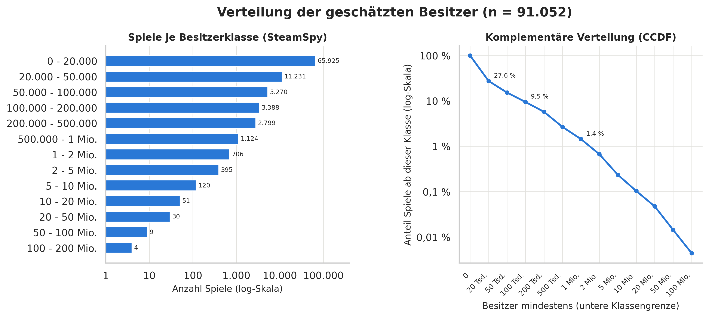

*Abbildung `fig_01_owners_distribution`: Häufigkeit der Besitzerklassen (links) und Anteil der Spiele mit mindestens der jeweiligen Klasse (CCDF, rechts).*

### 2.2 Veröffentlichungskohorten und Alter

| Jahr   | Kohorte   | N      | Erfolgsquote [95-%-KI]   | ≥ 100k   | kostenlos   | Rabatt (kostenpfl.)   | N „0 - 0“   | Anteil „0 - 0“   | Erfolgsquote mit „0 - 0“   | Hinweis            |
|:-------|:----------|:-------|:-------------------------|:---------|:------------|:----------------------|:------------|:-----------------|:---------------------------|:-------------------|
| 1997   | bis 2009  | 2      | 100,0 % [34,2; 100,0]    | 100,0 %  | 50,0 %      | 100,0 %               | 0           | 0,0 %            | 100,0 %                    | N < 100            |
| 1998   | bis 2009  | 1      | 100,0 % [20,7; 100,0]    | 100,0 %  | 0,0 %       | 100,0 %               | 0           | 0,0 %            | 100,0 %                    | N < 100            |
| 1999   | bis 2009  | 2      | 100,0 % [34,2; 100,0]    | 100,0 %  | 0,0 %       | 100,0 %               | 0           | 0,0 %            | 100,0 %                    | N < 100            |
| 2000   | bis 2009  | 2      | 100,0 % [34,2; 100,0]    | 100,0 %  | 0,0 %       | 50,0 %                | 0           | 0,0 %            | 100,0 %                    | N < 100            |
| 2001   | bis 2009  | 4      | 100,0 % [51,0; 100,0]    | 100,0 %  | 0,0 %       | 100,0 %               | 0           | 0,0 %            | 100,0 %                    | N < 100            |
| 2002   | bis 2009  | 1      | 100,0 % [20,7; 100,0]    | 100,0 %  | 0,0 %       | 100,0 %               | 0           | 0,0 %            | 100,0 %                    | N < 100            |
| 2003   | bis 2009  | 3      | 100,0 % [43,9; 100,0]    | 66,7 %   | 0,0 %       | 100,0 %               | 0           | 0,0 %            | 100,0 %                    | N < 100            |
| 2004   | bis 2009  | 5      | 100,0 % [56,6; 100,0]    | 100,0 %  | 20,0 %      | 100,0 %               | 0           | 0,0 %            | 100,0 %                    | N < 100            |
| 2005   | bis 2009  | 7      | 85,7 % [48,7; 97,4]      | 57,1 %   | 14,3 %      | 83,3 %                | 0           | 0,0 %            | 85,7 %                     | N < 100            |
| 2006   | bis 2009  | 63     | 98,4 % [91,5; 99,7]      | 55,6 %   | 9,5 %       | 78,9 %                | 0           | 0,0 %            | 98,4 %                     | N < 100            |
| 2007   | bis 2009  | 84     | 97,6 % [91,7; 99,3]      | 83,3 %   | 11,9 %      | 75,7 %                | 0           | 0,0 %            | 97,6 %                     | N < 100            |
| 2008   | bis 2009  | 152    | 82,9 % [76,1; 88,1]      | 51,3 %   | 7,9 %       | 70,5 %                | 0           | 0,0 %            | 82,9 %                     |                    |
| 2009   | bis 2009  | 301    | 83,1 % [78,4; 86,9]      | 47,5 %   | 6,6 %       | 64,3 %                | 3           | 1,0 %            | 82,2 %                     |                    |
| 2010   | 2010–2014 | 241    | 79,7 % [74,1; 84,3]      | 49,0 %   | 10,0 %      | 62,7 %                | 0           | 0,0 %            | 79,7 %                     |                    |
| 2011   | 2010–2014 | 251    | 90,4 % [86,2; 93,5]      | 62,5 %   | 10,0 %      | 64,9 %                | 0           | 0,0 %            | 90,4 %                     |                    |
| 2012   | 2010–2014 | 314    | 95,2 % [92,3; 97,1]      | 70,4 %   | 10,2 %      | 69,0 %                | 0           | 0,0 %            | 95,2 %                     |                    |
| 2013   | 2010–2014 | 433    | 93,8 % [91,1; 95,7]      | 67,0 %   | 9,9 %       | 69,5 %                | 2           | 0,5 %            | 93,3 %                     |                    |
| 2014   | 2010–2014 | 1.478  | 80,1 % [78,0; 82,1]      | 39,4 %   | 8,0 %       | 58,5 %                | 4           | 0,3 %            | 79,9 %                     |                    |
| 2015   | 2015–2019 | 2.437  | 63,0 % [61,1; 64,9]      | 27,5 %   | 10,7 %      | 50,3 %                | 4           | 0,2 %            | 62,9 %                     |                    |
| 2016   | 2015–2019 | 4.005  | 51,5 % [50,0; 53,1]      | 20,9 %   | 13,4 %      | 46,3 %                | 11          | 0,3 %            | 51,4 %                     |                    |
| 2017   | 2015–2019 | 5.708  | 36,6 % [35,3; 37,8]      | 12,4 %   | 14,3 %      | 39,4 %                | 17          | 0,3 %            | 36,5 %                     |                    |
| 2018   | 2015–2019 | 7.251  | 28,7 % [27,7; 29,8]      | 8,5 %    | 15,3 %      | 36,6 %                | 23          | 0,3 %            | 28,6 %                     |                    |
| 2019   | 2015–2019 | 6.977  | 25,5 % [24,5; 26,5]      | 8,3 %    | 15,4 %      | 36,1 %                | 10          | 0,1 %            | 25,5 %                     |                    |
| 2020   | 2020–2022 | 8.495  | 28,6 % [27,6; 29,6]      | 8,8 %    | 16,2 %      | 38,5 %                | 15          | 0,2 %            | 28,5 %                     |                    |
| 2021   | 2020–2022 | 9.377  | 28,0 % [27,1; 28,9]      | 7,9 %    | 8,7 %       | 38,8 %                | 756         | 7,5 %            | 25,9 %                     |                    |
| 2022   | 2020–2022 | 9.863  | 24,3 % [23,5; 25,2]      | 6,0 %    | 7,6 %       | 42,3 %                | 1.232       | 11,1 %           | 21,6 %                     |                    |
| 2023   | 2023–2025 | 11.405 | 19,9 % [19,1; 20,6]      | 5,5 %    | 7,7 %       | 46,0 %                | 1.560       | 12,0 %           | 17,5 %                     |                    |
| 2024   | 2023–2025 | 15.207 | 14,5 % [13,9; 15,0]      | 4,1 %    | 7,4 %       | 49,6 %                | 2.409       | 13,7 %           | 12,5 %                     |                    |
| 2025   | 2023–2025 | 6.983  | 11,5 % [10,8; 12,3]      | 2,5 %    | 4,0 %       | 50,0 %                | 1.143       | 14,1 %           | 9,9 %                      | nur Januar bis Mai |

Die Erfolgsquote hängt stark vom Jahrgang ab: Sie erreicht 95,2 % im Jahrgang 2012 (unter Jahrgängen mit mindestens 100 Spielen) und sinkt seit 2020 mit jedem Jahrgang bis auf 11,5 % im Jahrgang 2025 (nur Januar bis Mai). Erfolgreiche Spiele sind im Median 5,3 Jahre alt, nicht erfolgreiche 3,0 Jahre (`descriptives_by_success.csv`). Der Anteil der Einträge mit „0 - 0“ steigt ab 2021 sprunghaft. Zählt man sie als Nicht-Erfolg, sinkt die Gesamtquote von 27,6 % auf 25,6 %. Auch der Anteil kostenloser Spiele hängt an diesem Ausschluss: Unter den Spielen, die alle übrigen Kriterien erfüllen, sind mit den „0 - 0“-Einträgen 15,8 % kostenlos, ohne sie (Analysestichprobe) 10,2 %; von den „0 - 0“-Einträgen selbst sind 86,3 % kostenlos. Nur dieser Schritt geht auf den „0 - 0“-Ausschluss zurück. Der höhere Anteil im Rohdatensatz (21,2 %) lässt sich ihm dagegen nicht zuordnen, weil der Rohdatensatz zusätzlich Nicht-Spiele, Software, Releases ab dem Stichtag und Einträge der SteamSpy-Lücke enthält. Aussagen zu Kohorten, zur Erfolgsquote und zu kostenlosen Spielen gelten deshalb nur bedingt auf die Spiele mit Besitzerangabe.

Damit Gruppen mit unterschiedlicher Altersstruktur vergleichbar werden, weist `age_standardized_rates.csv` neben der rohen auch eine **altersstandardisierte Erfolgsquote** aus (direkte Standardisierung auf die Jahrgangsverteilung der Analysestichprobe; Schichten: bis 2009, danach Einzeljahre) sowie Quoten innerhalb der Kohorten. Für Gruppen unter 30 Spielen bleibt die standardisierte Quote leer. Die deskriptiven Kohorten (bis 2009, 2010–2014, 2015–2019, 2020–2022, 2023–2025) weichen von den vier Kohorten der Tests ab (Abschnitt 3.0).

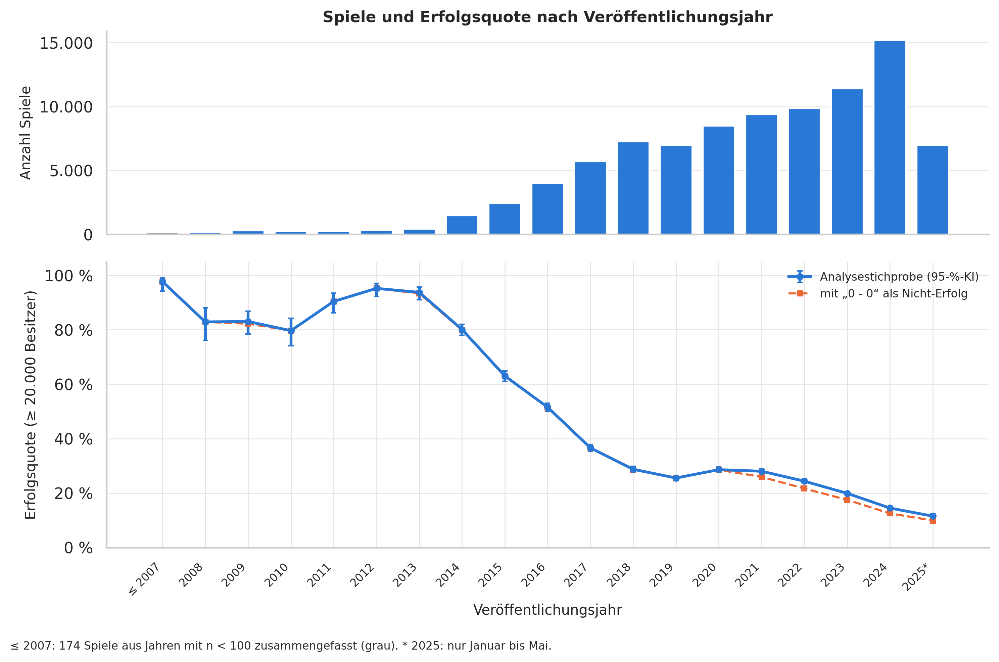

*Abbildung `fig_02_release_cohorts`: Spiele je Veröffentlichungsjahr und Erfolgsquote mit 95-%-KI; gestrichelt die Quote, wenn „0 - 0“-Einträge als Nicht-Erfolg zählen. Jahrgang 2025 nur Januar bis Mai.*

### 2.3 Steam-Genres

| Genre                 | N      | Anteil   | Erfolgsquote [95-%-KI]   | altersstandardisiert [95-%-KI]   | ≥ 100k   | ≥ 1 Mio.   | mittl. Alter (J.)   | Median Listenpreis (kostenpfl., USD)   | kostenlos   | F2P-Tag   |
|:----------------------|:-------|:---------|:-------------------------|:---------------------------------|:---------|:-----------|:--------------------|:---------------------------------------|:------------|:----------|
| Massively Multiplayer | 1.814  | 2,0 %    | 45,5 % [43,2; 47,8]      | 42,7 % [40,6; 44,9]              | 24,8 %   | 6,8 %      | 4,6                 | 5,99                                   | 44,0 %      | 35,3 %    |
| RPG                   | 16.658 | 18,3 %   | 35,7 % [35,0; 36,4]      | 36,5 % [35,8; 37,2]              | 13,1 %   | 2,1 %      | 4,0                 | 6,99                                   | 10,3 %      | 6,7 %     |
| Strategy              | 18.061 | 19,8 %   | 32,3 % [31,7; 33,0]      | 31,9 % [31,3; 32,6]              | 12,2 %   | 1,6 %      | 4,2                 | 5,89                                   | 10,1 %      | 6,5 %     |
| Adventure             | 36.793 | 40,4 %   | 29,6 % [29,2; 30,1]      | 30,3 % [29,9; 30,7]              | 9,8 %    | 1,4 %      | 4,1                 | 4,99                                   | 8,9 %       | 5,5 %     |
| Action                | 38.190 | 41,9 %   | 29,1 % [28,7; 29,6]      | 28,7 % [28,3; 29,1]              | 11,0 %   | 2,2 %      | 4,3                 | 4,99                                   | 10,5 %      | 6,3 %     |
| Simulation            | 18.861 | 20,7 %   | 26,9 % [26,2; 27,5]      | 27,9 % [27,3; 28,6]              | 10,4 %   | 1,5 %      | 3,9                 | 5,99                                   | 8,9 %       | 5,5 %     |
| Indie                 | 65.516 | 72,0 %   | 26,1 % [25,8; 26,4]      | 26,7 % [26,4; 27,1]              | 7,9 %    | 0,8 %      | 4,1                 | 4,99                                   | 9,8 %       | 6,0 %     |
| Racing                | 3.320  | 3,6 %    | 24,8 % [23,4; 26,3]      | 24,7 % [23,3; 26,1]              | 8,8 %    | 1,0 %      | 4,2                 | 4,99                                   | 9,1 %       | 5,5 %     |
| Sports                | 3.991  | 4,4 %    | 23,0 % [21,7; 24,3]      | 23,0 % [21,7; 24,2]              | 7,9 %    | 1,2 %      | 4,4                 | 5,99                                   | 10,1 %      | 5,7 %     |
| Casual                | 39.612 | 43,5 %   | 20,9 % [20,5; 21,3]      | 22,5 % [22,1; 22,9]              | 5,5 %    | 0,4 %      | 3,9                 | 3,99                                   | 9,5 %       | 6,3 %     |

Die höchsten Erfolgsquoten haben Massively Multiplayer (45,5 %), RPG und Strategy. Unter der Gesamtquote von 27,6 % liegen Simulation, Indie, Racing, Sports und Casual. Die Altersstandardisierung verschiebt die Quoten um höchstens 2,8 Prozentpunkte; Spitze (Massively Multiplayer) und Schluss (Casual, standardisiert 22,5 %) bleiben gleich. Massively Multiplayer hat mit 44,0 % den höchsten Anteil kostenloser Spiele.

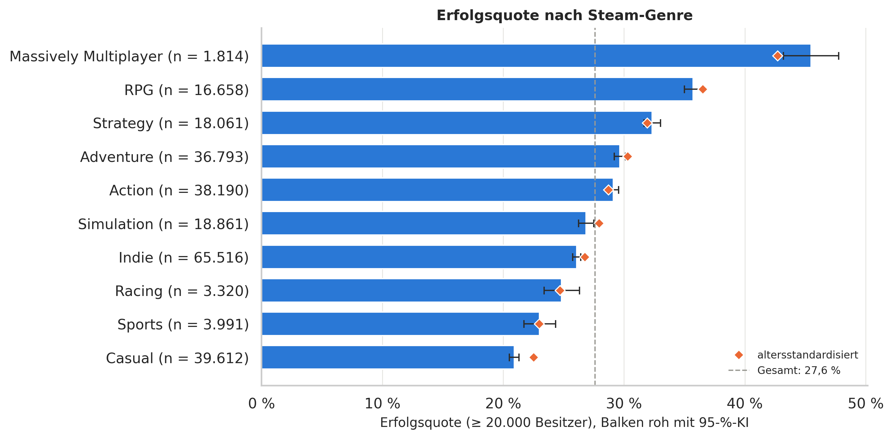

*Abbildung `fig_03_genre_success`: Erfolgsquote nach Steam-Genre mit 95-%-KI, roh und altersstandardisiert.*

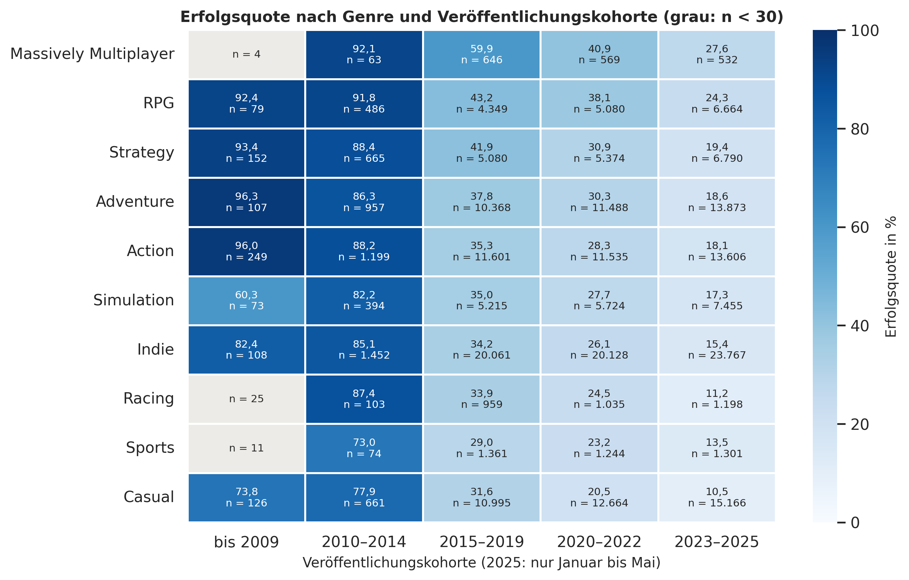

*Abbildung `fig_09_genre_cohort`: Erfolgsquote nach Genre und Veröffentlichungskohorte für alle 10 Genres; Zellen mit n < 30 grau maskiert, n annotiert.*

### 2.4 Spielmodi und Plattformen

| Merkmal            | Ausprägung           | N      | Erfolgsquote [95-%-KI]   | altersstandardisiert   | ≥ 100k   | ≥ 1 Mio.   | mittl. Alter (J.)   |
|:-------------------|:---------------------|:-------|:-------------------------|:-----------------------|:---------|:-----------|:--------------------|
| Spielmodus         | Keine Angabe         | 273    | 23,1 % [18,5; 28,4]      | 23,5 %                 | 9,5 %    | 0,7 %      | 4,4                 |
| Spielmodus         | Nur Multiplayer      | 3.144  | 36,4 % [34,7; 38,1]      | 34,9 %                 | 19,3 %   | 5,3 %      | 4,6                 |
| Spielmodus         | Nur Singleplayer     | 73.886 | 25,0 % [24,7; 25,4]      | 25,8 %                 | 7,3 %    | 0,7 %      | 4,0                 |
| Spielmodus         | Single + Multiplayer | 13.749 | 39,4 % [38,6; 40,2]      | 36,0 %                 | 18,9 %   | 4,6 %      | 4,9                 |
| Anzahl Plattformen | 1                    | 70.079 | 25,3 % [25,0; 25,6]      | 26,5 %                 | 8,0 %    | 1,2 %      | 4,0                 |
| Anzahl Plattformen | 2                    | 11.688 | 31,7 % [30,9; 32,6]      | 30,1 %                 | 12,0 %   | 1,9 %      | 4,5                 |
| Anzahl Plattformen | 3                    | 9.285  | 39,8 % [38,8; 40,8]      | 31,8 %                 | 17,8 %   | 3,0 %      | 5,6                 |

Plattformkombinationen (`platform_combo_overview.csv`; Quoten auch innerhalb der deskriptiven Kohorten):

| Kombination                    | N      | Anteil   | Erfolgsquote [95-%-KI]   | altersstandardisiert   | mittl. Alter (J.)   | Quote bis 2009   | Quote 2010–2014    | Quote 2015–2019     | Quote 2020–2022     | Quote 2023–2025     |
|:-------------------------------|:-------|:---------|:-------------------------|:-----------------------|:--------------------|:-----------------|:-------------------|:--------------------|:--------------------|:--------------------|
| nur Windows                    | 70.062 | 76,9 %   | 25,3 % [25,0; 25,6]      | 26,5 %                 | 4,0                 | 86,1 % (n = 503) | 84,3 % (n = 1.564) | 32,4 % (n = 18.537) | 26,0 % (n = 22.139) | 15,4 % (n = 27.319) |
| Windows + macOS                | 8.261  | 9,1 %    | 35,0 % [34,0; 36,1]      | 32,0 %                 | 4,9                 | 85,0 % (n = 60)  | 82,8 % (n = 384)   | 42,2 % (n = 3.039)  | 31,8 % (n = 2.352)  | 20,5 % (n = 2.426)  |
| Windows + Linux                | 3.426  | 3,8 %    | 23,7 % [22,3; 25,2]      | 26,1 %                 | 3,6                 | 100,0 % (n = 15) | 80,6 % (n = 62)    | 37,3 % (n = 773)    | 24,5 % (n = 1.088)  | 12,9 % (n = 1.488)  |
| Windows + macOS + Linux        | 9.285  | 10,2 %   | 39,8 % [38,8; 40,8]      | 31,8 %                 | 5,6                 | 95,9 % (n = 49)  | 88,0 % (n = 706)   | 48,9 % (n = 4.019)  | 32,1 % (n = 2.152)  | 15,9 % (n = 2.359)  |
| ohne Windows (nur macOS/Linux) | 18     | 0,0 %    | 22,2 % [9,0; 45,2]       | –                      | 5,7                 | – (n = 0)        | 100,0 % (n = 1)    | 20,0 % (n = 10)     | 25,0 % (n = 4)      | 0,0 % (n = 3)       |

Single- plus Multiplayer-Spiele (39,4 %) und reine Multiplayer-Spiele (36,4 %) sind häufiger erfolgreich als reine Singleplayer-Spiele (25,0 %). Die Kategorie „Singleplayer“ ist mit großem Abstand der Normalfall. Bei den Plattformen unterscheidet sich das Bild nach Kombination: Windows + macOS (35,0 %) und Windows + macOS + Linux (39,8 %) liegen über „nur Windows“ (25,3 %), Windows + Linux ohne macOS liegt darunter (23,7 %; standardisiert 26,1 % gegen 26,5 %). Innerhalb der Kohorten ab 2015 liegen W+M und W+M+L durchgehend über „nur Windows“, W+L dagegen in 2 von 3 Kohorten darunter (2020–2022, 2023–2025). Spiele mit drei Plattformen sind im Mittel deutlich älter (5,6 gegen 4,0 Jahre): Die Altersstandardisierung verringert den Vorsprung von W+M+L vor der Gesamtquote von 12,2 auf 4,2 Prozentpunkte. Für „ohne Windows“ (n = 18) wird keine standardisierte Quote berechnet.

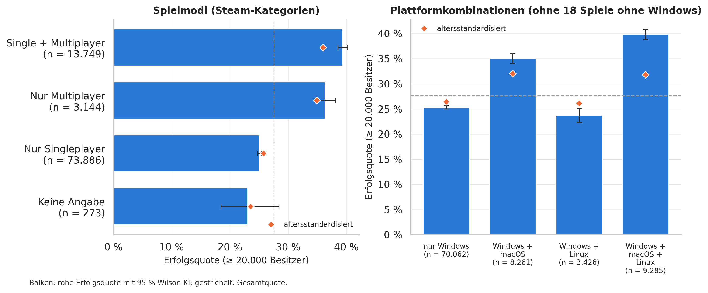

*Abbildung `fig_04_modes_platforms`: Erfolgsquote nach Spielmodus und Plattformkombination mit 95-%-KI, roh und altersstandardisiert.*

### 2.5 Preis, kostenlose Spiele und Rabatte

Preisklassen nach dem rekonstruierten **Listenpreis**. Ergänzend sind die Fallzahl und die Erfolgsquote angegeben, wenn man die Klassen nach dem Tagespreis bildet:

| Preisklasse (Listenpreis, USD)   | N      | Anteil   | Erfolgsquote [95-%-KI]   | altersstandardisiert   | ≥ 100k   | ≥ 1 Mio.   | mittl. Alter (J.)   | N nach Tagespreis   | Erfolgsquote nach Tagespreis   | Hinweis                                                                                        |
|:---------------------------------|:-------|:---------|:-------------------------|:-----------------------|:---------|:-----------|:--------------------|:--------------------|:-------------------------------|:-----------------------------------------------------------------------------------------------|
| Free                             | 9.306  | 10,2 %   | 40,1 % [39,1; 41,1]      | 35,4 %                 | 15,7 %   | 2,8 %      | 5,0                 | 9.338               | 40,1 %                         |                                                                                                |
| 0,01 - 4,99                      | 44.581 | 49,0 %   | 20,8 % [20,4; 21,1]      | 21,7 %                 | 4,7 %    | 0,3 %      | 4,0                 | 56.917              | 25,1 %                         |                                                                                                |
| 5 - 9,99                         | 19.747 | 21,7 %   | 25,5 % [24,9; 26,1]      | 24,0 %                 | 7,5 %    | 0,7 %      | 4,3                 | 15.680              | 27,0 %                         |                                                                                                |
| 10 - 19,99                       | 12.927 | 14,2 %   | 37,5 % [36,7; 38,3]      | 37,2 %                 | 16,6 %   | 2,8 %      | 4,2                 | 7.373               | 31,7 %                         |                                                                                                |
| 20 - 39,99                       | 3.466  | 3,8 %    | 52,7 % [51,0; 54,4]      | 54,5 %                 | 32,8 %   | 8,9 %      | 3,8                 | 1.280               | 36,6 %                         |                                                                                                |
| 40+                              | 694    | 0,8 %    | 60,5 % [56,8; 64,1]      | 62,8 %                 | 43,2 %   | 18,3 %     | 3,5                 | 167                 | 40,1 %                         | ohne Preisausreißer (Listenpreis > 100 USD) und ohne 54,99-USD-Cluster                         |
| 54,99-Cluster (ab 2024)          | 110    | 0,1 %    | 0,0 % [0,0; 3,4]         | 0,0 %                  | 0,0 %    | 0,0 %      | 0,7                 | –                   | –                              | Listenpreis exakt 54,99 USD, Release ab 2024; getrennt ausgewiesen                             |
| Ausreißer (> 100)                | 187    | 0,2 %    | 3,7 % [1,8; 7,5]         | 3,5 %                  | 0,0 %    | 0,0 %      | 3,1                 | –                   | –                              | Listenpreis > 100 USD, getrennt ausgewiesen                                                    |
| Listenpreis fehlt                | 34     | 0,0 %    | 44,1 % [28,9; 60,5]      | 39,8 %                 | 23,5 %   | 11,8 %     | 5,3                 | –                   | –                              | Listenpreis nicht rekonstruierbar: 100 % Rabatt (6) oder Tagespreis 0 trotz Rabatt 1–99 % (28) |

Preisausreißer über 100 USD und das 54,99-USD-Cluster (Listenpreis exakt 54,99 USD, Release ab 2024; Zusammensetzung unten) sind eigene Zeilen; die Klasse 40+ enthält beide nicht. Unter den kostenpflichtigen Spielen **steigt die Erfolgsquote mit dem Listenpreis durchgehend**: von 20,8 % (0,01–4,99 USD) über 52,7 % (20–39,99 USD) auf 60,5 % in der Klasse 40+ (Konfidenzintervalle überlappen nicht; altersstandardisiert 62,8 % gegen 54,5 %, mindestens 1 Mio. Besitzer 18,3 % gegen 8,9 %). Einen Einbruch oder ein Plateau bei teuren Titeln gibt es also nicht. Ein Plateau entstünde nur, wenn man das Cluster in der Klasse ließe: Dann läge sie bei 52,2 % [48,8; 55,7] und damit auf dem Niveau von 20–39,99. Nach dem Tagespreis gebildet steigt die Quote ebenfalls, aber flacher (25,1 % bis 40,1 %), weil rabattierte Vollpreistitel, die häufiger erfolgreich sind, dann in niedrigere Klassen fallen. Spiele mit Listenpreis über 100 USD sind fast nie erfolgreich (3,7 %, n = 187), die Titel des Clusters nie (0,0 %, n = 110). Die Tests in Abschnitt 3.2 rechnen auf allen kostenpflichtigen Spielen ohne Preisausreißer, also einschließlich des Clusters (dort Klasse 40+ mit Cluster); ohne Cluster ändert sich die partielle Rangkorrelation kaum (0,182 statt 0,181).

Zusammensetzung der Klasse 40+ einschließlich Ausreißern (`price_40plus_composition.csv`):

| Teilgruppe                                   | N   | Anteil an Klasse   | Erfolgsquote [95-%-KI]   | ≥ 1 Mio.   | Median Reviews   | Release 2024/25   | Publisher mit ≥ 3 Titeln   | Anteil größter Publisher   |
|:---------------------------------------------|:----|:-------------------|:-------------------------|:-----------|:-----------------|:------------------|:---------------------------|:---------------------------|
| Listenpreis > 100 USD (Preisausreißer)       | 187 | 18,9 %             | 3,7 % [1,8; 7,5]         | 0,0 %      | 14               | 24,6 %            | 73,3 %                     | 41,7 %                     |
| Listenpreis exakt 54,99 USD, Release ab 2024 | 110 | 11,1 %             | 0,0 % [0,0; 3,4]         | 0,0 %      | 1                | 100,0 %           | 94,5 %                     | 5,5 %                      |
| übrige Titel 40–100 USD                      | 694 | 70,0 %             | 60,5 % [56,8; 64,1]      | 18,3 %     | 1.078            | 24,9 %            | 67,0 %                     | 5,5 %                      |
| 40–100 USD einschließlich Cluster            | 804 | 81,1 %             | 52,2 % [48,8; 55,7]      | 15,8 %     | 546              | 35,2 %            | 70,8 %                     | 4,7 %                      |
| Klasse 40+ gesamt                            | 991 | 100,0 %            | 43,1 % [40,0; 46,2]      | 12,8 %     | 100              | 33,2 %            | 71,6 %                     | 8,0 %                      |

Von den 991 Spielen mit Listenpreis ab 40 USD sind 18,9 % Preisausreißer über 100 USD (41,7 % davon von einem einzigen Publisher). Weitere 11,1 % bilden ein Cluster mit Listenpreis exakt 54,99 USD und Release ab 2024: Kein Titel davon ist erfolgreich, der Median liegt bei 1 Review(s), und 94,5 % stammen von Publishern mit mindestens drei Titeln. Die übrigen Titel zwischen 40 und 100 USD sind zu 60,5 % erfolgreich.

Kostenlose Spiele nach Steam-Tag „Free To Play“ (`free_overview.csv`):

| Gruppe                                    | N      | Anteil   | Erfolgsquote [95-%-KI]   | altersstandardisiert [95-%-KI]   | ≥ 100k   | ≥ 1 Mio.   | mittl. Alter (J.)   |
|:------------------------------------------|:-------|:---------|:-------------------------|:---------------------------------|:---------|:-----------|:--------------------|
| Analysestichprobe gesamt                  | 91.052 | 100,0 %  | 27,6 % [27,3; 27,9]      | 27,6 % [27,3; 27,9]              | 9,5 %    | 1,4 %      | 4,2                 |
| kostenlos (Listenpreis 0)                 | 9.306  | 10,2 %   | 40,1 % [39,1; 41,1]      | 35,4 % [34,5; 36,3]              | 15,7 %   | 2,8 %      | 5,0                 |
| kostenlos, mit Genre „Free To Play“       | 5.493  | 6,0 %    | 45,9 % [44,6; 47,2]      | 43,1 % [42,0; 44,2]              | 20,0 %   | 3,8 %      | 4,5                 |
| kostenlos, ohne Genre „Free To Play“      | 3.813  | 4,2 %    | 31,7 % [30,2; 33,2]      | 28,4 % [26,1; 30,6]              | 9,6 %    | 1,5 %      | 5,7                 |
| kostenpflichtig (Listenpreis > 0)         | 81.712 | 89,7 %   | 26,2 % [25,9; 26,5]      | 26,3 % [26,1; 26,6]              | 8,8 %    | 1,3 %      | 4,1                 |
| kostenpflichtig, mit Genre „Free To Play“ | 93     | 0,1 %    | 38,7 % [29,4; 48,9]      | 47,4 % [36,0; 58,8]              | 11,8 %   | 0,0 %      | 2,7                 |

Kostenlose Spiele mit F2P-Tag sind häufiger erfolgreich (45,9 %; standardisiert 43,1 %) als kostenlose Spiele ohne Tag (31,7 %; standardisiert 28,4 %). Letztere liegen standardisiert nahe bei den kostenpflichtigen Spielen (26,3 %).

**Rabatte, nur kostenpflichtige Spiele** (Listenpreis > 0, ohne Preisausreißer; dieselbe Basis wie die Tests in Abschnitt 3.2; Erfolgsquote dieser Spiele insgesamt: 26,2 %; Analysestichprobe insgesamt: 27,6 %). Der Rabatt ist der Stand zum Store-Snapshot und teils nicht erfasst, also eine Untergrenze. Wie unvollständig er erfasst ist, zeigt die Preishistorie-Teilstichprobe: Von 54 kostenpflichtigen Spielen mit Rabatt 0 zum Snapshot kosten 45 (83,3 %) höchstens 90 % des Basispreises der Preishistorie und keines mehr als diesen. Bei den rabattierten Spielen stimmt der rekonstruierte Listenpreis dagegen in 478 von 518 Fällen (92,3 %) auf ± 0,02 USD mit dem Basispreis überein. Fehlende Rabatte ordnen rabattierte Spiele der Gruppe „kein Rabatt“ zu und unterschätzen ihren Listenpreis; das verzerrt den Rabattzusammenhang eher zur Null. Die Teilstichprobe ist stark selektiert (fast nur erfolgreiche Spiele), der Anteil lässt sich deshalb nicht auf alle Spiele übertragen; zudem können dauerhafte Preissenkungen nach Oktober 2025 einen Teil erklären:

| Rabattgruppe                  | N      | Anteil an Basis   | Erfolgsquote [95-%-KI]   | altersstandardisiert [95-%-KI]   | ≥ 100k   | ≥ 1 Mio.   | mittl. Alter (J.)   |
|:------------------------------|:-------|:------------------|:-------------------------|:---------------------------------|:---------|:-----------|:--------------------|
| kein Rabatt                   | 45.557 | 55,9 %            | 19,0 % [18,7; 19,4]      | 19,7 % [19,4; 20,1]              | 4,2 %    | 0,3 %      | 4,1                 |
| 1-25 %                        | 3.214  | 3,9 %             | 26,8 % [25,3; 28,3]      | 33,7 % [31,8; 35,7]              | 9,1 %    | 1,3 %      | 2,3                 |
| 26-50 %                       | 12.753 | 15,6 %            | 28,7 % [27,9; 29,5]      | 32,1 % [31,3; 33,0]              | 10,2 %   | 1,3 %      | 3,1                 |
| 51-75 %                       | 11.981 | 14,7 %            | 37,7 % [36,8; 38,5]      | 35,6 % [34,8; 36,4]              | 16,2 %   | 3,1 %      | 4,5                 |
| 76-100 %                      | 8.020  | 9,8 %             | 45,8 % [44,7; 46,9]      | 35,5 % [34,5; 36,5]              | 20,9 %   | 4,0 %      | 5,7                 |
| Rabatt aktiv (1-100 %)        | 35.968 | 44,1 %            | 35,3 % [34,9; 35,8]      | 35,3 % [34,8; 35,8]              | 14,5 %   | 2,5 %      | 4,1                 |
| alle kostenpflichtigen Spiele | 81.525 | 100,0 %           | 26,2 % [25,9; 26,5]      | 26,4 % [26,1; 26,7]              | 8,8 %    | 1,3 %      | 4,1                 |

Roh steigt die Erfolgsquote mit der Rabatthöhe von 19,0 % (kein Rabatt) auf 45,8 % (76–100 %). Die Rabattstufen sind aber sehr unterschiedlich alt: Niedrige Rabatte betreffen eher jüngere Titel (1–25 %: mittleres Alter 2,3 Jahre), hohe eher ältere (76–100 %: 5,7 Jahre). Im Mittel sind rabattierte und nicht rabattierte Spiele dagegen gleich alt (4,1 gegen 4,1 Jahre). Altersstandardisiert bleibt vor allem der Unterschied zwischen „kein Rabatt“ (19,7 %) und „Rabatt“: Ab 1 % Rabatt liegen die Stufen eng beieinander (32,1 % bis 35,6 %). Zwischen einzelnen Stufen bestehen kleine, gesicherte Unterschiede (z. B. 26–50 % [31,3; 33,0] gegen 51–75 % [34,8; 36,4], nicht überlappende Konfidenzintervalle), aber kein monotoner Gradient über die Rabatthöhe. Das gepoolte Plateau verdeckt gegenläufige Verläufe innerhalb der Kohorten (`age_standardized_rates.csv`, `fig_06` rechts): in 2015–2019 steigt die Quote mit der Rabatthöhe monoton (ohne Rabatt 22,5 %; 1–25 % bis 76–100 %: 39,5 % → 40,2 % → 52,0 % → 60,3 %); in 2020–2022 verläuft die Quote ohne klares Muster (ohne Rabatt 19,9 %; 33,0 % → 31,5 % → 35,0 % → 32,1 %); in 2023–2025 fällt die Quote ab der Stufe 1–25 % mit der Rabatthöhe (ohne Rabatt 11,2 %; 21,9 % → 21,7 % → 19,3 % → 16,9 %). Die Kohorten bis 2009 und 2010–2014 haben zu wenige Spiele mit niedrigem Rabatt (kleinste Gruppe n = 3, Schwelle 100). Die Richtung des Zusammenhangs ist offen.

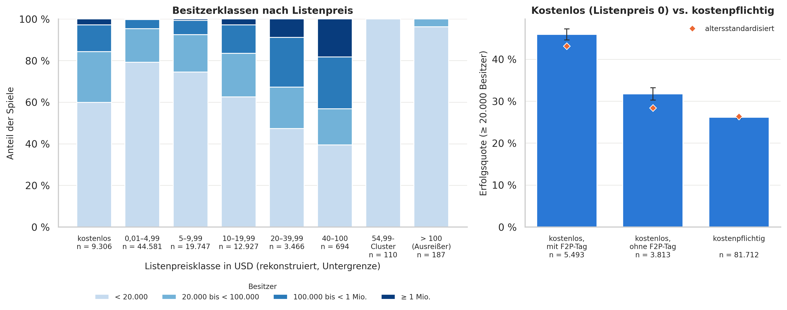

*Abbildung `fig_05_price`: Anteile der Besitzerklassen nach Listenpreisklasse (Klasse 40–100 ohne das 54,99-USD-Cluster, Cluster und Preisausreißer als eigene Balken) sowie Erfolgsquote kostenloser Spiele mit und ohne F2P-Tag gegenüber kostenpflichtigen Spielen.*

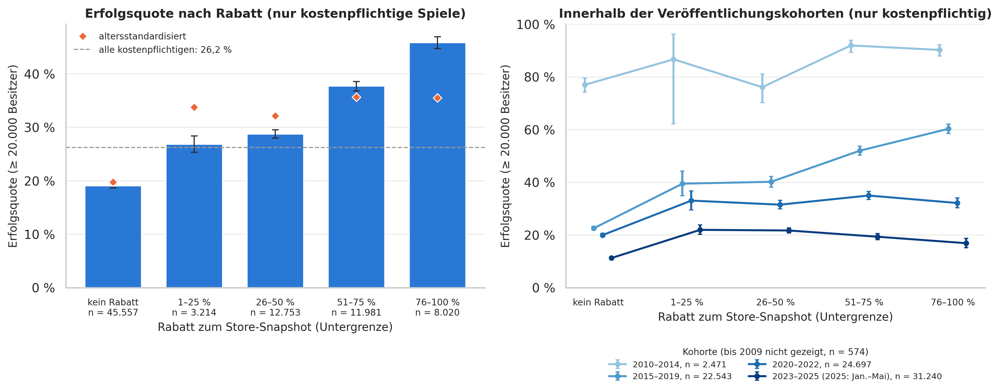

*Abbildung `fig_06_discount`: Erfolgsquote nach Rabattgruppe (nur kostenpflichtige Spiele), roh mit 95-%-KI und altersstandardisiert (links) sowie innerhalb der Veröffentlichungskohorten (rechts).*

### 2.6 Steam-Bewertungen und Metacritic

Bewertungsquartile (bindungstreu: gleiche Werte liegen immer im selben Quartil, die Gruppen sind deshalb nicht exakt gleich groß; Wertebereiche je Quartil angegeben):

| Bewertungsmaß           | Basis                                | Quartil      | N      | Wertebereich   | Erfolgsquote [95-%-KI]   | ≥ 100k   | ≥ 1 Mio.   | mittl. Alter (J.)   |
|:------------------------|:-------------------------------------|:-------------|:-------|:---------------|:-------------------------|:---------|:-----------|:--------------------|
| Positive Ratio          | Bewertungsstichprobe (>= 10 Reviews) | Q1 (niedrig) | 13.852 | 0,000–0,673    | 36,7 % [35,9; 37,5]      | 10,7 %   | 0,8 %      | 6,0                 |
| Positive Ratio          | Bewertungsstichprobe (>= 10 Reviews) | Q2           | 13.866 | 0,673–0,812    | 43,8 % [43,0; 44,6]      | 16,0 %   | 1,9 %      | 5,4                 |
| Positive Ratio          | Bewertungsstichprobe (>= 10 Reviews) | Q3           | 13.838 | 0,813–0,911    | 44,3 % [43,5; 45,1]      | 19,0 %   | 3,3 %      | 5,0                 |
| Positive Ratio          | Bewertungsstichprobe (>= 10 Reviews) | Q4 (hoch)    | 13.852 | 0,911–1,000    | 34,5 % [33,7; 35,3]      | 14,7 %   | 3,5 %      | 3,8                 |
| Wilson-Score (Diagnose) | Bewertungsstichprobe (>= 10 Reviews) | Q1 (niedrig) | 13.862 | 0,000–0,521    | 26,2 % [25,5; 27,0]      | 5,4 %    | 0,2 %      | 5,6                 |
| Wilson-Score (Diagnose) | Bewertungsstichprobe (>= 10 Reviews) | Q2           | 13.841 | 0,521–0,688    | 34,7 % [33,9; 35,5]      | 9,7 %    | 0,8 %      | 5,1                 |
| Wilson-Score (Diagnose) | Bewertungsstichprobe (>= 10 Reviews) | Q3           | 13.853 | 0,688–0,813    | 41,6 % [40,8; 42,5]      | 15,5 %   | 1,8 %      | 4,7                 |
| Wilson-Score (Diagnose) | Bewertungsstichprobe (>= 10 Reviews) | Q4 (hoch)    | 13.852 | 0,813–0,995    | 56,7 % [55,9; 57,6]      | 29,9 %   | 6,6 %      | 4,7                 |
| Metacritic (extern)     | externe Metacritic-Teilstichprobe    | Q1 (niedrig) | 1.000  | 19–67          | 82,0 % [79,5; 84,3]      | 47,2 %   | 6,6 %      | 8,0                 |
| Metacritic (extern)     | externe Metacritic-Teilstichprobe    | Q2           | 1.066  | 68–74          | 89,0 % [87,0; 90,8]      | 59,6 %   | 12,9 %     | 7,2                 |
| Metacritic (extern)     | externe Metacritic-Teilstichprobe    | Q3           | 1.062  | 75–80          | 90,6 % [88,7; 92,2]      | 68,5 %   | 18,0 %     | 6,7                 |
| Metacritic (extern)     | externe Metacritic-Teilstichprobe    | Q4 (hoch)    | 942    | 81–96          | 93,0 % [91,2; 94,5]      | 80,3 %   | 36,4 %     | 6,8                 |

Die **Positive Ratio** zeigt **keinen monotonen Verlauf**: Die mittleren Quartile sind am häufigsten erfolgreich (43,8 % und 44,3 %), die Ränder seltener (36,7 % im untersten, 34,5 % im obersten Quartil). Spiele mit sehr hoher Positive Ratio sind im Mittel jünger (3,8 gegen 6,0 Jahre im untersten Quartil); neuere Jahrgänge werden besser bewertet (ρ(Jahr, Positive Ratio) = 0,28 in der Steam-Korrelationsmatrix). Der Wilson-Score steigt monoton (26,2 % bis 56,7 %), weil er das Review-Volumen enthält; er dient nur als Diagnose (Abschnitt 3.6). Der externe Metascore steigt ebenfalls monoton (82,0 % bis 93,0 %; Anteil mit mindestens 1 Mio. Besitzern 6,6 % bis 36,4 %). Die Metacritic-Teilstichprobe ist stark selektiert (Erfolgsquote 88,6 %).

Externe Metacritic-Teilstichprobe, Kritiker- und Nutzerscore (Nutzerscore nur, wo vorhanden):

| Bewertungsmaß            | Basis                                             | Quartil      | N     | Wertebereich   | Erfolgsquote [95-%-KI]   | ≥ 100k   | ≥ 1 Mio.   |
|:-------------------------|:--------------------------------------------------|:-------------|:------|:---------------|:-------------------------|:---------|:-----------|
| Metacritic-Kritikerscore | externe Metacritic-Teilstichprobe                 | Q1 (niedrig) | 1.000 | 19–67          | 82,0 % [79,5; 84,3]      | 47,2 %   | 6,6 %      |
| Metacritic-Kritikerscore | externe Metacritic-Teilstichprobe                 | Q2           | 1.066 | 68–74          | 89,0 % [87,0; 90,8]      | 59,6 %   | 12,9 %     |
| Metacritic-Kritikerscore | externe Metacritic-Teilstichprobe                 | Q3           | 1.062 | 75–80          | 90,6 % [88,7; 92,2]      | 68,5 %   | 18,0 %     |
| Metacritic-Kritikerscore | externe Metacritic-Teilstichprobe                 | Q4 (hoch)    | 942   | 81–96          | 93,0 % [91,2; 94,5]      | 80,3 %   | 36,4 %     |
| Metacritic-Nutzerscore   | externe Metacritic-Teilstichprobe mit Nutzerscore | Q1 (niedrig) | 951   | 0,9–6,2        | 88,0 % [85,8; 89,9]      | 56,2 %   | 13,4 %     |
| Metacritic-Nutzerscore   | externe Metacritic-Teilstichprobe mit Nutzerscore | Q2           | 1.008 | 6,3–7,1        | 90,5 % [88,5; 92,1]      | 64,2 %   | 15,4 %     |
| Metacritic-Nutzerscore   | externe Metacritic-Teilstichprobe mit Nutzerscore | Q3           | 869   | 7,2–7,7        | 92,4 % [90,5; 94,0]      | 72,2 %   | 18,6 %     |
| Metacritic-Nutzerscore   | externe Metacritic-Teilstichprobe mit Nutzerscore | Q4 (hoch)    | 961   | 7,8–9,7        | 94,3 % [92,6; 95,6]      | 78,5 %   | 30,2 %     |

| Kennzahl                                                      | Wert   |
|:--------------------------------------------------------------|:-------|
| Analysestichprobe (N)                                         | 91.052 |
| mit externem Metascore (N)                                    | 4.070  |
| externe Metacritic-Coverage                                   | 4,5 %  |
| externe Metacritic-Coverage unter erfolgreichen Spielen       | 14,4 % |
| externe Metacritic-Coverage unter nicht erfolgreichen Spielen | 0,7 %  |
| externe Metacritic-Teilstichprobe mit Nutzerscore (N)         | 3.789  |
| mit FronkonGames-Metacritic-Score (N)                         | 4.095  |
| FronkonGames-Metacritic-Coverage                              | 4,5 %  |

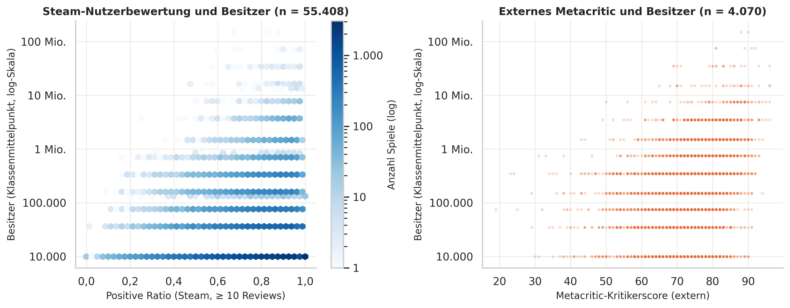

*Abbildung `fig_07_ratings`: Besitzer (Klassenmittelpunkt, log-Skala) gegen die Positive Ratio (≥ 10 Reviews; Hexbin mit Anzahl Spiele, links) und gegen den externen Metascore (Streudiagramm, rechts).*

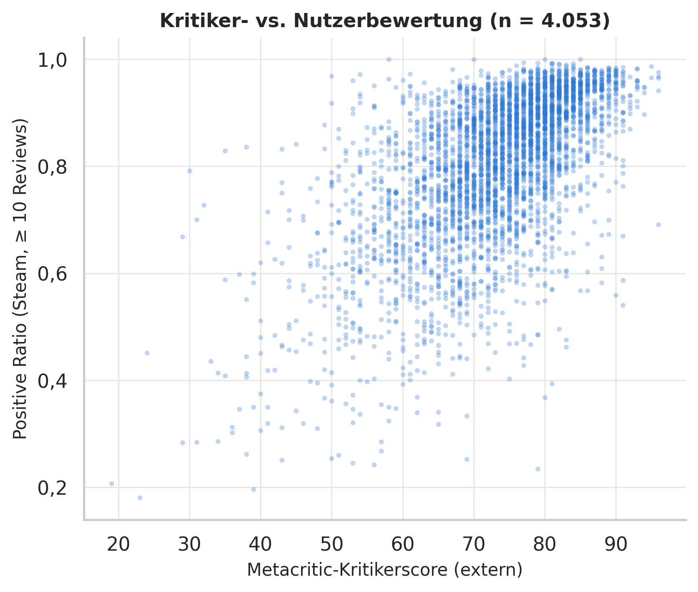

*Abbildung `fig_10_rating_agreement`: Externer Metascore gegen Positive Ratio (≥ 10 Reviews, n = 4.053).*

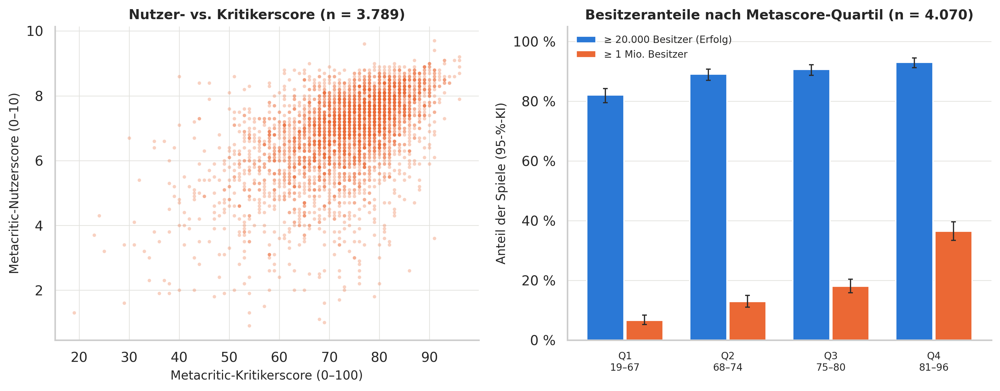

*Abbildung `fig_13_external_metacritic`: Metacritic-Nutzer- gegen -Kritikerscore sowie Anteile mit mindestens 20.000 bzw. 1 Mio. Besitzern je Metascore-Quartil.*

### 2.7 IGDB-Merkmale

**Deskriptive Statistik der externen Variablen (IGDB, Metacritic, Preishistorie)**, jeweils auf der angegebenen Teilstichprobe:

| Variable                           | Basis                                                                    | N      | Mittelwert   | SD    | Median   | Q1    | Q3    | Min   | Max    | Hinweis                                                                            |
|:-----------------------------------|:-------------------------------------------------------------------------|:-------|:-------------|:------|:---------|:------|:------|:------|:-------|:-----------------------------------------------------------------------------------|
| `igdb_rating`                      | IGDB-Teilstichprobe                                                      | 13.480 | 65,02        | 12,41 | 70,00    | 57,70 | 70,34 | 10,79 | 100,00 | Nutzerbewertung 0–100; 67,6 % der Werte ganzzahlig, 27,0 % exakt 70                |
| `igdb_aggregated_rating`           | IGDB-Teilstichprobe                                                      | 5.530  | 72,53        | 12,25 | 75,00    | 66,00 | 80,00 | 10,00 | 100,00 | Kritikerbewertung 0–100; Platzhalter 0 als fehlend                                 |
| `igdb_n_genres`                    | IGDB-Teilstichprobe mit Genreangabe                                      | 67.669 | 2,34         | 1,17  | 2,00     | 1,00  | 3,00  | 1,00  | 16,00  |                                                                                    |
| `mc_metascore`                     | externe Metacritic-Teilstichprobe                                        | 4.070  | 72,96        | 10,17 | 74,00    | 68,00 | 80,00 | 19,00 | 96,00  | Kritikerscore 0–100                                                                |
| `mc_user_score`                    | externe Metacritic-Teilstichprobe                                        | 3.789  | 6,87         | 1,28  | 7,10     | 6,20  | 7,80  | 0,90  | 9,70   | Nutzerscore 0–10, fehlt teils trotz Metascore                                      |
| `ph_months`                        | Preishistorie-Teilstichprobe                                             | 573    | 21,01        | 4,99  | 23,00    | 23,00 | 24,00 | 6,00  | 24,00  | Beobachtungsmonate (Teilmonat 2025-11 verworfen)                                   |
| `ph_price_changes_per_month`       | Preishistorie-Teilstichprobe                                             | 573    | 1,40         | 0,28  | 1,39     | 1,22  | 1,57  | 0,08  | 2,43   | Preisänderungen je beobachtetem Monat                                              |
| `ph_share_months_on_sale`          | Preishistorie-Teilstichprobe                                             | 573    | 0,85         | 0,14  | 0,88     | 0,79  | 0,95  | 0,00  | 1,00   | Anteil der Monate mit Rabatt                                                       |
| `ph_days_on_sale_per_month`        | Preishistorie-Teilstichprobe                                             | 573    | 6,20         | 2,08  | 5,88     | 4,88  | 7,30  | 0,00  | 15,89  | Rabatttage je Monat                                                                |
| `ph_mean_monthly_max_discount_pct` | Preishistorie-Teilstichprobe                                             | 573    | 45,39        | 20,13 | 45,86    | 27,36 | 62,52 | 0,00  | 88,29  | Mittel der monatlichen Höchstrabatte in % (aus dem monatlichen Tiefstpreis)        |
| `ph_max_discount_pct`              | Preishistorie, volles Fenster (Beginn Nov. oder Dez. 2023 bis Okt. 2025) | 434    | 68,11        | 18,66 | 75,01    | 60,02 | 80,04 | 0,00  | 96,70  | höchster Rabatt (Tiefstpreis ggü. Basispreis); nur bei vollem Fenster vergleichbar |
| `ph_base_price`                    | Preishistorie-Teilstichprobe                                             | 573    | 31,38        | 15,75 | 29,99    | 19,99 | 39,99 | 4,99  | 79,99  | statischer Basispreis der Quelle in USD                                            |
| `ph_lowest_price`                  | Preishistorie-Teilstichprobe                                             | 573    | 11,73        | 9,10  | 9,79     | 4,99  | 14,99 | 0,99  | 55,99  | Tiefstpreis im Fenster in USD                                                      |

Die Anzahl der IGDB-Genres fehlt, wenn keine Genres angegeben sind (4,4 % der IGDB-Treffer). Sie misst neben der Genrebreite auch die Dokumentationstiefe eines Eintrags.

Erfolgsquote nach IGDB-Genre (exakte IGDB-Bezeichnungen; Basis sind die 67.669 IGDB-Treffer mit Genreangabe; Genres unter 100 Spielen haben breite Konfidenzintervalle):

| IGDB-Genre                 | N      | Anteil an IGDB mit Genreangabe   | Anteil an der IGDB-Teilstichprobe   | Erfolgsquote [95-%-KI]   | ≥ 100k   | ≥ 1 Mio.   | mittl. Alter (J.)   | Median Listenpreis (USD)   |
|:---------------------------|:-------|:---------------------------------|:------------------------------------|:-------------------------|:---------|:-----------|:--------------------|:---------------------------|
| Real Time Strategy (RTS)   | 612    | 0,9 %                            | 0,9 %                               | 68,5 % [64,7; 72,0]      | 41,0 %   | 10,5 %     | 7,0                 | 12,99                      |
| Turn-based strategy (TBS)  | 1.071  | 1,6 %                            | 1,5 %                               | 63,8 % [60,8; 66,6]      | 34,1 %   | 5,9 %      | 4,9                 | 13,79                      |
| Tactical                   | 829    | 1,2 %                            | 1,2 %                               | 62,2 % [58,9; 65,5]      | 37,6 %   | 9,7 %      | 4,4                 | 14,99                      |
| Hack and slash/Beat 'em up | 937    | 1,4 %                            | 1,3 %                               | 54,9 % [51,7; 58,0]      | 28,8 %   | 7,9 %      | 4,7                 | 12,99                      |
| Point-and-click            | 1.261  | 1,9 %                            | 1,8 %                               | 52,9 % [50,1; 55,6]      | 21,4 %   | 1,4 %      | 4,8                 | 6,99                       |
| Shooter                    | 4.087  | 6,0 %                            | 5,8 %                               | 50,0 % [48,4; 51,5]      | 25,2 %   | 7,9 %      | 5,2                 | 8,99                       |
| MOBA                       | 31     | 0,0 %                            | 0,0 %                               | 48,4 % [32,0; 65,2]      | 32,3 %   | 22,6 %     | 3,6                 | 9,99                       |
| Fighting                   | 927    | 1,4 %                            | 1,3 %                               | 46,0 % [42,8; 49,2]      | 22,9 %   | 5,1 %      | 4,6                 | 9,99                       |
| Quiz/Trivia                | 110    | 0,2 %                            | 0,2 %                               | 43,6 % [34,7; 53,0]      | 22,7 %   | 3,6 %      | 5,5                 | 5,99                       |
| Pinball                    | 53     | 0,1 %                            | 0,1 %                               | 43,4 % [31,0; 56,7]      | 11,3 %   | 0,0 %      | 5,0                 | 5,49                       |
| Music                      | 501    | 0,7 %                            | 0,7 %                               | 42,5 % [38,3; 46,9]      | 17,4 %   | 2,4 %      | 5,1                 | 9,99                       |
| Puzzle                     | 6.567  | 9,7 %                            | 9,3 %                               | 40,4 % [39,2; 41,5]      | 16,9 %   | 1,8 %      | 5,0                 | 5,99                       |
| Role-playing (RPG)         | 11.236 | 16,6 %                           | 15,9 %                              | 39,5 % [38,6; 40,4]      | 16,4 %   | 2,9 %      | 4,3                 | 7,99                       |
| Card & Board Game          | 999    | 1,5 %                            | 1,4 %                               | 36,8 % [33,9; 39,9]      | 15,8 %   | 2,2 %      | 3,9                 | 7,99                       |
| Visual Novel               | 2.021  | 3,0 %                            | 2,9 %                               | 35,1 % [33,0; 37,2]      | 10,4 %   | 0,7 %      | 3,9                 | 8,99                       |
| Arcade                     | 4.146  | 6,1 %                            | 5,9 %                               | 35,1 % [33,6; 36,5]      | 11,6 %   | 1,4 %      | 4,6                 | 5,99                       |
| Platform                   | 4.298  | 6,4 %                            | 6,1 %                               | 34,8 % [33,4; 36,2]      | 14,5 %   | 2,0 %      | 4,8                 | 5,99                       |
| Strategy                   | 14.407 | 21,3 %                           | 20,4 %                              | 34,1 % [33,3; 34,9]      | 13,3 %   | 2,1 %      | 4,5                 | 5,99                       |
| Adventure                  | 30.112 | 44,5 %                           | 42,6 %                              | 31,9 % [31,3; 32,4]      | 11,1 %   | 1,8 %      | 4,3                 | 5,09                       |
| Simulator                  | 14.591 | 21,6 %                           | 20,6 %                              | 30,0 % [29,3; 30,8]      | 12,3 %   | 2,0 %      | 4,3                 | 5,99                       |
| Indie                      | 53.429 | 79,0 %                           | 75,5 %                              | 27,5 % [27,1; 27,8]      | 8,5 %    | 0,9 %      | 4,3                 | 4,99                       |
| Racing                     | 2.717  | 4,0 %                            | 3,8 %                               | 26,9 % [25,2; 28,6]      | 10,1 %   | 1,5 %      | 4,5                 | 4,99                       |
| Sport                      | 3.164  | 4,7 %                            | 4,5 %                               | 24,8 % [23,4; 26,4]      | 8,6 %    | 1,3 %      | 4,7                 | 5,99                       |

Erfolgsquote nach IGDB-Spielmodus. Die Modus-Anteile beziehen sich auf die 57.663 Treffer mit Modusangabe (81,5 % der IGDB-Teilstichprobe); ohne Angabe gelten die Modi als unbekannt, nicht als „nein“:

| IGDB-Merkmal                    | Basis                               | N      | Anteil an Basis   | Erfolgsquote [95-%-KI]   | ≥ 100k   | ≥ 1 Mio.   | N ohne Merkmal   | Erfolgsquote ohne Merkmal   |
|:--------------------------------|:------------------------------------|:-------|:------------------|:-------------------------|:---------|:-----------|:-----------------|:----------------------------|
| alle mit Modusangabe (Referenz) | IGDB-Teilstichprobe mit Modusangabe | 57.663 | 100,0 %           | 30,1 % [29,8; 30,5]      | 10,9 %   | 1,7 %      | –                | –                           |
| ohne Modusangabe                | IGDB-Teilstichprobe                 | 13.084 | 18,5 %            | 18,7 % [18,1; 19,4]      | 2,4 %    | 0,0 %      | –                | –                           |
| Singleplayer                    | IGDB-Teilstichprobe mit Modusangabe | 55.663 | 96,5 %            | 29,9 % [29,5; 30,3]      | 10,6 %   | 1,6 %      | 2.000            | 36,2 %                      |
| Multiplayer                     | IGDB-Teilstichprobe mit Modusangabe | 11.169 | 19,4 %            | 40,9 % [40,0; 41,8]      | 20,7 %   | 5,4 %      | 46.494           | 27,5 %                      |
| Kooperation                     | IGDB-Teilstichprobe mit Modusangabe | 6.393  | 11,1 %            | 44,2 % [43,0; 45,4]      | 23,9 %   | 6,8 %      | 51.270           | 28,4 %                      |
| MMO                             | IGDB-Teilstichprobe mit Modusangabe | 897    | 1,6 %             | 51,4 % [48,1; 54,7]      | 30,3 %   | 8,8 %      | 56.766           | 29,8 %                      |

Ohne Modusangabe ist die Erfolgsquote mit 18,7 % deutlich niedriger als mit Angabe (30,1 %): Die Dokumentationstiefe selbst hängt mit der Popularität zusammen. Unter Spielen mit Modusangabe sind Singleplayer-Spiele seltener erfolgreich als Spiele ohne Singleplayer (29,9 % gegen 36,2 %), also in derselben Richtung wie bei Steam. Multiplayer (40,9 %), Koop (44,2 %) und MMO (51,4 %, n = 897) liegen darüber.

**Übereinstimmung mit Steam.** IGDB-Genres und -Modi sind keine unabhängige Quelle. Mit den Steam-Kategorien stimmen sie weitgehend überein (Cohens κ 0,63 bis 0,93). Nur die näherungsweise Zuordnung „Action“ weicht ab (κ = 0,24); sie geht nicht in die H4-Entscheidung ein. Die IGDB-Merkmale sind deshalb eine Reliabilitäts- und Matchingprüfung, keine Bestätigung aus einer zweiten Quelle:

| Merkmal                                                              | IGDB                          | Steam                         | Stichprobe                   | N      | Anteil IGDB   | Anteil Steam   | identisch klassifiziert   | Cohens κ   | PABAK   |
|:---------------------------------------------------------------------|:------------------------------|:------------------------------|:-----------------------------|:-------|:--------------|:---------------|:--------------------------|:-----------|:--------|
| Singleplayer                                                         | `igdb_singleplayer`           | `single_player`               | IGDB-Treffer mit Modusangabe | 57.663 | 96,5 %        | 96,4 %         | 99,2 %                    | 0,88       | 0,98    |
| Multiplayer                                                          | `igdb_multiplayer`            | `multi_player`                | IGDB-Treffer mit Modusangabe | 57.663 | 19,4 %        | 19,9 %         | 97,8 %                    | 0,93       | 0,96    |
| Koop                                                                 | `igdb_coop`                   | `coop`                        | IGDB-Treffer mit Modusangabe | 57.663 | 11,1 %        | 10,7 %         | 97,4 %                    | 0,87       | 0,95    |
| MMO                                                                  | `igdb_mmo`                    | `mmo`                         | IGDB-Treffer mit Modusangabe | 57.663 | 1,6 %         | 0,8 %          | 99,1 %                    | 0,63       | 0,98    |
| Adventure                                                            | `igdb_genre_adventure`        | `genre_adventure`             | IGDB-Treffer mit Genreangabe | 67.669 | 44,5 %        | 42,2 %         | 94,1 %                    | 0,88       | 0,88    |
| Indie                                                                | `igdb_genre_indie`            | `genre_indie`                 | IGDB-Treffer mit Genreangabe | 67.669 | 79,0 %        | 78,2 %         | 95,7 %                    | 0,87       | 0,91    |
| Racing                                                               | `igdb_genre_racing`           | `genre_racing`                | IGDB-Treffer mit Genreangabe | 67.669 | 4,0 %         | 3,8 %          | 99,5 %                    | 0,93       | 0,99    |
| RPG                                                                  | `igdb_genre_role_playing_rpg` | `genre_rpg`                   | IGDB-Treffer mit Genreangabe | 67.669 | 16,6 %        | 18,1 %         | 94,7 %                    | 0,82       | 0,89    |
| Simulation/Simulator                                                 | `igdb_genre_simulator`        | `genre_simulation`            | IGDB-Treffer mit Genreangabe | 67.669 | 21,6 %        | 20,6 %         | 96,8 %                    | 0,91       | 0,94    |
| Sports/Sport                                                         | `igdb_genre_sport`            | `genre_sports`                | IGDB-Treffer mit Genreangabe | 67.669 | 4,7 %         | 4,6 %          | 99,4 %                    | 0,93       | 0,99    |
| Strategy (Strategy, RTS, TBS)                                        | `igdb_strategy_any`           | `genre_strategy`              | IGDB-Treffer mit Genreangabe | 67.669 | 21,6 %        | 20,4 %         | 96,9 %                    | 0,91       | 0,94    |
| Action (näherungsweise: Shooter, Fighting, Hack and slash, Platform) | `igdb_action_like`            | `genre_action`                | IGDB-Treffer mit Genreangabe | 67.669 | 13,5 %        | 43,6 %         | 65,4 %                    | 0,24       | 0,31    |
| MMO (IGDB-Modus) vs. Steam-Genre Massively Multiplayer               | `igdb_mmo`                    | `genre_massively_multiplayer` | IGDB-Treffer mit Modusangabe | 57.663 | 1,6 %         | 1,9 %          | 99,2 %                    | 0,76       | 0,98    |

**IGDB-Nutzerbewertung.** 67,6 % der Nutzerbewertungen sind ganzzahlig, 27,0 % liegen exakt bei 70. Ganzzahlige Werte deuten auf sehr wenige Stimmen hin; die IGDB-Datei enthält keine Stimmenzahl. Entsprechend haben Spiele mit ganzzahliger Bewertung im Median 128 Steam-Reviews und sind zu 52,0 % erfolgreich, Spiele mit nicht ganzzahliger Bewertung 3.345 Reviews und 94,6 %:

| Gruppe                  | N      | Anteil an Nutzerbewertungen   | Erfolgsquote [95-%-KI]   | ≥ 1 Mio.   | Median Reviews (Steam)   | Median Bewertung   |
|:------------------------|:-------|:------------------------------|:-------------------------|:-----------|:-------------------------|:-------------------|
| alle Nutzerbewertungen  | 13.480 | 100,0 %                       | 65,8 % [65,0; 66,6]      | 7,2 %      | 285                      | 70,0               |
| ganzzahlig              | 9.107  | 67,6 %                        | 52,0 % [51,0; 53,1]      | 0,5 %      | 128                      | 70,0               |
| nicht ganzzahlig        | 4.373  | 32,4 %                        | 94,6 % [93,8; 95,2]      | 20,9 %     | 3.345                    | 71,2               |
| ganzzahlig ohne Wert 70 | 5.470  | 40,6 %                        | 61,2 % [59,9; 62,5]      | 0,9 %      | 167                      | 50,0               |
| Wert exakt 30           | 104    | 0,8 %                         | 42,3 % [33,3; 51,9]      | 1,0 %      | 69                       | 30,0               |
| Wert exakt 40           | 507    | 3,8 %                         | 60,9 % [56,6; 65,1]      | 0,4 %      | 121                      | 40,0               |
| Wert exakt 50           | 2.275  | 16,9 %                        | 56,9 % [54,8; 58,9]      | 0,8 %      | 124                      | 50,0               |
| Wert exakt 60           | 1.512  | 11,2 %                        | 56,9 % [54,4; 59,4]      | 0,7 %      | 147                      | 60,0               |
| Wert exakt 70           | 3.637  | 27,0 %                        | 38,2 % [36,7; 39,8]      | 0,1 %      | 90                       | 70,0               |
| Wert exakt 80           | 926    | 6,9 %                         | 81,6 % [79,0; 84,0]      | 1,2 %      | 459                      | 80,0               |

| Bewertungsmaß                           | Quartil      | N     | Wertebereich   | Erfolgsquote [95-%-KI]   | ≥ 1 Mio.   | ganzzahlig   | exakt 70   | Median Reviews (Steam)   |
|:----------------------------------------|:-------------|:------|:---------------|:-------------------------|:-----------|:-------------|:-----------|:-------------------------|
| IGDB-Nutzerbewertung                    | Q1 (niedrig) | 3.370 | 10,8–57,7      | 61,7 % [60,1; 63,3]      | 1,8 %      | 86,8 %       | 0,0 %      | 151                      |
| IGDB-Nutzerbewertung                    | Q2           | 2.925 | 57,7–70,0      | 74,6 % [73,0; 76,1]      | 7,2 %      | 52,3 %       | 0,0 %      | 552                      |
| IGDB-Nutzerbewertung                    | Q3           | 3.815 | 70,0–70,3      | 40,8 % [39,3; 42,4]      | 0,5 %      | 95,3 %       | 95,3 %     | 97                       |
| IGDB-Nutzerbewertung                    | Q4 (hoch)    | 3.370 | 70,3–100,0     | 90,7 % [89,7; 91,6]      | 19,9 %     | 30,1 %       | 0,0 %      | 2.468                    |
| IGDB-Nutzerbewertung (nicht ganzzahlig) | Q1 (niedrig) | 1.093 | 10,8–65,2      | 92,2 % [90,5; 93,7]      | 11,3 %     | 0,0 %        | 0,0 %      | 1.884                    |
| IGDB-Nutzerbewertung (nicht ganzzahlig) | Q2           | 1.093 | 65,2–71,2      | 94,5 % [93,0; 95,7]      | 14,9 %     | 0,0 %        | 0,0 %      | 2.646                    |
| IGDB-Nutzerbewertung (nicht ganzzahlig) | Q3           | 1.094 | 71,2–78,7      | 96,2 % [94,9; 97,1]      | 26,8 %     | 0,0 %        | 0,0 %      | 5.246                    |
| IGDB-Nutzerbewertung (nicht ganzzahlig) | Q4 (hoch)    | 1.093 | 78,7–99,5      | 95,3 % [93,9; 96,4]      | 30,6 %     | 0,0 %        | 0,0 %      | 5.703                    |
| IGDB-Kritikerbewertung                  | Q1 (niedrig) | 1.370 | 10,0–65,9      | 65,7 % [63,1; 68,2]      | 4,6 %      | –            | –          | –                        |
| IGDB-Kritikerbewertung                  | Q2           | 1.390 | 66,0–74,9      | 74,3 % [72,0; 76,5]      | 10,3 %     | –            | –          | –                        |
| IGDB-Kritikerbewertung                  | Q3           | 1.434 | 75,0–80,0      | 75,3 % [73,0; 77,5]      | 11,1 %     | –            | –          | –                        |
| IGDB-Kritikerbewertung                  | Q4 (hoch)    | 1.336 | 80,1–100,0     | 86,8 % [84,8; 88,5]      | 26,7 %     | –            | –          | –                        |

Das dritte Quartil der Nutzerbewertung ist praktisch der Block um 70 (70,0–70,3; n = 3.815, davon 95,3 % exakt 70, Erfolgsquote 40,8 %). Die Quartilsquoten (61,7 % / 74,6 % / 40,8 % / 90,7 %) bilden deshalb vor allem den Anteil ganzzahliger Bewertungen ab. Innerhalb der nicht ganzzahligen Bewertungen ist der Verlauf nahezu flach (92,2 % bis 96,2 %). Die IGDB-Kritikerbewertung (Platzhalter 0 als fehlend) steigt monoton (65,7 % / 74,3 % / 75,3 % / 86,8 %).

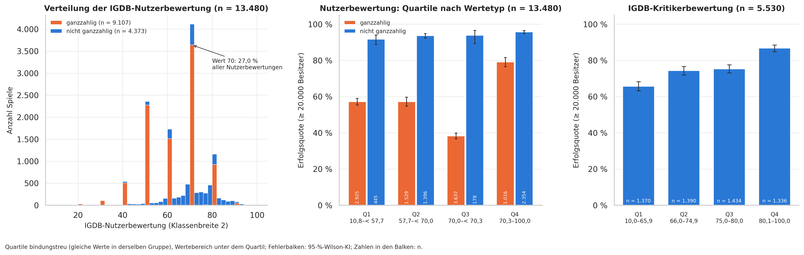

*Abbildung `fig_11_igdb_ratings`: Verteilung der IGDB-Nutzerbewertung nach Ganzzahligkeit, Erfolgsquote je Quartil getrennt nach ganzzahligen und nicht ganzzahligen Bewertungen sowie Quartile der IGDB-Kritikerbewertung.*

### 2.8 Preishistorie

Die Preishistorie umfasst 573 Spiele der Analysestichprobe (Datenstand: „rollierende Fenster von bis zu 24 Monaten zwischen Nov. 2023 und Okt. 2025; kürzer bei Release im Zeitraum“). Die Beobachtungsfenster sind unterschiedlich lang (`price_history_months.csv`); nur 434 Apps (75,7 %) haben das volle Fenster:

| Fensterlänge   | Apps   | Anteil   | davon volles Fenster   | Erfolgsquote   | ≥ 1 Mio.   | Median-Release-Jahr (Spanne)   | erster Monat        |
|:---------------|:-------|:---------|:-----------------------|:---------------|:-----------|:-------------------------------|:--------------------|
| 6–12 Monate    | 57     | 9,9 %    | 0                      | 94,7 %         | 15,8 %     | 2024–2025                      | 2024-11 bis 2025-05 |
| 13–22 Monate   | 82     | 14,3 %   | 0                      | 93,9 %         | 9,8 %      | 2024                           | 2024-01 bis 2024-10 |
| 23 Monate      | 219    | 38,2 %   | 219                    | 99,1 %         | 49,8 %     | 2020                           | 2023-12 bis 2023-12 |
| 24 Monate      | 215    | 37,5 %   | 215                    | 99,5 %         | 59,1 %     | 2019                           | 2023-11 bis 2023-11 |

Weil Summen über ungleich lange Fenster vor allem die Fensterlänge messen, werden nur **normierte Merkmale** verwendet: Preisänderungen je Monat, Anteil der Monate mit Rabatt, Rabatttage je Monat und das Mittel der monatlichen Höchstrabatte (aus dem monatlichen Tiefstpreis). Der maximale Rabatt wird nur im vollen Fenster verglichen. Quartile bei vollem Fenster (n = 434):

| Preismerkmal                        | Quartil      | N   | Wertebereich   | Erfolgsquote   | ≥ 100k   | ≥ 1 Mio.   | mittl. Alter (J.)   |
|:------------------------------------|:-------------|:----|:---------------|:---------------|:---------|:-----------|:--------------------|
| Preisänderungen je Monat            | Q1 (niedrig) | 111 | 0,08–1,26      | 99,1 %         | 95,5 %   | 46,8 %     | 6,4                 |
| Preisänderungen je Monat            | Q2           | 99  | 1,29–1,43      | 99,0 %         | 96,0 %   | 53,5 %     | 6,1                 |
| Preisänderungen je Monat            | Q3           | 112 | 1,46–1,58      | 99,1 %         | 94,6 %   | 64,3 %     | 6,3                 |
| Preisänderungen je Monat            | Q4 (hoch)    | 112 | 1,61–2,30      | 100,0 %        | 94,6 %   | 52,7 %     | 4,9                 |
| Anteil Monate mit Rabatt            | Q1 (niedrig) | 116 | 0,00–0,79      | 100,0 %        | 97,4 %   | 46,6 %     | 6,2                 |
| Anteil Monate mit Rabatt            | Q2           | 106 | 0,83–0,88      | 99,1 %         | 94,3 %   | 53,8 %     | 6,4                 |
| Anteil Monate mit Rabatt            | Q3           | 94  | 0,91–0,92      | 98,9 %         | 90,4 %   | 59,6 %     | 6,1                 |
| Anteil Monate mit Rabatt            | Q4 (hoch)    | 118 | 0,96–1,00      | 99,2 %         | 97,5 %   | 58,5 %     | 5,0                 |
| Rabatttage je Monat                 | Q1 (niedrig) | 108 | 0,00–5,04      | 99,1 %         | 95,4 %   | 48,1 %     | 6,1                 |
| Rabatttage je Monat                 | Q2           | 105 | 5,08–5,96      | 100,0 %        | 90,5 %   | 50,5 %     | 5,9                 |
| Rabatttage je Monat                 | Q3           | 113 | 6,00–7,46      | 100,0 %        | 98,2 %   | 54,9 %     | 5,8                 |
| Rabatttage je Monat                 | Q4 (hoch)    | 108 | 7,50–15,75     | 98,1 %         | 96,3 %   | 63,9 %     | 5,8                 |
| Mittlerer monatlicher Maximalrabatt | Q1 (niedrig) | 108 | 0,00–39,81     | 99,1 %         | 90,7 %   | 33,3 %     | 3,8                 |
| Mittlerer monatlicher Maximalrabatt | Q2           | 109 | 40,45–53,79    | 99,1 %         | 92,7 %   | 44,0 %     | 5,2                 |
| Mittlerer monatlicher Maximalrabatt | Q3           | 108 | 54,36–66,15    | 99,1 %         | 98,1 %   | 61,1 %     | 7,2                 |
| Mittlerer monatlicher Maximalrabatt | Q4 (hoch)    | 109 | 66,27–88,29    | 100,0 %        | 99,1 %   | 78,9 %     | 7,4                 |
| Maximaler Rabatt                    | Q1 (niedrig) | 107 | 0,00–60,01     | 98,1 %         | 91,6 %   | 39,3 %     | 4,0                 |
| Maximaler Rabatt                    | Q2           | 107 | 60,02–72,04    | 100,0 %        | 91,6 %   | 47,7 %     | 5,1                 |
| Maximaler Rabatt                    | Q3           | 113 | 75,01–80,04    | 99,1 %         | 98,2 %   | 59,3 %     | 7,1                 |
| Maximaler Rabatt                    | Q4 (hoch)    | 107 | 80,05–96,70    | 100,0 %        | 99,1 %   | 71,0 %     | 7,4                 |

Die Erfolgsquote liegt in allen Quartilen bei 98,1 % bis 100,0 %; Unterschiede zeigen sich daher nur im Anteil mit mindestens 1 Mio. Besitzern. Dieser steigt mit dem mittleren monatlichen Maximalrabatt (33,3 % bis 78,9 %) und mit dem maximalen Rabatt (39,3 % bis 71,0 %), aber nicht monoton mit den Preisänderungen je Monat (46,8 % / 53,5 % / 64,3 % / 52,7 %). Die Beschränkung auf das volle Fenster vermeidet ein Expositionsartefakt: Apps mit kurzem Fenster sind junge Releases und seltener erfolgreich (94,2 % gegenüber 99,3 % bei vollem Fenster). Spiele mit hohem Rabatt sind zudem im Mittel deutlich älter (mittleres Alter im obersten Quartil des Maximalrabatts 7,4 gegen 4,0 Jahre im untersten); Abschnitt 3.4 prüft die Zusammenhänge deshalb partiell für Jahr und Fensterlänge.

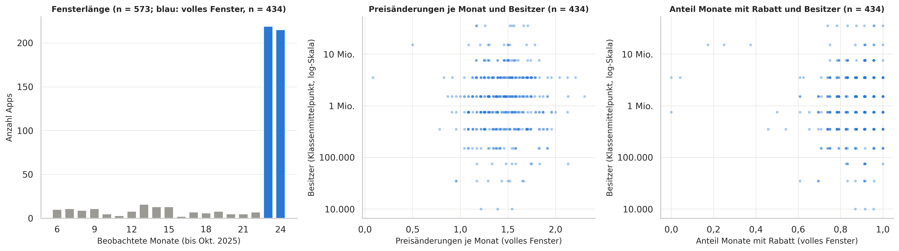

*Abbildung `fig_12_price_history`: Verteilung der Fensterlängen (links) und normierte Preismerkmale gegen Besitzer bei vollem Fenster (n = 434).*

### 2.9 Korrelationen und Überlappung der Datenquellen

Statt einer gemischten Gesamtmatrix gibt es vier Matrizen je Teilstichprobe (`correlation_spearman.csv`, mit N je Paar). Die Steam-Matrix nutzt die vollständigen Fälle der kostenpflichtigen Spiele der Bewertungsstichprobe ohne Preisausreißer, damit Listenpreis und Rabatt definiert sind (N = 48.260); die Matrizen für IGDB, Metacritic und Preishistorie sind paarweise innerhalb ihrer Teilstichprobe berechnet. Dort ist ρ(Positive Ratio, Besitzer) = 0,00, ρ(Wilson, Besitzer) = 0,28 und ρ(Listenpreis, Besitzer) = 0,21. Peak CCU geht in die Steam-Matrix als log10(1 + Peak) einschließlich der Nullwerte ein (67,7 % der Fälle) und mischt damit Aktivität am Messtag und Intensität: ρ(Peak, Besitzer) beträgt dort 0,49, bei Beschränkung auf Peak > 0 dagegen 0,56 (Zeile „Steam, nur Peak > 0“). Korrelationen mit den Besitzern:

| Matrix              | Basis                                                                                          | Variable                           | ρ mit log_owners   | N      |
|:--------------------|:-----------------------------------------------------------------------------------------------|:-----------------------------------|:-------------------|:-------|
| Steam               | Bewertungsstichprobe (>= 10 Reviews), kostenpflichtig, ohne Preisausreißer, vollständige Fälle | `log_peak_ccu`                     | 0,49               | 48.260 |
| Steam               | Bewertungsstichprobe (>= 10 Reviews), kostenpflichtig, ohne Preisausreißer, vollständige Fälle | `release_year`                     | −0,27              | 48.260 |
| Steam               | Bewertungsstichprobe (>= 10 Reviews), kostenpflichtig, ohne Preisausreißer, vollständige Fälle | `n_platforms`                      | 0,10               | 48.260 |
| Steam               | Bewertungsstichprobe (>= 10 Reviews), kostenpflichtig, ohne Preisausreißer, vollständige Fälle | `n_genres`                         | −0,05              | 48.260 |
| Steam               | Bewertungsstichprobe (>= 10 Reviews), kostenpflichtig, ohne Preisausreißer, vollständige Fälle | `dlc_count`                        | 0,28               | 48.260 |
| Steam               | Bewertungsstichprobe (>= 10 Reviews), kostenpflichtig, ohne Preisausreißer, vollständige Fälle | `list_price`                       | 0,21               | 48.260 |
| Steam               | Bewertungsstichprobe (>= 10 Reviews), kostenpflichtig, ohne Preisausreißer, vollständige Fälle | `discount`                         | 0,22               | 48.260 |
| Steam               | Bewertungsstichprobe (>= 10 Reviews), kostenpflichtig, ohne Preisausreißer, vollständige Fälle | `positive_ratio`                   | 0,00               | 48.260 |
| Steam               | Bewertungsstichprobe (>= 10 Reviews), kostenpflichtig, ohne Preisausreißer, vollständige Fälle | `wilson`                           | 0,28               | 48.260 |
| IGDB                | IGDB-Teilstichprobe, paarweise (Positive Ratio nur ab 10 Reviews)                              | `release_year`                     | −0,26              | 70.747 |
| IGDB                | IGDB-Teilstichprobe, paarweise (Positive Ratio nur ab 10 Reviews)                              | `positive_ratio`                   | −0,01              | 45.115 |
| IGDB                | IGDB-Teilstichprobe, paarweise (Positive Ratio nur ab 10 Reviews)                              | `igdb_rating`                      | 0,24               | 13.480 |
| IGDB                | IGDB-Teilstichprobe, paarweise (Positive Ratio nur ab 10 Reviews)                              | `igdb_aggregated_rating`           | 0,28               | 5.530  |
| IGDB                | IGDB-Teilstichprobe, paarweise (Positive Ratio nur ab 10 Reviews)                              | `igdb_n_genres`                    | 0,19               | 67.669 |
| Metacritic          | externe Metacritic-Teilstichprobe, paarweise (Positive Ratio nur ab 10 Reviews)                | `release_year`                     | −0,20              | 4.070  |
| Metacritic          | externe Metacritic-Teilstichprobe, paarweise (Positive Ratio nur ab 10 Reviews)                | `positive_ratio`                   | 0,24               | 4.053  |
| Metacritic          | externe Metacritic-Teilstichprobe, paarweise (Positive Ratio nur ab 10 Reviews)                | `mc_metascore`                     | 0,35               | 4.070  |
| Metacritic          | externe Metacritic-Teilstichprobe, paarweise (Positive Ratio nur ab 10 Reviews)                | `mc_user_score`                    | 0,23               | 3.789  |
| Preishistorie       | Preishistorie mit vollem Fenster, paarweise (Positive Ratio nur ab 10 Reviews)                 | `release_year`                     | −0,44              | 434    |
| Preishistorie       | Preishistorie mit vollem Fenster, paarweise (Positive Ratio nur ab 10 Reviews)                 | `positive_ratio`                   | 0,15               | 434    |
| Preishistorie       | Preishistorie mit vollem Fenster, paarweise (Positive Ratio nur ab 10 Reviews)                 | `ph_base_price`                    | 0,03               | 434    |
| Preishistorie       | Preishistorie mit vollem Fenster, paarweise (Positive Ratio nur ab 10 Reviews)                 | `ph_price_changes_per_month`       | 0,04               | 434    |
| Preishistorie       | Preishistorie mit vollem Fenster, paarweise (Positive Ratio nur ab 10 Reviews)                 | `ph_share_months_on_sale`          | 0,10               | 434    |
| Preishistorie       | Preishistorie mit vollem Fenster, paarweise (Positive Ratio nur ab 10 Reviews)                 | `ph_days_on_sale_per_month`        | 0,11               | 434    |
| Preishistorie       | Preishistorie mit vollem Fenster, paarweise (Positive Ratio nur ab 10 Reviews)                 | `ph_mean_monthly_max_discount_pct` | 0,31               | 434    |
| Preishistorie       | Preishistorie mit vollem Fenster, paarweise (Positive Ratio nur ab 10 Reviews)                 | `ph_max_discount_pct`              | 0,23               | 434    |
| Steam, nur Peak > 0 | wie Steam-Matrix, nur Peak CCU > 0 (in der Steam-Matrix sind 67,7 % der Fälle Peak = 0)        | `log_peak_ccu`                     | 0,56               | 15.582 |

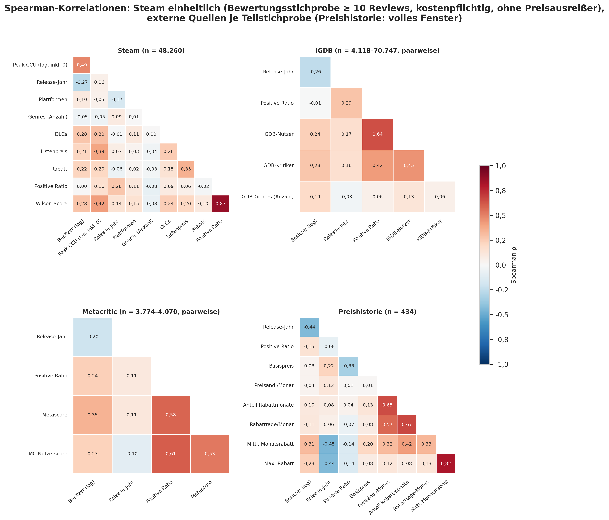

*Abbildung `fig_08_correlation_heatmap`: Spearman-Korrelationen in vier Matrizen je Teilstichprobe (Steam: vollständige Fälle; IGDB, Metacritic, Preishistorie: paarweise innerhalb der Teilstichprobe).*

Alle Spiele stammen aus dem Basisdatensatz; 78,5 % haben zusätzlich mindestens eine externe Quelle, 324 alle vier. Die quellenübergreifenden Analysen nutzen jeweils die größtmögliche Teilstichprobe.

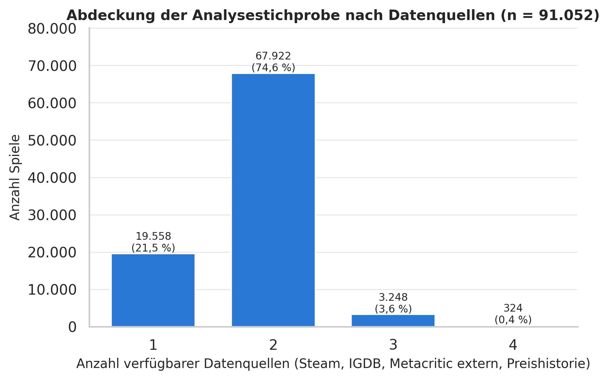

*Abbildung `fig_14_source_overlap`: Abdeckung der Analysestichprobe durch die externen Quellen.*

## 3. Statistische Tests

### 3.0 Methoden, Hypothesen und Entscheidungsregeln

**Verfahren** (`scripts/03_tests.py`):

- Binäre Merkmale: χ²-Test mit Odds Ratio (Woolf-Konfidenzintervall). Bei Quartilsvergleichen mit Zellen unter 5 Fällen wird ein bedingtes ML-Odds-Ratio mit exaktem Konfidenzintervall und Fisher-Test berechnet. Quartils-ORs gelten als **instabil**, wenn der Erfolgsanteil der Teilstichprobe über 85 % liegt oder eine Zelle kleiner als 5 ist. Dort werden stetige Rangmaße bevorzugt.
- Ordinale bzw. metrische Merkmale: Spearman ρ mit log_owners (Konfidenzintervall über Fisher-z), Mann-Whitney-U mit Cliff's δ, Kruskal-Wallis mit ε² = H/(n − 1).
- **Alterskontrolle:** logistische Regression mit Jahr-Fixed-Effects (Hauptadjustierung). Aufeinanderfolgende seltene Jahrgänge werden zusammengefasst, bis jede Gruppe mindestens 200 Spiele hat. Eine quadratische Spezifikation mit zentriertem Jahr ((Jahr − 2015)/10) dient nur als Sensitivität. Jede Logit-Schätzung wird auf Konvergenz geprüft; alle Schätzungen in allen Ergebnistabellen sind konvergiert. Partielle Rangkorrelationen residualisieren die Ränge beider Variablen auf Jahr-FE (Gruppen ab 30 Spielen), bei der Preishistorie zusätzlich auf die Fensterlänge.
- Plattformen zusätzlich als Kombinationen gegen „nur Windows“ und macOS/Linux gegenseitig adjustiert; Genres, Modi und Plattformen außerdem in einem **gemeinsamen Modell** mit Jahr-FE.
- Peak CCU zweiteilig: P(Peak > 0) als Hürde (OR bzw. Cliff's δ) und die Intensität nur bei Peak > 0.
- **Kohorten** für Stratifizierung und Interaktionstests: bis 2014, 2015–2018, 2019–2022, 2023–2025 (Jahrgang 2025 nur Januar bis Mai). Heterogenität der Korrelationen über Cochran-Q (Fisher-z), Interaktionen über Likelihood-Ratio-Tests.
- H3-Vergleich in **identischer Stichprobe**: Differenz der Spearman-Korrelationen per Bootstrap (2.000 Wiederholungen, Seed 42).
- p-Werte werden je Ergebnistabelle über alle Zeilen per **Benjamini-Hochberg** korrigiert (q-Werte). Wegen der großen Stichproben sind viele p-Werte extrem klein; die Bewertung stützt sich deshalb auf Effektmaße und die folgenden Regeln. Alle Ergebnisse beschreiben **Zusammenhänge**, keine Wirkungen.

**Hypothesen** (ausformuliert, Quelle: `hypothesis_decisions.csv`):

- **H1:** Spieleigenschaften: Genre, Spielmodus und Plattformangebot hängen mit dem Erfolg (≥ 20.000 Besitzer) zusammen; bestimmte Ausprägungen sind unter erfolgreichen Spielen über- bzw. unterrepräsentiert.
- **H2:** Preis: Die Preisstrategie hängt mit der Popularität zusammen – kostenlose Spiele (Listenpreis 0), das Preisniveau kostenpflichtiger Spiele (Listenpreis) und aktive Rabatte gehen mit einer anderen Erfolgsquote bzw. Besitzerzahl einher.
- **H3:** Bewertungen: Höhere Kritikerbewertungen (Metascore) und höhere Nutzerbewertungen (Steam Positive Ratio) gehen mit mehr Besitzern einher.
- **H4:** Externe Quellen: IGDB-Spielmodi und -Genres zeigen dieselbe Richtung wie die Steam-Merkmale (Konsistenzprüfung, keine unabhängige Bestätigung), IGDB-Bewertungen hängen positiv mit den Besitzern zusammen, und normierte Preishistorien-Merkmale hängen mit den Besitzern zusammen.

**Entscheidungsregel:** Teiltest gestützt, wenn BH-q < 0,05, praktisch relevant (OR ≥ 1,5 bzw. ≤ 1/1,5; ∣ρ∣ ≥ 0,1; ∣Cliff's δ∣ ≥ 0,147; ε² ≥ 0,01) und richtungskonsistent: gleiche Richtung im adjustierten Modell (falls vorhanden; die Richtung muss dort statistisch gesichert sein, q < 0,05) sowie unter success_50k und success_100k (bei H4 zusätzlich: IGDB-Merkmal in derselben Richtung wie das Steam-Merkmal bzw. gleiches Vorzeichen der rohen Korrelation im vollen Preisfenster). Komponente gestützt, wenn mindestens ein Teiltest gestützt ist; Hypothese gestützt = alle Kernkomponenten, teilweise = mindestens eine, nicht gestützt = keine. Streng: zusätzlich ist der adjustierte Zusammenhang praktisch relevant. Sensitivitäten (Release-Datum einschließlich geschätztem Markteintritt, „0 - 0“, Releases bis 2020, Tagespreis, 54,99-Cluster, partielle Korrelation im vollen Preisfenster) werden ausgewiesen, gehen aber nicht in die Entscheidung ein; adjustierte bzw. partielle Sensitivitäten werden mit dem adjustierten Haupteffekt verglichen, rohe mit dem rohen.

Kernkomponenten sind bei H1 Genres (mindestens ein Genre), Spielmodi und Plattformen; bei H2 kostenlos gegenüber kostenpflichtig, Preisniveau (Listenpreis) und Rabatt; bei H3 Kritikerbewertung (Metascore) und Nutzerbewertung (Positive Ratio); bei H4 die Richtungsgleichheit der IGDB-Modi und -Genres mit Steam (Konsistenzprüfung), die IGDB-Bewertungen und die normierten Preishistorien-Merkmale. DLC-Anzahl und die Positive Ratio in der identischen Metacritic-Stichprobe sind Zusatzzeilen ohne Einfluss auf die Entscheidung.

**Zeitpunkt der Regeln:** Relevanzschwellen, Kernkomponenten und Entscheidungsregel wurden nicht vor der Datenanalyse festgelegt oder präregistriert, sondern erst während der Auswertung, als erste Ergebnisse bereits bekannt waren. Die Schwellen folgen üblichen Konventionen für kleine Zusammenhänge (OR 1,5, |ρ| 0,10, |δ| 0,147, ε² 0,01), sind aber nicht unabhängig von den Ergebnissen gewählt. Die Urteile sind deshalb eine regelgeleitete Zusammenfassung, kein konfirmatorischer Test.

**Abweichungen von der Planung (offengelegt):** (1) „Gleiche Richtung im adjustierten Modell“ wird als gleiches Vorzeichen mit statistisch gesicherter Richtung umgesetzt (adjustiertes q < 0,05). Ein Nullzusammenhang nach Alterskontrolle gilt also nicht als richtungskonsistent. Wörtlich angewandt (nur gleiches Vorzeichen), wären 4 von 5 Preishistorien-Teiltests gestützt. Damit wäre H4 nach der Hauptregel „gestützt“ statt „teilweise gestützt“; nach der strengen Regel bliebe es bei „teilweise gestützt“, weil die adjustierten Korrelationen unter der Relevanzschwelle liegen (0,04 bis 0,08). Die übrigen Hypothesenurteile ändern sich durch die Auslegung nicht. (2) Statt der drei Kohorten aus dem Planungsbeispiel werden vier verwendet (bis 2014, 2015–2018, 2019–2022, 2023–2025). (3) Die näherungsweise IGDB-Zuordnung „Action“ (κ = 0,24) wird berichtet, geht aber nicht in die H4-Entscheidung ein. (4) Die Rollen von Positive Ratio und Wilson-Score wurden nach der Volumendiagnose getauscht (Abschnitt 1.4).

**Übersicht der Entscheidungen:**

| Hypothese   | Komponente                                                    | Kernkomponente   | Teiltests gestützt   | Komponente gestützt (Hauptregel)   | Komponente gestützt (streng)   | Hypothese (Hauptregel)   | Hypothese (streng)   |
|:------------|:--------------------------------------------------------------|:-----------------|:---------------------|:-----------------------------------|:-------------------------------|:-------------------------|:---------------------|
| H1          | Genres                                                        | ja               | 3 von 10             | ja                                 | ja                             | gestützt                 | teilweise gestützt   |
| H1          | Spielmodi                                                     | ja               | 3 von 5              | ja                                 | ja                             | gestützt                 | teilweise gestützt   |
| H1          | Plattformen                                                   | ja               | 5 von 6              | ja                                 | nein                           | gestützt                 | teilweise gestützt   |
| H2          | kostenlos vs. kostenpflichtig                                 | ja               | 1 von 1              | ja                                 | ja                             | gestützt                 | gestützt             |
| H2          | Preisniveau (Listenpreis)                                     | ja               | 1 von 1              | ja                                 | ja                             | gestützt                 | gestützt             |
| H2          | Rabatt                                                        | ja               | 1 von 1              | ja                                 | ja                             | gestützt                 | gestützt             |
| H2          | DLC-Anzahl (Zusatz)                                           | nein             | 1 von 1              | ja                                 | ja                             | gestützt                 | gestützt             |
| H3          | Kritikerbewertung                                             | ja               | 1 von 1              | ja                                 | ja                             | teilweise gestützt       | teilweise gestützt   |
| H3          | Nutzerbewertung (Positive Ratio)                              | ja               | 0 von 1              | nein                               | nein                           | teilweise gestützt       | teilweise gestützt   |
| H3          | Nutzerbewertung in identischer Metacritic-Stichprobe (Zusatz) | nein             | 1 von 1              | ja                                 | ja                             | teilweise gestützt       | teilweise gestützt   |
| H4          | IGDB-Modi/-Genres richtungsgleich mit Steam                   | ja               | 4 von 11             | ja                                 | ja                             | teilweise gestützt       | teilweise gestützt   |
| H4          | IGDB-Bewertungen                                              | ja               | 2 von 2              | ja                                 | ja                             | teilweise gestützt       | teilweise gestützt   |
| H4          | Preishistorie (normierte Merkmale)                            | ja               | 0 von 5              | nein                               | nein                           | teilweise gestützt       | teilweise gestützt   |

### 3.1 H1 – Spieleigenschaften

Teiltests mit roher und altersadjustierter Odds Ratio (Jahr-FE), quadratischer Sensitivität und den Odds Ratios unter den alternativen Erfolgsdefinitionen:

| Komponente   | Teiltest                                                      | N      | Maß   | roh [95-%-KI]     | q       | adjustiert [95-%-KI]   | q (adj.)   | Jahr² (Sens.)   | ≥ 50k   | ≥ 100k   | relevant   | Richtung konsistent   | gestützt (Haupt / streng)   |
|:-------------|:--------------------------------------------------------------|:-------|:------|:------------------|:--------|:-----------------------|:-----------|:----------------|:--------|:---------|:-----------|:----------------------|:----------------------------|
| Genres       | Genre: Action                                                 | 91.052 | OR    | 1,14 [1,11; 1,17] | < 0,001 | 1,11 [1,07; 1,14]      | < 0,001    | 1,11            | 1,24    | 1,36     | nein       | ja                    | nein / nein                 |
| Genres       | Genre: Adventure                                              | 91.052 | OR    | 1,19 [1,15; 1,22] | < 0,001 | 1,29 [1,25; 1,34]      | < 0,001    | 1,30            | 1,11    | 1,07     | nein       | ja                    | nein / nein                 |
| Genres       | Genre: Casual                                                 | 91.052 | OR    | 0,54 [0,53; 0,56] | < 0,001 | 0,59 [0,57; 0,61]      | < 0,001    | 0,58            | 0,46    | 0,41     | ja         | ja                    | ja / ja                     |
| Genres       | Genre: Indie                                                  | 91.052 | OR    | 0,77 [0,74; 0,79] | < 0,001 | 0,83 [0,81; 0,86]      | < 0,001    | 0,82            | 0,64    | 0,56     | nein       | ja                    | nein / nein                 |
| Genres       | Genre: Massively Multiplayer                                  | 91.052 | OR    | 2,23 [2,03; 2,45] | < 0,001 | 2,28 [2,07; 2,52]      | < 0,001    | 2,23            | 2,81    | 3,26     | ja         | ja                    | ja / ja                     |
| Genres       | Genre: RPG                                                    | 91.052 | OR    | 1,60 [1,54; 1,66] | < 0,001 | 1,81 [1,74; 1,88]      | < 0,001    | 1,81            | 1,64    | 1,58     | ja         | ja                    | ja / ja                     |
| Genres       | Genre: Racing                                                 | 91.052 | OR    | 0,86 [0,80; 0,93] | < 0,001 | 0,84 [0,77; 0,91]      | < 0,001    | 0,85            | 0,94    | 0,92     | nein       | ja                    | nein / nein                 |
| Genres       | Genre: Simulation                                             | 91.052 | OR    | 0,95 [0,92; 0,99] | 0,012   | 1,04 [1,00; 1,08]      | 0,054      | 1,03            | 1,09    | 1,13     | nein       | nein                  | nein / nein                 |
| Genres       | Genre: Sports                                                 | 91.052 | OR    | 0,78 [0,72; 0,84] | < 0,001 | 0,76 [0,70; 0,82]      | < 0,001    | 0,74            | 0,81    | 0,82     | nein       | ja                    | nein / nein                 |
| Genres       | Genre: Strategy                                               | 91.052 | OR    | 1,33 [1,28; 1,38] | < 0,001 | 1,35 [1,30; 1,40]      | < 0,001    | 1,35            | 1,42    | 1,44     | nein       | ja                    | nein / nein                 |
| Spielmodi    | Spielmodus: Singleplayer                                      | 91.052 | OR    | 0,69 [0,64; 0,74] | < 0,001 | 0,69 [0,64; 0,75]      | < 0,001    | 0,71            | 0,54    | 0,44     | nein       | ja                    | nein / nein                 |
| Spielmodi    | Spielmodus: Multiplayer                                       | 91.052 | OR    | 1,90 [1,83; 1,97] | < 0,001 | 1,70 [1,64; 1,77]      | < 0,001    | 1,69            | 2,42    | 2,97     | ja         | ja                    | ja / ja                     |
| Spielmodi    | Spielmodus: Koop                                              | 91.052 | OR    | 1,93 [1,84; 2,02] | < 0,001 | 2,02 [1,93; 2,12]      | < 0,001    | 2,01            | 2,41    | 2,89     | ja         | ja                    | ja / ja                     |
| Spielmodi    | Spielmodus: PvP                                               | 91.052 | OR    | 1,42 [1,36; 1,48] | < 0,001 | 1,49 [1,42; 1,56]      | < 0,001    | 1,41            | 1,74    | 2,04     | nein       | ja                    | nein / nein                 |
| Spielmodi    | Spielmodus: MMO                                               | 91.052 | OR    | 3,68 [3,21; 4,20] | < 0,001 | 3,44 [2,99; 3,97]      | < 0,001    | 3,39            | 4,66    | 5,27     | ja         | ja                    | ja / ja                     |
| Plattformen  | Plattform: macOS                                              | 91.052 | OR    | 1,78 [1,72; 1,85] | < 0,001 | 1,38 [1,32; 1,43]      | < 0,001    | 1,39            | 1,99    | 2,22     | ja         | ja                    | ja / nein                   |
| Plattformen  | Plattform: Linux                                              | 91.052 | OR    | 1,54 [1,48; 1,60] | < 0,001 | 1,22 [1,17; 1,28]      | < 0,001    | 1,25            | 1,71    | 1,86     | ja         | ja                    | ja / nein                   |
| Plattformen  | Mehr als eine Plattform                                       | 91.052 | OR    | 1,61 [1,56; 1,67] | < 0,001 | 1,30 [1,25; 1,35]      | < 0,001    | 1,31            | 1,79    | 1,97     | ja         | ja                    | ja / nein                   |
| Plattformen  | Plattformkombination: Windows + macOS vs. nur Windows         | 78.323 | OR    | 1,59 [1,52; 1,67] | < 0,001 | 1,35 [1,28; 1,42]      | < 0,001    | –               | 1,72    | 1,88     | ja         | ja                    | ja / nein                   |
| Plattformen  | Plattformkombination: Windows + Linux vs. nur Windows         | 73.488 | OR    | 0,92 [0,85; 0,99] | 0,039   | 0,95 [0,87; 1,03]      | 0,235      | –               | 0,93    | 0,88     | nein       | nein                  | nein / nein                 |
| Plattformen  | Plattformkombination: Windows + macOS + Linux vs. nur Windows | 79.347 | OR    | 1,95 [1,87; 2,04] | < 0,001 | 1,40 [1,33; 1,47]      | < 0,001    | –               | 2,22    | 2,50     | ja         | ja                    | ja / nein                   |

Kategoriale Gesamttests und gegenseitig adjustierte Plattformen:

| Merkmal                                         | Modell          | Stichprobe        | N      | Maß       | Wert [95-%-KI]    | Zusatzmaß          | p (BH)   | Hinweis                                                                                                                   |
|:------------------------------------------------|:----------------|:------------------|:-------|:----------|:------------------|:-------------------|:---------|:--------------------------------------------------------------------------------------------------------------------------|
| Spielmodus (4 Kategorien)                       | unadjustiert    | Analysestichprobe | 91.052 | χ² (df=3) | 1.321,3           | Cramér's V = 0,120 | < 0,001  | Erfolgsquote je Gruppe: Keine Angabe: 0,231; Nur Multiplayer: 0,364; Nur Singleplayer: 0,250; Single + Multiplayer: 0,394 |
| Anzahl Plattformen (1/2/3)                      | unadjustiert    | Analysestichprobe | 91.052 | χ² (df=2) | 979,8             | Cramér's V = 0,104 | < 0,001  | Erfolgsquote je Gruppe: 1: 0,253; 2: 0,317; 3: 0,398                                                                      |
| Plattformkombination (4 Kategorien mit Windows) | unadjustiert    | Analysestichprobe | 91.034 | χ² (df=3) | 1.134,8           | Cramér's V = 0,112 | < 0,001  | Erfolgsquote je Gruppe: W: 0,253; W+L: 0,237; W+M: 0,350; W+M+L: 0,398                                                    |
| Plattform: macOS                                | Jahr-FE + linux | Analysestichprobe | 91.052 | aOR       | 1,37 [1,31; 1,44] |                    | < 0,001  |                                                                                                                           |
| Plattform: Linux                                | Jahr-FE + mac   | Analysestichprobe | 91.052 | aOR       | 1,00 [0,95; 1,06] |                    | 0,895    |                                                                                                                           |

Gemeinsames Modell (10 Genres + 5 Modi + macOS + Linux + Jahr-FE; Pseudo-R² 0,130 / 0,160 / 0,181):

| Merkmal                      | aOR ≥ 20.000              | aOR ≥ 50.000              | aOR ≥ 100.000             |
|:-----------------------------|:--------------------------|:--------------------------|:--------------------------|
| Genre: Action                | 1,00 [0,96; 1,03] (n. s.) | 1,10 [1,05; 1,14]         | 1,20 [1,14; 1,27]         |
| Genre: Adventure             | 1,26 [1,22; 1,31]         | 1,27 [1,22; 1,32]         | 1,30 [1,23; 1,37]         |
| Genre: Casual                | 0,64 [0,62; 0,66]         | 0,58 [0,55; 0,60]         | 0,54 [0,51; 0,57]         |
| Genre: Indie                 | 0,84 [0,81; 0,87]         | 0,71 [0,68; 0,74]         | 0,61 [0,58; 0,65]         |
| Genre: Massively Multiplayer | 1,13 [0,98; 1,29] (n. s.) | 1,11 [0,95; 1,30] (n. s.) | 1,11 [0,93; 1,33] (n. s.) |
| Genre: RPG                   | 1,58 [1,52; 1,65]         | 1,64 [1,56; 1,72]         | 1,56 [1,47; 1,66]         |
| Genre: Racing                | 0,93 [0,85; 1,02] (n. s.) | 0,97 [0,87; 1,09] (n. s.) | 0,89 [0,78; 1,03] (n. s.) |
| Genre: Simulation            | 1,09 [1,05; 1,13]         | 1,34 [1,27; 1,41]         | 1,47 [1,39; 1,57]         |
| Genre: Sports                | 0,74 [0,68; 0,81]         | 0,70 [0,63; 0,78]         | 0,70 [0,61; 0,79]         |
| Genre: Strategy              | 1,29 [1,24; 1,34]         | 1,32 [1,26; 1,39]         | 1,30 [1,22; 1,38]         |
| Spielmodus: Singleplayer     | 1,03 [0,94; 1,13] (n. s.) | 0,90 [0,82; 1,00] (n. s.) | 0,80 [0,71; 0,90]         |
| Spielmodus: Multiplayer      | 1,49 [1,38; 1,61]         | 1,54 [1,41; 1,68]         | 1,66 [1,51; 1,82]         |
| Spielmodus: Koop             | 1,40 [1,30; 1,51]         | 1,58 [1,46; 1,71]         | 1,71 [1,56; 1,87]         |
| Spielmodus: PvP              | 0,94 [0,87; 1,01] (n. s.) | 1,07 [0,98; 1,16] (n. s.) | 1,13 [1,03; 1,24]         |
| Spielmodus: MMO              | 1,47 [1,21; 1,77]         | 1,45 [1,18; 1,77]         | 1,34 [1,08; 1,68]         |
| Plattform: macOS             | 1,38 [1,32; 1,45]         | 1,53 [1,44; 1,62]         | 1,74 [1,63; 1,86]         |
| Plattform: Linux             | 1,02 [0,96; 1,07] (n. s.) | 1,06 [0,99; 1,13] (n. s.) | 1,07 [0,99; 1,15] (n. s.) |

Kernergebnisse:

- **Genres:** Massively Multiplayer, RPG und Casual sind praktisch relevant und in allen Erfolgsdefinitionen richtungsgleich. Adventure, Strategy, Action, Indie, Sports und Racing sind signifikant, bleiben aber unter der Relevanzschwelle. Simulation ist nicht robust: roh leicht negativ, adjustiert nicht signifikant (1,04 [1,00; 1,08]). Im gemeinsamen Modell geht der Genre-Zusammenhang von Massively Multiplayer im MMO-Modus auf (1,13 [0,98; 1,29], n. s.).
- **Spielmodi:** Multiplayer, Koop und MMO sind positiv und relevant assoziiert. PvP ist positiv, aber unter der Relevanzschwelle (OR 1,42 [1,36; 1,48]). Die Singleplayer-Kategorie hat eine OR unter 1 (0,69 [0,64; 0,75] adjustiert), weil Spiele ohne Singleplayer überwiegend reine Multiplayer-Titel sind. Im gemeinsamen Modell verschwindet dieser Zusammenhang (1,03 [0,94; 1,13], n. s.); er ist also kein Beleg gegen Singleplayer-Spiele.
- **Plattformen:** macOS (roh 1,78 [1,72; 1,85], adjustiert 1,38 [1,32; 1,43]) und die Kombinationen Windows + macOS (1,35 [1,28; 1,42]) bzw. Windows + macOS + Linux (1,40 [1,33; 1,47]) sind positiv assoziiert. Linux allein ist roh positiv (1,54 [1,48; 1,60]), gegenseitig mit macOS adjustiert aber nicht mehr (1,00 [0,95; 1,06]); Windows + Linux ohne macOS unterscheidet sich nicht von „nur Windows“ (0,95 [0,87; 1,03]). Alle adjustierten Plattform-ORs liegen unter 1,5. Die Plattformangabe kann auch Portierungsaufwand oder Studiogröße widerspiegeln; beides ist in den Daten nicht erfasst und wurde nicht geprüft.

**H1 wird nach der Hauptregel als „gestützt“ eingestuft:** In allen drei Kernkomponenten gibt es mindestens einen gestützten Teiltest. Nach der strengen Regel ist H1 nur „teilweise gestützt“, weil die adjustierten Plattform-ORs unter der Relevanzschwelle liegen.

### 3.2 H2 – Preis

Teiltests (Preisniveau als Spearman ρ mit log_owners; unter den alternativen Erfolgsdefinitionen Cliff's δ):

| Komponente                                       | Teiltest                                                   | N      | Maß        | roh [95-%-KI]        | q       | adjustiert [95-%-KI]   | q (adj.)   | Jahr² (Sens.)   | ≥ 50k   | ≥ 100k   | relevant   | Richtung konsistent   | gestützt (Haupt / streng)   |
|:-------------------------------------------------|:-----------------------------------------------------------|:-------|:-----------|:---------------------|:--------|:-----------------------|:-----------|:----------------|:--------|:---------|:-----------|:----------------------|:----------------------------|
| kostenlos vs. kostenpflichtig                    | kostenlos (Listenpreis 0)                                  | 91.018 | OR         | 1,89 [1,81; 1,97]    | < 0,001 | 1,81 [1,73; 1,90]      | < 0,001    | 1,73            | 1,94    | 1,95     | ja         | ja                    | ja / ja                     |
| Preisniveau (Listenpreis)                        | Listenpreis vs. Besitzer (kostenpflichtig, ohne Ausreißer) | 81.525 | Spearman ρ | 0,191 [0,184; 0,198] | < 0,001 | 0,181 [0,174; 0,187]   | < 0,001    | –               | 0,331   | 0,417    | ja         | ja                    | ja / ja                     |
| Rabatt                                           | Rabatt aktiv vs. kein Rabatt (kostenpflichtig)             | 81.525 | OR         | 2,33 [2,26; 2,40]    | < 0,001 | 2,46 [2,37; 2,54]      | < 0,001    | 2,48            | 3,07    | 3,82     | ja         | ja                    | ja / ja                     |
| DLC-Anzahl (Zusatz, nicht entscheidungsrelevant) | DLC-Anzahl vs. Besitzer                                    | 91.052 | Spearman ρ | 0,269 [0,263; 0,275] | < 0,001 | 0,260 [0,254; 0,266]   | < 0,001    | –               | –       | –        | ja         | ja                    | ja / ja                     |

Sensitivitäten je Teiltest (aus `hypothesis_decisions.csv`; sie gehen nicht in die Entscheidung ein, schränken die Aussage aber ein):

| Teiltest                                                   | Sensitivitäten (Effekt, p unkorr.; Vergleich mit dem Haupteffekt gleicher Art)                                                                                                                                                                                                                                                                                                                                                                                                                                                                                                                                                                                                                                                                    | alle bestätigt   | Hinweis                                                                                                                                                                                                                      |
|:-----------------------------------------------------------|:--------------------------------------------------------------------------------------------------------------------------------------------------------------------------------------------------------------------------------------------------------------------------------------------------------------------------------------------------------------------------------------------------------------------------------------------------------------------------------------------------------------------------------------------------------------------------------------------------------------------------------------------------------------------------------------------------------------------------------------------------|:-----------------|:-----------------------------------------------------------------------------------------------------------------------------------------------------------------------------------------------------------------------------|
| kostenlos (Listenpreis 0)                                  | ohne release_shifted (IGDB-Jahr < Steam-Jahr − 1): 1,789 (p unkorr. = 8,1 · 10⁻¹²⁵); Jahr-FE mit release_year_alt: 1,802 (p unkorr. = 9,1 · 10⁻¹³³); ohne EA-Absolventen-Proxy (früherer Markteintritt): 1,845 (p unkorr. = 3,3 · 10⁻¹³⁹); Jahr-FE mit market_entry_year: 1,801 (p unkorr. = 2,9 · 10⁻¹³²); „0 - 0“ als Nicht-Erfolg einbezogen: 1,016 (p unkorr. = 0,46) – gleiche Richtung, nicht signifikant; nur Releases bis 2020: 2,285 (p unkorr. = 1,5 · 10⁻¹⁵⁵); nur Kohorte 2023–2025: 0,945 (p unkorr. = 0,35) – Richtung entgegengesetzt; Steam-Tag „Free To Play“ statt Listenpreis 0: 2,597 (p unkorr. = 7,9 · 10⁻²³¹); kostenlos ohne F2P-Tag vs. kostenpflichtig: 1,069 (p unkorr. = 0,078) – gleiche Richtung, nicht signifikant | nein             | bis 2014: aOR 1,62 [1,08; 2,43]; 2015–2018: aOR 2,03 [1,87; 2,21]; 2019–2022: aOR 2,18 [2,04; 2,34]; 2023–2025: aOR 0,95 [0,84; 1,06]; Interaktion × Kohorte p = 5,4 · 10⁻³⁶                                                 |
| Listenpreis vs. Besitzer (kostenpflichtig, ohne Ausreißer) | inkl. Preisausreißer: 0,188 (p unkorr. < 10⁻³⁰⁰); ohne 54,99-Cluster (partiell): 0,182 (p unkorr. < 10⁻³⁰⁰); Tagespreis statt Listenpreis (partiell): 0,067 (p unkorr. = 1,4 · 10⁻⁸⁰) – nicht praktisch relevant; nur Spiele ohne aktuellen Rabatt (partiell): 0,009 (p unkorr. = 0,063) – gleiche Richtung, nicht signifikant; nur Spiele mit aktuellem Rabatt (partiell): 0,282 (p unkorr. < 10⁻³⁰⁰)                                                                                                                                                                                                                                                                                                                                            | nein             | Kruskal-Wallis nach Preisklasse ε² = 0,050; Erfolgsquote (success_top25) je Gruppe: 0,01 - 4,99: 0,208 (n=44.581); 5 - 9,99: 0,255 (n=19.747); 10 - 19,99: 0,375 (n=12.927); 20 - 39,99: 0,527 (n=3.466); 40+: 0,522 (n=804) |
| Rabatt aktiv vs. kein Rabatt (kostenpflichtig)             | ohne release_shifted (IGDB-Jahr < Steam-Jahr − 1): 2,454 (p unkorr. < 10⁻³⁰⁰); Jahr-FE mit release_year_alt: 2,419 (p unkorr. < 10⁻³⁰⁰); ohne EA-Absolventen-Proxy (früherer Markteintritt): 2,376 (p unkorr. < 10⁻³⁰⁰); Jahr-FE mit market_entry_year: 2,432 (p unkorr. < 10⁻³⁰⁰)                                                                                                                                                                                                                                                                                                                                                                                                                                                                | ja               | Rabatt zum Store-Snapshot (ca. März 2026), teils fehlend und damit Untergrenze; SteamSpy-Besitzer stammen von ca. Juni 2025                                                                                                  |

Kostenlos gegenüber kostenpflichtig nach Kohorte, mit „0 - 0“ als Nicht-Erfolg und für Releases bis 2020 (`h2_free_sensitivity.csv`):

| Stichprobe                                                             | Kohorte                                          | N      | N kostenlos   | Erfolgsquote kostenlos / kostenpfl.   | OR [95-%-KI]      | aOR Jahr-FE [95-%-KI]   | p (aOR, unkorr.)   | Interaktion (LR χ², p)          | Hinweis   |
|:-----------------------------------------------------------------------|:-------------------------------------------------|:-------|:--------------|:--------------------------------------|:------------------|:------------------------|:-------------------|:--------------------------------|:----------|
| Analysestichprobe, Listenpreis bestimmbar                              | gesamt                                           | 91.018 | 9.306         | 40,1 % / 26,2 %                       | 1,89 [1,81; 1,97] | 1,81 [1,73; 1,90]       | 2,9 · 10⁻¹³⁵       |                                 |           |
| Analysestichprobe, Listenpreis bestimmbar                              | bis 2014                                         | 3.338  | 293           | 90,4 % / 84,9 %                       | 1,68 [1,13; 2,52] | 1,62 [1,08; 2,43]       | 0,020              |                                 |           |
| Analysestichprobe, Listenpreis bestimmbar                              | 2015–2018                                        | 19.395 | 2.725         | 52,9 % / 37,9 %                       | 1,84 [1,69; 1,99] | 2,03 [1,87; 2,21]       | 2,9 · 10⁻⁶¹        |                                 |           |
| Analysestichprobe, Listenpreis bestimmbar                              | 2019–2022                                        | 34.702 | 4.016         | 41,7 % / 24,6 %                       | 2,19 [2,04; 2,34] | 2,18 [2,04; 2,34]       | 1,9 · 10⁻¹¹⁰       |                                 |           |
| Analysestichprobe, Listenpreis bestimmbar                              | 2023–2025                                        | 33.583 | 2.272         | 15,5 % / 15,7 %                       | 0,98 [0,88; 1,11] | 0,95 [0,84; 1,06]       | 0,352              |                                 |           |
| Analysestichprobe, Listenpreis bestimmbar                              | Interaktion Merkmal × Kohorte (LR-Test, Jahr-FE) | 91.018 | –             | –                                     | –                 | –                       | –                  | χ²(3) = 167,1, p = 5,4 · 10⁻³⁶  |           |
| Analysestichprobe + „0 - 0“ (als Nicht-Erfolg), Listenpreis bestimmbar | gesamt                                           | 98.207 | 15.513        | 24,1 % / 25,9 %                       | 0,91 [0,87; 0,95] | 1,02 [0,97; 1,06]       | 0,462              |                                 |           |
| Analysestichprobe + „0 - 0“ (als Nicht-Erfolg), Listenpreis bestimmbar | bis 2014                                         | 3.347  | 296           | 89,5 % / 84,7 %                       | 1,54 [1,05; 2,26] | 1,48 [1,00; 2,18]       | 0,049              |                                 |           |
| Analysestichprobe + „0 - 0“ (als Nicht-Erfolg), Listenpreis bestimmbar | 2015–2018                                        | 19.450 | 2.741         | 52,6 % / 37,8 %                       | 1,82 [1,68; 1,97] | 2,01 [1,85; 2,19]       | 6,4 · 10⁻⁶⁰        |                                 |           |
| Analysestichprobe + „0 - 0“ (als Nicht-Erfolg), Listenpreis bestimmbar | 2019–2022                                        | 36.715 | 5.938         | 28,2 % / 24,6 %                       | 1,21 [1,13; 1,28] | 1,21 [1,14; 1,29]       | 1,4 · 10⁻⁹         |                                 |           |
| Analysestichprobe + „0 - 0“ (als Nicht-Erfolg), Listenpreis bestimmbar | 2023–2025                                        | 38.695 | 6.538         | 5,4 % / 15,3 %                        | 0,32 [0,28; 0,35] | 0,31 [0,28; 0,35]       | 7,1 · 10⁻⁹³        |                                 |           |
| Analysestichprobe + „0 - 0“ (als Nicht-Erfolg), Listenpreis bestimmbar | Interaktion Merkmal × Kohorte (LR-Test, Jahr-FE) | 98.207 | –             | –                                     | –                 | –                       | –                  | χ²(3) = 862,9, p = 1,0 · 10⁻¹⁸⁶ |           |
| Analysestichprobe, Releases bis 2020, Listenpreis bestimmbar           | gesamt                                           | 38.202 | 5.472         | 51,5 % / 36,7 %                       | 1,83 [1,73; 1,94] | 2,29 [2,15; 2,43]       | 1,5 · 10⁻¹⁵⁵       |                                 |           |
| Analysestichprobe, Releases bis 2020, Listenpreis bestimmbar           | bis 2014                                         | 3.338  | 293           | 90,4 % / 84,9 %                       | 1,68 [1,13; 2,52] | 1,62 [1,08; 2,43]       | 0,020              |                                 |           |
| Analysestichprobe, Releases bis 2020, Listenpreis bestimmbar           | 2015–2018                                        | 19.395 | 2.725         | 52,9 % / 37,9 %                       | 1,84 [1,69; 1,99] | 2,03 [1,87; 2,21]       | 2,9 · 10⁻⁶¹        |                                 |           |
| Analysestichprobe, Releases bis 2020, Listenpreis bestimmbar           | 2019–2020                                        | 15.469 | 2.454         | 45,2 % / 23,8 %                       | 2,65 [2,42; 2,89] | 2,64 [2,42; 2,89]       | 3,6 · 10⁻¹⁰¹       |                                 |           |
| Analysestichprobe, Releases bis 2020, Listenpreis bestimmbar           | Interaktion Merkmal × Kohorte (LR-Test, Jahr-FE) | 38.202 | –             | –                                     | –                 | –                       | –                  | χ²(2) = 20,0, p = 4,5 · 10⁻⁵    |           |

Weitere Tests (Steam-Tag „Free To Play“, Preisniveau-Sensitivitäten, Rabatthöhe):

| Merkmal                                                       | Modell                              | Stichprobe                                                                                | N      | Maß              | Wert [95-%-KI]       | Zusatzmaß              | p (BH)   | Hinweis                                                                                                                                                                          |
|:--------------------------------------------------------------|:------------------------------------|:------------------------------------------------------------------------------------------|:-------|:-----------------|:---------------------|:-----------------------|:---------|:---------------------------------------------------------------------------------------------------------------------------------------------------------------------------------|
| Besitzerklasse: kostenlos (Listenpreis 0) vs. kostenpflichtig | unadjustiert                        | Analysestichprobe, Listenpreis bestimmbar                                                 | 91.018 | Cliff's δ        | 0,148                |                        | < 0,001  |                                                                                                                                                                                  |
| Erfolgsquote: Steam-Tag „Free To Play“ vs. ohne               | unadjustiert                        | Analysestichprobe                                                                         | 91.052 | OR               | 2,35 [2,23; 2,48]    | Cramér's V = 0,104     | < 0,001  |                                                                                                                                                                                  |
| Erfolgsquote: Steam-Tag „Free To Play“ vs. ohne               | Jahr-FE                             | Analysestichprobe                                                                         | 91.052 | aOR              | 2,60 [2,45; 2,75]    |                        | < 0,001  |                                                                                                                                                                                  |
| Erfolgsquote: kostenlos mit F2P-Tag vs. kostenpflichtig       | Jahr-FE                             | Analysestichprobe, Listenpreis bestimmbar                                                 | 87.205 | aOR              | 2,61 [2,46; 2,76]    |                        | < 0,001  |                                                                                                                                                                                  |
| Erfolgsquote: kostenlos ohne F2P-Tag vs. kostenpflichtig      | Jahr-FE                             | Analysestichprobe, Listenpreis bestimmbar                                                 | 85.525 | aOR              | 1,07 [0,99; 1,15]    |                        | 0,078    |                                                                                                                                                                                  |
| Besitzerklasse nach Preisklasse (Listenpreis)                 | unadjustiert                        | kostenpflichtig (Listenpreis > 0), ohne Preisausreißer (> 100 USD)                        | 81.525 | Kruskal-Wallis H | 4.080,0              | ε² = H/(n − 1) = 0,050 | < 0,001  | Erfolgsquote (success_top25) je Gruppe: 0,01 - 4,99: 0,208 (n=44.581); 5 - 9,99: 0,255 (n=19.747); 10 - 19,99: 0,375 (n=12.927); 20 - 39,99: 0,527 (n=3.466); 40+: 0,522 (n=804) |
| Listenpreis vs. Besitzer (inkl. Ausreißer)                    | unadjustiert                        | kostenpflichtig (Listenpreis > 0), inkl. Preisausreißer                                   | 81.712 | Spearman ρ       | 0,188 [0,182; 0,195] |                        | < 0,001  |                                                                                                                                                                                  |
| Listenpreis vs. Besitzer (ohne aktuellen Rabatt)              | unadjustiert                        | kostenpflichtig (Listenpreis > 0), ohne Preisausreißer (> 100 USD), ohne aktuellen Rabatt | 45.557 | Spearman ρ       | 0,017 [0,008; 0,026] |                        | < 0,001  |                                                                                                                                                                                  |
| Listenpreis vs. Besitzer (ohne aktuellen Rabatt)              | partiell: Jahr-FE                   | kostenpflichtig (Listenpreis > 0), ohne Preisausreißer (> 100 USD), ohne aktuellen Rabatt | 45.557 | Spearman ρ       | 0,009 [0,000; 0,018] |                        | 0,064    |                                                                                                                                                                                  |
| Listenpreis vs. Besitzer (mit aktuellem Rabatt)               | unadjustiert                        | kostenpflichtig (Listenpreis > 0), ohne Preisausreißer (> 100 USD), mit aktuellem Rabatt  | 35.968 | Spearman ρ       | 0,281 [0,272; 0,291] |                        | < 0,001  |                                                                                                                                                                                  |
| Listenpreis vs. Besitzer (mit aktuellem Rabatt)               | partiell: Jahr-FE                   | kostenpflichtig (Listenpreis > 0), ohne Preisausreißer (> 100 USD), mit aktuellem Rabatt  | 35.968 | Spearman ρ       | 0,282 [0,272; 0,291] |                        | < 0,001  |                                                                                                                                                                                  |
| Listenpreis vs. Besitzer (mit aktuellem Rabatt)               | partiell: Jahr-FE + discount (Rang) | kostenpflichtig (Listenpreis > 0), ohne Preisausreißer (> 100 USD), mit aktuellem Rabatt  | 35.968 | Spearman ρ       | 0,281 [0,271; 0,290] |                        | < 0,001  |                                                                                                                                                                                  |
| Tagespreis vs. Besitzer                                       | unadjustiert                        | Tagespreis > 0, ohne Preisausreißer                                                       | 81.527 | Spearman ρ       | 0,042 [0,036; 0,049] |                        | < 0,001  |                                                                                                                                                                                  |
| Tagespreis vs. Besitzer                                       | partiell: Jahr-FE                   | Tagespreis > 0, ohne Preisausreißer                                                       | 81.527 | Spearman ρ       | 0,067 [0,060; 0,073] |                        | < 0,001  |                                                                                                                                                                                  |
| Besitzerklasse nach Preisklasse (Tagespreis)                  | unadjustiert                        | Tagespreis > 0, ohne Preisausreißer                                                       | 81.527 | Kruskal-Wallis H | 337,9                | ε² = H/(n − 1) = 0,004 | < 0,001  | Erfolgsquote (success_top25) je Gruppe: 0,01 - 4,99: 0,251 (n=56.917); 5 - 9,99: 0,270 (n=15.680); 10 - 19,99: 0,317 (n=7.373); 20 - 39,99: 0,365 (n=1.281); 40+: 0,243 (n=276)  |
| Rabatthöhe vs. Besitzer                                       | unadjustiert                        | kostenpflichtig (Listenpreis > 0), ohne Preisausreißer (> 100 USD)                        | 81.525 | Spearman ρ       | 0,228 [0,222; 0,235] |                        | < 0,001  |                                                                                                                                                                                  |
| Rabatthöhe vs. Besitzer                                       | partiell: Jahr-FE                   | kostenpflichtig (Listenpreis > 0), ohne Preisausreißer (> 100 USD)                        | 81.525 | Spearman ρ       | 0,200 [0,194; 0,207] |                        | < 0,001  |                                                                                                                                                                                  |
| Besitzerklasse nach Rabattgruppe                              | unadjustiert                        | kostenpflichtig (Listenpreis > 0), ohne Preisausreißer (> 100 USD)                        | 81.525 | Kruskal-Wallis H | 4.310,0              | ε² = H/(n − 1) = 0,053 | < 0,001  | Erfolgsquote (success_top25) je Gruppe: kein Rabatt: 0,190 (n=45.557); 1-25 %: 0,268 (n=3.214); 26-50 %: 0,287 (n=12.753); 51-75 %: 0,377 (n=11.981); 76-100 %: 0,458 (n=8.020)  |

Peak CCU als Hürde (P(Peak > 0)) und Intensität (nur Peak > 0), Momentaufnahme am Vortag des SteamSpy-Abrufs:

| Merkmal                                                                | Modell            | Stichprobe                                                                   | N      | Maß        | Wert [95-%-KI]       | Zusatzmaß          | p (BH)   |
|:-----------------------------------------------------------------------|:------------------|:-----------------------------------------------------------------------------|:-------|:-----------|:---------------------|:-------------------|:---------|
| P(Peak > 0): kostenlos (Listenpreis 0) vs. kostenpflichtig             | unadjustiert      | Analysestichprobe, Listenpreis bestimmbar                                    | 91.018 | OR         | 1,14 [1,08; 1,20]    | Cramér's V = 0,016 | < 0,001  |
| P(Peak > 0): kostenlos (Listenpreis 0) vs. kostenpflichtig             | Jahr-FE           | Analysestichprobe, Listenpreis bestimmbar                                    | 91.018 | aOR        | 1,19 [1,13; 1,26]    |                    | < 0,001  |
| Peak CCU (nur Peak > 0): kostenlos (Listenpreis 0) vs. kostenpflichtig | unadjustiert      | Peak > 0, Listenpreis bestimmbar                                             | 18.376 | Cliff's δ  | 0,044                |                    | < 0,001  |
| Listenpreis: Peak > 0 vs. Peak = 0                                     | unadjustiert      | kostenpflichtig (Listenpreis > 0), ohne Preisausreißer (> 100 USD)           | 81.525 | Cliff's δ  | 0,486                |                    | < 0,001  |
| Listenpreis vs. Peak CCU (nur Peak > 0)                                | unadjustiert      | kostenpflichtig (Listenpreis > 0), ohne Preisausreißer (> 100 USD), Peak > 0 | 16.315 | Spearman ρ | 0,382 [0,369; 0,395] |                    | < 0,001  |
| Listenpreis vs. Peak CCU (nur Peak > 0)                                | partiell: Jahr-FE | kostenpflichtig (Listenpreis > 0), ohne Preisausreißer (> 100 USD), Peak > 0 | 16.315 | Spearman ρ | 0,394 [0,381; 0,407] |                    | < 0,001  |
| Listenpreis vs. Besitzer (nur Peak > 0)                                | unadjustiert      | kostenpflichtig (Listenpreis > 0), ohne Preisausreißer (> 100 USD), Peak > 0 | 16.315 | Spearman ρ | 0,241 [0,226; 0,255] |                    | < 0,001  |
| P(Peak > 0): Rabatt aktiv vs. kein Rabatt                              | unadjustiert      | kostenpflichtig (Listenpreis > 0), ohne Preisausreißer (> 100 USD)           | 81.525 | OR         | 3,85 [3,71; 3,99]    | Cramér's V = 0,260 | < 0,001  |
| P(Peak > 0): Rabatt aktiv vs. kein Rabatt                              | Jahr-FE           | kostenpflichtig (Listenpreis > 0), ohne Preisausreißer (> 100 USD)           | 81.525 | aOR        | 3,67 [3,53; 3,81]    |                    | < 0,001  |
| Rabatthöhe vs. Peak CCU (nur Peak > 0)                                 | unadjustiert      | kostenpflichtig (Listenpreis > 0), ohne Preisausreißer (> 100 USD), Peak > 0 | 16.315 | Spearman ρ | 0,131 [0,116; 0,146] |                    | < 0,001  |
| Rabatthöhe vs. Peak CCU (nur Peak > 0)                                 | partiell: Jahr-FE | kostenpflichtig (Listenpreis > 0), ohne Preisausreißer (> 100 USD), Peak > 0 | 16.315 | Spearman ρ | 0,128 [0,113; 0,143] |                    | < 0,001  |

Kernergebnisse:

- **Kostenlos (Listenpreis 0):** Gepoolt sind kostenlose Spiele häufiger erfolgreich (aOR 1,81 [1,73; 1,90]). Der Zusammenhang ist aber **kohortenabhängig** (Interaktion χ²(3) = 167,1, p = 5,4 · 10⁻³⁶): Er besteht in den Kohorten bis einschließlich 2019–2022 und fehlt in 2023–2025. Er ist **nicht robust** gegenüber dem Ausschluss der „0 - 0“-Einträge, die überwiegend kostenlos sind: Zählen sie als Nicht-Erfolg, liegt die aOR bei 1,02 [0,97; 1,06], in 2023–2025 sogar bei 0,31 [0,28; 0,35]. Für Releases bis 2020 ist er dagegen deutlich (2,29 [2,15; 2,43]). Getragen wird er von den Titeln mit Steam-Tag „Free To Play“ (mit Tag 2,61 [2,46; 2,76], ohne Tag 1,07 [0,99; 1,15]); auch der Tag allein ist kohortenabhängig (Interaktion p = 3,0 · 10⁻⁸⁷). Bei Peak CCU ist der Unterschied klein (Hürde aOR 1,19 [1,13; 1,26], Intensität δ = 0,044).
- **Preisniveau (kostenpflichtig, ohne Ausreißer):** Der Listenpreis korreliert schwach positiv mit den Besitzern (ρ 0,191 [0,184; 0,198], partiell 0,181 [0,174; 0,187]; Kruskal-Wallis nach Preisklasse ε² = 0,050, Klasse 40+ dort einschließlich 54,99-USD-Cluster; ohne Cluster ε² = 0,052). Der Zusammenhang **hängt am aktuellen Rabatt** (Effektmodifikation): Unter Spielen ohne aktuellen Rabatt ist er praktisch null (partiell 0,009 [0,000; 0,018]), unter rabattierten Spielen deutlich und größer als gepoolt (0,282 [0,272; 0,291]; zusätzlich für die Rabatthöhe kontrolliert 0,281 [0,271; 0,290]). Ob das inhaltlich ist oder aus der Rekonstruktion stammt (bei nicht erfasstem Rabatt ist der Listenpreis zu niedrig), lässt sich nicht trennen. Beim Tagespreis bleibt nur ein kleiner Zusammenhang (partiell 0,067 [0,060; 0,073]). Unter Spielen mit Aktivität am Messtag (Peak > 0, n = 16.315) korreliert der Listenpreis stärker mit der Intensität (ρ 0,382 [0,369; 0,395]) als in derselben Teilstichprobe mit den Besitzern (ρ 0,241 [0,226; 0,255]).
- **Rabatt (kostenpflichtig):** Ein aktiver Rabatt geht mit einer höheren Erfolgsquote einher (OR 2,33 [2,26; 2,40], aOR 2,46 [2,37; 2,54]) und deutlich häufiger mit Aktivität am Messtag (Hürde aOR 3,67 [3,53; 3,81]). Über die Rabatthöhe ergibt sich nach Altersstandardisierung gepoolt kein monotoner Gradient; innerhalb der Kohorten verlaufen die Quoten gegenläufig (in 2015–2019 mit der Rabatthöhe steigend, in 2023–2025 fallend) (Abschnitt 2.5). Der Rabatt ist zum Store-Snapshot gemessen, also später als die Besitzer (SteamSpy-Stand), und eine Untergrenze, die den Zusammenhang eher abschwächt. Die Richtung ist offen: Bereits populäre Titel könnten häufiger rabattiert werden, Rabatte könnten aber auch die Verbreitung fördern.
- **DLC-Anzahl (Zusatz):** ρ 0,269 [0,263; 0,275], partiell 0,260 [0,254; 0,266]; auch hier ist die Richtung offen.

**H2 wird nach der Hauptregel als „gestützt“ eingestuft** (streng: „gestützt“), weil alle drei Kernkomponenten einen gestützten Teiltest haben. Die Sensitivitäten schränken das Urteil deutlich ein: Der Vorteil kostenloser Spiele ist kohortenabhängig und hängt am Umgang mit „0 - 0“, der Listenpreis-Zusammenhang entsteht fast nur unter rabattierten Spielen.

### 3.3 H3 – Bewertungen

Teiltests (Spearman ρ mit log_owners; unter den alternativen Erfolgsdefinitionen Cliff's δ):

| Komponente                                                                                 | Teiltest                                                            | N      | Maß        | roh [95-%-KI]          | q       | adjustiert [95-%-KI]   | q (adj.)   | ≥ 50k   | ≥ 100k   | relevant   | Richtung konsistent   | gestützt (Haupt / streng)   |
|:-------------------------------------------------------------------------------------------|:--------------------------------------------------------------------|:-------|:-----------|:-----------------------|:--------|:-----------------------|:-----------|:--------|:---------|:-----------|:----------------------|:----------------------------|
| Kritikerbewertung                                                                          | Metascore vs. Besitzer                                              | 4.070  | Spearman ρ | 0,347 [0,320; 0,374]   | < 0,001 | 0,385 [0,359; 0,411]   | < 0,001    | 0,278   | 0,311    | ja         | ja                    | ja / ja                     |
| Nutzerbewertung (Positive Ratio)                                                           | Positive Ratio vs. Besitzer (mind. 10 Reviews)                      | 55.408 | Spearman ρ | −0,001 [−0,009; 0,008] | 0,872   | 0,066 [0,058; 0,074]   | < 0,001    | 0,024   | 0,068    | nein       | nein                  | nein / nein                 |
| Nutzerbewertung in identischer Metacritic-Stichprobe (Zusatz, nicht entscheidungsrelevant) | Positive Ratio vs. Besitzer (Metascore vorhanden, mind. 10 Reviews) | 4.053  | Spearman ρ | 0,237 [0,207; 0,266]   | < 0,001 | 0,269 [0,240; 0,298]   | < 0,001    | 0,159   | 0,210    | ja         | ja                    | ja / ja                     |

Sensitivitäten und Hinweise je Teiltest:

| Teiltest                                                            | Sensitivitäten (Effekt, p unkorr.; Vergleich mit dem Haupteffekt gleicher Art)                                                                                                       | alle bestätigt   | Hinweis                                                                                                                                                                                                                                                                              |
|:--------------------------------------------------------------------|:-------------------------------------------------------------------------------------------------------------------------------------------------------------------------------------|:-----------------|:-------------------------------------------------------------------------------------------------------------------------------------------------------------------------------------------------------------------------------------------------------------------------------------|
| Metascore vs. Besitzer                                              |                                                                                                                                                                                      | –                | selektive Teilstichprobe (4.070 Spiele, Erfolgsquote 88,6 % vs. 39,8 % in der Bewertungsstichprobe); identische Stichprobe mit Positive Ratio: unadjustiert: ρ 0,35 vs. 0,24, Δ 0,111 [0,082; 0,138] (N=4.053); partiell: Jahr-FE: ρ 0,39 vs. 0,27, Δ 0,117 [0,088; 0,145] (N=4.053) |
| Positive Ratio vs. Besitzer (mind. 10 Reviews)                      | mind. 50 Reviews (roh): 0,006 (p unkorr. = 0,32) – Vorzeichen entgegengesetzt (beide n. s.); mind. 50 Reviews (partiell): 0,072 (p unkorr. = 1,1 · 10⁻³⁵) – nicht praktisch relevant | nein             | nicht monoton (Erfolgsquote Q1–Q4: 0,367 / 0,438 / 0,443 / 0,345); Kohorten: bis 2014: 0,39; 2015–2018: 0,14; 2019–2022: 0,06; 2023–2025: −0,07; Heterogenität q (BH) = 1,5 · 10⁻¹⁶⁴                                                                                                 |
| Positive Ratio vs. Besitzer (Metascore vorhanden, mind. 10 Reviews) |                                                                                                                                                                                      | –                | Vergleichbarkeit mit der Kritikerbewertung; nicht entscheidungsrelevant                                                                                                                                                                                                              |

**Vergleich in identischer Stichprobe** (`h3_identical_sample.csv`; A = Kritiker- bzw. erstgenanntes Maß, B = Nutzermaß):

| Vergleich                                                          | Modell            | Stichprobe                                                                      | N      | Erfolgsquote   | ρ A   | ρ B   | Δρ (A − B) [95-%-KI]   | p (Bootstrap)   |
|:-------------------------------------------------------------------|:------------------|:--------------------------------------------------------------------------------|:-------|:---------------|:------|:------|:-----------------------|:----------------|
| Metascore vs. Positive Ratio                                       | unadjustiert      | Metacritic extern (Metascore vorhanden), mind. 10 Reviews                       | 4.053  | 88,9 %         | 0,348 | 0,237 | 0,111 [0,082; 0,138]   | < 0,001         |
| Metascore vs. Positive Ratio                                       | partiell: Jahr-FE | Metacritic extern (Metascore vorhanden), mind. 10 Reviews                       | 4.053  | 88,9 %         | 0,386 | 0,269 | 0,117 [0,088; 0,145]   | < 0,001         |
| Metascore vs. Metacritic-Nutzerscore                               | unadjustiert      | Metacritic extern (Metascore vorhanden), Nutzerscore vorhanden                  | 3.789  | 91,3 %         | 0,340 | 0,229 | 0,111 [0,078; 0,144]   | < 0,001         |
| Metascore vs. Metacritic-Nutzerscore                               | partiell: Jahr-FE | Metacritic extern (Metascore vorhanden), Nutzerscore vorhanden                  | 3.789  | 91,3 %         | 0,371 | 0,221 | 0,150 [0,118; 0,182]   | < 0,001         |
| IGDB-Kritikerbewertung vs. Positive Ratio                          | unadjustiert      | IGDB-Kritikerbewertung vorhanden, mind. 10 Reviews                              | 5.465  | 76,2 %         | 0,277 | 0,183 | 0,095 [0,067; 0,123]   | < 0,001         |
| IGDB-Kritikerbewertung vs. Positive Ratio                          | partiell: Jahr-FE | IGDB-Kritikerbewertung vorhanden, mind. 10 Reviews                              | 5.465  | 76,2 %         | 0,322 | 0,209 | 0,113 [0,085; 0,142]   | < 0,001         |
| IGDB-Nutzerbewertung vs. Positive Ratio                            | unadjustiert      | IGDB-Nutzerbewertung vorhanden, mind. 10 Reviews                                | 13.401 | 66,2 %         | 0,242 | 0,192 | 0,050 [0,036; 0,066]   | < 0,001         |
| IGDB-Nutzerbewertung vs. Positive Ratio                            | partiell: Jahr-FE | IGDB-Nutzerbewertung vorhanden, mind. 10 Reviews                                | 13.401 | 66,2 %         | 0,214 | 0,177 | 0,037 [0,022; 0,053]   | < 0,001         |
| IGDB-Kritikerbewertung vs. IGDB-Nutzerbewertung                    | unadjustiert      | IGDB-Kritiker- und -Nutzerbewertung vorhanden                                   | 4.118  | 87,1 %         | 0,321 | 0,323 | −0,002 [−0,032; 0,028] | 0,923           |
| IGDB-Kritikerbewertung vs. IGDB-Nutzerbewertung                    | partiell: Jahr-FE | IGDB-Kritiker- und -Nutzerbewertung vorhanden                                   | 4.118  | 87,1 %         | 0,303 | 0,314 | −0,011 [−0,042; 0,020] | 0,501           |
| IGDB-Kritikerbewertung vs. IGDB-Nutzerbewertung (nicht ganzzahlig) | unadjustiert      | IGDB-Kritiker- und -Nutzerbewertung vorhanden, Nutzerbewertung nicht ganzzahlig | 2.961  | 95,7 %         | 0,239 | 0,271 | −0,033 [−0,067; 0,004] | 0,077           |
| IGDB-Kritikerbewertung vs. IGDB-Nutzerbewertung (nicht ganzzahlig) | partiell: Jahr-FE | IGDB-Kritiker- und -Nutzerbewertung vorhanden, Nutzerbewertung nicht ganzzahlig | 2.961  | 95,7 %         | 0,272 | 0,283 | −0,011 [−0,045; 0,027] | 0,577           |

**Kohortenstratifizierte Korrelationen** (`h3_cohort_stratified.csv`):

| Maß            | Stichprobe                                                | Kohorte                             | N      | Erfolgsquote   | Wert [95-%-KI]          | Maß des Werts   | p (BH)       |
|:---------------|:----------------------------------------------------------|:------------------------------------|:-------|:---------------|:------------------------|:----------------|:-------------|
| Positive Ratio | mind. 10 Reviews                                          | bis 2014                            | 3.300  | 86,2 %         | 0,388 [0,358; 0,416]    | Spearman ρ      | 3,2 · 10⁻¹¹⁸ |
| Positive Ratio | mind. 10 Reviews                                          | 2015–2018                           | 15.782 | 47,9 %         | 0,138 [0,122; 0,153]    | Spearman ρ      | 4,5 · 10⁻⁶⁷  |
| Positive Ratio | mind. 10 Reviews                                          | 2019–2022                           | 21.039 | 36,0 %         | 0,061 [0,047; 0,074]    | Spearman ρ      | 1,2 · 10⁻¹⁸  |
| Positive Ratio | mind. 10 Reviews                                          | 2023–2025                           | 15.287 | 26,9 %         | −0,072 [−0,088; −0,057] | Spearman ρ      | 4,6 · 10⁻¹⁹  |
| Positive Ratio | mind. 10 Reviews                                          | Heterogenität (Cochran-Q, Fisher-z) | 55.408 | –              | 764,2                   | Q (df=3)        | 1,5 · 10⁻¹⁶⁴ |
| Positive Ratio | mind. 50 Reviews                                          | bis 2014                            | 3.070  | 91,0 %         | 0,366 [0,335; 0,396]    | Spearman ρ      | 2,9 · 10⁻⁹⁷  |
| Positive Ratio | mind. 50 Reviews                                          | 2015–2018                           | 9.680  | 70,9 %         | 0,101 [0,081; 0,121]    | Spearman ρ      | 3,4 · 10⁻²³  |
| Positive Ratio | mind. 50 Reviews                                          | 2019–2022                           | 10.051 | 57,5 %         | 0,051 [0,031; 0,070]    | Spearman ρ      | 3,7 · 10⁻⁷   |
| Positive Ratio | mind. 50 Reviews                                          | 2023–2025                           | 7.142  | 45,1 %         | −0,049 [−0,072; −0,026] | Spearman ρ      | 3,6 · 10⁻⁵   |
| Positive Ratio | mind. 50 Reviews                                          | Heterogenität (Cochran-Q, Fisher-z) | 29.943 | –              | 414,0                   | Q (df=3)        | 5,6 · 10⁻⁸⁹  |
| Wilson-Score   | mind. 10 Reviews                                          | bis 2014                            | 3.300  | 86,2 %         | 0,519 [0,494; 0,543]    | Spearman ρ      | 4,7 · 10⁻²²⁶ |
| Wilson-Score   | mind. 10 Reviews                                          | 2015–2018                           | 15.782 | 47,9 %         | 0,380 [0,366; 0,393]    | Spearman ρ      | < 10⁻³⁰⁰     |
| Wilson-Score   | mind. 10 Reviews                                          | 2019–2022                           | 21.039 | 36,0 %         | 0,307 [0,295; 0,319]    | Spearman ρ      | < 10⁻³⁰⁰     |
| Wilson-Score   | mind. 10 Reviews                                          | 2023–2025                           | 15.287 | 26,9 %         | 0,212 [0,197; 0,227]    | Spearman ρ      | 8,2 · 10⁻¹⁵⁴ |
| Wilson-Score   | mind. 10 Reviews                                          | Heterogenität (Cochran-Q, Fisher-z) | 55.408 | –              | 479,4                   | Q (df=3)        | 5,0 · 10⁻¹⁰³ |
| Metascore      | Metacritic extern (Metascore vorhanden), mind. 10 Reviews | bis 2014                            | 1.024  | 97,0 %         | 0,423 [0,371; 0,472]    | Spearman ρ      | 2,6 · 10⁻⁴⁵  |
| Metascore      | Metacritic extern (Metascore vorhanden), mind. 10 Reviews | 2015–2018                           | 1.066  | 90,8 %         | 0,409 [0,358; 0,458]    | Spearman ρ      | 5,2 · 10⁻⁴⁴  |
| Metascore      | Metacritic extern (Metascore vorhanden), mind. 10 Reviews | 2019–2022                           | 1.191  | 87,0 %         | 0,377 [0,327; 0,425]    | Spearman ρ      | 2,5 · 10⁻⁴¹  |
| Metascore      | Metacritic extern (Metascore vorhanden), mind. 10 Reviews | 2023–2025                           | 772    | 78,4 %         | 0,317 [0,252; 0,379]    | Spearman ρ      | 2,8 · 10⁻¹⁹  |
| Metascore      | Metacritic extern (Metascore vorhanden), mind. 10 Reviews | Heterogenität (Cochran-Q, Fisher-z) | 4.053  | –              | 7,7                     | Q (df=3)        | 0,054        |
| Positive Ratio | Metacritic extern (Metascore vorhanden), mind. 10 Reviews | bis 2014                            | 1.024  | 97,0 %         | 0,451 [0,401; 0,499]    | Spearman ρ      | 3,4 · 10⁻⁵²  |
| Positive Ratio | Metacritic extern (Metascore vorhanden), mind. 10 Reviews | 2015–2018                           | 1.066  | 90,8 %         | 0,340 [0,286; 0,392]    | Spearman ρ      | 4,7 · 10⁻³⁰  |
| Positive Ratio | Metacritic extern (Metascore vorhanden), mind. 10 Reviews | 2019–2022                           | 1.191  | 87,0 %         | 0,220 [0,165; 0,273]    | Spearman ρ      | 2,0 · 10⁻¹⁴  |
| Positive Ratio | Metacritic extern (Metascore vorhanden), mind. 10 Reviews | 2023–2025                           | 772    | 78,4 %         | 0,045 [−0,025; 0,116]   | Spearman ρ      | 0,208        |
| Positive Ratio | Metacritic extern (Metascore vorhanden), mind. 10 Reviews | Heterogenität (Cochran-Q, Fisher-z) | 4.053  | –              | 95,1                    | Q (df=3)        | 2,6 · 10⁻²⁰  |

Quartile der Positive Ratio und des Metascores unter allen drei Erfolgsdefinitionen (`quartile_groups.csv`):

| Maß                               | Quartil      | n      | Wertebereich   | Erfolgsquote ≥ 20.000   | Erfolgsquote ≥ 50.000   | Erfolgsquote ≥ 100.000   |
|:----------------------------------|:-------------|:-------|:---------------|:------------------------|:------------------------|:-------------------------|
| Positive Ratio (mind. 10 Reviews) | Q1 (niedrig) | 13.852 | 0,000–0,673    | 36,7 %                  | 18,9 %                  | 10,7 %                   |
| Positive Ratio (mind. 10 Reviews) | Q2           | 13.866 | 0,673–0,812    | 43,8 %                  | 25,8 %                  | 16,0 %                   |
| Positive Ratio (mind. 10 Reviews) | Q3           | 13.838 | 0,813–0,911    | 44,3 %                  | 28,2 %                  | 19,0 %                   |
| Positive Ratio (mind. 10 Reviews) | Q4 (hoch)    | 13.852 | 0,911–1,000    | 34,5 %                  | 21,1 %                  | 14,7 %                   |
| Metascore (extern)                | Q1 (niedrig) | 1.000  | 19–67          | 82,0 %                  | 63,3 %                  | 47,2 %                   |
| Metascore (extern)                | Q2           | 1.066  | 68–74          | 89,0 %                  | 75,7 %                  | 59,6 %                   |
| Metascore (extern)                | Q3           | 1.062  | 75–80          | 90,6 %                  | 80,7 %                  | 68,5 %                   |
| Metascore (extern)                | Q4 (hoch)    | 942    | 81–96          | 93,0 %                  | 87,0 %                  | 80,3 %                   |

Weitere Tests (Quartile, Nichtlinearität, Wilson-Score als Diagnose, Metacritic-Nutzerscore, Übereinstimmung):

| Merkmal                                                               | Modell            | Stichprobe                                                       | N      | Maß                | Wert [95-%-KI]          | Zusatzmaß          | p (BH)   | Hinweis                                                                                          |
|:----------------------------------------------------------------------|:------------------|:-----------------------------------------------------------------|:-------|:-------------------|:------------------------|:-------------------|:---------|:-------------------------------------------------------------------------------------------------|
| Erfolgsquote Positive Ratio Q4 vs. Q1 (mind. 10 Reviews)              | unadjustiert      | mind. 10 Reviews                                                 | 27.704 | OR Q4/Q1           | 0,91 [0,87; 0,96]       |                    | < 0,001  | Q4: 0,9107–1 (n=13.852); Q1: 0–0,673 (n=13.852)                                                  |
| Positive Ratio: Erfolgsquote über Quartile (mind. 10 Reviews)         | unadjustiert      | mind. 10 Reviews                                                 | 55.408 | χ² (df=3)          | 426,0                   | Cramér's V = 0,088 | < 0,001  | Erfolgsquote Q1–Q4: 0,367 / 0,438 / 0,443 / 0,345                                                |
| Positive Ratio: Erfolgsquote über Quartile (mind. 10 Reviews)         | unadjustiert      | mind. 10 Reviews                                                 | 55.408 | z (linearer Trend) | −3,2                    |                    | 0,001    | Erfolgsquote Q1–Q4: 0,367 / 0,438 / 0,443 / 0,345                                                |
| Positive Ratio: Erfolgsquote über Quartile (mind. 10 Reviews)         | unadjustiert      | mind. 10 Reviews                                                 | 55.408 | χ² (df=2)          | 415,7                   |                    | < 0,001  | Erfolgsquote Q1–Q4: 0,367 / 0,438 / 0,443 / 0,345                                                |
| Positive Ratio vs. Besitzer (mind. 50 Reviews)                        | unadjustiert      | mind. 50 Reviews                                                 | 29.943 | Spearman ρ         | 0,006 [−0,006; 0,017]   |                    | 0,331    |                                                                                                  |
| Positive Ratio vs. Besitzer (mind. 50 Reviews)                        | partiell: Jahr-FE | mind. 50 Reviews                                                 | 29.943 | Spearman ρ         | 0,072 [0,061; 0,083]    |                    | < 0,001  |                                                                                                  |
| Erfolgsquote Positive Ratio Q4 vs. Q1 (mind. 50 Reviews)              | unadjustiert      | mind. 50 Reviews                                                 | 14.972 | OR Q4/Q1           | 0,76 [0,71; 0,81]       |                    | < 0,001  | Q4: 0,9049–1 (n=7.486); Q1: 0,07143–0,7003 (n=7.486)                                             |
| Positive Ratio vs. Besitzer (mind. 10 Reviews, ohne Metacritic-Match) | unadjustiert      | mind. 10 Reviews, ohne Metascore                                 | 51.355 | Spearman ρ         | −0,022 [−0,031; −0,014] |                    | < 0,001  |                                                                                                  |
| Wilson-Score vs. Besitzer (mind. 10 Reviews)                          | unadjustiert      | mind. 10 Reviews                                                 | 55.408 | Spearman ρ         | 0,281 [0,273; 0,288]    |                    | < 0,001  |                                                                                                  |
| Wilson-Score vs. Besitzer (mind. 10 Reviews)                          | partiell: Jahr-FE | mind. 10 Reviews                                                 | 55.408 | Spearman ρ         | 0,315 [0,308; 0,323]    |                    | < 0,001  |                                                                                                  |
| Erfolgsquote Wilson-Score Q4 vs. Q1 (mind. 10 Reviews)                | unadjustiert      | mind. 10 Reviews                                                 | 27.714 | OR Q4/Q1           | 3,69 [3,50; 3,88]       |                    | < 0,001  | Q4: 0,8131–0,9946 (n=13.852); Q1: 0–0,5212 (n=13.862)                                            |
| Erfolgsquote Metascore Q4 vs. Q1                                      | unadjustiert      | Metacritic extern (Metascore vorhanden)                          | 1.942  | OR Q4/Q1           | 2,91 [2,16; 3,92]       |                    | < 0,001  | instabil; Q4: 81–96 (n=942); Q1: 19–67 (n=1.000); Erfolgsanteil der Teilstichprobe 88,6 % > 85 % |
| Metascore: Erfolgsquote über Quartile                                 | unadjustiert      | Metacritic extern (Metascore vorhanden)                          | 4.070  | χ² (df=3)          | 65,6                    | Cramér's V = 0,127 | < 0,001  | Erfolgsquote Q1–Q4: 0,820 / 0,890 / 0,906 / 0,930                                                |
| Metascore: Erfolgsquote über Quartile                                 | unadjustiert      | Metacritic extern (Metascore vorhanden)                          | 4.070  | z (linearer Trend) | 7,6                     |                    | < 0,001  | Erfolgsquote Q1–Q4: 0,820 / 0,890 / 0,906 / 0,930                                                |
| Metascore: Erfolgsquote über Quartile                                 | unadjustiert      | Metacritic extern (Metascore vorhanden)                          | 4.070  | χ² (df=2)          | 7,5                     |                    | 0,024    | Erfolgsquote Q1–Q4: 0,820 / 0,890 / 0,906 / 0,930                                                |
| Metacritic-Nutzerscore vs. Besitzer                                   | unadjustiert      | Metacritic extern (Metascore vorhanden), Nutzerscore vorhanden   | 3.789  | Spearman ρ         | 0,229 [0,198; 0,259]    |                    | < 0,001  |                                                                                                  |
| Metacritic-Nutzerscore vs. Besitzer                                   | partiell: Jahr-FE | Metacritic extern (Metascore vorhanden), Nutzerscore vorhanden   | 3.789  | Spearman ρ         | 0,221 [0,190; 0,251]    |                    | < 0,001  |                                                                                                  |
| Positive Ratio vs. Metascore (Übereinstimmung)                        | unadjustiert      | Metacritic extern (Metascore vorhanden), mind. 10 Reviews        | 4.053  | Spearman ρ         | 0,585 [0,564; 0,605]    |                    | < 0,001  |                                                                                                  |
| Wilson vs. Metascore (Übereinstimmung)                                | unadjustiert      | Metacritic extern (Metascore vorhanden), mind. 10 Reviews        | 4.053  | Spearman ρ         | 0,614 [0,594; 0,632]    |                    | < 0,001  |                                                                                                  |
| Externer vs. FronkonGames-Metascore (Übereinstimmung)                 | unadjustiert      | Metacritic extern (Metascore vorhanden), FG-Metacritic vorhanden | 2.728  | Spearman ρ         | 0,992 [0,992; 0,993]    |                    | < 0,001  |                                                                                                  |

Peak CCU als Hürde und Intensität:

| Merkmal                                                      | Modell            | Stichprobe                                                               | N      | Maß        | Wert [95-%-KI]       | p (BH)   |
|:-------------------------------------------------------------|:------------------|:-------------------------------------------------------------------------|:-------|:-----------|:---------------------|:---------|
| Positive Ratio: Peak > 0 vs. Peak = 0 (mind. 10 Reviews)     | unadjustiert      | mind. 10 Reviews                                                         | 55.408 | Cliff's δ  | 0,182                | < 0,001  |
| Positive Ratio vs. Peak CCU (nur Peak > 0, mind. 10 Reviews) | unadjustiert      | mind. 10 Reviews, Peak > 0                                               | 17.476 | Spearman ρ | 0,103 [0,089; 0,118] | < 0,001  |
| Positive Ratio vs. Peak CCU (nur Peak > 0, mind. 10 Reviews) | partiell: Jahr-FE | mind. 10 Reviews, Peak > 0                                               | 17.476 | Spearman ρ | 0,100 [0,085; 0,115] | < 0,001  |
| Wilson-Score vs. Peak CCU (nur Peak > 0, mind. 10 Reviews)   | unadjustiert      | mind. 10 Reviews, Peak > 0                                               | 17.476 | Spearman ρ | 0,305 [0,292; 0,319] | < 0,001  |
| Metascore: Peak > 0 vs. Peak = 0                             | unadjustiert      | Metacritic extern (Metascore vorhanden)                                  | 4.070  | Cliff's δ  | 0,458                | < 0,001  |
| Metascore vs. Peak CCU (nur Peak > 0)                        | unadjustiert      | Metacritic extern (Metascore vorhanden), Peak > 0                        | 3.214  | Spearman ρ | 0,372 [0,342; 0,402] | < 0,001  |
| Metascore vs. Peak CCU (nur Peak > 0)                        | partiell: Jahr-FE | Metacritic extern (Metascore vorhanden), Peak > 0                        | 3.214  | Spearman ρ | 0,365 [0,335; 0,395] | < 0,001  |
| Metacritic-Nutzerscore vs. Peak CCU (nur Peak > 0)           | unadjustiert      | Metacritic extern (Metascore vorhanden), Nutzerscore vorhanden, Peak > 0 | 3.069  | Spearman ρ | 0,185 [0,151; 0,219] | < 0,001  |

Kernergebnisse:

- **Kritikerbewertung:** Der externe Metascore korreliert moderat positiv mit den Besitzern (ρ 0,347 [0,320; 0,374], partiell 0,385 [0,359; 0,411]), über die Kohorten nicht signifikant heterogen (Q = 7,7, q = 0,054), aber tendenziell abnehmend (0,42 → 0,41 → 0,38 → 0,32), und unter allen Erfolgsdefinitionen richtungsgleich. Die Quartils-OR ist wegen der Erfolgsquote von über 85 % als instabil markiert; maßgeblich ist die Rangkorrelation.
- **Identische Stichprobe:** Auf denselben 4.053 Spielen hängen beide Bewertungsarten positiv mit den Besitzern zusammen, der Metascore etwas stärker als die Positive Ratio (Δρ 0,11 [0,08; 0,14]; partiell 0,12 [0,09; 0,15]). Dasselbe Muster zeigen Metascore gegen Metacritic-Nutzerscore sowie IGDB-Kritiker- gegen Steam-Nutzerbewertung. Innerhalb von IGDB sind Kritiker- und Nutzerbewertung auf denselben 4.118 Spielen dagegen etwa gleich stark mit den Besitzern verknüpft (ρ 0,321 gegen 0,323, Δρ −0,002 [−0,032; 0,028]); das gilt auch, wenn nur nicht ganzzahlige Nutzerbewertungen betrachtet werden (n = 2.961, Δρ −0,033 [−0,067; 0,004]).
- **Nutzerbewertung in der Breite:** In der Bewertungsstichprobe ist die Positive Ratio gepoolt unkorreliert (ρ −0,001 [−0,009; 0,008]; partiell mit Jahr-FE 0,066 [0,058; 0,074], unter der Relevanzschwelle). Die Konfundierung über die Jahrgänge erklärt nur die Verschiebung von −0,001 auf 0,066: Neuere Jahrgänge werden besser bewertet (ρ(Jahr, Positive Ratio) = 0,28) und haben weniger Besitzer (ρ(Jahr, Besitzer) = −0,27; beides in der Steam-Korrelationsmatrix). Auch innerhalb der Jahrgänge bleibt der Zusammenhang im Mittel unter der Relevanzschwelle (gewichtetes Mittel der Kohorten-ρ 0,067, partiell mit Jahr-FE 0,066). Bestimmend ist die Heterogenität über die Kohorten: bei älteren Titeln deutlich positiv (0,39, bis 2014), bei Neuerscheinungen negativ (−0,07, 2023–2025; Heterogenität Q = 764,2, q = 1,5 · 10⁻¹⁶⁴). Der Verlauf über die Quartile ist umgekehrt U-förmig: Der lineare Trend ist schwach negativ (z = −3,2), die Abweichung davon dominiert (χ²(2) = 415,7). Das Q4/Q1-Verhältnis wechselt mit der Erfolgsschwelle die Seite (0,91 / 1,15 / 1,44 für ≥ 20.000, ≥ 50.000, ≥ 100.000). Die Mindestzahl von 10 Reviews selektiert zudem bereits sichtbare Spiele.
- **Wilson-Score (Diagnose):** ρ 0,281 [0,273; 0,288] mit den Besitzern, aber ρ 0,505 [0,499; 0,511] mit der Review-Anzahl (Positive Ratio: 0,063 [0,054; 0,071]). Sein Zusammenhang mit den Besitzern bildet vor allem das Review-Volumen ab.
- **Peak CCU:** Höhere Bewertungen gehen häufiger mit Aktivität am Messtag einher (Hürde Positive Ratio δ = 0,182, Metascore δ = 0,458); die Intensität korreliert mit dem Metascore mit ρ 0,372 [0,342; 0,402] (Metacritic-Teilstichprobe mit Peak > 0, n = 3.214) und mit der Positive Ratio mit ρ 0,103 [0,089; 0,118] (mind. 10 Reviews und Peak > 0, n = 17.476). Die beiden Werte stammen aus verschiedenen Teilstichproben und sind nicht direkt vergleichbar.
- **Metacritic-Quellen:** Externer und FronkonGames-Metascore stimmen auf der Schnittmenge nahezu überein (ρ 0,992 [0,992; 0,993]); das ist ein Matching-Check, kein unabhängiger Validitätsnachweis.

**H3 wird als „teilweise gestützt“ eingestuft** (streng: „teilweise gestützt“): Die Kritikerbewertung ist gestützt, die Positive Ratio in der Breite nicht. In der dokumentierten Metacritic-Teilstichprobe hängen beide Bewertungsarten positiv mit den Besitzern zusammen, Kritikerbewertungen etwas stärker; in der Breite gibt es keinen monotonen Zusammenhang der Nutzerbewertung.

### 3.4 H4 – Quellenübergreifende Analysen

Teiltests (IGDB-Modi und -Genres nur auf Spielen mit Modus- bzw. Genreangabe; Bewertungen und Preishistorie als Spearman ρ, unter den alternativen Erfolgsdefinitionen Cliff's δ):

| Komponente                                  | Teiltest                                             | N      | Maß        | roh [95-%-KI]        | q       | adjustiert [95-%-KI]   | q (adj.)   | Jahr² (Sens.)   | ≥ 50k   | ≥ 100k   | relevant   | Richtung konsistent   | gestützt (Haupt / streng)   |
|:--------------------------------------------|:-----------------------------------------------------|:-------|:-----------|:---------------------|:--------|:-----------------------|:-----------|:----------------|:--------|:---------|:-----------|:----------------------|:----------------------------|
| IGDB-Modi/-Genres richtungsgleich mit Steam | IGDB-Modus: Singleplayer                             | 57.663 | OR         | 0,75 [0,68; 0,82]    | < 0,001 | 0,74 [0,67; 0,82]      | < 0,001    | 0,75            | 0,61    | 0,52     | nein       | ja                    | nein / nein                 |
| IGDB-Modi/-Genres richtungsgleich mit Steam | IGDB-Modus: Multiplayer                              | 57.663 | OR         | 1,82 [1,74; 1,90]    | < 0,001 | 1,63 [1,56; 1,71]      | < 0,001    | 1,62            | 2,30    | 2,79     | ja         | ja                    | ja / ja                     |
| IGDB-Modi/-Genres richtungsgleich mit Steam | IGDB-Modus: Koop                                     | 57.663 | OR         | 2,00 [1,89; 2,11]    | < 0,001 | 2,01 [1,90; 2,12]      | < 0,001    | 2,01            | 2,54    | 3,06     | ja         | ja                    | ja / ja                     |
| IGDB-Modi/-Genres richtungsgleich mit Steam | IGDB-Modus: MMO                                      | 57.663 | OR         | 2,49 [2,18; 2,84]    | < 0,001 | 2,29 [1,99; 2,63]      | < 0,001    | 2,15            | 3,27    | 3,66     | ja         | ja                    | ja / ja                     |
| IGDB-Modi/-Genres richtungsgleich mit Steam | IGDB-Genre: Adventure                                | 67.669 | OR         | 1,33 [1,29; 1,37]    | < 0,001 | 1,41 [1,36; 1,46]      | < 0,001    | 1,42            | 1,32    | 1,35     | nein       | ja                    | nein / nein                 |
| IGDB-Modi/-Genres richtungsgleich mit Steam | IGDB-Genre: Indie                                    | 67.669 | OR         | 0,77 [0,74; 0,80]    | < 0,001 | 0,80 [0,77; 0,84]      | < 0,001    | 0,79            | 0,64    | 0,57     | nein       | ja                    | nein / nein                 |
| IGDB-Modi/-Genres richtungsgleich mit Steam | IGDB-Genre: Racing                                   | 67.669 | OR         | 0,91 [0,84; 1,00]    | 0,048   | 0,88 [0,80; 0,96]      | 0,007      | 0,88            | 1,04    | 1,05     | nein       | nein                  | nein / nein                 |
| IGDB-Modi/-Genres richtungsgleich mit Steam | IGDB-Genre: RPG                                      | 67.669 | OR         | 1,82 [1,74; 1,89]    | < 0,001 | 1,98 [1,89; 2,07]      | < 0,001    | 1,89            | 2,03    | 2,15     | ja         | ja                    | ja / ja                     |
| IGDB-Modi/-Genres richtungsgleich mit Steam | IGDB-Genre: Simulation/Simulator                     | 67.669 | OR         | 1,09 [1,05; 1,13]    | < 0,001 | 1,13 [1,08; 1,17]      | < 0,001    | 1,12            | 1,29    | 1,42     | nein       | nein                  | nein / nein                 |
| IGDB-Modi/-Genres richtungsgleich mit Steam | IGDB-Genre: Sports/Sport                             | 67.669 | OR         | 0,82 [0,75; 0,89]    | < 0,001 | 0,77 [0,71; 0,84]      | < 0,001    | 0,76            | 0,86    | 0,87     | nein       | ja                    | nein / nein                 |
| IGDB-Modi/-Genres richtungsgleich mit Steam | IGDB-Genre: Strategy (Strategy, RTS, TBS)            | 67.669 | OR         | 1,43 [1,37; 1,48]    | < 0,001 | 1,39 [1,33; 1,45]      | < 0,001    | 1,40            | 1,57    | 1,66     | nein       | ja                    | nein / nein                 |
| IGDB-Bewertungen                            | IGDB-Nutzerbewertung (nicht ganzzahlig) vs. Besitzer | 4.373  | Spearman ρ | 0,212 [0,183; 0,240] | < 0,001 | 0,221 [0,193; 0,249]   | < 0,001    | –               | 0,148   | 0,163    | ja         | ja                    | ja / ja                     |
| IGDB-Bewertungen                            | IGDB-Kritikerbewertung vs. Besitzer                  | 5.530  | Spearman ρ | 0,279 [0,254; 0,303] | < 0,001 | 0,325 [0,302; 0,349]   | < 0,001    | –               | 0,258   | 0,277    | ja         | ja                    | ja / ja                     |
| Preishistorie (normierte Merkmale)          | Preisänderungen je Monat vs. Besitzer                | 573    | Spearman ρ | 0,156 [0,075; 0,235] | < 0,001 | 0,066 [−0,017; 0,148]  | 0,133      | –               | 0,274   | 0,227    | ja         | nein                  | nein / nein                 |
| Preishistorie (normierte Merkmale)          | Anteil Monate mit Rabatt vs. Besitzer                | 573    | Spearman ρ | 0,098 [0,017; 0,179] | 0,024   | 0,069 [−0,013; 0,151]  | 0,116      | –               | 0,078   | 0,084    | nein       | nein                  | nein / nein                 |
| Preishistorie (normierte Merkmale)          | Rabatttage je Monat vs. Besitzer                     | 573    | Spearman ρ | 0,118 [0,036; 0,198] | 0,007   | 0,069 [−0,014; 0,151]  | 0,118      | –               | 0,109   | 0,148    | ja         | nein                  | nein / nein                 |
| Preishistorie (normierte Merkmale)          | mittlerer monatlicher Maximalrabatt vs. Besitzer     | 573    | Spearman ρ | 0,443 [0,375; 0,507] | < 0,001 | 0,082 [0,000; 0,164]   | 0,062      | –               | 0,511   | 0,540    | ja         | nein                  | nein / nein                 |
| Preishistorie (normierte Merkmale)          | maximaler Rabatt (nur volles Fenster) vs. Besitzer   | 434    | Spearman ρ | 0,235 [0,144; 0,322] | < 0,001 | 0,042 [−0,053; 0,137]  | 0,399      | –               | 0,377   | 0,407    | ja         | nein                  | nein / nein                 |

Sensitivitäten und Hinweise je Teiltest:

| Teiltest                                             | Sensitivitäten (Effekt, p unkorr.; Vergleich mit dem Haupteffekt gleicher Art)                                                                                                                      | alle bestätigt   | Hinweis                                                                                                                                                                                                                                          |
|:-----------------------------------------------------|:----------------------------------------------------------------------------------------------------------------------------------------------------------------------------------------------------|:-----------------|:-------------------------------------------------------------------------------------------------------------------------------------------------------------------------------------------------------------------------------------------------|
| IGDB-Modus: Singleplayer                             | IGDB-Merkmal gegeben Steam-Merkmal (Zusatzinformation): 1,154 (p unkorr. = 0,19) – Richtung entgegengesetzt                                                                                         | nein             | Richtung wie Steam-Merkmal: ja (Odds Ratio 0,695)                                                                                                                                                                                                |
| IGDB-Modus: Multiplayer                              | IGDB-Merkmal gegeben Steam-Merkmal (Zusatzinformation): 1,300 (p unkorr. = 4,7 · 10⁻⁵) – nicht praktisch relevant                                                                                   | ja               | Richtung wie Steam-Merkmal: ja (Odds Ratio 1,766)                                                                                                                                                                                                |
| IGDB-Modus: Koop                                     | IGDB-Merkmal gegeben Steam-Merkmal (Zusatzinformation): 1,787 (p unkorr. = 1,5 · 10⁻²²)                                                                                                             | ja               | Richtung wie Steam-Merkmal: ja (Odds Ratio 1,818)                                                                                                                                                                                                |
| IGDB-Modus: MMO                                      | IGDB-Merkmal gegeben Steam-Merkmal (Zusatzinformation): 1,529 (p unkorr. = 6,2 · 10⁻⁶)                                                                                                              | ja               | Richtung wie Steam-Merkmal: ja (Odds Ratio 3,601)                                                                                                                                                                                                |
| IGDB-Genre: Adventure                                | IGDB-Merkmal gegeben Steam-Merkmal (Zusatzinformation): 1,889 (p unkorr. = 3,3 · 10⁻⁶²)                                                                                                             | ja               | Richtung wie Steam-Merkmal: ja (Odds Ratio 1,149)                                                                                                                                                                                                |
| IGDB-Genre: Indie                                    | IGDB-Merkmal gegeben Steam-Merkmal (Zusatzinformation): 1,257 (p unkorr. = 4,6 · 10⁻⁷) – Richtung entgegengesetzt                                                                                   | nein             | Richtung wie Steam-Merkmal: ja (Odds Ratio 0,710)                                                                                                                                                                                                |
| IGDB-Genre: Racing                                   | IGDB-Merkmal gegeben Steam-Merkmal (Zusatzinformation): 1,379 (p unkorr. = 0,012) – Richtung entgegengesetzt                                                                                        | nein             | Richtung wie Steam-Merkmal: ja (Odds Ratio 0,837)                                                                                                                                                                                                |
| IGDB-Genre: RPG                                      | IGDB-Merkmal gegeben Steam-Merkmal (Zusatzinformation): 1,883 (p unkorr. = 3,1 · 10⁻⁵⁴)                                                                                                             | ja               | Richtung wie Steam-Merkmal: ja (Odds Ratio 1,580)                                                                                                                                                                                                |
| IGDB-Genre: Simulation/Simulator                     | IGDB-Merkmal gegeben Steam-Merkmal (Zusatzinformation): 1,676 (p unkorr. = 1,3 · 10⁻²³)                                                                                                             | ja               | Richtung wie Steam-Merkmal: nein (Odds Ratio 0,966)                                                                                                                                                                                              |
| IGDB-Genre: Sports/Sport                             | IGDB-Merkmal gegeben Steam-Merkmal (Zusatzinformation): 1,145 (p unkorr. = 0,27) – Richtung entgegengesetzt                                                                                         | nein             | Richtung wie Steam-Merkmal: ja (Odds Ratio 0,764)                                                                                                                                                                                                |
| IGDB-Genre: Strategy (Strategy, RTS, TBS)            | IGDB-Merkmal gegeben Steam-Merkmal (Zusatzinformation): 2,059 (p unkorr. = 1 · 10⁻⁴⁴)                                                                                                               | ja               | Richtung wie Steam-Merkmal: ja (Odds Ratio 1,250)                                                                                                                                                                                                |
| IGDB-Nutzerbewertung (nicht ganzzahlig) vs. Besitzer |                                                                                                                                                                                                     | –                | Ganzzahlige Bewertungen (wenige Stimmen, Häufung bei 70) getrennt: ρ = −0,037; stark selektiert (siehe external_selection_tests.csv)                                                                                                             |
| IGDB-Kritikerbewertung vs. Besitzer                  |                                                                                                                                                                                                     | –                | stark selektiert (siehe external_selection_tests.csv); identische Stichprobe mit IGDB-Nutzerbewertung: unadjustiert: ρ 0,32 vs. 0,32, Δ −0,002 [−0,032; 0,028] (N=4.118); partiell: Jahr-FE: ρ 0,30 vs. 0,31, Δ −0,011 [−0,042; 0,020] (N=4.118) |
| Preisänderungen je Monat vs. Besitzer                | volles Fenster (partiell): 0,099 (p unkorr. = 0,041) – nicht praktisch relevant; ohne Apps mit Tiefstpreis > Basispreis (partiell): 0,073 (p unkorr. = 0,089) – gleiche Richtung, nicht signifikant | nein             | Richtung im vollen Fenster: ja (Spearman rho 0,038)                                                                                                                                                                                              |
| Anteil Monate mit Rabatt vs. Besitzer                | volles Fenster (partiell): 0,159 (p unkorr. = 0,00097); ohne Apps mit Tiefstpreis > Basispreis (partiell): 0,083 (p unkorr. = 0,055) – gleiche Richtung, nicht signifikant                          | nein             | Richtung im vollen Fenster: ja (Spearman rho 0,104)                                                                                                                                                                                              |
| Rabatttage je Monat vs. Besitzer                     | volles Fenster (partiell): 0,158 (p unkorr. = 0,0011); ohne Apps mit Tiefstpreis > Basispreis (partiell): 0,081 (p unkorr. = 0,061) – gleiche Richtung, nicht signifikant                           | nein             | Richtung im vollen Fenster: ja (Spearman rho 0,114)                                                                                                                                                                                              |
| mittlerer monatlicher Maximalrabatt vs. Besitzer     | volles Fenster (partiell): 0,138 (p unkorr. = 0,0044); ohne Apps mit Tiefstpreis > Basispreis (partiell): 0,093 (p unkorr. = 0,032) – nicht praktisch relevant                                      | ja               | Richtung im vollen Fenster: ja (Spearman rho 0,313)                                                                                                                                                                                              |
| maximaler Rabatt (nur volles Fenster) vs. Besitzer   | ohne Apps mit Tiefstpreis > Basispreis (partiell): 0,036 (p unkorr. = 0,47) – gleiche Richtung, nicht signifikant                                                                                   | nein             |                                                                                                                                                                                                                                                  |

**Konsistenz von IGDB und Steam.** IGDB-Merkmal und Steam-Merkmal in derselben Teilstichprobe, Übereinstimmung (κ) und IGDB-Merkmal bei gegebenem Steam-Merkmal:

| Merkmal                       | IGDB OR           | Steam OR (gleiche Teilstichprobe)   | IGDB aOR (Jahr-FE)   | Steam aOR (gleiche Teilstichprobe)   | gleiche Richtung (roh / adjustiert)   | Cohens κ   | IGDB aOR gegeben Steam-Merkmal   |
|:------------------------------|:------------------|:------------------------------------|:---------------------|:-------------------------------------|:--------------------------------------|:-----------|:---------------------------------|
| Singleplayer                  | 0,75 [0,68; 0,82] | 0,69 [0,63; 0,76]                   | 0,74 [0,67; 0,82]    | 0,69 [0,63; 0,76]                    | ja / ja                               | 0,88       | 1,15 [0,93; 1,43] (n. s.)        |
| Multiplayer                   | 1,82 [1,74; 1,90] | 1,77 [1,69; 1,84]                   | 1,63 [1,56; 1,71]    | 1,62 [1,55; 1,69]                    | ja / ja                               | 0,93       | 1,30 [1,15; 1,48]                |
| Koop                          | 2,00 [1,89; 2,11] | 1,82 [1,72; 1,92]                   | 2,01 [1,90; 2,12]    | 1,91 [1,80; 2,02]                    | ja / ja                               | 0,87       | 1,79 [1,59; 2,01]                |
| MMO                           | 2,49 [2,18; 2,84] | 3,60 [3,00; 4,32]                   | 2,29 [1,99; 2,63]    | 3,44 [2,83; 4,17]                    | ja / ja                               | 0,63       | 1,53 [1,27; 1,84]                |
| Adventure                     | 1,33 [1,29; 1,37] | 1,15 [1,11; 1,19]                   | 1,41 [1,36; 1,46]    | 1,26 [1,22; 1,31]                    | ja / ja                               | 0,88       | 1,89 [1,75; 2,04]                |
| Indie                         | 0,77 [0,74; 0,80] | 0,71 [0,68; 0,74]                   | 0,80 [0,77; 0,84]    | 0,73 [0,70; 0,77]                    | ja / ja                               | 0,87       | 1,26 [1,15; 1,37]                |
| Racing                        | 0,91 [0,84; 1,00] | 0,84 [0,77; 0,92]                   | 0,88 [0,80; 0,96]    | 0,83 [0,75; 0,91]                    | ja / ja                               | 0,93       | 1,38 [1,07; 1,77]                |
| RPG                           | 1,82 [1,74; 1,89] | 1,58 [1,52; 1,65]                   | 1,98 [1,89; 2,07]    | 1,75 [1,67; 1,82]                    | ja / ja                               | 0,82       | 1,88 [1,74; 2,04]                |
| Simulation/Simulator          | 1,09 [1,05; 1,13] | 0,97 [0,93; 1,01] (n. s.)           | 1,13 [1,08; 1,17]    | 1,03 [0,99; 1,08] (n. s.)            | nein / ja                             | 0,91       | 1,68 [1,51; 1,85]                |
| Sports/Sport                  | 0,82 [0,75; 0,89] | 0,76 [0,70; 0,83]                   | 0,77 [0,71; 0,84]    | 0,74 [0,68; 0,81]                    | ja / ja                               | 0,93       | 1,14 [0,90; 1,46] (n. s.)        |
| Strategy (Strategy, RTS, TBS) | 1,43 [1,37; 1,48] | 1,25 [1,20; 1,30]                   | 1,39 [1,33; 1,45]    | 1,26 [1,21; 1,31]                    | ja / ja                               | 0,91       | 2,06 [1,86; 2,28]                |
| Action (näherungsweise)       | 2,10 [2,00; 2,19] | 1,07 [1,03; 1,11]                   | 1,85 [1,76; 1,94]    | 1,05 [1,02; 1,09]                    | ja / ja                               | 0,24       | 1,94 [1,84; 2,04]                |

**IGDB-Bewertungen** (weitere Tests):

| Merkmal                                                                            | Modell            | Stichprobe                                         | N      | Maß        | Wert [95-%-KI]          | p (BH)   | Hinweis                                                                                                        |
|:-----------------------------------------------------------------------------------|:------------------|:---------------------------------------------------|:-------|:-----------|:------------------------|:---------|:---------------------------------------------------------------------------------------------------------------|
| IGDB-Nutzerbewertung (alle) vs. Besitzer                                           | unadjustiert      | IGDB-Nutzerbewertung vorhanden                     | 13.480 | Spearman ρ | 0,241 [0,225; 0,257]    | < 0,001  |                                                                                                                |
| IGDB-Nutzerbewertung (alle) vs. Besitzer                                           | partiell: Jahr-FE | IGDB-Nutzerbewertung vorhanden                     | 13.480 | Spearman ρ | 0,215 [0,198; 0,231]    | < 0,001  |                                                                                                                |
| Erfolgsquote IGDB-Nutzerbewertung (alle) Q4 vs. Q1                                 | unadjustiert      | IGDB-Nutzerbewertung vorhanden                     | 6.740  | OR Q4/Q1   | 6,06 [5,29; 6,94]       | < 0,001  | Q4: 70,35–100 (n=3.370); Q1: 10,79–57,69 (n=3.370)                                                             |
| Erfolgsquote IGDB-Nutzerbewertung (nicht ganzzahlig (mehr Stimmen)) Q4 vs. Q1      | unadjustiert      | IGDB-Nutzerbewertung nicht ganzzahlig              | 2.186  | OR Q4/Q1   | 1,72 [1,20; 2,46]       | 0,004    | instabil; Q4: 78,75–99,48 (n=1.093); Q1: 10,79–65,24 (n=1.093); Erfolgsanteil der Teilstichprobe 94,6 % > 85 % |
| IGDB-Nutzerbewertung (ganzzahlig (wenige Stimmen)) vs. Besitzer                    | unadjustiert      | IGDB-Nutzerbewertung ganzzahlig                    | 9.107  | Spearman ρ | −0,037 [−0,058; −0,017] | < 0,001  |                                                                                                                |
| IGDB-Nutzerbewertung (ganzzahlig (wenige Stimmen)) vs. Besitzer                    | partiell: Jahr-FE | IGDB-Nutzerbewertung ganzzahlig                    | 9.107  | Spearman ρ | 0,012 [−0,008; 0,033]   | 0,267    |                                                                                                                |
| Erfolgsquote IGDB-Nutzerbewertung (ganzzahlig (wenige Stimmen)) Q4 vs. Q1          | unadjustiert      | IGDB-Nutzerbewertung ganzzahlig                    | 3.937  | OR Q4/Q1   | 2,85 [2,41; 3,37]       | < 0,001  | Q4: 71–100 (n=1.016); Q1: 20–50 (n=2.921)                                                                      |
| Ganzzahlige IGDB-Nutzerbewertung (Indikator wenige Stimmen) vs. Besitzer           | unadjustiert      | IGDB-Nutzerbewertung vorhanden                     | 13.480 | Spearman ρ | −0,629 [−0,639; −0,619] | < 0,001  |                                                                                                                |
| Erfolgsquote IGDB-Kritikerbewertung Q4 vs. Q1                                      | unadjustiert      | IGDB-Kritikerbewertung vorhanden                   | 2.706  | OR Q4/Q1   | 3,42 [2,82; 4,15]       | < 0,001  | Q4: 80,09–100 (n=1.336); Q1: 10–65,88 (n=1.370)                                                                |
| Anzahl IGDB-Genres vs. Besitzer (auch Dokumentationstiefe)                         | unadjustiert      | IGDB-Treffer mit Genreangabe                       | 67.669 | Spearman ρ | 0,189 [0,181; 0,196]    | < 0,001  |                                                                                                                |
| IGDB-Nutzerbewertung (alle) vs. Peak CCU (nur Peak > 0)                            | unadjustiert      | IGDB-Nutzerbewertung vorhanden, Peak > 0           | 5.970  | Spearman ρ | 0,302 [0,279; 0,325]    | < 0,001  |                                                                                                                |
| IGDB-Nutzerbewertung (nicht ganzzahlig (mehr Stimmen)) vs. Peak CCU (nur Peak > 0) | unadjustiert      | IGDB-Nutzerbewertung nicht ganzzahlig, Peak > 0    | 3.715  | Spearman ρ | 0,292 [0,262; 0,321]    | < 0,001  |                                                                                                                |
| IGDB-Kritikerbewertung vs. Peak CCU (nur Peak > 0)                                 | unadjustiert      | IGDB-Kritikerbewertung vorhanden, Peak > 0         | 3.677  | Spearman ρ | 0,304 [0,275; 0,333]    | < 0,001  |                                                                                                                |
| IGDB-Nutzerbewertung vs. Positive Ratio (Übereinstimmung)                          | unadjustiert      | IGDB-Nutzerbewertung vorhanden, mind. 10 Reviews   | 13.401 | Spearman ρ | 0,642 [0,632; 0,652]    | < 0,001  |                                                                                                                |
| IGDB-Kritikerbewertung vs. Positive Ratio (Übereinstimmung)                        | unadjustiert      | IGDB-Kritikerbewertung vorhanden, mind. 10 Reviews | 5.465  | Spearman ρ | 0,423 [0,401; 0,444]    | < 0,001  |                                                                                                                |
| IGDB-Kritikerbewertung vs. Metascore (Übereinstimmung)                             | unadjustiert      | IGDB-Kritikerbewertung und Metascore vorhanden     | 2.911  | Spearman ρ | 0,747 [0,730; 0,762]    | < 0,001  |                                                                                                                |

**Preishistorie** (normierte Merkmale; Rangkorrelationen mit log_owners, weil die Erfolgsquote nahe 100 % liegt; „n. s.“: BH-q ≥ 0,05 innerhalb von `h4_external_tests.csv`, die Konfidenzintervalle sind unkorrigiert und können die 0 deshalb auch bei „n. s.“ knapp ausschließen):

| Merkmal                               | N   | ρ roh                | partiell (Jahr-FE + Fensterlänge)   | volles Fenster roh            | volles Fenster partiell      | ohne Tiefstpreis > Basispreis (partiell)   | Peak CCU (nur > 0)             |
|:--------------------------------------|:----|:---------------------|:------------------------------------|:------------------------------|:-----------------------------|:-------------------------------------------|:-------------------------------|
| Preisänderungen je Monat              | 573 | 0,156 [0,075; 0,235] | 0,066 [−0,017; 0,148] (n. s.)       | 0,038 [−0,057; 0,131] (n. s.) | 0,099 [0,004; 0,192] (n. s.) | 0,073 [−0,011; 0,157] (n. s.)              | 0,053 [−0,029; 0,135] (n. s.)  |
| Anteil Monate mit Rabatt              | 573 | 0,098 [0,017; 0,179] | 0,069 [−0,013; 0,151] (n. s.)       | 0,104 [0,010; 0,196]          | 0,159 [0,065; 0,251]         | 0,083 [−0,002; 0,166] (n. s.)              | 0,070 [−0,012; 0,152] (n. s.)  |
| Rabatttage je Monat                   | 573 | 0,118 [0,036; 0,198] | 0,069 [−0,014; 0,151] (n. s.)       | 0,114 [0,020; 0,206]          | 0,158 [0,064; 0,250]         | 0,081 [−0,004; 0,164] (n. s.)              | 0,076 [−0,006; 0,157] (n. s.)  |
| mittlerer monatlicher Maximalrabatt   | 573 | 0,443 [0,375; 0,507] | 0,082 [0,000; 0,164] (n. s.)        | 0,313 [0,225; 0,395]          | 0,138 [0,043; 0,230]         | 0,093 [0,008; 0,176]                       | 0,038 [−0,044; 0,120] (n. s.)  |
| maximaler Rabatt (nur volles Fenster) | 434 | 0,235 [0,144; 0,322] | 0,042 [−0,053; 0,137] (n. s.)       | = Hauptzeile                  | = Hauptzeile                 | 0,036 [−0,062; 0,133] (n. s.)              | −0,031 [−0,125; 0,064] (n. s.) |

Quartils-ORs der Preishistorie (nur zur Dokumentation, wegen der Erfolgsquote nahe 100 % instabil):

| Merkmal                                         | Modell       | Stichprobe                    | N   | Maß      | Wert [95-%-KI]    | p (BH)   | Hinweis                                                                                                                                                                                                   |
|:------------------------------------------------|:-------------|:------------------------------|:----|:---------|:------------------|:---------|:----------------------------------------------------------------------------------------------------------------------------------------------------------------------------------------------------------|
| Erfolgsquote maximaler Rabatt Q4 vs. Q1         | unadjustiert | Preishistorie, volles Fenster | 214 | OR Q4/Q1 | ∞ [0,19; ∞]       | 0,506    | instabil; Q4: 80,05–96,7 (n=107); Q1: 0–60,01 (n=107); Erfolgsanteil der Teilstichprobe 99,3 % > 85 %; kleinste Zelle 0 < 5; bedingtes ML-OR unendlich (Nullzelle), nur das exakte KI ist interpretierbar |
| Erfolgsquote Anteil Monate mit Rabatt Q4 vs. Q1 | unadjustiert | Preishistorie                 | 288 | OR Q4/Q1 | 0,50 [0,01; 9,66] | 1,000    | instabil; Q4: 0,95–1 (n=144); Q1: 0–0,7857 (n=144); Erfolgsanteil der Teilstichprobe 98,1 % > 85 %; kleinste Zelle 1 < 5                                                                                  |

Kernergebnisse:

- **IGDB-Modi und -Genres:** Die Merkmale mit sinnvoller Zuordnung zeigen dieselbe Richtung wie das Steam-Merkmal in derselben Teilstichprobe. Ausnahme ist Simulation/Simulator: Dort hat das Steam-Merkmal selbst keine gesicherte Richtung (roh 0,97 [0,93; 1,01], adjustiert 1,03 [0,99; 1,08]). Auch Singleplayer zeigt dieselbe Richtung wie Steam (IGDB aOR 0,74 [0,67; 0,82], Steam 0,69 [0,63; 0,76]); fehlende Modusangaben gelten dabei als unbekannt, nicht als „nein“. IGDB-MMO ist positiv assoziiert (OR 2,49 [2,18; 2,84], n = 897). Wegen der hohen Übereinstimmung (κ 0,63–0,93) ist das eine Konsistenzprüfung. Dass einige IGDB-Merkmale bei gegebenem Steam-Merkmal zusätzlich assoziiert sind, kann auch die Dokumentationstiefe widerspiegeln: Gut dokumentierte IGDB-Einträge sind häufiger erfolgreich (Abschnitt 2.7; Anzahl IGDB-Genres ρ 0,189 [0,181; 0,196]).
- **IGDB-Nutzerbewertung:** Nicht ganzzahlige Bewertungen (mehr Stimmen) korrelieren positiv mit den Besitzern (ρ 0,212 [0,183; 0,240], partiell 0,221 [0,193; 0,249]). Ganzzahlige Bewertungen korrelieren roh schwach negativ (−0,037 [−0,058; −0,017]), partiell nicht (0,012 [−0,008; 0,033]). Die Quartils-OR über alle Bewertungen (6,06 [5,29; 6,94]) ist zu einem großen Teil durch die Zusammensetzung nach Stimmenvolumen aufgebläht: Schon die Ganzzahligkeit allein korreliert mit ρ −0,629 [−0,639; −0,619] mit den Besitzern. Innerhalb der Wertetypen ist die Quartils-OR deutlich kleiner, aber größer als 1: nicht ganzzahlig 1,72 [1,20; 2,46] (instabil, Erfolgsquote über 85 %), ganzzahlig 2,85 [2,41; 3,37]. Auf der Log-Skala bleiben damit 30 % bzw. 58 % der Gesamt-OR erhalten; die Zusammensetzung erklärt je nach Wertetyp also etwa 42 % bis 70 %, den überwiegenden Teil nur bei den nicht ganzzahligen Werten. Die Quartile haben allerdings andere Grenzen (alle Werte: Q1 10,8–57,7, Q4 70,3–100,0; ganzzahlig: Q1 20–50, Q4 71–100; nicht ganzzahlig: Q1 10,8–65,2, Q4 78,7–99,5), sodass die ORs nicht direkt vergleichbar sind; bei ganzzahligen Werten ist der Verlauf wegen des Blocks bei 70 nicht monoton (Abschnitt 2.7).
- **IGDB-Kritikerbewertung:** ρ 0,279 [0,254; 0,303], partiell 0,325 [0,302; 0,349]; sie stimmt eng mit dem Metascore überein (ρ 0,747 [0,730; 0,762]). Die Einzelwerte von Kritiker- und Nutzerbewertung stammen aus verschiedenen Teilstichproben; in identischer Stichprobe (n = 4.118) sind beide etwa gleich stark (ρ 0,321 gegen 0,323, Δρ −0,002 [−0,032; 0,028]; Abschnitt 3.3). Beide IGDB-Bewertungsstichproben sind stark selektiert (Abschnitt 3.5).
- **Preishistorie:** Roh korrelieren mehrere normierte Merkmale positiv mit den Besitzern, am stärksten der mittlere monatliche Maximalrabatt (0,443 [0,375; 0,507]). Nach Kontrolle von Veröffentlichungsjahr und Fensterlänge ist in der Hauptspezifikation **kein** Merkmal signifikant (partiell 0,04 bis 0,08); auch die Anzahl der Preisänderungen je Monat nicht (0,066 [−0,017; 0,148]). Im vollen Fenster (n = 434) zeigen dagegen Rabatthäufigkeit (Anteil der Monate mit Rabatt) 0,159 [0,065; 0,251], Rabatttage je Monat 0,158 [0,064; 0,250] und mittlerer monatlicher Maximalrabatt 0,138 [0,043; 0,230] kleine positive Partialkorrelationen oberhalb der Relevanzschwelle. Ohne Apps mit Tiefstpreis über dem Basispreis ist partiell der mittlere monatliche Maximalrabatt (0,093 [0,008; 0,176]) signifikant. Der maximale Rabatt ist im vollen Fenster roh signifikant (0,235 [0,144; 0,322]), nach Alterskontrolle nicht mehr (0,042 [−0,053; 0,137]). Die Rabatthäufigkeit liegt roh in der gepoolten Teilstichprobe knapp unter der Relevanzschwelle (0,098), im vollen Fenster knapp über der Schwelle (0,104). Die Quartils-OR des Maximalrabatts ist nicht interpretierbar (die bedingte OR ist bei einer Nullzelle unendlich, exaktes KI 0,19 bis ∞). Bei n = 573 und einer Erfolgsquote nahe 100 % heißt „nicht signifikant“ nur „nicht nachweisbar“: Kleine Zusammenhänge sind mit den Konfidenzintervallen vereinbar. Mit dem geschätzten Markteintritt (`market_entry_year`) statt des Store-Jahres als Jahreskontrolle wird der mittlere monatliche Maximalrabatt (ρ 0,131) signifikant (Abschnitt 3.7).
- **Quellenübereinstimmung:** IGDB-Nutzerbewertung und Positive Ratio (0,642 [0,632; 0,652]) sowie Positive Ratio und Metascore (0,585 [0,564; 0,605]) stimmen moderat überein; die Quellen messen verwandte, aber verschiedene Konstrukte.

**H4 wird als „teilweise gestützt“ eingestuft** (streng: „teilweise gestützt“): IGDB-Modi und -Genres (als Konsistenzprüfung) und IGDB-Bewertungen sind gestützt, die Preishistorie nach der festgelegten Regel nicht. Bei wörtlicher Anwendung der Richtungsregel wäre auch die Preishistorie gestützt und H4 damit „gestützt“ (Abschnitt 3.0); das Urteil hängt also an dieser Auslegung. Wegen unterschiedlicher Abdeckung und Zeiträume sind die Quellen komplementär, nicht austauschbar.

### 3.5 Selektion der externen Teilstichproben

Gematchte und nicht gematchte Spiele werden über die Besitzerverteilung (Cliff's δ) und die Erfolgsquote (OR) verglichen; zusätzlich je Kohorte, nach Sprachunterstützung und je IGDB-Stufe (`external_selection_tests.csv`):

| Verfügbarkeit             | Schicht                | N      | verfügbar       | Erfolgsquote verfügbar / nicht   | Cliff's δ (Besitzer)   | p (BH, δ)   | OR Erfolg [95-%-KI]    | p (BH, OR)   |
|:--------------------------|:-----------------------|:-------|:----------------|:---------------------------------|:-----------------------|:------------|:-----------------------|:-------------|
| IGDB-Treffer              | gesamt                 | 91.052 | 70.747 (77,7 %) | 28,0 % / 26,1 %                  | 0,016                  | < 0,001     | 1,10 [1,06; 1,14]      | < 0,001      |
| IGDB-Nutzerbewertung      | gesamt                 | 91.052 | 13.480 (14,8 %) | 65,8 % / 21,0 %                  | 0,497                  | < 0,001     | 7,27 [6,99; 7,57]      | < 0,001      |
| IGDB-Kritikerbewertung    | gesamt                 | 91.052 | 5.530 (6,1 %)   | 75,4 % / 24,5 %                  | 0,596                  | < 0,001     | 9,47 [8,89; 10,08]     | < 0,001      |
| Metascore extern          | gesamt                 | 91.052 | 4.070 (4,5 %)   | 88,6 % / 24,7 %                  | 0,759                  | < 0,001     | 23,70 [21,49; 26,14]   | < 0,001      |
| Preishistorie             | gesamt                 | 91.052 | 573 (0,6 %)     | 98,1 % / 27,1 %                  | 0,904                  | < 0,001     | 137,09 [75,47; 249,02] | < 0,001      |
| Metacritic (FronkonGames) | gesamt                 | 91.052 | 4.095 (4,5 %)   | 87,9 % / 24,8 %                  | 0,747                  | < 0,001     | 22,00 [20,01; 24,19]   | < 0,001      |
| IGDB-Treffer Stufe 1      | Stufe vs. kein Treffer | 83.726 | 63.421 (75,7 %) | 28,4 % / 26,1 %                  | 0,020                  | < 0,001     | 1,12 [1,08; 1,16]      | < 0,001      |
| IGDB-Treffer Stufe 2      | Stufe vs. kein Treffer | 22.869 | 2.564 (11,2 %)  | 44,5 % / 26,1 %                  | 0,195                  | < 0,001     | 2,27 [2,09; 2,47]      | < 0,001      |
| IGDB-Treffer Stufe 3      | Stufe vs. kein Treffer | 25.067 | 4.762 (19,0 %)  | 13,8 % / 26,1 %                  | −0,135                 | < 0,001     | 0,45 [0,41; 0,49]      | < 0,001      |

IGDB-Treffer nach Schicht:

| Verfügbarkeit   | Schicht                          | N      | verfügbar       | Erfolgsquote verfügbar / nicht   | Cliff's δ (Besitzer)   | p (BH, δ)   | OR Erfolg [95-%-KI]   | p (BH, OR)   |
|:----------------|:---------------------------------|:-------|:----------------|:---------------------------------|:-----------------------|:------------|:----------------------|:-------------|
| IGDB-Treffer    | gesamt                           | 91.052 | 70.747 (77,7 %) | 28,0 % / 26,1 %                  | 0,016                  | < 0,001     | 1,10 [1,06; 1,14]     | < 0,001      |
| IGDB-Treffer    | Kohorte bis 2014                 | 3.344  | 2.166 (64,8 %)  | 85,0 % / 86,0 %                  | −0,004                 | 0,842       | 0,92 [0,75; 1,13]     | 0,436        |
| IGDB-Treffer    | Kohorte 2015–2018                | 19.401 | 16.456 (84,8 %) | 38,9 % / 46,2 %                  | −0,080                 | < 0,001     | 0,74 [0,69; 0,80]     | < 0,001      |
| IGDB-Treffer    | Kohorte 2019–2022                | 34.712 | 27.845 (80,2 %) | 26,3 % / 27,8 %                  | −0,018                 | 0,003       | 0,93 [0,88; 0,99]     | 0,016        |
| IGDB-Treffer    | Kohorte 2023–2025                | 33.595 | 24.280 (72,3 %) | 17,5 % / 11,0 %                  | 0,066                  | < 0,001     | 1,72 [1,60; 1,85]     | < 0,001      |
| IGDB-Treffer    | Englisch unterstützt             | 87.288 | 69.363 (79,5 %) | 28,1 % / 26,6 %                  | 0,010                  | 0,009       | 1,08 [1,04; 1,12]     | < 0,001      |
| IGDB-Treffer    | ohne Englisch (mit Sprachangabe) | 3.670  | 1.305 (35,6 %)  | 25,0 % / 22,7 %                  | 0,025                  | 0,099       | 1,13 [0,97; 1,33]     | 0,123        |

Der **IGDB-Treffer** selbst ist kaum selektiert (δ = 0,016). Das gilt aber nicht in jeder Kohorte: In 2015–2018 haben gematchte Spiele eher weniger Besitzer (δ = −0,080), in 2023–2025 mehr (δ = 0,066). Stufe-2-Treffer sind häufiger erfolgreich (OR 2,27), Stufe-3-Treffer seltener (0,45). **Stark selektiert** sind die Teilstichproben mit IGDB-Nutzerbewertung (OR 7,3; je Kohorte 2,0 bis 41,2), mit IGDB-Kritikerbewertung (OR 9,5; 4,0 bis 10,2), mit externem Metascore (OR 23,7; 6,8 bis 21,4) und mit Preishistorie (OR 137,1; in einzelnen Kohorten mit Nullzellen). Bei IGDB-Bewertungen und Metascore nimmt die Selektion von Kohorte zu Kohorte zu. Unter Spielen ohne Englisch (bei vorhandener Sprachangabe) liegt die IGDB-Abdeckung bei 35,6 % gegenüber 79,5 % bei englischsprachigen Spielen; externe Bewertungen und Preishistorie fehlen dort fast vollständig.

Die Analysen der IGDB-Bewertungen, des externen Metascores und der Preishistorie sind deshalb **Analysen der in diesen Quellen dokumentierten, überwiegend erfolgreichen und englischsprachigen Spiele**; die Spiele mit diesen Daten haben überwiegend höhere Besitzerklassen (Cliff's δ 0,50 bis 0,90). Für die IGDB-Modus- und Genre-Analysen gilt das kaum: Der IGDB-Treffer selbst ist nur schwach selektiert (Erfolgsquote 28,0 % gegenüber 26,1 % ohne Treffer, mit Modusangabe 30,1 %; δ = 0,016), allerdings je nach Kohorte in unterschiedlicher Richtung. Die Ergebnisse der externen Teilstichproben lassen sich nicht ohne Weiteres auf alle Steam-Spiele verallgemeinern.

### 3.6 Bewertungsvolumen: Diagnose, keine Kontrolle

Die Review-Anzahl ist selbst ein Popularitätsmaß. Rechnet man sie aus dem Zusammenhang zwischen Bewertung und Besitzern heraus, entfernt man einen Teil der Zielgröße (**Überkontrolle**). Die folgende Tabelle dient deshalb nur als **Diagnose der Volumenabhängigkeit** und wird einheitlich für alle Bewertungsmaße berechnet:

| Bewertungsmaß                           | Stichprobe                                                     | N      | ρ(Reviews, Besitzer)   | ρ(Maß, Reviews)   | ρ(Maß, Besitzer) roh   | partiell (Reviews herausgerechnet)   |
|:----------------------------------------|:---------------------------------------------------------------|:-------|:-----------------------|:------------------|:-----------------------|:-------------------------------------|
| Positive Ratio                          | mind. 10 Reviews                                               | 55.408 | 0,666                  | 0,063             | −0,001 [−0,009; 0,008] | −0,057 [−0,065; −0,049]              |
| Positive Ratio                          | mind. 50 Reviews                                               | 29.943 | 0,747                  | 0,176             | 0,006 [−0,006; 0,017]  | −0,192 [−0,203; −0,181]              |
| Wilson-Score                            | mind. 10 Reviews                                               | 55.408 | 0,666                  | 0,505             | 0,281 [0,273; 0,288]   | −0,086 [−0,095; −0,078]              |
| Wilson-Score                            | mind. 50 Reviews                                               | 29.943 | 0,747                  | 0,384             | 0,166 [0,155; 0,177]   | −0,197 [−0,208; −0,186]              |
| Metascore (extern)                      | Metacritic extern (Metascore vorhanden)                        | 4.070  | 0,888                  | 0,430             | 0,347 [0,320; 0,374]   | −0,084 [−0,115; −0,054]              |
| Metacritic-Nutzerscore                  | Metacritic extern (Metascore vorhanden), Nutzerscore vorhanden | 3.789  | 0,883                  | 0,250             | 0,229 [0,198; 0,259]   | 0,017 [−0,014; 0,049] (n. s.)        |
| IGDB-Nutzerbewertung                    | IGDB-Nutzerbewertung vorhanden                                 | 13.480 | 0,853                  | 0,343             | 0,241 [0,225; 0,257]   | −0,104 [−0,121; −0,088]              |
| IGDB-Nutzerbewertung (nicht ganzzahlig) | IGDB-Nutzerbewertung nicht ganzzahlig                          | 4.373  | 0,874                  | 0,278             | 0,212 [0,183; 0,240]   | −0,067 [−0,096; −0,037]              |
| IGDB-Kritikerbewertung                  | IGDB-Kritikerbewertung vorhanden                               | 5.530  | 0,901                  | 0,343             | 0,279 [0,254; 0,303]   | −0,073 [−0,099; −0,047]              |

Nach Herauspartialisieren der Review-Anzahl liegen alle Bewertungsmaße bei null oder darunter, auch Metascore und IGDB-Bewertungen. Das ist ein Artefakt der Überkontrolle und kein inhaltlicher Befund; die Partialisierung wird für kein Maß als Prüfkriterium verwendet. Aussagekräftig ist die Spalte „ρ(Maß, Reviews)“: Der Wilson-Score hängt viel stärker vom Review-Volumen ab als die Positive Ratio. Er wird deshalb nur zur Diagnose berichtet. Auch die Kritiker- und IGDB-Bewertungen korrelieren deutlich mit der Review-Anzahl; ihr Zusammenhang mit den Besitzern ist daher ebenfalls nicht frei von Popularitätseffekten.

### 3.7 Robustheit: Veröffentlichungsdatum und Erfolgsdefinitionen

**Veröffentlichungsdatum.** Das Store-Datum ist bei Early-Access-Absolventen das Datum der Vollversion. **IGDB datiert diese Spiele teils ebenfalls auf die Vollversion, teils auf den Early-Access-Start.** `release_shifted` kann zudem nur Spiele ohne IGDB-Treffer und Abstände ab zwei Jahren erfassen: Alle 3.479 Fälle stammen aus dem Namens-Lookup, 44,9 % davon mit einem Abstand von zwei bis drei Jahren (der Größenordnung typischer Early-Access-Phasen, aber auch vieler Portierungen). Von den Spielen des Markteintritts-Proxys (siehe unten) mit IGDB-Jahr (2.262) hat IGDB in 1.811 Fällen dasselbe Jahr wie Steam, 361 sind `release_shifted`. Ähnlich bei den 23 Spielen der Preishistorie, deren Preisdaten mehr als einen Monat vor dem Store-Datum beginnen (das Preisfenster beginnt erst im Nov. 2023, die frühere Phase kann also deutlich länger sein): IGDB hat in 21 von 22 Fällen mit IGDB-Jahr dasselbe Jahr wie Steam, 1 ist `release_shifted`; 21 von ihnen haben einen IGDB-Treffer und können schon deshalb nicht `release_shifted` sein. `release_shifted` und `release_year_alt` erfassen daher vor allem Neuauflagen, Portierungen und frühere Veröffentlichungen außerhalb von Steam, Early-Access-Phasen nur teilweise. Ergänzend dient ein grober **Markteintritts-Proxy** (`ea_graduate_proxy`, nur Spiele ohne aktuelle Early-Access-Markierung): AppID unter dem Median der AppIDs des Jahrgangs 3 Jahre vor dem Store-Jahr (Referenzjahrgänge mit mindestens 200 Spielen) oder erster Preismonat der Preishistorie mehr als einen Monat vor dem Store-Datum. Das trifft auf 2.603 Spiele zu (2.592 über die AppID, 23 über die Preishistorie, davon 12 auch über die AppID); nur 13,9 % davon sind zugleich `release_shifted`. Sie sind häufiger erfolgreich (46,5 % gegen 27,0 %). Der Proxy mischt Early-Access-Absolventen mit lange vorab angekündigten Titeln und erkennt kürzere Early-Access-Phasen nicht; `market_entry_year` (geschätztes Jahr des Markteintritts: AppID-Jahr bzw. Jahr des ersten Preismonats) ist entsprechend grob.

Adjustierte ORs (`release_date_sensitivity.csv`) im Hauptmodell, ohne die 3.479 Spiele mit früherer IGDB-Erstveröffentlichung (`release_shifted`), mit dem früheren Jahr als Jahr-FE (`release_year_alt`), ohne die 2.603 Spiele des Markteintritts-Proxys und mit `market_entry_year` als Jahr-FE:

| Merkmal                        | N (Haupt / ohne release_shifted / ohne EA-Proxy)   | Hauptmodell (Jahr-FE, Steam-Jahr)   | ohne release_shifted (IGDB-Jahr < Steam-Jahr − 1)   | Jahr-FE mit release_year_alt   | ohne EA-Absolventen-Proxy (früherer Markteintritt)   | Jahr-FE mit market_entry_year   |
|:-------------------------------|:---------------------------------------------------|:------------------------------------|:----------------------------------------------------|:-------------------------------|:-----------------------------------------------------|:--------------------------------|
| Genre: Action                  | 91.052 / 87.573 / 88.449                           | 1,11 [1,07; 1,14]                   | 1,10 [1,07; 1,14]                                   | 1,12 [1,08; 1,15]              | 1,08 [1,05; 1,12]                                    | 1,09 [1,06; 1,13]               |
| Genre: Adventure               | 91.052 / 87.573 / 88.449                           | 1,29 [1,25; 1,34]                   | 1,31 [1,27; 1,35]                                   | 1,28 [1,24; 1,33]              | 1,30 [1,25; 1,34]                                    | 1,29 [1,25; 1,33]               |
| Genre: Casual                  | 91.052 / 87.573 / 88.449                           | 0,59 [0,57; 0,61]                   | 0,60 [0,58; 0,62]                                   | 0,59 [0,57; 0,61]              | 0,61 [0,59; 0,63]                                    | 0,60 [0,58; 0,62]               |
| Genre: Indie                   | 91.052 / 87.573 / 88.449                           | 0,83 [0,81; 0,86]                   | 0,87 [0,83; 0,90]                                   | 0,86 [0,83; 0,89]              | 0,83 [0,80; 0,86]                                    | 0,82 [0,80; 0,85]               |
| Genre: Massively Multiplayer   | 91.052 / 87.573 / 88.449                           | 2,28 [2,07; 2,52]                   | 2,18 [1,97; 2,42]                                   | 2,20 [1,99; 2,43]              | 2,20 [1,98; 2,43]                                    | 2,23 [2,02; 2,46]               |
| Genre: RPG                     | 91.052 / 87.573 / 88.449                           | 1,81 [1,74; 1,88]                   | 1,80 [1,73; 1,87]                                   | 1,80 [1,73; 1,87]              | 1,80 [1,73; 1,87]                                    | 1,80 [1,73; 1,87]               |
| Genre: Racing                  | 91.052 / 87.573 / 88.449                           | 0,84 [0,77; 0,91]                   | 0,84 [0,77; 0,92]                                   | 0,83 [0,76; 0,90]              | 0,83 [0,76; 0,91]                                    | 0,84 [0,77; 0,91]               |
| Genre: Simulation              | 91.052 / 87.573 / 88.449                           | 1,04 [1,00; 1,08]                   | 1,03 [0,99; 1,08]                                   | 1,03 [0,99; 1,07]              | 1,00 [0,96; 1,04]                                    | 1,03 [0,99; 1,07]               |
| Genre: Sports                  | 91.052 / 87.573 / 88.449                           | 0,76 [0,70; 0,82]                   | 0,77 [0,71; 0,83]                                   | 0,75 [0,69; 0,81]              | 0,75 [0,70; 0,82]                                    | 0,75 [0,69; 0,81]               |
| Genre: Strategy                | 91.052 / 87.573 / 88.449                           | 1,35 [1,30; 1,40]                   | 1,33 [1,28; 1,39]                                   | 1,34 [1,29; 1,39]              | 1,32 [1,26; 1,37]                                    | 1,34 [1,29; 1,39]               |
| Spielmodus: Singleplayer       | 91.052 / 87.573 / 88.449                           | 0,69 [0,64; 0,75]                   | 0,71 [0,66; 0,77]                                   | 0,70 [0,65; 0,75]              | 0,70 [0,65; 0,75]                                    | 0,70 [0,65; 0,76]               |
| Spielmodus: Multiplayer        | 91.052 / 87.573 / 88.449                           | 1,70 [1,64; 1,77]                   | 1,66 [1,60; 1,73]                                   | 1,70 [1,63; 1,76]              | 1,62 [1,55; 1,68]                                    | 1,65 [1,59; 1,72]               |
| Spielmodus: Koop               | 91.052 / 87.573 / 88.449                           | 2,02 [1,93; 2,12]                   | 1,98 [1,88; 2,08]                                   | 2,01 [1,91; 2,11]              | 1,89 [1,79; 1,98]                                    | 1,95 [1,86; 2,05]               |
| Spielmodus: PvP                | 91.052 / 87.573 / 88.449                           | 1,49 [1,42; 1,56]                   | 1,43 [1,37; 1,50]                                   | 1,44 [1,37; 1,51]              | 1,43 [1,36; 1,50]                                    | 1,44 [1,37; 1,51]               |
| Spielmodus: MMO                | 91.052 / 87.573 / 88.449                           | 3,44 [2,99; 3,97]                   | 3,21 [2,76; 3,73]                                   | 3,20 [2,77; 3,70]              | 3,28 [2,83; 3,81]                                    | 3,30 [2,86; 3,81]               |
| Plattform: macOS               | 91.052 / 87.573 / 88.449                           | 1,38 [1,32; 1,43]                   | 1,40 [1,35; 1,46]                                   | 1,40 [1,35; 1,46]              | 1,37 [1,31; 1,42]                                    | 1,35 [1,30; 1,40]               |
| Plattform: Linux               | 91.052 / 87.573 / 88.449                           | 1,22 [1,17; 1,28]                   | 1,24 [1,19; 1,30]                                   | 1,25 [1,20; 1,31]              | 1,22 [1,17; 1,27]                                    | 1,20 [1,14; 1,25]               |
| Mehr als eine Plattform        | 91.052 / 87.573 / 88.449                           | 1,30 [1,25; 1,35]                   | 1,32 [1,27; 1,37]                                   | 1,33 [1,28; 1,37]              | 1,30 [1,25; 1,34]                                    | 1,27 [1,23; 1,32]               |
| kostenlos (Listenpreis 0)      | 91.018 / 87.544 / 88.415                           | 1,81 [1,73; 1,90]                   | 1,79 [1,71; 1,88]                                   | 1,80 [1,72; 1,89]              | 1,85 [1,76; 1,94]                                    | 1,80 [1,72; 1,89]               |
| Rabatt aktiv (kostenpflichtig) | 81.525 / 78.368 / 79.131                           | 2,46 [2,37; 2,54]                   | 2,45 [2,37; 2,54]                                   | 2,42 [2,34; 2,50]              | 2,38 [2,29; 2,46]                                    | 2,43 [2,35; 2,52]               |

Alle im Hauptmodell signifikanten adjustierten ORs bleiben in allen Varianten richtungsstabil. Die Richtung wechselt nur bei „Genre: Simulation“: im Hauptmodell nicht signifikant (aOR 1,039, p = 0,051), ohne Proxy-Fälle 0,997 (p = 0,884). In der Tabelle ist das wegen der Rundung auf zwei Stellen nicht sichtbar. Bezogen auf das Hauptmodell ändern sich die adjustierten ORs mit den IGDB-Varianten relativ um höchstens 7,1 % (Spielmodus: MMO, mit `release_year_alt`), mit den Varianten des Markteintritts-Proxys um höchstens 6,7 % (Spielmodus: Koop, ohne Proxy-Fälle). Weil der Proxy unvollständig ist, belegt das nur, dass die erkennbaren Fälle die Ergebnisse wenig verschieben, nicht, dass Early-Access-Phasen insgesamt ohne Einfluss sind.

**Kohortenanalysen mit alternativem Veröffentlichungsjahr** (`release_cohort_sensitivity.csv`): Kohortenzuordnung nach dem Steam-Jahr, ohne die Spiele mit `release_shifted`, nach `release_year_alt` (Jahre vor 1997 zählen zur ältesten Kohorte), ohne die Spiele des Markteintritts-Proxys und nach `market_entry_year`; die Jahr-FE folgen jeweils derselben Jahresvariable:

| Analyse                                                                       | Kohorte                               | Steam-Jahr (Hauptanalyse)           | ohne release_shifted                | release_year_alt                    | ohne EA-Absolventen-Proxy           | market_entry_year                   |
|:------------------------------------------------------------------------------|:--------------------------------------|:------------------------------------|:------------------------------------|:------------------------------------|:------------------------------------|:------------------------------------|
| Erfolgsquote                                                                  | bis 2014                              | 85,3 % (n = 3.344)                  | 85,5 % (n = 2.757)                  | 75,9 % (n = 4.703)                  | 85,3 % (n = 3.317)                  | 85,2 % (n = 3.477)                  |
| Erfolgsquote                                                                  | 2015–2018                             | 40,0 % (n = 19.401)                 | 39,1 % (n = 18.524)                 | 39,1 % (n = 19.458)                 | 39,7 % (n = 19.261)                 | 40,3 % (n = 20.275)                 |
| Erfolgsquote                                                                  | 2019–2022                             | 26,6 % (n = 34.712)                 | 26,0 % (n = 33.474)                 | 26,2 % (n = 34.266)                 | 25,9 % (n = 33.842)                 | 26,4 % (n = 35.260)                 |
| Erfolgsquote                                                                  | 2023–2025                             | 15,7 % (n = 33.595)                 | 15,4 % (n = 32.818)                 | 15,3 % (n = 32.625)                 | 14,6 % (n = 32.029)                 | 14,6 % (n = 32.040)                 |
| Positive Ratio vs. Besitzer (ρ, mind. 10 Reviews)                             | bis 2014                              | 0,388 [0,358; 0,416]                | 0,434 [0,403; 0,464]                | 0,252 [0,224; 0,279]                | 0,387 [0,357; 0,415]                | 0,389 [0,360; 0,417]                |
| Positive Ratio vs. Besitzer (ρ, mind. 10 Reviews)                             | 2015–2018                             | 0,138 [0,122; 0,153]                | 0,132 [0,116; 0,148]                | 0,129 [0,114; 0,145]                | 0,134 [0,118; 0,149]                | 0,134 [0,119; 0,149]                |
| Positive Ratio vs. Besitzer (ρ, mind. 10 Reviews)                             | 2019–2022                             | 0,061 [0,047; 0,074]                | 0,058 [0,044; 0,072]                | 0,054 [0,041; 0,068]                | 0,063 [0,049; 0,077]                | 0,056 [0,043; 0,069]                |
| Positive Ratio vs. Besitzer (ρ, mind. 10 Reviews)                             | 2023–2025                             | −0,072 [−0,088; −0,057]             | −0,070 [−0,086; −0,054]             | −0,070 [−0,086; −0,053]             | −0,061 [−0,078; −0,045]             | −0,061 [−0,078; −0,045]             |
| Positive Ratio vs. Besitzer (ρ, mind. 10 Reviews)                             | Heterogenität (Cochran-Q)             | Q = 764,2, p unkorr. = 2,5 · 10⁻¹⁶⁵ | Q = 774,8, p unkorr. = 1,3 · 10⁻¹⁶⁷ | Q = 496,9, p unkorr. = 2,2 · 10⁻¹⁰⁷ | Q = 681,1, p unkorr. = 2,6 · 10⁻¹⁴⁷ | Q = 713,1, p unkorr. = 3,0 · 10⁻¹⁵⁴ |
| kostenlos vs. kostenpflichtig (aOR Jahr-FE)                                   | bis 2014                              | 1,62 [1,08; 2,43]                   | 1,52 [0,99; 2,33]                   | 2,03 [1,51; 2,73]                   | 1,62 [1,08; 2,43]                   | 1,64 [1,10; 2,45]                   |
| kostenlos vs. kostenpflichtig (aOR Jahr-FE)                                   | 2015–2018                             | 2,03 [1,87; 2,21]                   | 2,01 [1,84; 2,19]                   | 2,07 [1,90; 2,25]                   | 2,05 [1,88; 2,23]                   | 1,99 [1,83; 2,16]                   |
| kostenlos vs. kostenpflichtig (aOR Jahr-FE)                                   | 2019–2022                             | 2,18 [2,04; 2,34]                   | 2,19 [2,04; 2,35]                   | 2,15 [2,00; 2,30]                   | 2,23 [2,08; 2,39]                   | 2,14 [2,00; 2,30]                   |
| kostenlos vs. kostenpflichtig (aOR Jahr-FE)                                   | 2023–2025                             | 0,95 [0,84; 1,06]                   | 0,89 [0,79; 1,01]                   | 0,88 [0,77; 0,99]                   | 0,93 [0,82; 1,06]                   | 0,93 [0,82; 1,05]                   |
| Preishistorie, partielles ρ (Jahr-FE + Fensterlänge; n. s.: p unkorr. ≥ 0,05) | Preisänderungen je Monat              | 0,066 [−0,017; 0,148] (n. s.)       | 0,058 [−0,027; 0,142] (n. s.)       | 0,066 [−0,016; 0,148] (n. s.)       | 0,061 [−0,030; 0,150] (n. s.)       | 0,061 [−0,022; 0,143] (n. s.)       |
| Preishistorie, partielles ρ (Jahr-FE + Fensterlänge; n. s.: p unkorr. ≥ 0,05) | Anteil Monate mit Rabatt              | 0,069 [−0,013; 0,151] (n. s.)       | 0,069 [−0,016; 0,153] (n. s.)       | 0,075 [−0,008; 0,156] (n. s.)       | 0,096 [0,005; 0,185]                | 0,092 [0,009; 0,174]                |
| Preishistorie, partielles ρ (Jahr-FE + Fensterlänge; n. s.: p unkorr. ≥ 0,05) | Rabatttage je Monat                   | 0,069 [−0,014; 0,151] (n. s.)       | 0,072 [−0,013; 0,156] (n. s.)       | 0,070 [−0,013; 0,152] (n. s.)       | 0,092 [0,002; 0,181]                | 0,082 [−0,001; 0,164] (n. s.)       |
| Preishistorie, partielles ρ (Jahr-FE + Fensterlänge; n. s.: p unkorr. ≥ 0,05) | mittlerer monatlicher Maximalrabatt   | 0,082 [0,000; 0,164] (n. s.)        | 0,078 [−0,007; 0,162] (n. s.)       | 0,085 [0,002; 0,167]                | 0,085 [−0,006; 0,174] (n. s.)       | 0,131 [0,049; 0,212]                |
| Preishistorie, partielles ρ (Jahr-FE + Fensterlänge; n. s.: p unkorr. ≥ 0,05) | maximaler Rabatt (nur volles Fenster) | 0,042 [−0,053; 0,137] (n. s.)       | 0,038 [−0,060; 0,135] (n. s.)       | 0,045 [−0,050; 0,140] (n. s.)       | 0,045 [−0,059; 0,149] (n. s.)       | 0,070 [−0,026; 0,164] (n. s.)       |

Ohne `release_shifted` ändern sich die Erfolgsquoten der Kohorten um höchstens 0,9 Prozentpunkte. Mit `release_year_alt` wandern Neuauflagen und Portierungen in ältere Kohorten; die Quote der ältesten Kohorte sinkt deshalb von 85,3 % (n = 3.344) auf 75,9 % (n = 4.703). Der Markteintritts-Proxy wirkt vor allem auf die jüngste Kohorte: Ihre Erfolgsquote sinkt ohne die Proxy-Fälle von 15,7 % (n = 33.595) auf 14,6 % (n = 32.029), mit `market_entry_year` auf 14,6 % (n = 32.040); jüngere Jahrgänge sind also etwas weniger erfolgreich, als das Store-Datum nahelegt. Das Muster der Positive Ratio bleibt in allen Varianten erhalten: in der ältesten Kohorte positiv, in der jüngsten negativ, signifikant heterogen. Kostenlose Spiele sind in der jüngsten Kohorte in keiner Variante positiv assoziiert (aOR 0,95 / 0,89 / 0,88 / 0,93 / 0,93); mit `release_year_alt` sogar signifikant negativ. Die partiellen Preishistorien-Korrelationen ändern sich um höchstens 0,049; unkorrigiert signifikant werden mit `release_year_alt` der mittlere monatliche Maximalrabatt (ρ 0,085, p = 0,044); ohne EA-Absolventen-Proxy die Rabatthäufigkeit (ρ 0,096, p = 0,038) und die Zahl der Rabatttage je Monat (ρ 0,092, p = 0,046); mit `market_entry_year` die Rabatthäufigkeit (ρ 0,092, p = 0,029) und der mittlere monatliche Maximalrabatt (ρ 0,131, p = 0,002, über der Relevanzschwelle). Die Preishistorien-Befunde hängen damit auch an der Alterskontrolle: Mit dem geschätzten Markteintritt statt des Store-Jahres ist der mittlere monatliche Maximalrabatt signifikant und praktisch relevant, in der Hauptspezifikation dagegen kein Merkmal.

**Erfolgsdefinitionen** (`robustness_success_definitions.csv`): Die Entscheidungstabellen in 3.1 bis 3.4 zeigen jeden Teiltest zusätzlich unter ≥ 50.000 und ≥ 100.000 Besitzern; ein Teiltest gilt nur als gestützt, wenn die Richtung dort erhalten bleibt. Bei 28 von 35 binären Merkmalen wird die rohe Odds Ratio mit der strengsten Schwelle in gleicher Richtung stärker; nicht stärker werden Genre: Adventure, Genre: RPG, Genre: Racing, Genre: Sports, IGDB-Genre: Sports/Sport. Das Vorzeichen wechselt bei Genre: Simulation, IGDB-Genre: Racing. Bei den stetigen Maßen wechselt das Q4/Q1-Verhältnis der Positive Ratio die Seite (Abschnitt 3.3). In der Preishistorie sind die Cliff's δ von Rabattmonaten und Rabatttagen je Monat unter ≥ 20.000 negativ (−0,086 bzw. −0,136), aber nicht signifikant (p = 0,625 bzw. 0,440). Sie beruhen auf nur 11 nicht erfolgreichen von 573 Spielen und sind wegen der Erfolgsquote von 98,1 % nicht interpretierbar. Der maximale Rabatt ist dort nicht schätzbar (3 nicht erfolgreiche Spiele im vollen Fenster).

## 4. Beantwortung der Forschungsfragen

### F1 – Spieleigenschaften

**Welche Genres, Spielmodi und Plattformen sind bei erfolgreichen Spielen überdurchschnittlich häufig vertreten?**

Überdurchschnittlich vertreten sind Massively Multiplayer, RPG und, schwächer, Strategy, Adventure und Action; unterdurchschnittlich Casual sowie, schwächer, Sports, Indie und Racing. Mehrspieler-, Koop- und MMO-Spiele sind deutlich häufiger erfolgreich, PvP schwächer. Bei den Plattformen gilt das für macOS bzw. Windows + macOS (+ Linux), nicht für Linux ohne macOS. Diese Zusammenhänge bleiben in den Einzelmodellen nach Kontrolle des Veröffentlichungsjahres bestehen; Simulation ist nicht robust. Im gemeinsamen Modell (Genres, Modi und Plattformen zusammen, mit Jahr-FE) sind bei ≥ 20.000 Besitzern Action, Racing und PvP nicht mehr signifikant (Racing unter keiner der drei Erfolgsschwellen); das Genre Massively Multiplayer geht dort im MMO-Modus auf (aOR 1,13, n. s.). Die adjustierten Plattform-ORs sind klein (unter 1,5). IGDB zeigt, wo das Steam-Merkmal eine gesicherte Richtung hat, dieselben Richtungen, ist wegen der hohen Übereinstimmung mit den Steam-Kategorien aber nur eine Konsistenzprüfung. H1 wird nach der Hauptregel als „gestützt“, nach der strengen Regel als „teilweise gestützt“ eingestuft.

### F2 – Preis

**Welcher Zusammenhang besteht zwischen Preisstrategie und Popularität?**

Kostenlose Spiele (Listenpreis 0) sind gepoolt häufiger erfolgreich. Dieser Zusammenhang gilt aber nur für ältere Kohorten (in 2023–2025 aOR 0,95, n. s.), hängt am Ausschluss der Einträge mit „0 - 0“ und an den als „Free To Play“ markierten Titeln. Unter kostenpflichtigen Spielen hängt ein höherer Listenpreis schwach positiv mit den Besitzern zusammen; das gilt fast nur für Spiele, die zum Snapshot rabattiert sind. Auch über 40 USD steigt die Erfolgsquote weiter (60,5 % gegen 52,7 % bei 20–39,99 USD), wenn Preisausreißer über 100 USD und das 54,99-USD-Cluster getrennt betrachtet werden; einen Einbruch bei teuren Titeln gibt es nicht. Ein aktiver Rabatt geht mit einer deutlich höheren Erfolgsquote einher, nach Altersstandardisierung gepoolt aber ohne monotonen Gradienten über die Rabatthöhe; innerhalb der Kohorten verlaufen die Quoten gegenläufig (in 2015–2019 mit der Rabatthöhe steigend, in 2023–2025 fallend). Die Richtung ist offen: Bereits populäre Titel könnten häufiger rabattiert werden, Rabatte könnten aber auch die Verbreitung fördern; zudem ist der Rabatt später gemessen als die Besitzer und unvollständig erfasst. In der Preishistorie (normierte Merkmale, n = 573) korrelieren Rabattmerkmale roh positiv mit den Besitzern. Nach Kontrolle von Jahr und Fensterlänge ist in der Hauptspezifikation keines signifikant; im vollen Beobachtungsfenster (n = 434) bleiben kleine positive Zusammenhänge (Rabatthäufigkeit 0,159, Rabatttage je Monat 0,158 und mittlerer monatlicher Maximalrabatt 0,138). Wegen anderer Konstrukte (Rabattverlauf statt Rabatt zum Snapshot) und einer fast vollständig erfolgreichen Teilstichprobe ist das weder eine Bestätigung noch ein Widerspruch zum Rabattzusammenhang der Vollstichprobe. H2 wird als „gestützt“ eingestuft, mit den genannten Einschränkungen.

### F3 – Bewertungen

**Wie stark hängen Nutzer- und Kritikerbewertungen mit Popularität zusammen?**

Kritikerbewertungen (Metascore) hängen moderat positiv mit den Besitzern zusammen; über die Kohorten ist der Zusammenhang nicht signifikant verschieden, nimmt aber tendenziell ab (ρ 0,42 bis 0,32). In derselben Teilstichprobe gilt das auch für die Steam-Positive-Ratio, aber etwas schwächer (ρ 0,35 gegen 0,24). In der Breite der Bewertungsstichprobe gibt es keinen monotonen Zusammenhang der Nutzerbewertung: Die mittleren Bewertungsbereiche sind am häufigsten erfolgreich. Die Konfundierung über die Jahrgänge (neuere Jahrgänge werden besser bewertet und haben weniger Besitzer) drückt die gepoolte Rangkorrelation von 0,066 (partiell) auf −0,001; auch innerhalb der Jahrgänge bleibt sie im Mittel unter der Relevanzschwelle. Bestimmend ist die Heterogenität über die Kohorten: bei älteren Titeln deutlich positiv (ρ 0,39) und bei Neuerscheinungen negativ (−0,07). Der Wilson-Score ist wegen seiner Volumenabhängigkeit nur eine Diagnose; die Kontrolle auf das Review-Volumen ist Überkontrolle und wird nicht als Befund gewertet. Die IGDB-Bewertungen hängen in ihren stark selektierten Teilstichproben wie die Metacritic-Bewertungen und anders als die Positive Ratio in der Breite positiv mit den Besitzern zusammen (Kritikerbewertung ρ 0,279, n = 5.530; nicht ganzzahlige Nutzerbewertungen 0,212, n = 4.373; alle Nutzerbewertungen 0,241, n = 13.480; verschiedene Teilstichproben). Anders als bei Metacritic ist die Kritikerbewertung aber nicht stärker: In identischer Stichprobe (n = 4.118) sind beide etwa gleich stark (ρ 0,321 gegen 0,323, Δρ −0,002 [−0,032; 0,028]). Eine unabhängige Bestätigung ist das nicht, denn die IGDB-Nutzerbewertung hängt eng mit der Positive Ratio zusammen (ρ 0,642). H3 wird als „teilweise gestützt“ eingestuft: gestützt für Kritikerbewertungen, nicht für die Nutzerbewertung in der Breite.

### Quellenübergreifende Einordnung

Die vier Quellen messen Unterschiedliches: Steam liefert Reichweite und Nutzerfeedback, IGDB zusätzliche Klassifikationen und Bewertungen, Metacritic das Kritikerurteil, die Preishistorie die Rabattdynamik einer kleinen Teilmenge. Wo sie dasselbe messen und die Richtung gesichert ist, stimmen sie überein. Scheinbare Widersprüche gehen auf die Behandlung fehlender Angaben (fehlende IGDB-Modi sind unbekannt, nicht „nein“) oder auf verschiedene Stichproben zurück (Positive Ratio in der Breite gegenüber der Metacritic-Teilstichprobe). Die externen Teilstichproben mit Bewertungen und Preishistorie sind stark selektiert; ihre Ergebnisse ergänzen den Steam-Querschnitt, ersetzen ihn aber nicht. H4 wird als „teilweise gestützt“ eingestuft; bei wörtlicher Anwendung der Richtungsregel wäre H4 „gestützt“ (Abschnitt 3.0). Die Analyse ist eine Multi-Source-Beschreibung von Zusammenhängen, keine Prognose und keine kausale Identifikation.

## 5. Grenzen der Umsetzung

- **Grobe, kumulierte Zielgröße:** Die Besitzer liegen nur als Klassen vor; 72,4 % der Analysestichprobe liegen in der untersten Klasse. „Erfolg“ heißt praktisch, diese Klasse zu verlassen. Die Besitzerzahl ist kumuliert und hängt stark vom Alter ab. Jahr-Fixed-Effects und Altersstandardisierung mildern das, Restkonfundierung bleibt möglich.
- **Zeitliche Inkonsistenz der Quellen:** Store-Felder ca. Anfang März 2026, SteamSpy-Felder ca. Anfang Juni 2025, IGDB „Momentaufnahme Juli 2025 (Kaggle-Version 1 vom 26.07.2025)“, Metacritic „Veröffentlichungen bis Anfang Oktober 2025“, Preishistorie „rollierende Fenster von bis zu 24 Monaten zwischen Nov. 2023 und Okt. 2025; kürzer bei Release im Zeitraum“. Preis und Rabatt stammen damit aus einem deutlich späteren Stand als Besitzer und Reviews. Der Jahrgang 2025 ist nur bis Mai beobachtet, und die jüngsten Spiele hatten wenig Zeit, Besitzer zu sammeln.
- **Stichtag:** Spiele ab dem 01.06.2025 sind ausgeschlossen, weil ihre SteamSpy-Felder strukturell fehlen; darunter Early-Access-Absolventen mit späterem Store-Datum (580 mit SteamSpy-Daten).
- **Fehlende Besitzerangaben „0 - 0“:** Der Ausfall ist nicht zufällig (Anteil steigt ab 2021 stark, überwiegend kostenlose Einträge). Erfolgsquote, Kohortenverlauf und der Befund zu kostenlosen Spielen hängen an diesem Ausschluss (Abschnitt 3.2).
- **SteamSpy-Lücke:** 2.494 Einträge des Rohdatensatzes haben trotz Store-Recommendations keine SteamSpy-Daten, darunter bekannte Titel; sie sind ausgeschlossen. Recommendations wären ein möglicher Ersatz, sind aber nicht mit den Reviews vergleichbar.
- **Veröffentlichungsdatum:** `release_year` ist das aktuelle Store-Datum; bei Early-Access-Absolventen ist es das Datum der Vollversion, bei Neuauflagen und Portierungen das Steam-Datum. IGDB datiert Early-Access-Absolventen teils ebenfalls auf die Vollversion, und `release_shifted` greift nur bei Spielen ohne IGDB-Treffer (Namens-Lookup) und ab zwei Jahren Abstand: `release_shifted` und `release_year_alt` erfassen deshalb vor allem Neuauflagen und Portierungen, Early-Access-Phasen nur teilweise (von 2.262 Spielen des Markteintritts-Proxys mit IGDB-Jahr haben 1.811 dasselbe Jahr wie Steam, 361 sind `release_shifted`). Ihre Robustheit (die adjustierten ORs ändern sich kaum; `release_year_alt` verschiebt vor allem die älteste Kohorte, Erfolgsquote 75,9 % statt 85,3 %) sagt daher nichts über Early Access. Dafür gibt es nur einen groben Markteintritts-Proxy über AppID und ersten Preismonat (2.603 Spiele, gemischt mit lange angekündigten Titeln, kürzere Early-Access-Phasen unerkannt). Mit ihm ändern sich die adjustierten ORs um höchstens 6,7 %, die Erfolgsquote der jüngsten Kohorte sinkt von 15,7 % auf 14,6 % (ohne Proxy-Fälle); in der Preishistorie wird mit `market_entry_year` als Jahreskontrolle der mittlere monatliche Maximalrabatt (ρ 0,131) signifikant, die Preishistorien-Befunde hängen also an der Alterskontrolle (Abschnitt 3.7). Restkonfundierung durch nicht erkannte Early-Access-Phasen bleibt möglich.
- **Preis und Rabatt:** Der Listenpreis ist aus Tagespreis und Rabatt rekonstruiert und wegen teils fehlender Rabatte eine Untergrenze; Rabattbefunde sind entsprechend verunreinigt. In der (stark selektierten) Preishistorie-Teilstichprobe kosten 45 von 54 Spielen ohne erfassten Rabatt höchstens 90 % des Basispreises; fehlende Rabatte verzerren den Rabattzusammenhang eher zur Null. Bei 34 Spielen ist der Listenpreis nicht bestimmbar (100 % Rabatt bzw. Tagespreis 0 trotz Rabatt); sie fehlen in den Preisvergleichen. Preisausreißer über 100 USD und ein Cluster von 110 Titeln zu 54,99 USD (Release ab 2024) verzerren die oberste Preisklasse; in der Preisübersicht (Abschnitt 2.5) und in `fig_05` werden beide getrennt ausgewiesen. Die Rangtests in Abschnitt 3.2 schließen nur die Ausreißer aus, das Cluster bleibt enthalten (ohne Cluster partiell ρ 0,182 statt 0,181). Bei 75 rabattierten Spielen widerspricht die Rabattangabe dem Tagespreis (z. B. 39,99 USD bei 85 % Rabatt ergäbe 266,60 USD); dort gilt der Tagespreis als Listenpreis, die Rabattgruppe folgt weiter der Quelle. Weitere 409 rabattierte Spiele (1,1 %) haben ungewöhnliche, aber mit Tagespreis und Rabatt vereinbare Listenpreise (nicht x,99 oder ganzer Dollar); sie bleiben unverändert.
- **„Kostenlos“:** Listenpreis 0 umfasst neben echten Free-to-Play-Titeln auch delistete, werbefinanzierte und sonstige Gratisangebote. „Free Editions“ und Testserver gelten als Nicht-Spiele, obwohl einzelne spielbare F2P-Produkte sind.
- **Peak CCU:** Momentaufnahme eines Tages (Vortag des SteamSpy-Abrufs), kein Allzeit-Peak; bei 79,8 % der Spiele gleich 0.
- **Matching:** Namensbasiertes Matching kann Editionen, Remakes und gleichnamige Spiele verwechseln oder verfehlen. Die Recall-Referenz liegt bei 77,9 %. Namen mit nicht-lateinischem Schlüssel werden kaum gematcht (68 von 1.530); gemischtschriftliche Namen werden auf ihren lateinischen Teil reduziert, was generische Schlüssel erzeugen kann. Stufe-3-Treffer sind spärlich dokumentiert und werden nur ohne Firmenwiderspruch übernommen. Widersprüchliche Firmen bei IGDB-Treffern der Stufen 1 und 2 (4,9 % bzw. 6,0 %) und bei Metacritic (2,6 % bzw. 3,7 %) sowie seltener gleiche Metascores in Stufe 2 (95,4 % gegenüber 98,0 % in Stufe 1) zeigen einzelne Fehlzuordnungen und Versionsverwechslungen. Eine vollständige manuelle Prüfung fehlt.
- **IGDB:** Keine unabhängige Quelle für Genres und Modi (κ 0,63–0,93). Ohne Stimmenzahlen ist die Nutzerbewertung nur über die Ganzzahligkeit nach Volumen zu stratifizieren; es gibt eine starke Häufung bei 70. Momentaufnahme vom Juli 2025.
- **Metacritic extern:** Nur PC-Einträge; das Metacritic-Datum ist das spielweite Erstveröffentlichungsdatum, späte PC-Portierungen werden nur über die Stufe 2 erfasst. Der Nutzerscore fehlt teils (6,9 % der Teilstichprobe). Die Werte decken sich mit der FronkonGames-Spalte, die Abdeckung nicht.
- **Preishistorie:** Nur 573 Apps, fast alle erfolgreich; unterschiedlich lange Fenster (nur 75,7 % mit vollem Fenster); monatliche Aggregation; statischer Basispreis der Quelle (Rabatte und Rabatttage beziehen sich auf einen festen Referenzpreis; 25 Apps mit Tiefstpreis über dem Basispreis); unvollständiger Monat 2025-11 verworfen; doppelte App-Monate in der Quelle; keine kostenlosen Titel; einzelne falsche Namensangaben in der Quelle.
- **Selektion:** Review-Schwelle, externe Bewertungen und Preishistorie verschieben die Teilstichproben zu populären, englischsprachigen und älteren Spielen; der IGDB-Treffer selbst ist nur schwach selektiert (Abschnitt 3.5).
- **Bewertungsmaße:** Der Wilson-Score enthält das Review-Volumen; aber auch die übrigen Bewertungen korrelieren mit der Review-Anzahl. Eine Kontrolle auf das Volumen wäre Überkontrolle. Die Wahl der Positive Ratio als Hauptmaß fiel nach der Volumendiagnose.
- **Multiples Testen und Entscheidungsregeln:** BH-Korrektur je Tabelle; bei sehr großen N sind auch kleine Zusammenhänge signifikant, deshalb die Relevanzschwellen. Schwellen und Entscheidungsregel wurden erst während der Auswertung festgelegt (nicht präregistriert). Die Auslegung „Richtung im adjustierten Modell gesichert“ und die vier Kohorten sind Umsetzungsentscheidungen (Abschnitt 3.0); vom ersten hängt das H4-Urteil ab (wörtlich angewandt: „gestützt“).
- **Keine Prognose, keine Kausalität:** Es werden bewusst keine Vorhersagemodelle geschätzt; alle Aussagen sind deskriptiv und assoziativ.

## 6. Reproduzierbarkeit

**Umgebung:** Python 3.12 (festgehalten in `.python-version` und im Kopf von `requirements.txt`; verifiziert mit 3.12.0). Die gepinnten Versionen von pandas und numpy bieten für neuere Python-Versionen keine fertigen Pakete. Alle direkten Abhängigkeiten sind in `requirements.txt` exakt gepinnt (`pandas==2.2.2`, `numpy==1.26.4`, `scipy==1.13.1`, `matplotlib==3.9.0`, `seaborn==0.13.2`, `statsmodels==0.15.0`, `pyarrow==16.1.0`, `kagglehub==1.0.2`, `tabulate==0.10.0`); transitive Abhängigkeiten sind nicht gelockt.

**Aufbau:**

- `scripts/common.py` – importiertes Modul: Pfade, Seed (42), SteamSpy-Stichtag, Quellentabelle `SOURCES` (Version, Datei, Bytes, SHA-256, Zeilen), Download- und Prüffunktionen (`fetch_source`, `record_rows`, `write_provenance`), Einlesen und Strukturprüfung der Rohdatei, Namensnormalisierung und statistische Hilfsfunktionen. Es wird nicht separat ausgeführt.
- `scripts/external_data.py` – importiertes Modul (von 01 aufgerufen): Laden, Bereinigen und stufenweises Matchen von IGDB, Metacritic und Preishistorie, inklusive `source_counts.csv` und `metacritic_overlap.csv`.
- `scripts/01_prepare_data.py` – Aufbereitung, Stichproben, Erfolgsdefinitionen, Parquets in `data/` und die Zwischenergebnisse `data_provenance.csv`, `steamspy_coverage_by_month.csv`, `sample_flow.csv`, `exclusion_samples.csv`, `data_quality_summary.csv`, `success_thresholds.csv`, `missing_values.csv`, `variable_overview.csv`, `source_coverage.csv`, `source_counts.csv`, `metacritic_overlap.csv`, `source_overlap.csv`.
- `scripts/02_eda.py` – deskriptive Tabellen und Abbildungen; liest die Parquets.
- `scripts/03_tests.py` – χ²/Odds Ratio, Mann-Whitney-U/Cliff's δ, Kruskal-Wallis/ε², Spearman und partielle Rangkorrelationen (Jahr-FE), logistische Regressionen mit Jahr-FE inkl. Konvergenzprüfung und gemeinsamem Modell, bedingte ORs mit exaktem KI, Bootstrap, BH-Korrektur und die regelbasierten Hypothesenentscheidungen (`hypothesis_decisions.csv`); liest nur die Parquets.
- `scripts/05_report.py` – erzeugt diesen Bericht ausschließlich aus den Tabellen und Parquets; qualitative Aussagen werden gegen die Tabellen geprüft. Die Nummer 04 ist nicht vergeben; ein Skript 04 gab es auch in der Projekthistorie nicht.

Die CSV-Zwischenergebnisse von 01 sind Teil der versionierten Ausgaben; 05 liest sie zusammen mit den Ausgaben von 02 und 03.

**Ausführung** aus dem Projektordner (Reihenfolge 01 → 02 → 03 → 05):

```bash
pip install -r requirements.txt
python scripts/01_prepare_data.py
python scripts/02_eda.py
python scripts/03_tests.py
python scripts/05_report.py
```

**Rohdaten:** `common.fetch_source` lädt je Quelle genau die benötigte Datei der gepinnten Kaggle-Version über `kagglehub` (Cache-Ort über `KAGGLEHUB_CACHE` steuerbar) und prüft Größe und SHA-256; bei einer Abweichung oder einer nicht mehr abrufbaren Version bricht der Lauf mit einer Meldung ab. Liefert `kagglehub` einen Pfad ohne `versions/N` (in Kaggle- und Colab-Notebooks über deren Cache-Resolver), entscheidet allein die Hashprüfung; `data_provenance.csv` vermerkt in `Version_Herkunft`, woher die Versionsangabe stammt. Eine lokale Kopie unter `data/raw/<Datei>` hat Vorrang, wird aber nur nach erfolgreicher Hashprüfung verwendet; `data/raw/` ist von der Versionierung ausgenommen. Der Basisdatensatz ist `games.csv` in Version 58 vom 08.11.2026 (die ursprüngliche Auswertung nannte die nicht mehr öffentliche Version 57; ihre Daten sind inhaltsgleich mit Version 58): 401.140.503 Bytes, SHA-256 `1b48008b01a799d82385d6e66ba0cb65dd477b6aa4b6c2ec8c443025ab6880ad` (Prüfung gegen die ursprüngliche Auswertung: Abschnitt 1.1). **Empfehlung:** `games.csv` mit diesem Hash dauerhaft archivieren (z. B. Zenodo/OSF, Release-Asset oder Git LFS), weil der Eigentümer ältere Kaggle-Versionen löscht. Hashes aller Rohdateien: Abschnitt 1.1 und `data_provenance.csv`.

**Determinismus:** Bei einem Kontrolllauf am 15. November 2026 mit dem Codestand dieses Berichts wurde die Folge 01 → 02 → 03 → 05 zweimal hintereinander vollständig ausgeführt; alle 54 CSV-Tabellen, 10 Parquet-Dateien und 14 Abbildungen sowie dieser Bericht waren bytegleich (MD5-Vergleich, Python 3.12.0 mit den gepinnten Versionen). Dieser Vergleich ist nicht Teil der Pipeline; sein Ergebnis ist als Konstante in `scripts/05_report.py` dokumentiert und muss nach Codeänderungen wiederholt werden. Gleitkommazahlen werden mit 10 signifikanten Stellen geschrieben; das unterdrückt plattformabhängiges Rauschen der Logit-Schätzungen in der letzten Stelle. Auf anderen Plattformen oder mit anderen Bibliotheksversionen sind Abweichungen in den hinteren Nachkommastellen möglich, aber ohne inhaltliche Folgen.

## Anhang: Ausgabedateien

| Datei                                               | Inhalt                                                                  |
|:----------------------------------------------------|:------------------------------------------------------------------------|
| `outputs/tables/age_standardized_rates.csv`         | Rohe, altersstandardisierte und kohortenstratifizierte Erfolgsquoten    |
| `outputs/tables/cohort_by_year.csv`                 | Veröffentlichungsjahrgänge inkl. „0 - 0“-Anteil                         |
| `outputs/tables/correlation_spearman.csv`           | Korrelationsmatrizen (Langformat mit N)                                 |
| `outputs/tables/data_provenance.csv`                | Provenienz der Rohdateien (Version, Bytes, SHA-256, Zeilen, Datenstand) |
| `outputs/tables/data_quality_summary.csv`           | Datenqualitätsprüfungen mit Bezugsbasis                                 |
| `outputs/tables/descriptives_by_success.csv`        | Deskriptive Statistik nach Erfolg                                       |
| `outputs/tables/descriptives_external.csv`          | Deskriptive Statistik der externen Variablen                            |
| `outputs/tables/descriptives_overall.csv`           | Deskriptive Statistik (mit Basis)                                       |
| `outputs/tables/discount_overview.csv`              | Rabattgruppen (nur kostenpflichtige Spiele)                             |
| `outputs/tables/exclusion_samples.csv`              | Zufällige Beispiele je Ausschlussgrund                                  |
| `outputs/tables/external_metacritic_overview.csv`   | Quartile von Metascore und Metacritic-Nutzerscore                       |
| `outputs/tables/external_selection_tests.csv`       | Selektion der externen Teilstichproben                                  |
| `outputs/tables/free_overview.csv`                  | Kostenlose Spiele mit/ohne F2P-Tag                                      |
| `outputs/tables/free_share_owners_zero.csv`         | Anteil kostenloser Spiele mit und ohne „0 - 0“                          |
| `outputs/tables/genre_cohort_overview.csv`          | Steam-Genres × Kohorte (Daten zu fig_09)                                |
| `outputs/tables/genre_overview.csv`                 | Steam-Genres                                                            |
| `outputs/tables/h1_joint_model.csv`                 | H1: gemeinsames Modell je Erfolgsdefinition                             |
| `outputs/tables/h1_tests.csv`                       | H1-Tests (Genres, Modi, Plattformen)                                    |
| `outputs/tables/h2_free_sensitivity.csv`            | H2: kostenlos nach Kohorte, „0 - 0“, bis 2020, F2P-Tag                  |
| `outputs/tables/h2_tests.csv`                       | H2-Tests (kostenlos, Preisniveau, Rabatt, DLC)                          |
| `outputs/tables/h3_cohort_stratified.csv`           | H3: kohortenstratifizierte Korrelationen                                |
| `outputs/tables/h3_identical_sample.csv`            | H3: Bootstrap-Vergleich in identischer Stichprobe                       |
| `outputs/tables/h3_tests.csv`                       | H3-Tests (Positive Ratio, Wilson, Metascore)                            |
| `outputs/tables/h4_external_tests.csv`              | H4-Tests (IGDB, Preishistorie, Übereinstimmung)                         |
| `outputs/tables/hypothesis_decisions.csv`           | Regelbasierte Hypothesenentscheidungen                                  |
| `outputs/tables/igdb_genre_overview.csv`            | IGDB-Genres                                                             |
| `outputs/tables/igdb_mode_overview.csv`             | IGDB-Spielmodi (Basis: Modusangabe)                                     |
| `outputs/tables/igdb_rating_overview.csv`           | IGDB-Bewertungsquartile nach Ganzzahligkeit                             |
| `outputs/tables/igdb_rating_values.csv`             | Struktur der IGDB-Nutzerbewertung (Ganzzahligkeit, Häufung bei 70)      |
| `outputs/tables/igdb_steam_agreement.csv`           | Übereinstimmung IGDB/Steam (Anteil identisch, κ)                        |
| `outputs/tables/metacritic_coverage.csv`            | Abdeckung der Metacritic-Quellen                                        |
| `outputs/tables/metacritic_overlap.csv`             | Abgleich FronkonGames- und externer Metascore                           |
| `outputs/tables/missing_values.csv`                 | Fehlanteile je Variable (Analysestichprobe)                             |
| `outputs/tables/mode_platform_overview.csv`         | Spielmodi, Plattformanzahl und -kombinationen                           |
| `outputs/tables/owners_distribution.csv`            | Besitzerklassen mit CCDF                                                |
| `outputs/tables/platform_combo_overview.csv`        | Plattformkombinationen inkl. Kohorten                                   |
| `outputs/tables/price_40plus_composition.csv`       | Zusammensetzung der Preisklasse 40+                                     |
| `outputs/tables/price_history_months.csv`           | Fensterlängen der Preishistorie                                         |
| `outputs/tables/price_history_overview.csv`         | Normierte Preishistorien-Merkmale (volles Fenster)                      |
| `outputs/tables/price_overview.csv`                 | Preisklassen nach Listenpreis (Tagespreis als Zusatz)                   |
| `outputs/tables/quartile_groups.csv`                | Quartilsgruppen: Wertebereiche, n und Erfolgsquoten                     |
| `outputs/tables/ratings_overview.csv`               | Bewertungsquartile mit Wertebereichen                                   |
| `outputs/tables/release_cohort_sensitivity.csv`     | Kohortenanalysen mit alternativem Veröffentlichungsjahr                 |
| `outputs/tables/release_date_sensitivity.csv`       | Sensitivität der adjustierten ORs zum Veröffentlichungsdatum            |
| `outputs/tables/review_volume_diagnostic.csv`       | Diagnose der Volumenabhängigkeit der Bewertungsmaße                     |
| `outputs/tables/robustness_success_definitions.csv` | Zentrale Tests unter allen drei Erfolgsdefinitionen                     |
| `outputs/tables/sample_flow.csv`                    | Stichprobenfluss und Teilstichproben                                    |
| `outputs/tables/source_counts.csv`                  | Zählungen aller Lade-, Filter- und Matching-Schritte                    |
| `outputs/tables/source_coverage.csv`                | Matching-Ergebnisse je Datenquelle                                      |
| `outputs/tables/source_overlap.csv`                 | Überlappung der Datenquellen                                            |
| `outputs/tables/steamspy_coverage_by_month.csv`     | Abdeckung der SteamSpy-Felder je Release-Monat (Beleg des Stichtags)    |
| `outputs/tables/success_thresholds.csv`             | Erfolgsschwellen, Basis und Prävalenz                                   |
| `outputs/tables/tests_all.csv`                      | Alle Hypothesentests (H1–H4) mit Kennung                                |
| `outputs/tables/variable_overview.csv`              | Variablen, Definitionen und Rollen                                      |
| `data/analytic_sample.parquet`                      | Parquet (aufbereitete Daten bzw. Teilstichprobe)                        |
| `data/external_features.parquet`                    | Parquet (aufbereitete Daten bzw. Teilstichprobe)                        |
| `data/igdb_sample.parquet`                          | Parquet (aufbereitete Daten bzw. Teilstichprobe)                        |
| `data/mc_external_sample.parquet`                   | Parquet (aufbereitete Daten bzw. Teilstichprobe)                        |
| `data/meta_sample.parquet`                          | Parquet (aufbereitete Daten bzw. Teilstichprobe)                        |
| `data/multi_source_sample.parquet`                  | Parquet (aufbereitete Daten bzw. Teilstichprobe)                        |
| `data/price_history_sample.parquet`                 | Parquet (aufbereitete Daten bzw. Teilstichprobe)                        |
| `data/rating_sample.parquet`                        | Parquet (aufbereitete Daten bzw. Teilstichprobe)                        |
| `data/rating_sample_50.parquet`                     | Parquet (aufbereitete Daten bzw. Teilstichprobe)                        |
| `data/steam_prepared.parquet`                       | Parquet (aufbereitete Daten bzw. Teilstichprobe)                        |

*Hinweis: Alle Ergebniszahlen in diesem Bericht werden von `scripts/05_report.py` aus den oben genannten Tabellen und Parquets gelesen, Methodenparameter aus den Quelltexten von 02 und 03; qualitative Aussagen sind gegen die Tabellen geprüft. Ausgenommen sind die als Konstanten dokumentierten Ergebnisse des Versionsabgleichs (Abschnitt 1.1) und der Determinismusprüfung (Abschnitt 6), die außerhalb der Pipeline ermittelt wurden. Auswertungsstand: 15. November 2026.*
